# BuilderAgent需求SOP

> 原文：https://ku.baidu-int.com/knowledge/HFVrC7hq1Q/sKDyMRFxWe/6XrP29TGw_/vyoLQJb1plN3bj

# ChangeLog
|日期|版本|说明|
|-|-|-|
|7.22|v0.1|第一版|

欢迎加入 **13166269** 如流群交流和问题反馈

# 1. 概述
本SOP定义了基于AI智能体（Comate）的敏捷开发全流程，覆盖从需求准备到项目上线的7个阶段。流程以"人机协同"为核心：人工负责决策、评审与上线把关，机器自动化负责代码生成、测试与部署，通过迭代loop持续打磨质量。

角色图例：【人】= 人工操作；【自】= 机器自动化（Skill驱动）。标注"loop"的阶段为可迭代循环，直至质量达标后进入下一阶段。

本SOP适用于数字人视频等具备完整沙箱环境的业务线，依赖Comate Skills体系（requirements-clarification、enhanced-superpowers-flow、cecom-ep-aireview、submit-code等）。

# 2. 整体流程概览
整体流程共7个阶段，阶段2~4为迭代loop，阶段5~7为线性推进。下图展示全流程与各阶段角色归属。

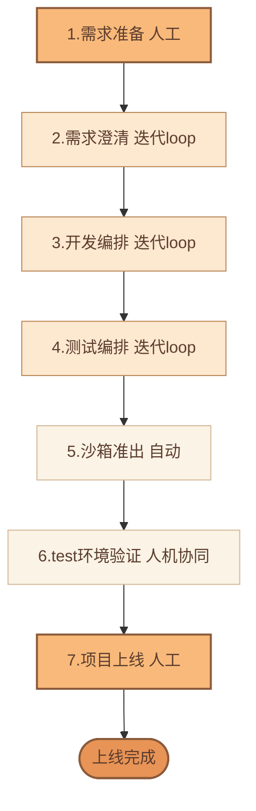
阶段2~4构成核心迭代闭环：澄清→开发→测试→质量检查，未通过则回到开发继续打磨，通过后进入沙箱准出。

# 3. 阶段一：需求准备
由产品/研发人工完成项目初始化与沙箱搭建，为后续自动化流程提供输入。

|**步骤**|**角色**|**任务说明**|**工具/产物**|
|-|-|-|-|
|1.1 创建项目|【人】|编写PRD<br/>提交feature卡片（需在ai提效空间创建）<br/>通过eclaw助手创建项目群|iCafe、eclaw|
|1.2 创建沙箱|【人】|参考 3.2 沙箱管理手册 完成权限授予、环境初始化|沙箱管理手册|
|1.4 默认环境初始化|【自】|沙箱默认环境初始化|sandbox-manager|

## 3.1 前置准备
* PRD、需求说明
* 视觉稿、交互稿或页面截图（如果涉及前端界面）
* 明确的验收标准

iCafe卡片必须在ai提效空间创建，否则后续自动化流程无法识别卡片字段。

空间位置 [ECBU-数字人业务/产研AI敏捷迭代探索/视频toP](https://console.cloud.baidu-int.com/devops/icafe/space/DS-shuziren2023/planbox/1133065/issue?viewId=137388?t=mention&mt=doc&dt=sdk)****

### 3.1.1 配置 Feature 卡片
创建卡片后，依次检查卡片类型、状态及必填字段，确保后续自动化流程可以正常识别和执行。

#### 1. 确认卡片类型
卡片类型必须选择 **Feature**。

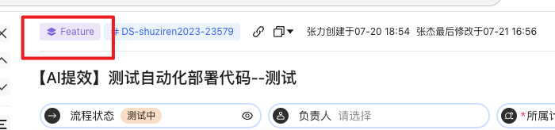
#### 2. 完成状态及字段配置
将卡片状态流转至**"详评完成"**，并按照下图配置相关必填字段。

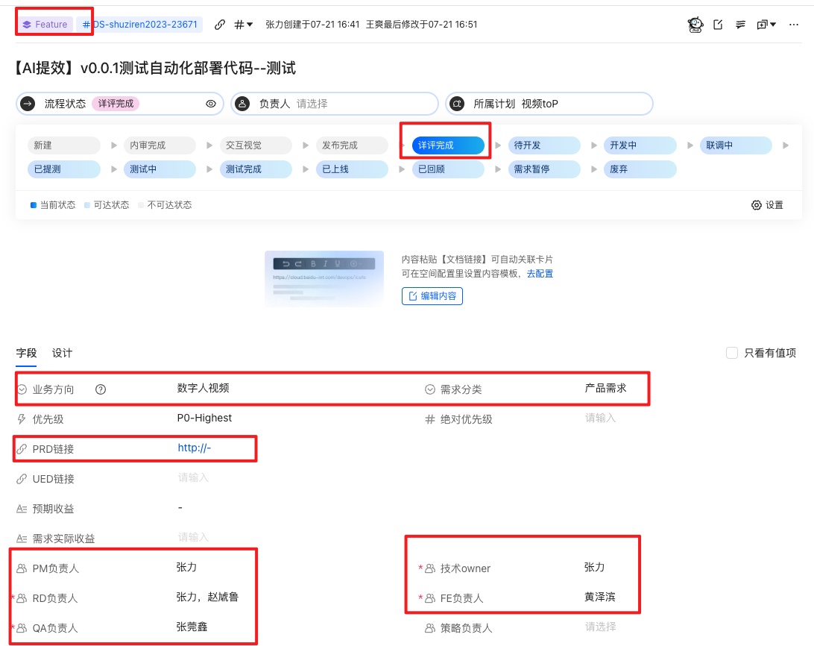
卡片字段"开发环境"必须选择**"沙箱"**。


### 3.1.2 创建项目通知群
项目群用于同步敏捷开发各阶段的进度和结果。完成 Feature 卡片配置后，按照以下步骤创建项目群：

1. 进入如流群 **13210536**。
2. 在群内 @eClaw 机器人，并发送拉群指令。
3. 确认机器人成功创建项目群，并检查相关成员是否已加入。

**指令格式：**

```
@eClaw 帮我拉群 [Feature 卡片编号]
```
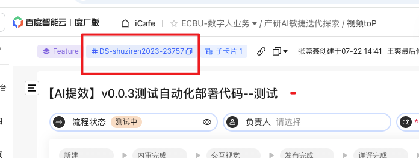
**示例：**

```
@eClaw 帮我拉群 DS-shuziren2023-23757
```
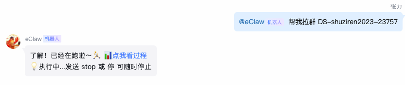

## 3.2 沙箱管理手册
⏱ 空间 & 代码库权限：联系：zhaoxiaolu01、huangzebin01、zhangyongzhe01

沙箱环境创建入口：[https://console.cloud.baidu-int.com/onetool/space/7935](https://console.cloud.baidu-int.com/onetool/space/7935)

邮件组找以下同学加权限，正常是你们的+1同学有管理权限

[https://eac.baidu-int.com/email/group](https://eac.baidu-int.com/email/group)

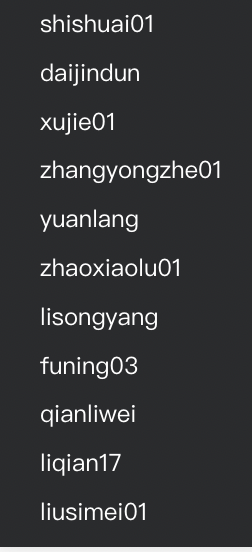
### 3.2.1 创建并配置沙箱
先申请以下对应的**代码库权限****（找负责人加入 dh_agent_builder@baidu.com 邮件组）**，进入沙箱环境创建页面，按照页面提示完成沙箱创建及基础配置。**模板根据项目选择，具体见下表**

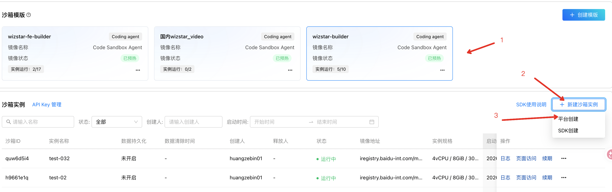
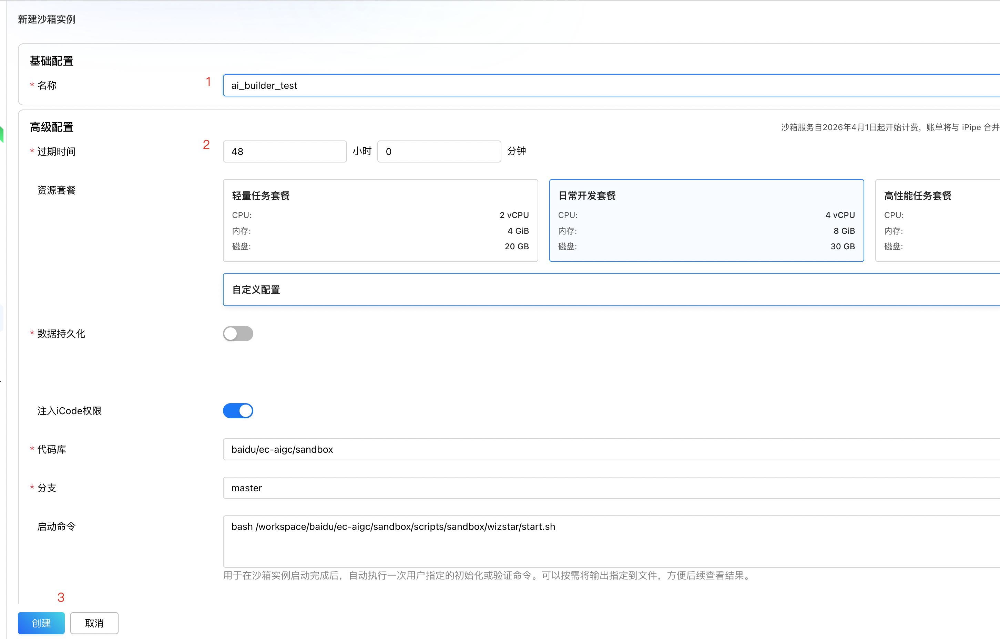
|项目|沙箱模板|
|-|-|
|海外wizstar 前后端|##### wizstar-builder|
|国内短漫剧|##### drama-growth|
|海外wizstar 纯前端|##### wizstar-fe-builder|

#### 配置注意事项
* **设置过期时间：**沙箱超过有效期后会被自动释放，请根据开发周期合理设置。
* **开启过期提醒：**可以配置到期前通知。需要关注 OneTool 服务号，才能正常接收提醒。
* **按需开启数据持久化：**如果需要在沙箱释放后恢复数据，请开启数据持久化功能。


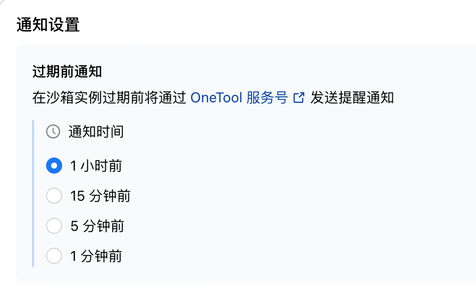
### 3.2.2 进入 Agent Coding 页面
提交创建任务后，等待沙箱状态变为**"运行中"**。该状态表示沙箱已创建完成，此时可以点击沙箱入口进入 Agent Coding 页面。

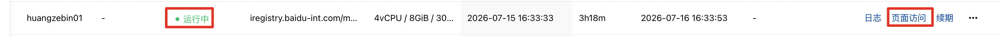
### 3.2.3 完成 Comate 授权
进入 Agent Coding 页面后，点击授权入口，并按照以下截图从左到右依次完成认证。出现最后一张图所示页面，即表示 Comate 授权成功。

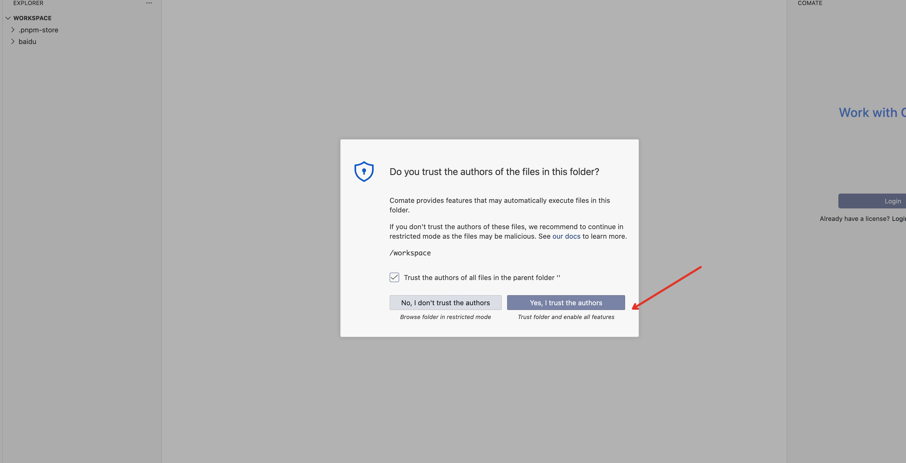
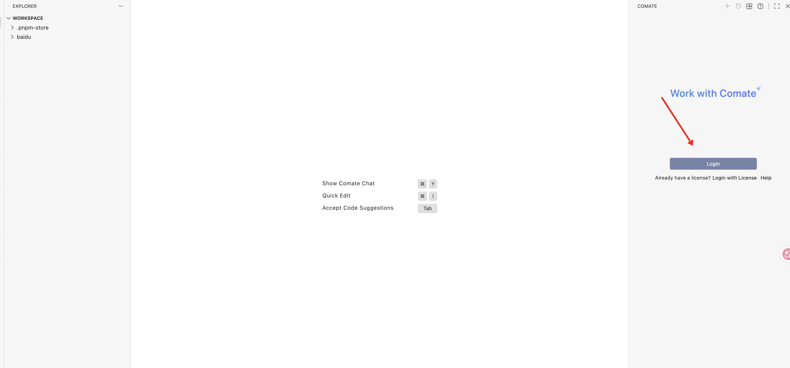
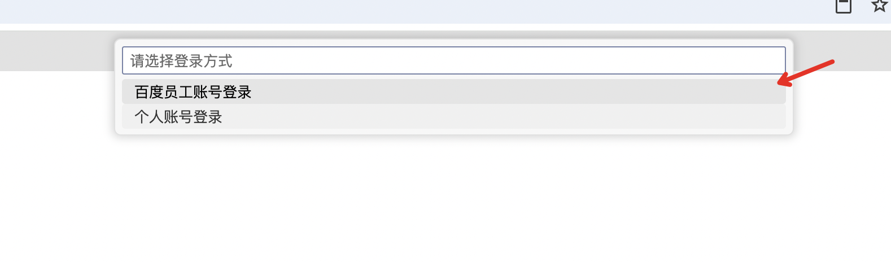
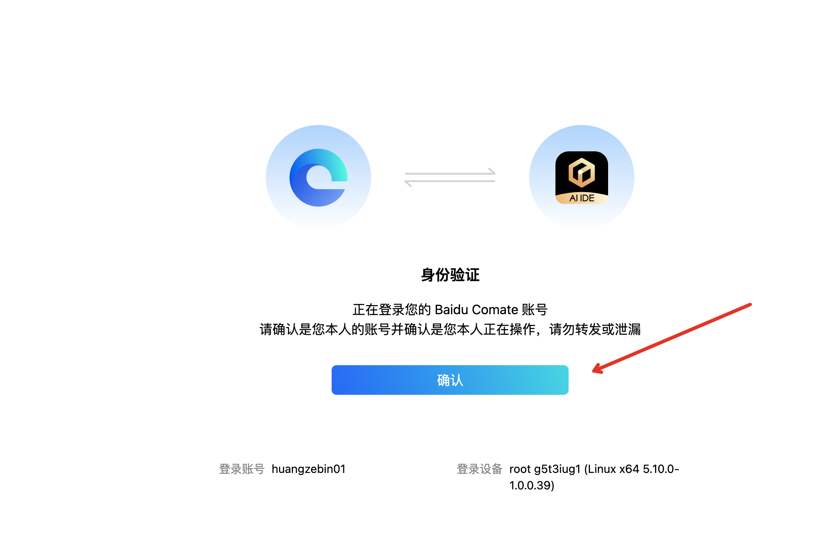
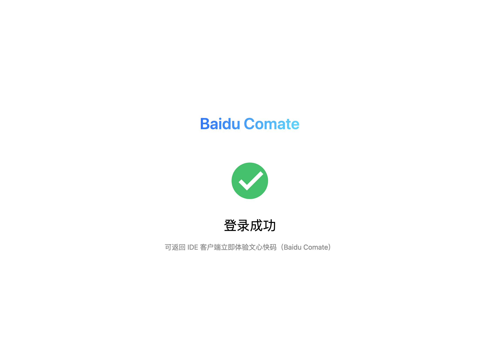
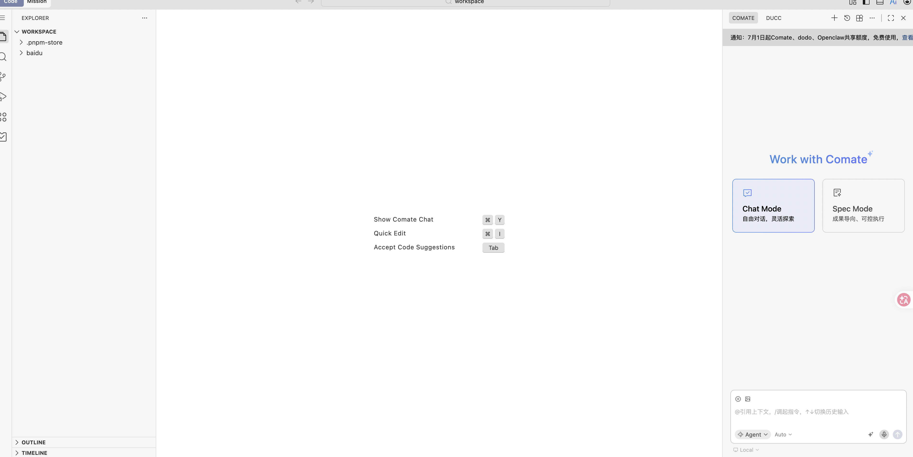
### 3.2.4 检查初始化结果
授权完成后，系统会继续初始化环境。根据工作区中出现的文件判断当前进度：

|**完成标志**|**说明与下一步操作**|
|-|-|
|`CLADU.md`<br/>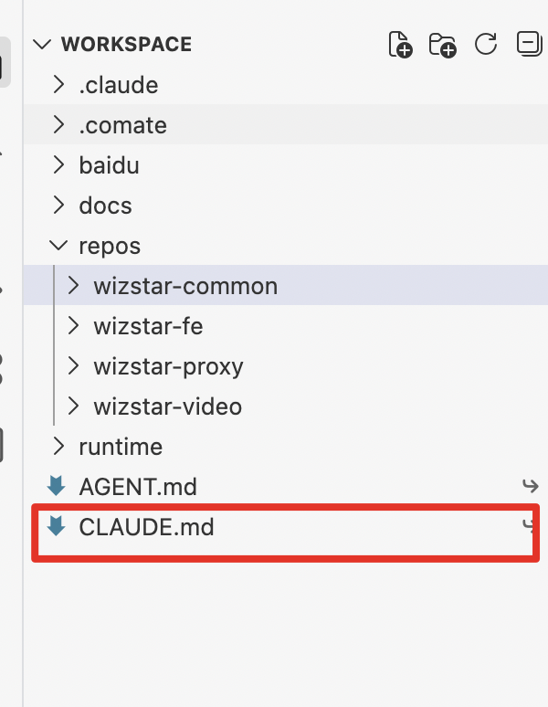|该文件出现后，表示 AI 交互环境已准备完成。<br/>可以在右侧 AI 对话窗口中开始需求澄清。|
|`WIZSTAR_READY.txt`<br/>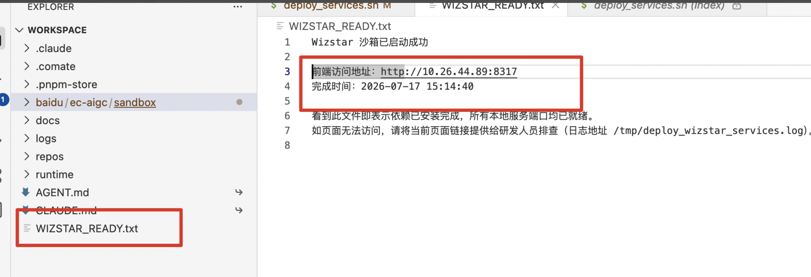|该文件出现后，表示所有模块均已完成部署。<br/>此时可以访问前端链接进行预览。初始化过程预计需要等待约 10 分钟。<br/><br/>如果 Wizstar 服务启动失败或卡住，可以在沙箱终端手动重新部署：<br/>rm -f /tmp/wizstar-services_deploying.lock \      /tmp/wizstar-services_deployed.done \      /workspace/WIZSTAR_READY.txtbash /workspace/knowledge/scripts/sandbox/wizstar/hooks/deploy_services.sh<br/>脚本会在后台执行。查看进度：<br/>tail -f /tmp/deploy_sandbox_services.log|

**判断原则：**`CLADU.md` 用于确认 AI 交互环境是否就绪；`WIZSTAR_READY.txt` 用于确认项目模块是否已全部部署完成。

# 4. 阶段二：需求澄清（迭代loop）
基于PRD链接执行需求澄清，产出可实现的spec文档与task列表，人工review后进入开发。依赖Skill：requirements-clarification。

|**步骤**|**角色**|**任务说明**|**产物**|
|-|-|-|-|
|2.1 执行澄清|【自】|基于PRD链接，执行澄清任务，分析可行性、识别矛盾点、分析代码影响范围|澄清doc文件|
|2.2 人工review|【人】|review并修改澄清doc文件，确认需求边界|确认后的doc|
|2.3 产出spec|【自】|基于确认的doc，产出spec文档和task列表|spec.md、tasks.md|

## 4.1 澄清需求
按照以下步骤执行需求澄清。开始前，请准备 iCafe 卡片、PRD 链接、PRD 文件路径或需求正文中的任意一种输入。

### 步骤一：进入 Spec Mode
在 Comate 中切换至 **Spec Mode**，用于执行需求分析与澄清。

根据个人情况自主选模型

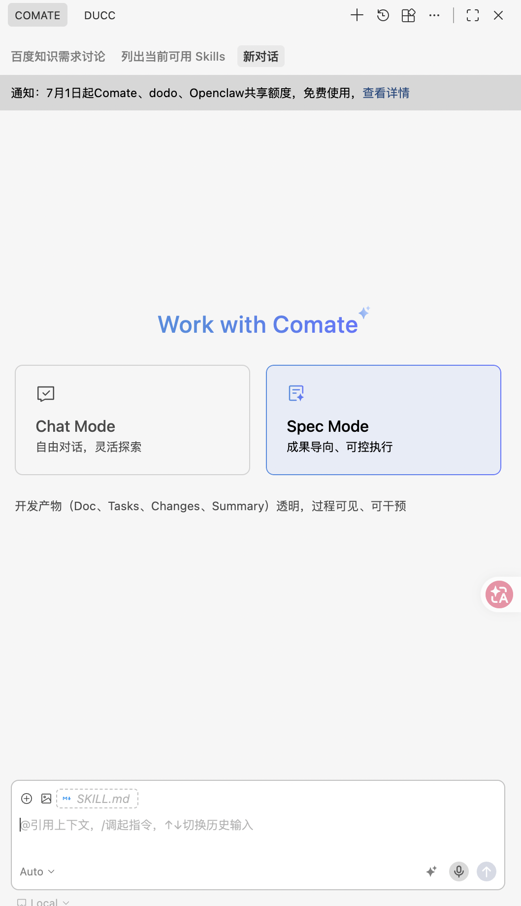
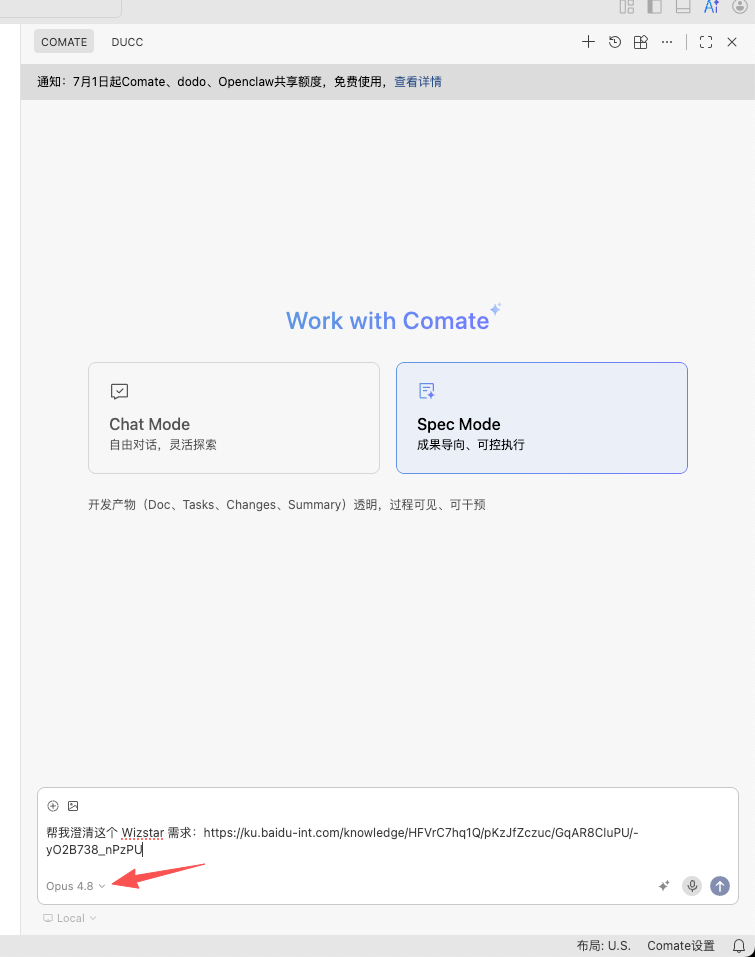
### 步骤二：提交澄清指令
在对话窗口中输入以下 Prompt，并将占位内容替换为实际的需求信息：

```shell
帮我澄清这个 Wizstar 需求：[iCafe 卡片 URL 或卡片 ID]，再附 [PRD 文件路径 / PRD 链接 / 需求正文]
```
### 步骤三：完成知识库认证
如果输入中包含知识库链接，Comate 需要获取知识库 Token 才能读取内容。根据页面弹出的认证链接完成身份认证。

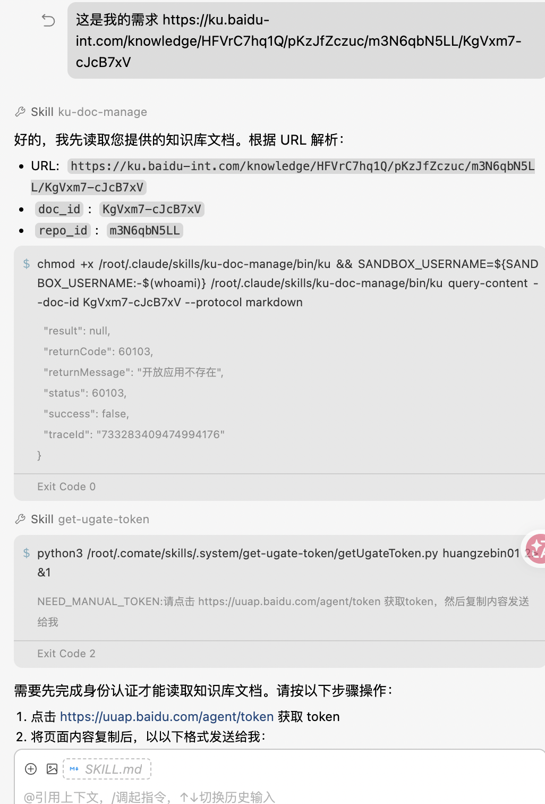
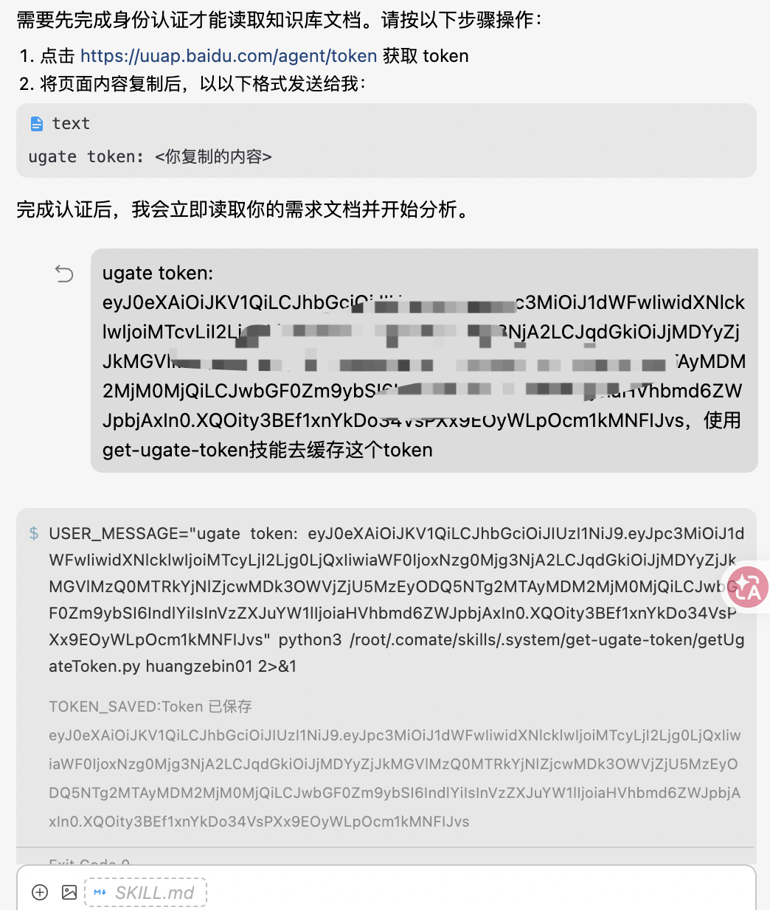
**处理 Token 异常**

如果系统提示缺少 Token 或无法读取知识库，请继续询问模型：**我应该去哪里拿到 Token？** 然后按照模型提供的指引完成配置。

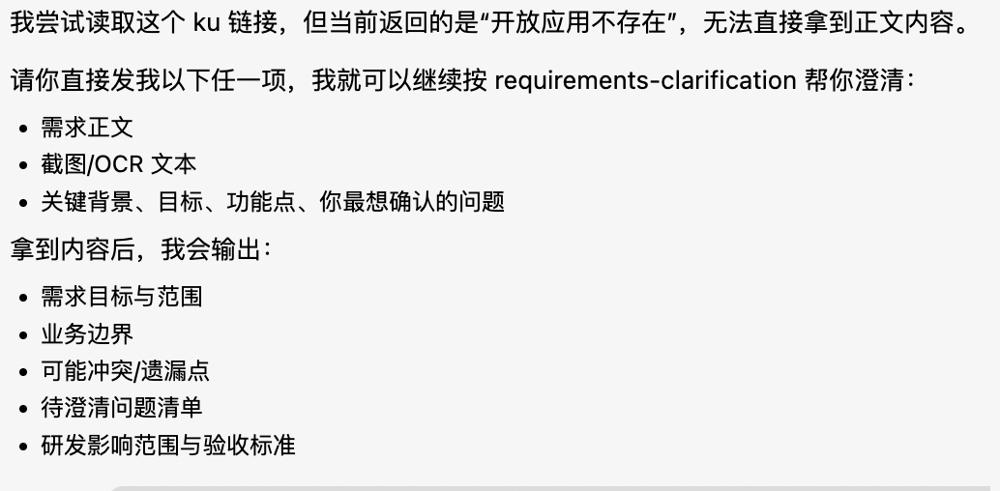
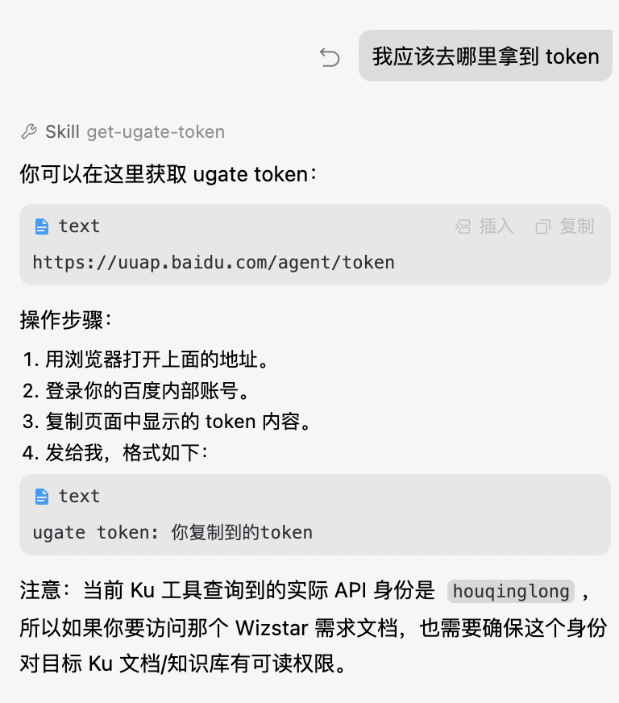
### 步骤四：检查澄清结果
认证完成后，Agent 会继续执行任务，如没有继续，和模型说：**请继续**。

检查模型输出的需求边界、待确认事项和实现约束；如有遗漏或理解偏差，应继续补充信息并迭代澄清。

需求澄清产物地点

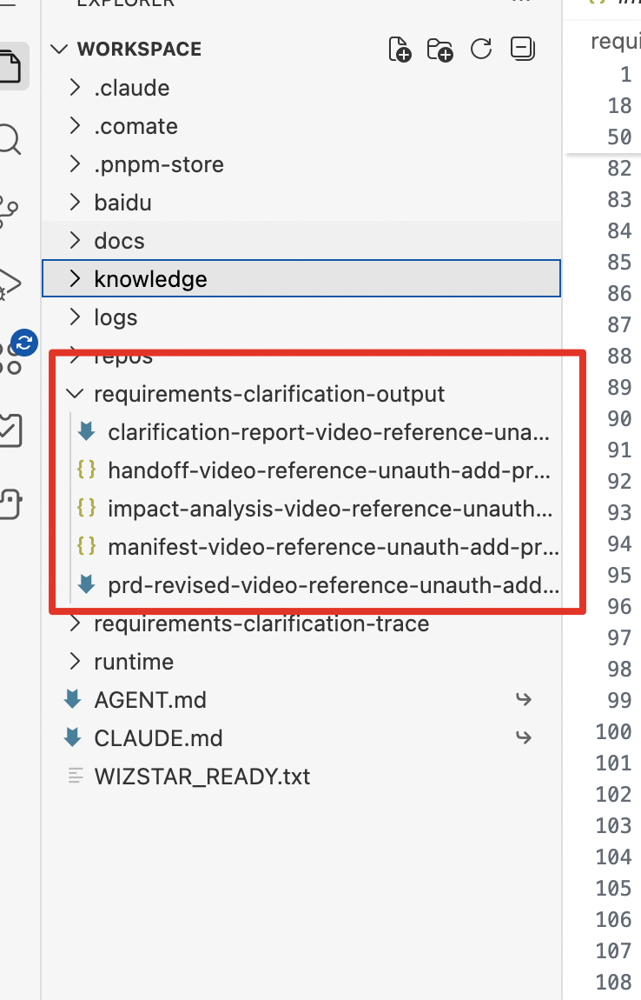
# 5. 阶段三：开发编排（迭代loop）
基于task列表自动编写代码并补齐单测。依赖Skill：enhanced-superpowers-flow。

|**步骤**|**角色**|**任务说明**|**产物**|
|-|-|-|-|
|3.1 代码编写|【自】|基于task列表逐任务编写增量代码|增量代码diff|
|3.2 单元测试|【自】|补齐单测，验证函数行为，修复发现的问题|单测用例+覆盖率|

## 5.1 进入开发编排
确认澄清完成后发送：

```
请使用 enhanced-superpowers-flow Skill 开始实现当前需求。
```
Agent 会读取澄清产物、确认影响仓库、制定方案并实施，同时自动完成必要的单元测试和前端 E2E。PM 不需要执行测试命令，只需在需要 E2E 时提供沙箱 URL、测试账号或登录态，并查看测试结论。

PM 重点检查：

* 方案是否覆盖全部需求和验收标准。
* 页面状态、异常态和跨服务链路是否遗漏。
* 是否在开发分支上修改，而不是直接修改 `master`。
* 单测和 E2E 是否真实执行；`failed` 必须修复，`skipped`、`not_covered` 或环境阻断必须说明原因，不能写成通过。

如果涉及 MySQL、Redis、消息队列或数据格式变更，流程会生成数据变更技术文档到此知识库 [技术文档](https://ku.baidu-int.com/knowledge/HFVrC7hq1Q/pKzJfZczuc/E8VyaAuZfe/jZJiXxn_36GDBY?t=mention&mt=doc&dt=doc)。PM 与给研发确认数据变更方案后才能继续。

具体流程：[迭代涉及 SQL 修改时的研发感知与更新流程](https://ku.baidu-int.com/knowledge/HFVrC7hq1Q/pKzJfZczuc/6XrP29TGw_/yGKssgNhRu3ib8?t=mention&mt=doc&dt=doc)

# 6. 阶段四：测试编排（迭代loop）
对增量代码执行静态CR、E2E测试与质量检查，未通过则回到开发阶段。下图展示迭代闭环。

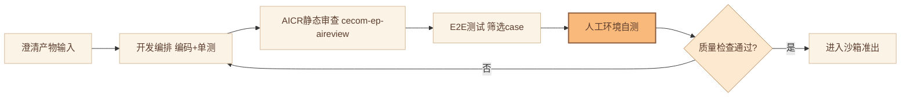
|**步骤**|**角色**|**任务说明**|**工具/Skill**|
|-|-|-|-|
|4.1 AICR审查|【自】|对增量代码执行静态代码检查，给出修复建议|cecom-ep-aireview|
|4.2 E2E测试|【自】|验证核心用户流程，筛选case并优化|frontend-e2e|
|4.3 环境自测|【人】|人工在沙箱环境自测验证|沙箱预览链接|
|4.4 质量检查|【自】|外部环境代码适配，修复问题，审查覆盖率|—|

这一流程理论上不用关注，自动包含在开发编程的 step 里，如果 Agent 恢复测试未通过，让它继续改即可

# 7. 阶段五：沙箱准出
将沙箱代码准出为可提交状态，沉淀业务知识并自动提交代码。依赖Skill：submit-code。

|**步骤**|**角色**|**任务说明**|**产物**|
|-|-|-|-|
|5.1 完善spec|【自】|总结完善spec，沉淀业务知识到新增代码库|业务知识沉淀|
|5.2 扫描变更|【自】|扫描代码变更，自动拆story子卡片|iCafe子卡片|
|5.3 检查分支|【自】|检查/创建分支|发布分支|
|5.4 提交推送|【自】|逐仓库生成commit message并提交推送|CR评审|

发送以下 prompt

```
请使用 submit-code Skill 提交当前 Wizstar 多仓代码。父卡片：[iCafe ID 或 URL]。质量门未通过时不得提交。
```
Agent 会扫描各仓库变更、检查临时和调试代码、按仓库拆分子卡片、生成 commit message 并推送 CR。PM 最后确认：

* 父卡片正确。
* 需求范围与实际改动一致。
* 所有变更仓库均已纳入。
* 单测、E2E 和环境阻断情况可以追溯。

这里我们输入 icafe 链接

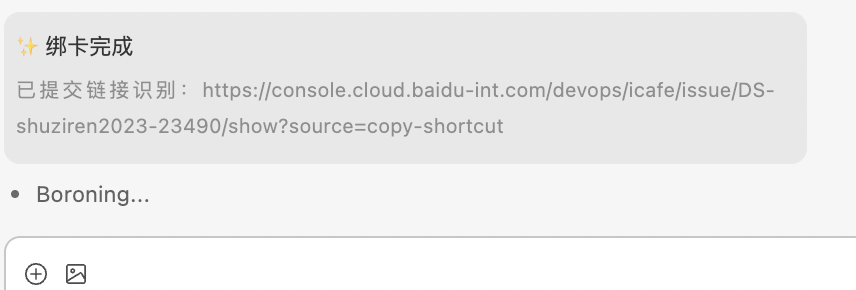
确认代码提交

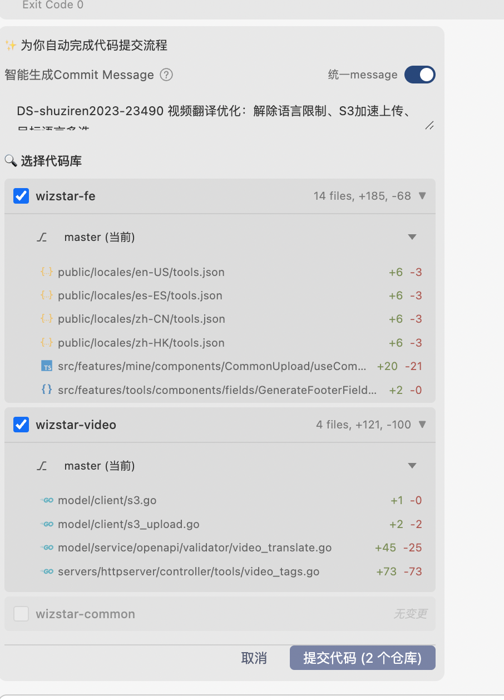
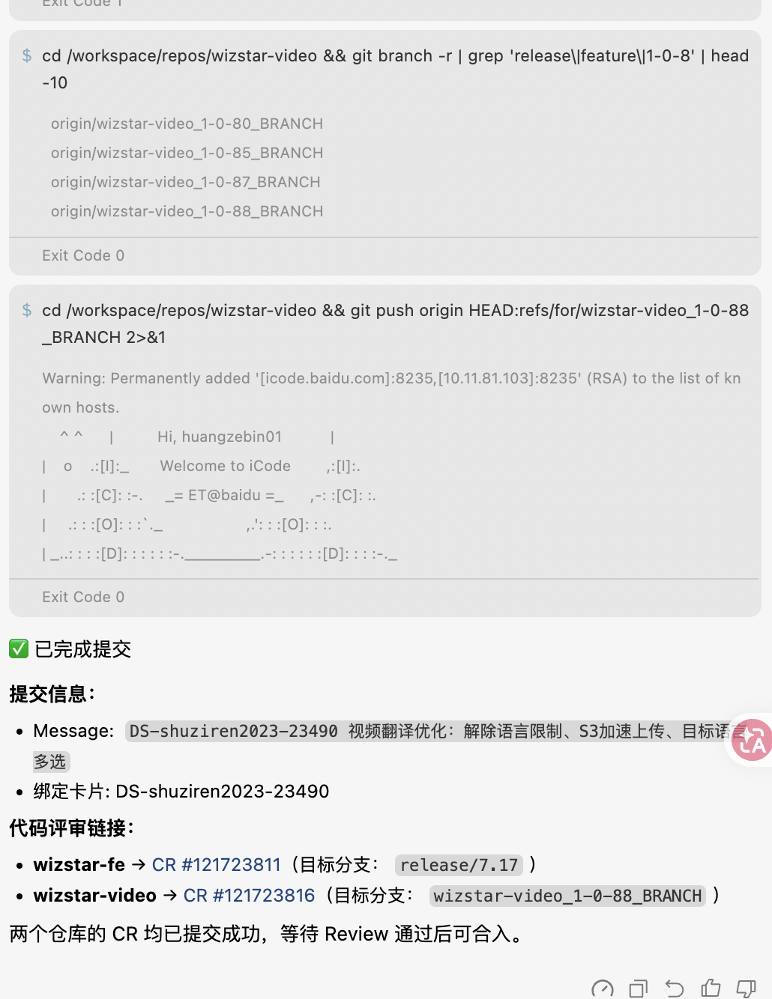

# 8. 阶段六：test环境验证
在test环境部署验证，人工review测试用例并验证，完成后流转卡片。下图展示本阶段与上线阶段的衔接。

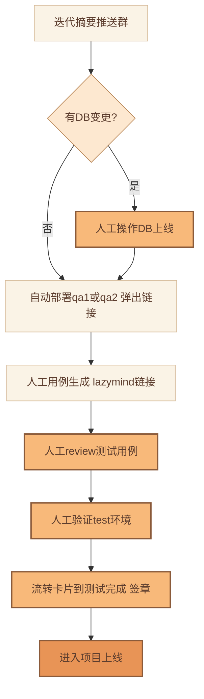
|**步骤**|**角色**|**任务说明**|**备注**|
|-|-|-|-|
|6.1 迭代摘要|【自】|生成本次迭代摘要，推送项目群|—|
|6.2 DB变更|【人】|如有DB变更，人工操作上线|沿用内循环模式|
|6.3 自动部署|【自】|根据feature卡片字段，自动部署指定环境qa01-02，弹出链接|轮询token消耗较多|
|6.4 用例生成|【自】|人工用例生成（非自测、开发中时已生成），弹出lazymind链接|—|
|6.5 review用例|【人】|人工review测试用例|—|
|6.6 环境验证|【人】|验证test环境，完成后手动流转卡片到测试完成|需要签章等|

代码提交之后，会有机器人自动部署代码（约部署10分钟），群里会通知test环境部署进度，根据链接验证即可

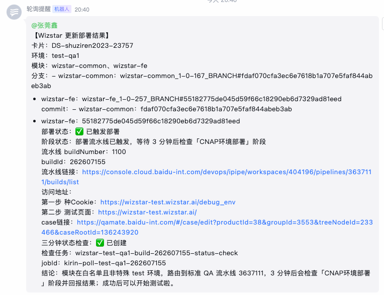

验证测试完毕之后，自测需求，自行流转Feature卡片下所有Story状态为【测试完成】，否则由 QA 流转

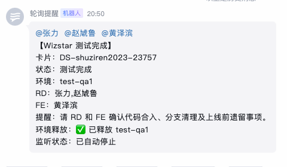
自动部署qa01-02时轮询会消耗较多token，需关注成本；最多同时2个需求在海外环境验证。

# 9. 阶段七：项目上线
由值班RD完成代码CR、合入与上线，builder协同验证，case自动收集。

|**步骤**|**角色**|**任务说明**|**备注**|
|-|-|-|-|
|7.1 代码CR|【人】|值班RD完成代码CR和合入|—|
|7.2 冲突解决|【人】|值班解决上线冲突|—|
|7.3 预发上线|【人】|值班判断上线顺序，手工触发预发环境上线|builder协同验证|
|7.4 prod上线|【人】|值班上线prod环境|builder验证最终效果|
|7.5 case收集|【自】|case自动收集|—|

前端vibe coding需求上线sop：

1. vibe coding验证完毕后提起cr，在icode检查通过后**一键通知cr人**
    1. 如果看不到这个一键通知的按钮，查看当前的cr记录是否在自己名下

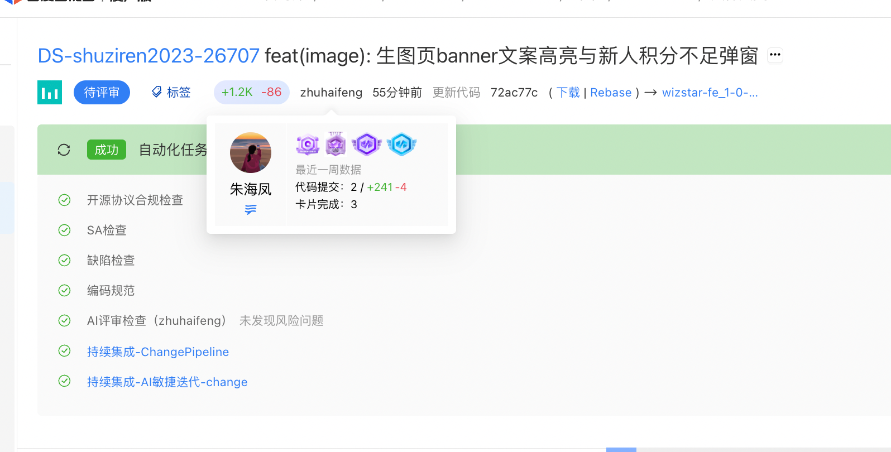
2. CR通过后在计划上线的日期登记上线单，没有上线单的链接可以找前端值周的同学要，值周表：[https://zhiban.baidu-int.com/detail?id=ac44454d42284187a5e458691462adbb](https://zhiban.baidu-int.com/detail?id=ac44454d42284187a5e458691462adbb)
3. 等待前端值周发布预发环境后验证，验证通过后通知前端值周同学
4. 等待上线后验证
5. 验证通过后通知值周同学  【预发环境和线上环境验证成功后一定要通知值周同学】

# 10. 角色与职责矩阵
汇总各阶段人工与自动化职责分布，便于快速定位责任人。

|**阶段**|**人工职责**|**自动化职责**|
|-|-|-|
|1.需求准备|编写PRD、提交feature、创建沙箱、权限授予|默认环境初始化|
|2.需求澄清|review并修改澄清doc|执行澄清、产出spec和task|
|3.开发编排|—|代码编写、单元测试|
|4.测试编排|环境自测验证|AICR审查、E2E测试、质量检查|
|5.沙箱准出|—|完善spec、拆story、提交推送|
|6.test验证|DB上线、review用例、环境验证、流转卡片|迭代摘要、自动部署、用例生成|
|7.项目上线|CR合入、冲突解决、预发/prod上线|case自动收集|

# 11. 附录：Skill速查表
|**Skill**|**用途**|**所属阶段**|
|-|-|-|
|requirements-clarification|需求澄清，产出spec和task|阶段2|
|enhanced-superpowers-flow|开发编排，代码编写+单测|阶段3|
|cecom-ep-aireview|AICR静态代码审查|阶段4|
|frontend-e2e|E2E端到端测试执行层1|阶段4|
|playwright-cli-smoke|E2E端到端测试执行层2|阶段4|
|submit-code|沙箱准出，拆卡+提交推送|阶段5|
|sandbox-manager|沙箱创建与管理|阶段1|
|icafe-subcard-splitter|iCafe子卡片拆分|阶段5|
|create-branch|分支创建与管理|阶段5|
|smart-commit|生成commit并推送|阶段5|

# 12. 总结
本SOP通过7个阶段的人机协同，将需求澄清、代码开发、测试验证、环境部署与上线流程标准化。核心收益：需求侧通过澄清产出可执行spec，开发侧通过迭代loop保证代码质量，测试侧通过AICR+E2E双重保障，上线侧通过值班RD人工把关。后续持续优化方向：业务知识库建设（提升AICR准确率至可自动合并）、海外环境并发能力对齐、token成本优化。

# 13. todo
AI迭代需求的使用范围：

* todo：判断自动化等级，握手PMO建立此类需求发布机制
* 直播当前新建模板：复用模板or新建
* 对齐研发开发规范

1. 需求准备
    1. 【人】创建项目：编写PRD、提交feature，**通过eclaw助手**，创建项目群
        1. icafe需要在ai提效空间创建

    2. 【人】创建沙箱：参考手册，权限授予、【自】默认环境初始化（优化速度）

2. 【loop】需求澄清：skill requirements-clarification
    1. 【自】基于PRD链接，执行澄清任务，产出doc文件
    2. 【人】review并修改doc文件
    3. 【自】产出spec文档和task列表

3. 【loop】开发编排：skill enhanced-superpowers-flow
    1. 【自】代码编写：基于task列表
    2. 【自】单元测试：补齐单测，验证函数，修复问题

4. 【loop】测试编排：
    1. 【自】AICR审查：skill cecom-ep-aireview
    2. *【自】E2E测试：验证核心用户流程，需要筛选case并优化*
    3. 【人】环境自测验证
    4. 【自】质量检查：外部环境代码适配，修复问题，审查*覆盖率*

5. 沙箱准出：skill submit-code
    1. 【自】*总结完善spec，沉淀业务知识 【新增代码库】*
    2. 【自】扫描代码变更，自动拆story，检查/创建分支，**提交推送**

6. test环境验证：
    1. *【自】本次迭代摘要，推送群内*
    2. *【人】如果有DB变更，操作上线*
    3. 【自】根据feature卡片字段，自动部署指定环境qa01-02，弹出链接
        1. 轮询当前消耗token过多

    4. 【自】人工用例生成（非自测、开发中时已生成）：弹出lazymind链接
    5. 【人】review测试用例
    6. 【人】验证test环境，完成后，手动流转卡片到测试完成
        1. 需要签章等

7. 项目上线
    1. 【人】值班RD完成代码CR和合入
    2. 【人】值班解决上线冲突
    3. 【人】值班判断上线顺序，值班手工触发预发环境的上线，builder协同验证
    4. 【人】值班上线prod环境，builder验证最终效果
    5. 【自】*case自动收集*
