> 原文：https://ku.baidu-int.com/knowledge/HFVrC7hq1Q/pKzJfZczuc/noISsAmuLf/HiC9H1EDbTWpku

Qwen2.5-7B微调行业大模型

基于Qwen2.5-7B-Instruct⼤模型进⾏微调实现酒店推荐垂直⼤模型

```md
# 微调前（啥都会但不够专业）
用户：酒店有游泳池吗？
模型：可能存在，建议查询官网或致电前台。

# 微调后（酒店领域专家）
用户：酒店有游泳池吗？
模型：是的！我们有恒温游泳池，开放时间6:00-22:00，需携带房卡。
```
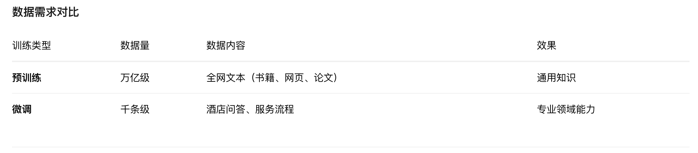
## **一、什么是大模型**
### 1、不严谨的类⽐，通俗理解什么是⼤模型微调
[Fine-tuning](Fine-tuning.md)

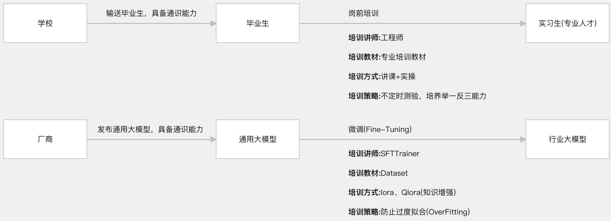
### 2、轻量化微调流程图
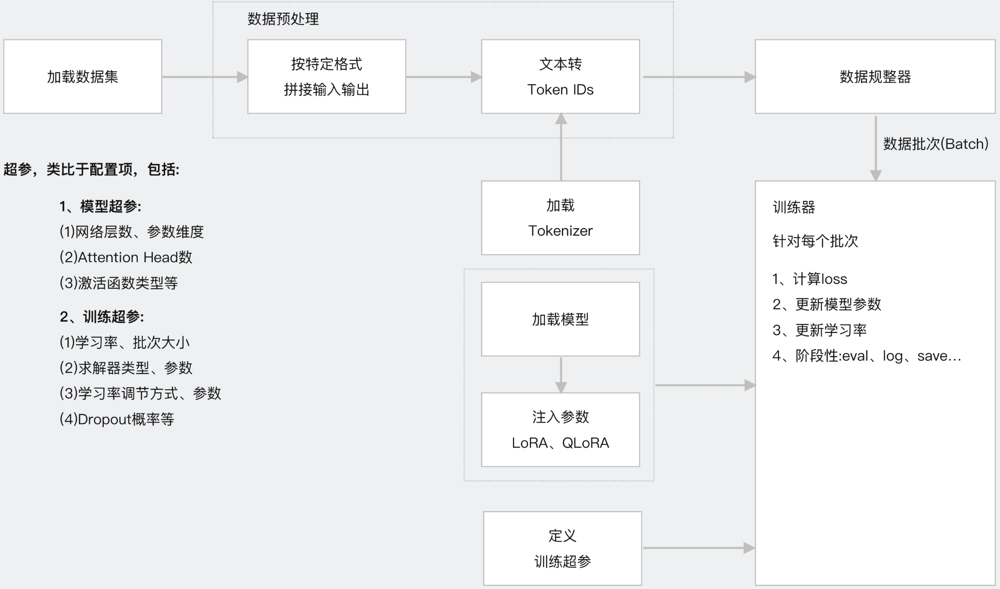
## 二、搭建环境
选择 AutoDL 的 4090 云 GPU 做为训练测试环境。因为独⽴部署⾃⼰训练的⼤模型， 4090 是⽬前性价⽐最⾼的⽅案

### 1、 注册AutoDL并进⾏实名认证
AutoDL官⽹链接：[https://www.autodl.com/](https://www.autodl.com/)

根据平台要求进⾏账号注册，注册成功登录平台进⾏实名认证，按照官⽅要求进⾏认证即可

### 2、 挑选GPU
在官⽹⾸⻚点击算⼒市场菜单进⼊并进⾏GPU选择，参考如下截图配置进⾏选择即可(参考)

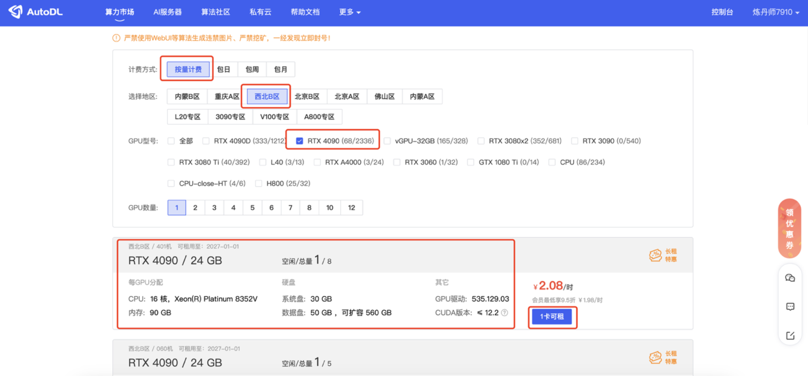
### 3、 创建实例
GPU选择确定后，单击n卡可租进⼊创建实例⻚⾯，并按照如下截图进⾏配置

其中，镜像选择使⽤开源的社区镜像，这⾥推荐选择 agiclass/fine-tuning-lab/finetune-lab-v8 ，并选择最新版本，社区

版本镜像中已经配置好了微调所需要依赖包环境，⾮常⽅便⼤家使⽤

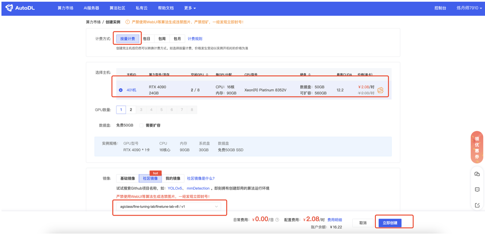
实例创建成功如下截图所示，当状态为运⾏中时，表示创建完成，并且开始计费

如果要暂停计费，请点击关机。下次需要使⽤时，再点击开机，这⾥需要注意官⽅相关的限制策略

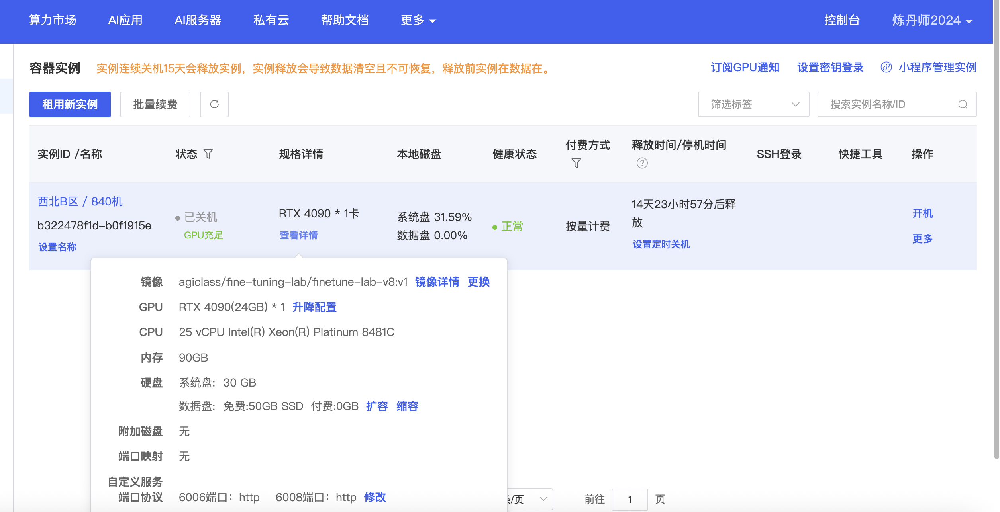
## 三、微调前⼯作
### 1、连接实例
这⾥推荐⼤家使⽤SSH客户端软件远程登录到服务器，并同时连接SFTP服务进⾏⽂件的上传下载

连接信息可在如下截图所示的地⽅获取

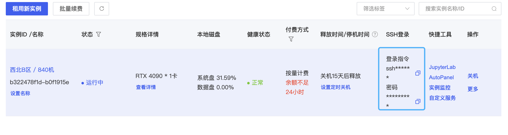
打开SSH客户端⼯具(这⾥使⽤的Mac，⼯具为Termius)进⾏远程连接，按照如下截图所示进⾏配置即可

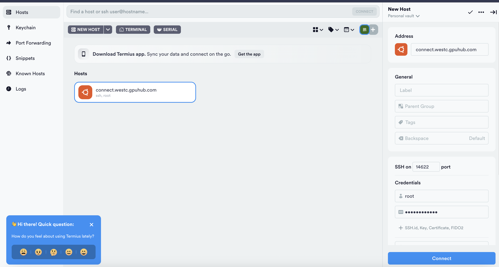
### 2、下载预训练模型
这⾥所需的预训练模型Qwen2.5-7B-Instruct从HuggingFace下载，考虑到国内访问HuggingFace⽐较慢，这⾥使⽤hf-mirror，官⽹链接 [https://hf-mirror.com/Qwen/Qwen2.5-7B-Instruct](https://hf-mirror.com/Qwen/Qwen2.5-7B-Instruct)

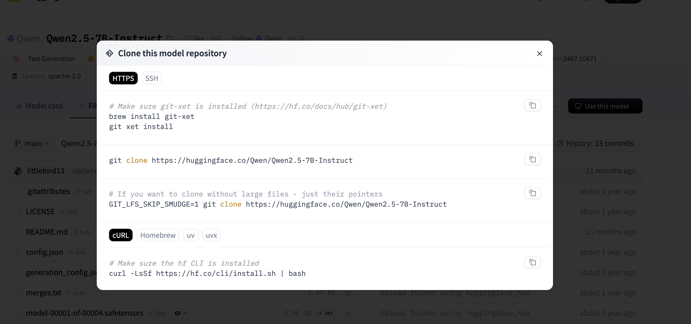
执⾏如下命令⾏进⾏模型下载:

```json
cd /root/autodl-tmp
git lfs install
git clone https://hf-mirror.com/Qwen/Qwen2.5-7B-Instruct
```
执⾏完成后，耐⼼等待下载完成即可，这个过程需要持续⼤概**1-2小时**左右

下载完成后，查看⽂件

```json
cd Qwen2.5-7B-Instruct
rm -rf .git #清除掉.git⽬录，避免数据盘空间不⾜
```
### 3、上传代码
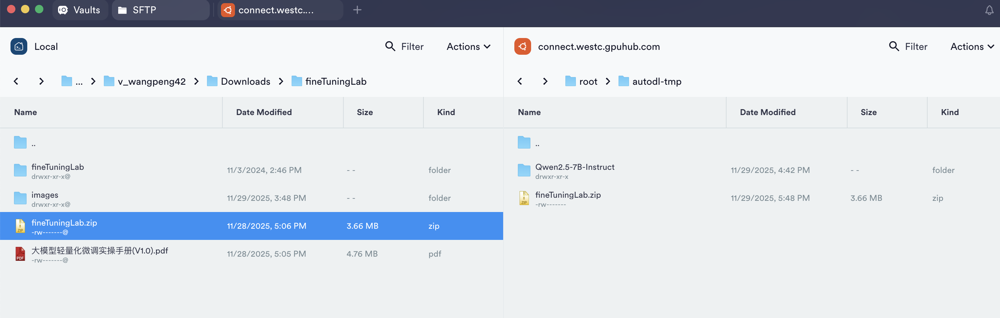
将代码先进⾏压缩为zip包，通过SFTP进⾏上传⾄/root/autodl-tmp⽬录下

上传成功后，在服务器命令⾏终端中进⾏解压

```json
cd /root/autodl-tmp
unzip fineTuningLab.zip
```
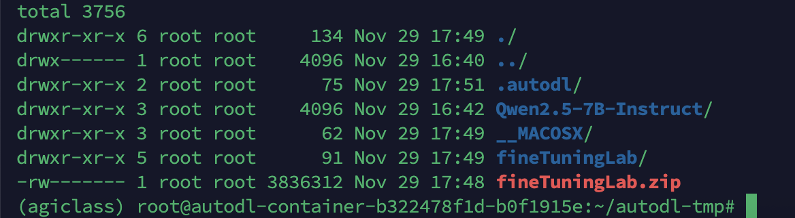
## 四、微调进⾏中
### 1、 训练
[Fine-tuning](Fine-tuning.md)

这⾥使⽤lora进⾏微调训练，命令⾏终端执⾏下⾯的命令，开始训练

LoRA（Low - Rank Adaptation）的核心思想是‌**在模型微调时，不直接修改原始的巨大权重矩阵**** ****W****0*****W*****0****​****（如**** ****W****Q*****W******Q*****​**** ****这类大权重矩阵），而是通过“小规模、可训练的低秩分解矩阵**** ****A*****A***** ****和**** ****B*****B*****”来近似权重矩阵的更新**‌，从而实现高效微调。

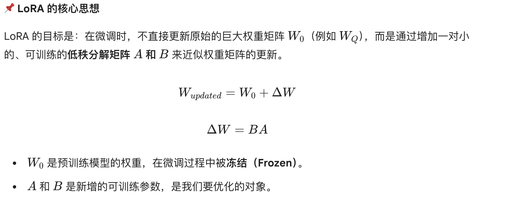
```json
cd /root/autodl-tmp/fineTuningLab/qwen2/
bash train.sh
```
```bash
#! /usr/bin/env bash
# 指定使用bash shell执行此脚本

# 设置严格的执行模式：
# -e: 遇到任何命令执行失败（返回非零状态码）时立即退出脚本
# -x: 在执行每个命令前打印命令本身，便于调试
set -ex

# 设置学习率
LR=2e-4

# 生成当前时间的时间戳字符串，格式为：年月日-时分秒
# 例如：20231215-143022
DATESTR=`date +%Y%m%d-%H%M%S`

# 设置本次训练运行的名称标识
RUN_NAME=hotel_qwen2

# 设置输出目录，包含运行名称和时间戳，确保每次运行都有唯一目录
OUTPUT_DIR=output/${RUN_NAME}-${DATESTR}

# 创建输出目录
# -p 参数表示如果目录不存在则创建，如果已存在也不会报错
mkdir -p $OUTPUT_DIR

# 设置预训练模型的路径
MODEL_PATH="/root/autodl-tmp/Qwen2.5-7B-Instruct"

# 使用CUDA_VISIBLE_DEVICES指定使用哪张GPU卡进行训练
# 这里指定使用第0张GPU卡（单卡训练）
CUDA_VISIBLE_DEVICES=0 python finetune.py \
    # 启用训练模式
    --do_train \
    # 启用评估模式（在训练过程中进行验证）
    --do_eval \
    # 指定训练数据文件的路径（JSONL格式）
    --train_file ../data/train.jsonl \
    # 指定验证数据文件的路径（JSONL格式）
    --validation_file ../data/dev.jsonl \
    # 指定输入文本在数据文件中对应的列名（提示文本列）
    --prompt_column context \
    # 指定目标文本在数据文件中对应的列名（响应文本列）
    --response_column response \
    # 指定要加载的预训练模型的路径或HuggingFace模型标识
    --model_name_or_path "${MODEL_PATH}" \
    # 指定模型输出和保存的目录
    --output_dir $OUTPUT_DIR \
    # 设置输入文本的最大token长度（超过会被截断）
    --max_source_length 2048 \
    # 设置输出文本的最大token长度（超过会被截断）
    --max_target_length 1024 \
    # 设置每个GPU/设备的训练批次大小
    --per_device_train_batch_size 1 \
    # 设置每个GPU/设备的评估批次大小
    --per_device_eval_batch_size 1 \
    # 设置梯度累积步数，用于模拟更大的批次大小
    # 有效批次大小 = per_device_train_batch_size × gradient_accumulation_steps × GPU数量
    --gradient_accumulation_steps 4 \
    # 设置评估策略：按步数（steps）进行评估
    --evaluation_strategy steps \
    # 设置每训练多少步进行一次评估
    --eval_steps 300 \
    # 设置训练的总轮数（epoch）
    --num_train_epochs 2 \
    # 设置每训练多少步记录一次日志
    --logging_steps 30 \
    # 设置TensorBoard日志的保存目录
    --logging_dir $OUTPUT_DIR/logs \
    # 设置每训练多少步保存一次模型checkpoint
    --save_steps 300 \
    # 设置优化器的学习率
    --learning_rate $LR \
    # ========== LoRA相关参数配置 ==========
    # 设置LoRA的秩（rank），控制LoRA适配器的大小
    --lora_rank 8 \
    # 设置LoRA的alpha参数，影响适配器的缩放
    --lora_alpha 32 \
    # 设置LoRA的dropout率，用于防止过拟合
    --lora_dropout 0.1 \
    # 将标准输出和标准错误都重定向到文件，同时也在终端显示
    # tee命令：同时输出到文件和终端
    # 2>&1：将标准错误重定向到标准输出
    # |：管道符号，将前一个命令的输出作为后一个命令的输入
    2>&1 | tee ${OUTPUT_DIR}/train.log
```
```json
{
    "context": "[{\"role\": \"user\", \"content\": \"你好，帮我推荐一个能提供早餐服务的酒店，谢谢。\"}]",
    "response": "{\"role\": \"search\", \"arguments\": {\"facilities\": [\"早餐服务\"]}}"
}
{
    "context": "[{\"role\": \"user\", \"content\": \"其中哪个酒店是高档的并且有中式餐厅呀？\"}, {\"role\": \"search\", \"arguments\": {\"facilities\": [\"中式餐厅\"], \"type\": \"高档型\"}}, {\"role\": \"return\", \"records\": [{\"name\": \"北京天伦王朝酒店\", \"type\": \"豪华型\", \"address\": \"北京东城区王府井大街50号\", \"subway\": \"灯市口地铁站A口\", \"phone\": \"010-58168888\", \"facilities\": [\"公共区域和部分房间提供wifi\", \"宽带上网\", \"国际长途电话\", \"吹风机\", \"24小时热水\", \"西式餐厅\", \"中式餐厅\", \"残疾人设施\", \"室内游泳池\", \"会议室\", \"健身房\", \"无烟房\", \"商务中心\", \"桑拿\", \"棋牌室\", \"早餐服务\", \"接站服务\", \"接机服务\", \"接待外宾\", \"洗衣服务\", \"行李寄存\", \"租车\", \"叫醒服务\"], \"price\": 815.0, \"rating\": 4.5, \"hotel_id\": 4}]}, {\"role\": \"assistant\", \"content\": \"北京天伦王朝酒店是豪华型酒店，比较接近您的要求，且含有中式餐厅。\"}, {\"role\": \"user\", \"content\": \"我想找一家评分在4分以上的酒店。\"}, {\"role\": \"search\", \"arguments\": {\"facilities\": [\"中式餐厅\"], \"type\": \"高档型\", \"rating_range_lower\": 4.0}}, {\"role\": \"return\", \"records\": [{\"name\": \"布丁酒店(北京西站店)\", \"type\": \"经济型\", \"address\": \"北京丰台区西三环南路甲6号\", \"subway\": \"六里桥东地铁站D口\", \"phone\": \"010-63334266\", \"facilities\": [\"公共区域和部分房间提供wifi\", \"宽带上网\", \"国际长途电话\", \"吹风机\", \"24小时热水\", \"暖气\", \"中式餐厅\", \"无烟房\", \"棋牌室\", \"洗衣服务\", \"行李寄存\", \"叫醒服务\", \"收费停车位\"], \"price\": 158.0, \"rating\": 4.2, \"hotel_id\": 333}, {\"name\": \"格林豪泰酒店北京市首都机场第二店\", \"type\": \"经济型\", \"address\": \"北京顺义区天竺镇天竺中街4号\", \"subway\": \"T2航站楼地铁站\", \"phone\": \"010-52138888\", \"facilities\": [\"公共区域和部分房间提供wifi\", \"宽带上网\", \"吹风机\", \"24小时热水\", \"无烟房\", \"早餐服务\", \"接待外宾\", \"行李寄存\", \"叫醒服务\"], \"price\": 199.0, \"rating\": 4.4, \"hotel_id\": 12}]}, {\"role\": \"assistant\", \"content\": \"格林豪泰酒店北京市首都机场第二店和布丁酒店(北京西站店)评分在4分以上。\"}, {\"role\": \"user\", \"content\": \"哪家价格在100-200元呀？\"}]",
    "response": "{\"role\": \"search\", \"arguments\": {\"facilities\": [\"中式餐厅\"], \"type\": \"高档型\", \"rating_range_lower\": 4.0, \"price_range_lower\": 100, \"price_range_upper\": 200}}"
}
```
这是一个非常标准的 **基于 Hugging Face Transformers 库和 PEFT 库** 对大型语言模型（LLM）进行 **LoRA 微调** 的 Python 脚本

```md
# 导入所需模块和库，包含用于加载模型、配置低秩适应（LoRA）参数、定义数据预处理等功能
import json
import torch
from transformers import (
    AutoTokenizer, 
    AutoModelForCausalLM,
    BitsAndBytesConfig,
    DataCollatorForSeq2Seq, 
    HfArgumentParser,
    TrainingArguments, 
    Trainer
)
from peft import LoraConfig, TaskType, get_peft_model
from arguments import ModelArguments, DataTrainingArguments, PeftArguments
from data_preprocess import InputOutputDataset

def main():
    # 使用 HfArgumentParser 解析命令行参数，并将参数解析成数据类对象：model_args（模型相关）、data_args（数据相关）、peft_args（LoRA参数）、training_args（训练配置）
    parser = HfArgumentParser((ModelArguments, DataTrainingArguments, PeftArguments, TrainingArguments))
    model_args, data_args, peft_args, training_args = parser.parse_args_into_dataclasses()

    # 加载预训练的生成式语言模型 (AutoModelForCausalLM) 和分词器 (AutoTokenizer)。模型加载时设定了数据类型为 torch.bfloat16
    model = AutoModelForCausalLM.from_pretrained(model_args.model_name_or_path, torch_dtype=torch.bfloat16)
    tokenizer = AutoTokenizer.from_pretrained(model_args.model_name_or_path)

    # 设置LoRA的配置
    lora_config = LoraConfig(
        inference_mode=False,
        # 指定任务类型为生成语言模型 (TaskType.CAUSAL_LM)
        task_type=TaskType.CAUSAL_LM,
        # 指定了模型中应用 LoRA 的模块，如 q_proj、k_proj 和 v_proj
        target_modules=["q_proj", "k_proj", "v_proj"],
        r=peft_args.lora_rank, 
        lora_alpha=peft_args.lora_alpha, 
        lora_dropout=peft_args.lora_dropout
    )
    # 将 LoRA 配置应用到模型中并移至 GPU
    model = get_peft_model(model, lora_config).to("cuda")
    # 输出模型中的可训练参数数量
    model.print_trainable_parameters()

    # 设置数据规整器用于在训练过程中对数据批量填充
    data_collator = DataCollatorForSeq2Seq(
        tokenizer=tokenizer, 
        padding=True
    )

    # 如果启用了 do_train 标志，读取训练数据文件（JSONL 格式）并加载为列表格式，然后通过 InputOutputDataset 类预处理数据
    if training_args.do_train:
        with open(data_args.train_file, "r", encoding="utf-8") as f:
            train_data = [json.loads(line) for line in f]
        train_dataset = InputOutputDataset(train_data, tokenizer, data_args)
    # 如果启用了 do_eval 标志，类似地读取验证数据文件并加载为验证数据集
    if training_args.do_eval:
        with open(data_args.validation_file, "r", encoding="utf-8") as f:
            eval_data = [json.loads(line) for line in f]
        eval_dataset = InputOutputDataset(eval_data, tokenizer, data_args)

    # 实例化 Trainer 对象，用于训练和评估。传入模型、分词器、数据规整器、训练参数以及（如果启用训练或评估）数据集
    trainer = Trainer(
        model=model,
        tokenizer=tokenizer,
        data_collator=data_collator,
        args=training_args,
        train_dataset=train_dataset if training_args.do_train else None,
        eval_dataset=eval_dataset if training_args.do_eval else None,
    )

    # 启用梯度检查点来降低显存使用，并开启输入梯度需求，以便更高效的梯度计算
    if training_args.do_train:
        model.gradient_checkpointing_enable()
        model.enable_input_require_grads()
        trainer.train()

    # 如果启用评估标志，调用 trainer.evaluate() 执行评估
    if training_args.do_eval:
        trainer.evaluate()

if __name__ == "__main__":
    main()

```
|**参数**|**含义**|**详细解释**|
|-|-|-|
|`inference_mode`|**推断模式**|设置为 `False` 表示当前配置用于**训练 (Training)** 或**微调 (Fine-tuning)**。如果是 `True`，则表示用于**推断 (Inference)**/加载已训练的 LoRA 权重。|
|`task_type`|**任务类型**|指定模型将要执行的任务。`TaskType.CAUSAL_LM` 表示**因果语言模型 (Causal Language Modeling)** 任务，即常见的 **LLM (Large Language Model)** 文本生成任务（如 GPT 系列模型）。|
|`target_modules`|**目标模块**|一个字符串列表，指定在基础模型中**哪些线性层 (Linear Layers)** 应该应用 LoRA 适配器。常见的注意力机制中的投影层包括：<br/>* `"q_proj"`: Query 投影层<br/>* `"k_proj"`: Key 投影层<br/>* `"v_proj"`: Value 投影层<br/>选择这些层是因为它们是 Transformer 模型中最关键且参数量最大的部分。|
|`r`|**LoRA 秩 (Rank)**|设置 LoRA 低秩矩阵 $A$ 和 $B$ 的**维度**。这是 LoRA **最核心**的超参数之一。较小的 $r$ 意味着更少的参数量和更快的训练速度，但可能牺牲性能；较大的 $r$ 接近全量微调的性能，但参数量增加。通常取值如 $4, 8, 16, 32, 64$ 等。您这里使用了变量 `peft_args.lora_rank`。|
|`lora_alpha`|**LoRA 缩放因子**|用于缩放 LoRA 权重 ($B \cdot A$) 输出的**超参数**。缩放因子是 $\frac{\text{lora\_alpha}}{r}$。较大的 `lora_alpha` 会给予 LoRA 权重更大的影响，从而更“激进”地适应新数据。通常设置为 $r$ 的两倍或与 $r$ 相等。您这里使用了变量 `peft_args.lora_alpha`。|
|`lora_dropout`|**LoRA Dropout**|应用于 LoRA 适配器层 ($B \cdot A$) **之前**的 **Dropout 比率**，用于防止过拟合。设置为 $0.0$ 表示不使用 Dropout。您这里使用了变量 `peft_args.lora_dropout`。|

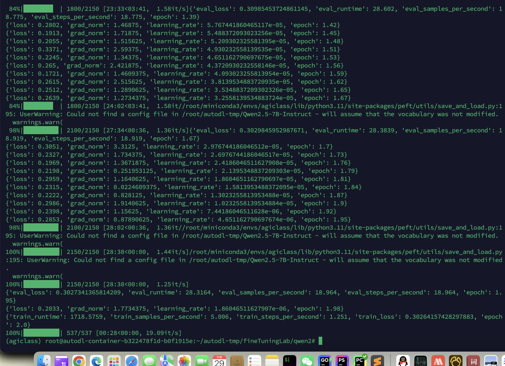
训练期间要保持⽹络连接，否则会导致前台训练任务进程被kill从⽽导致训练失败

训练过程中会有运⾏的进度条，整个训练耗时需要**28分钟左右**

当训练的进度条⾛完，说明训练完成。训练⽣成的⽂件在 /root/autodl-tmp/fine-tuning-lab/qwen2/output ⽬录下。

checkpoint-nnn 是训练过程中的中间结果，nnn 数字最⼤的那个是最终结果。

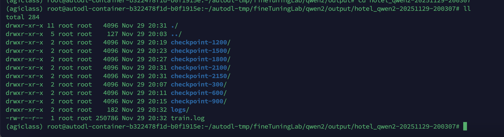
### 2、训练过程可视化
新建⼀个终端，使⽤tensorboard⼯具将记录的loss可视化展示，终端命令⾏运⾏如下命令

tensorboard --logdir=output/hotel_qwen2-20251129-200307 --bind_all --load_fast=false

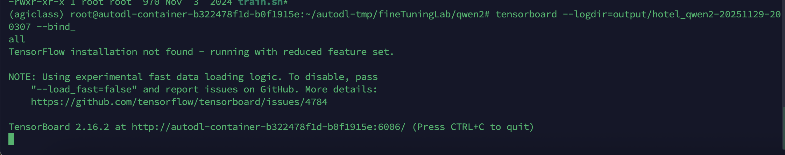
其中，--logdir的内容为训练过程中⽣成内容，如output/hotel_qwen2-20251129-200307

[模型微调可视化分析](%E6%A8%A1%E5%9E%8B%E5%BE%AE%E8%B0%83%E5%8F%AF%E8%A7%86%E5%8C%96%E5%88%86%E6%9E%90.md)

运⾏成功后，在AutoDL实例中可以通过⾃定义服务访问到tensorboard可视化web⻚，如下截图所示：

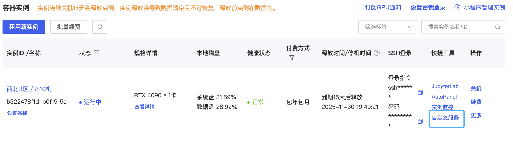
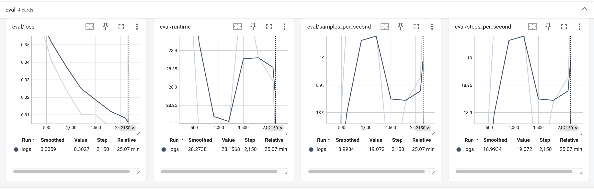
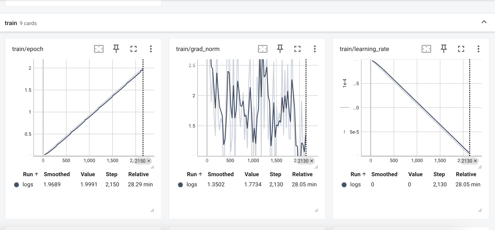
## **五、微调后测试**
训练完成后，在测试集上进⾏推理测试，并计算出SLOT和BLEU的指标

在运⾏测试指令前，需要修改对应的checkpoint⽂件所在路径

```bash
cd qwen2
vim eval.sh
```
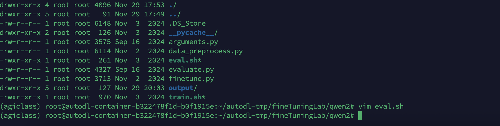
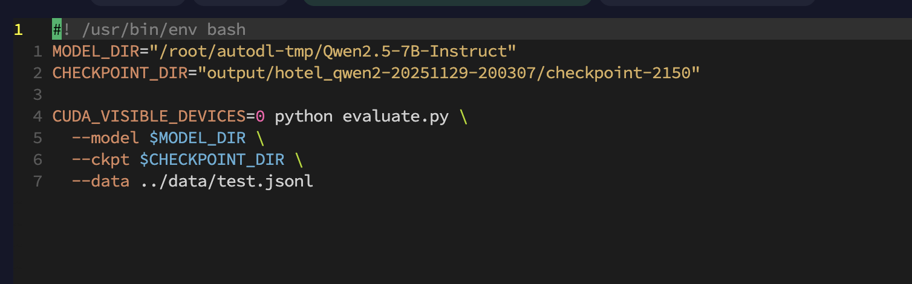
```bash
#! /usr/bin/env bash
# 指定使用bash作为脚本解释器，/usr/bin/env用于自动查找bash的路径

MODEL_DIR="/root/autodl-tmp/Qwen2.5-7B-Instruct"
# 定义环境变量：原始预训练模型路径（微调前的基础Qwen2.5-7B模型）

CHECKPOINT_DIR="output/hotel_qwen2-20251129-200307/checkpoint-2150"
# 定义环境变量：微调后的模型检查点路径
# output/hotel_qwen2-20251129-200307/ - 训练输出目录（包含时间戳）
# checkpoint-2150 - 第2150步保存的模型权重

CUDA_VISIBLE_DEVICES=0 python evaluate.py \
# 设置环境变量，指定使用第0号GPU卡
# 运行evaluate.py评估脚本，\ 表示命令继续到下一行

  --model $MODEL_DIR \
  # 传递参数：原始预训练模型的路径（用于对比基准性能）

  --ckpt $CHECKPOINT_DIR \
  # 传递参数：微调后模型的检查点路径（用于评估微调效果）

  --data ../data/test.jsonl
  # 传递参数：测试数据文件路径（相对于当前目录的上级data目录）
```
在打开的⽂件中，将对应的⽂件夹路径调整为⾃⼰的checkpoint⽂件所在路径

调整完成后，保存退出，然后执⾏如下命令

```bash
bash eval.sh
```
运⾏结束后，整个测试耗时需要**10分钟左右，**结果如下图所示

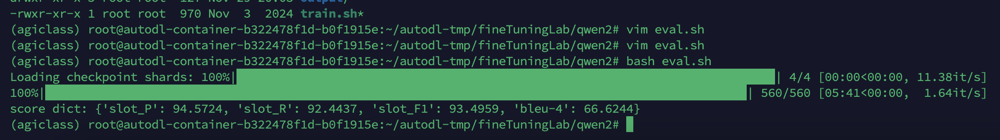
```json
{
  "slot_P": 94.5724,
  "slot_R": 92.4437,
  "slot_F1": 93.4959,
  "bleu-4": 66.6244
}
```
[评估结果分析](%E8%AF%84%E4%BC%B0%E7%BB%93%E6%9E%9C%E5%88%86%E6%9E%90.md)

## 六、模型使⽤
使用wcd（weaviate cloud）向量库和huggingface模型做分词

**Weaviate：** 选择了一个现代的、开源的**向量数据库**，它天然支持**结构化数据过滤**、**关键词搜索 (BM25)** 和**语义向量搜索 (Vector Search)**，这使得它非常适合实现复杂的混合搜索功能。

```json
wcd：https://console.weaviate.cloud/cluster-details/9529e444-22c7-4d7a-8493-0367812d5688
数据集：https://raw.githubusercontent.com/hamburgerswang/hotel-chatbot/main/data/hotel.json
其他数据集：https://hf-mirror.com/datasets/coeuslearning/hotel_reviews/tree/main
```
### 1、创建wcd并导入数据
```python
import json

from dotenv import load_dotenv
load_dotenv("api_keys.env")
import os
import re
import weaviate
from weaviate.classes.init import Auth


def rrf(rankings, k=60):
    if not isinstance(rankings, list):
        raise ValueError("Rankings should be a list.")
    scores = dict()
    for ranking in rankings:
        if not ranking:  # 如果ranking为空，跳过它
            continue
        for i, doc in enumerate(ranking):
            if not isinstance(doc, dict):
                raise ValueError("Each item should be dict type.")
            doc_id = doc.get('hotel_id', None)
            if doc_id is None:
                raise ValueError("Each item should have 'hotel_id' key.")
            if doc_id not in scores:
                scores[doc_id] = (0, doc)
            scores[doc_id] = (scores[doc_id][0] + 1 / (k + i), doc)

    sorted_scores = sorted(scores.values(), key=lambda x: x[0], reverse=True)
    return [item[1] for item in sorted_scores]


class HotelDB():
    def __init__(self, url="http://8.217.22.255:6500"):
        client = weaviate.connect_to_weaviate_cloud(
            cluster_url="https://ipu4fofq3cudvfcc1ek7a.c0.asia-southeast1.gcp.weaviate.cloud",
            auth_credentials=Auth.api_key(os.getenv("WEAVIATE_API_KEY")),
            headers={
                "X-OpenAI-Api-Key": os.getenv("OPENAI_API_KEY"),
                "X-HuggingFace-Api-Key": os.getenv("HUGGINGFACE_API_KEY")},
            additional_config=weaviate.config.AdditionalConfig(
                timeout=weaviate.config.Timeout(init=10)
            )
        )
        self.client = client

    def insert(self):
        """用 v4 方式创建 Hotel Collection 并导入数据"""
        from weaviate.classes.config import Configure, Property, DataType, Tokenization

        collection_name = "Hotel"

        # 使用上下文管理器确保连接关闭
        with self.client as client:
            # 删除已存在的 Collection
            if client.collections.exists(collection_name):
                print(f"⚠️ Collection '{collection_name}' 已存在，正在删除...")
                client.collections.delete(collection_name)

            # 创建新 Collection
            client.collections.create(
                name=collection_name,
                description="hotel info",
                # vectorizer_config=Configure.Vectorizer.text2vec_huggingface(
                #     model="sentence-transformers/all-MiniLM-L6-v2",  # 免费、轻量、中文可用
                #     wait_for_model=False,
                #     use_gpu=False,
                #     vectorize_collection_name=False,
                # ),
                vectorizer_config=Configure.Vectorizer.text2vec_huggingface(
                    model="sentence-transformers/paraphrase-multilingual-MiniLM-L12-v2",  # 多语言，支持中文
                    wait_for_model=False,
                    use_gpu=False,
                    vectorize_collection_name=False,
                ),
                properties=[
                    # hotel_id
                    Property(
                        name="hotel_id",
                        data_type=DataType.INT,
                        description="id of hotel"
                    ),
                    # _name（用于 BM25 搜索）
                    Property(
                        name="_name",
                        data_type=DataType.TEXT,
                        description="name of hotel (tokenized for search)",
                        index_filterable=True,
                        index_searchable=True,
                        tokenization=Tokenization.WHITESPACE,  # ✅ 修复点1
                        # skip_vectorization=True,
                    ),
                    # name（原始值）
                    Property(
                        name="name",
                        data_type=DataType.TEXT,
                        description="type of hotel",
                        # skip_vectorization=True,
                    ),
                    # type
                    Property(
                        name="type",
                        data_type=DataType.TEXT,
                        description="type of hotel",
                        # skip_vectorization=True,
                    ),
                    # _address（用于 BM25 搜索）
                    Property(
                        name="_address",
                        data_type=DataType.TEXT,
                        description="address of hotel (tokenized for search)",
                        index_filterable=True,
                        index_searchable=True,
                        tokenization=Tokenization.WHITESPACE,  # ✅ 修复点1
                        # skip_vectorization=True,
                    ),
                    # address（原始值）
                    Property(
                        name="address",
                        data_type=DataType.TEXT,
                        description="type of hotel",
                        # skip_vectorization=True,
                    ),
                    # subway
                    Property(
                        name="subway",
                        data_type=DataType.TEXT,
                        description="nearby subway",
                        # skip_vectorization=True,
                    ),
                    # phone
                    Property(
                        name="phone",
                        data_type=DataType.TEXT,
                        description="phone of hotel",
                        # skip_vectorization=True,
                    ),
                    # price
                    Property(
                        name="price",
                        data_type=DataType.NUMBER,
                        description="price of hotel"
                    ),
                    # rating
                    Property(
                        name="rating",
                        data_type=DataType.NUMBER,
                        description="rating of hotel"
                    ),
                    # facilities（唯一被向量化的文本字段）
                    Property(
                        name="facilities",
                        data_type=DataType.TEXT,
                        description="facilities provided",
                        index_filterable=True,
                        index_searchable=True,
                        skip_vectorization=False,  # 允许 OpenAI 向量化
                    ),
                ]
            )
            print(f"✅ Collection '{collection_name}' 创建成功")

            # 下载并加载数据
            import requests
            import json
            from tqdm import tqdm

            url = "https://raw.githubusercontent.com/agiclass/hotel-chatbot/main/data/hotel.json"
            if not os.path.exists("hotel.json"):
                print("📥 正在下载 hotel.json...")
                try:
                    response = requests.get(url, timeout=30)  # 增加超时时间
                    response.raise_for_status()
                    with open("hotel.json", "w", encoding="utf-8") as f:
                        json.dump(response.json(), f, ensure_ascii=False, indent=2)
                    print("✅ 下载完成")
                except Exception as e:
                    print(f"❌ 下载失败: {e}")
                    return  # 如果下载失败，提前退出，避免后续操作
            else:
                print("📁 hotel.json 已存在")

            with open("hotel.json", "r", encoding="utf-8") as f:
                hotels = json.load(f)

            # 批量导入数据
            collection = client.collections.get(collection_name)
            print(f"📤 正在导入 {len(hotels)} 条酒店数据...")

            with collection.batch.dynamic() as batch:
                for hotel in tqdm(hotels, desc="导入进度"):
                    batch.add_object(
                        properties=hotel,
                        uuid=weaviate.util.generate_uuid5(hotel, collection_name)
                    )

            # 检查失败对象
            if collection.batch.failed_objects:
                print(f"⚠️ 导入失败数量: {len(collection.batch.failed_objects)}")
                print("第一个失败对象错误:", collection.batch.failed_objects[0].message)
            else:
                print("✅ 所有数据导入成功！")

    def search(self, dsl, name="Hotel", limit=1):
        # 清理 DSL
        dsl = {k: v for k, v in dsl.items() if v is not None}
        _limit = limit + 10
        output_fields = ["hotel_id", "name", "type", "address", "phone", "subway", "facilities", "price", "rating"]

        collection = self.client.collections.get(name)

        # === 1. 构建 filters (v4) ===
        from weaviate.classes.query import Filter
        filters = None

        if "type" in dsl:
            filters = Filter.by_property("type").equal(dsl["type"])
        if "price_range_lower" in dsl:
            f = Filter.by_property("price").greater_than(dsl["price_range_lower"])
            filters = f if filters is None else filters & f
        if "price_range_upper" in dsl:
            f = Filter.by_property("price").less_than(dsl["price_range_upper"])
            filters = f if filters is None else filters & f
        if "rating_range_lower" in dsl:
            f = Filter.by_property("rating").greater_than(dsl["rating_range_lower"])
            filters = f if filters is None else filters & f
        if "rating_range_upper" in dsl:
            f = Filter.by_property("rating").less_than(dsl["rating_range_upper"])
            filters = f if filters is None else filters & f

        candidates = []

        # === 2. 向量搜索 (facilities) ===
        if "facilities" in dsl and dsl["facilities"]:
            query_text = "酒店提供：" + "，".join(dsl["facilities"])
            res = collection.query.near_text(
                query=query_text,
                limit=_limit,
                filters=filters,
                return_properties=output_fields
            )
            candidates = [obj.properties for obj in res.objects]

        # === 3. 关键词搜索 (name) ===
        elif "name" in dsl and dsl["name"]:
            import re
            clean_name = " ".join(re.findall(r"[\w\-]+", dsl["name"]))
            res = collection.query.bm25(
                query=clean_name,
                query_properties=["_name"],
                limit=_limit,
                filters=filters,
                return_properties=output_fields
            )
            candidates = [obj.properties for obj in res.objects]

        # === 4. 关键词搜索 (address) ===
        elif "address" in dsl and dsl["address"]:
            import re
            clean_addr = " ".join(re.findall(r"[\w\-]+", dsl["address"]))
            res = collection.query.bm25(
                query=clean_addr,
                query_properties=["_address"],
                limit=_limit,
                filters=filters,
                return_properties=output_fields
            )
            candidates = [obj.properties for obj in res.objects]

        # === 5. 纯结构化过滤 ===
        else:
            res = collection.query.fetch_objects(
                limit=_limit,
                filters=filters,
                return_properties=output_fields
            )
            candidates = [obj.properties for obj in res.objects]

        # === 6. 排序 ===
        if "sort.slot" in dsl:
            reverse = dsl.get("sort.ordering") == "descend"
            slot = dsl["sort.slot"]
            candidates = sorted(candidates, key=lambda x: x.get(slot, 0), reverse=reverse)

        # === 7. name 后过滤（子串匹配）===
        if "name" in dsl:
            filtered = []
            for r in candidates:
                if dsl["name"] in r.get("name", ""):
                    filtered.append(r)
            candidates = filtered

        return candidates[:limit]


if __name__ == "__main__":
    db = HotelDB()
    try:
        # 你的逻辑，比如 db.search(...)
        result = db.search({"facilities": ["wifi"]}, limit=3)
        print(json.dumps(result, ensure_ascii=False, indent=2))
    finally:
        # 确保连接被关闭
        db.client.close()

```
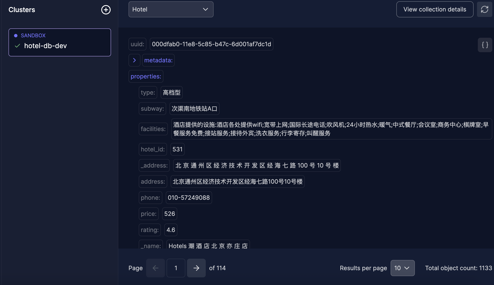
运行查看数据

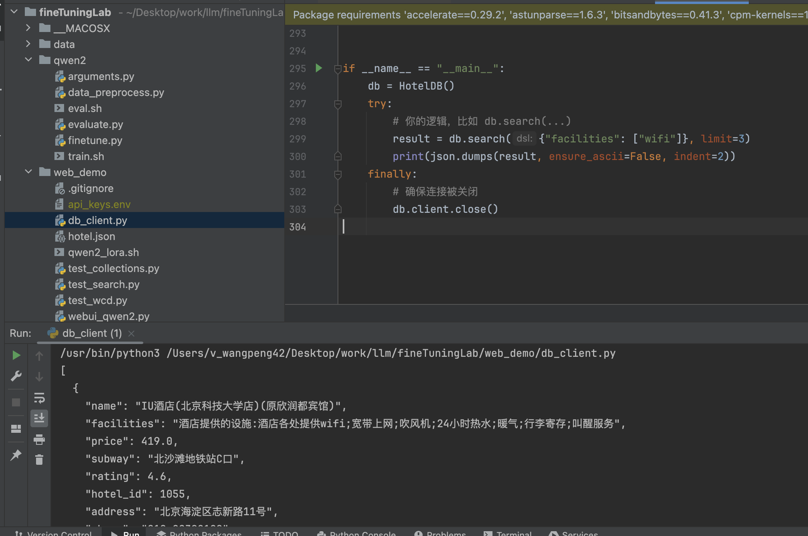
### 2、使用gradio渲染可视化页面
```python
import warnings
warnings.filterwarnings('ignore')
import sys
sys.path.append('../qwen2')
import json
import torch
import argparse
import gradio as gr
import pandas as pd
from db_client import HotelDB
from evaluate import load_model
from data_preprocess import build_prompt, parse_json

# init gloab variables
parser = argparse.ArgumentParser()
parser.add_argument("--model", type=str, default=None, required=True, help="main model weights")
parser.add_argument("--ckpt", type=str, default=None, required=True, help="The checkpoint path")
args = parser.parse_args()

db = HotelDB()
tokenizer, model = load_model(args.model, args.ckpt)

def get_completion(prompt):
    inputs = tokenizer([prompt], return_tensors="pt").to("cuda")
    with torch.no_grad():
        outputs = model.generate(**inputs, max_new_tokens=1024)
        response = tokenizer.decode(outputs[:,inputs['input_ids'].shape[1]:][0], skip_special_tokens=True)
    return response

def remove_search_history(context):
    i = 0
    while i < len(context):
        if context[i]['role'] in ['search','return']:
            del context[i]
        else:
            i += 1

def chat(user_input, chatbot, context, search_field, return_field):
    context.append({'role':'user','content':user_input})
    response = get_completion(build_prompt(context))
    #print(response)
    # 判断以search命令开头时去执行搜索
    if "search" in response:
        # 取出最新一条 'search' 后面的json查询条件
        search_query = parse_json(response)
        if search_query is not None:
            search_field = json.dumps(search_query,indent=4,ensure_ascii=False)
            remove_search_history(context)
            context.append({'role':'search','arguments':search_query})
            # 调用酒店查询接口
            try:
                return_field = db.search(search_query, limit=3)
            finally:
                db.client.close()

            context.append({'role':'return','records':return_field})
            keys = []
            if return_field:
                keys = ['name', 'address', 'phone', 'price', 'rating', 'subway', 'type', 'facilities']
            data = {key: [item[key] for item in return_field] for key in keys}
            data = data or {"hotel": []}
            return_field = pd.DataFrame(data)
            # 将查询结果发给LLM，再次那么让LLM生成回复
            response = get_completion(build_prompt(context))

    reply = response.replace("assistant", "")
    chatbot.append((user_input, reply))
    context.append({'role':'assistant','content':reply})
    return "", chatbot, context, search_field, return_field

def reset_state():
    return [], [], "", "", None

def main():
    with gr.Blocks() as demo:
        gr.HTML("""<h1 align="center">Hotel Chatbot (Qwen2 LoRA)</h1>""")

        with gr.Row():
            with gr.Column(scale=2):
                chatbot = gr.Chatbot()
            with gr.Column(scale=2):
                gr.HTML("""<h4>Search</h4>""")
                search_field = gr.Textbox(show_label=False, placeholder="search...", lines=8)
                user_input = gr.Textbox(show_label=False, placeholder="输入框...", lines=2)
                with gr.Row():
                    submitBtn = gr.Button("提交", variant="primary")
                    emptyBtn = gr.Button("清空")

        with gr.Row():
            with gr.Column():
                gr.HTML("""<h4>Return</h4>""")
                return_field = gr.Dataframe()

        context = gr.State([])

        submitBtn.click(chat, [user_input, chatbot, context, search_field, return_field],
                        [user_input, chatbot, context, search_field, return_field])
        emptyBtn.click(reset_state, outputs=[chatbot, context, user_input, search_field, return_field])

    demo.queue().launch(share=False, server_name='0.0.0.0', server_port=6006, inbrowser=True)

if __name__ == "__main__":
    main()

```
```python
import json
import torch
import argparse
from tqdm import tqdm
from peft import PeftModel
from transformers import AutoTokenizer, AutoModelForCausalLM
from nltk.translate.bleu_score import sentence_bleu, SmoothingFunction
from data_preprocess import build_prompt, parse_json

def load_model(model_path, checkpoint_path):
    tokenizer = AutoTokenizer.from_pretrained(model_path)
    model = AutoModelForCausalLM.from_pretrained(model_path, torch_dtype=torch.bfloat16)
    model = PeftModel.from_pretrained(model, model_id=checkpoint_path).to("cuda").eval()
    return tokenizer, model

class Evaluator:
    def __init__(self,tokenizer,model,data_path):
        self.tokenizer = tokenizer
        self.model = model
        self.data_path = data_path

    def slot_accuracy(self, pred, label):
        correct = 0
        if pred is not None:
            for k, v in pred.items():
                if v is None:
                    continue
                if label and k in label:
                    if not isinstance(v,list):
                        correct += int(v==label[k])
                    else:
                        for t in v:
                            correct += int(t in label[k])
        pred_slots = sum(len(v) if isinstance(v, list) else 1 for v in pred.values()) if pred else 0
        true_slots = sum(len(v) if isinstance(v, list) else 1 for v in label.values()) if label else 0
        return correct, pred_slots, true_slots

    def bleu4(self, pred, label):
        pred = pred.strip()
        label = label.strip()

        hypothesis = list(pred)
        reference = list(label)

        if len(hypothesis) == 0 or len(reference) == 0:
            return 0

        bleu_score = sentence_bleu([reference], hypothesis, smoothing_function=SmoothingFunction().method3)
        return bleu_score

    def compute_metrics(self):
        score_dict = { "slot_P": 0.0, "slot_R": 0.0, "slot_F1": 0.0 }
        bleu_scores = []
        true_slot_count = 0
        pred_slot_count = 0
        correct_slot_count = 0

        with open(self.data_path, "r", encoding="utf-8") as f:
            test_dataset = [json.loads(line) for line in f]

        for item in tqdm(test_dataset):
            template = build_prompt(item["context"])
            inputs = self.tokenizer([template], return_tensors="pt").to("cuda")
            with torch.no_grad():
                outputs = self.model.generate(**inputs, max_new_tokens=1024)
                response = self.tokenizer.decode(outputs[:,inputs['input_ids'].shape[1]:][0], skip_special_tokens=True)
            label = json.loads(item["response"])
            if label["role"] == "search":
                try:
                    preds = parse_json(response)
                except:
                    preds = {}
                truth = label["arguments"]
                correct, pred_slots, true_slots = self.slot_accuracy(preds, truth)
                true_slot_count += true_slots
                pred_slot_count += pred_slots
                correct_slot_count += correct
            else:
                response = response.replace("assistant","")
                bleu_scores.append(self.bleu4(response, label['content']))

        score_dict["slot_P"] = float(correct_slot_count/pred_slot_count) if pred_slot_count > 0 else 0
        score_dict["slot_R"] = float(correct_slot_count/true_slot_count) if true_slot_count > 0 else 0
        score_dict["slot_F1"] = 2*score_dict["slot_P"]*score_dict["slot_R"]/(score_dict["slot_P"]+score_dict["slot_R"]) if (score_dict["slot_P"]+score_dict["slot_R"]) > 0 else 0
        score_dict["bleu-4"] = sum(bleu_scores) / len(bleu_scores)
        for k, v in score_dict.items():
            score_dict[k] = round(v * 100, 4)
        print(f"score dict: {score_dict}")


if __name__ == "__main__":
    parser = argparse.ArgumentParser()
    parser.add_argument("--model", type=str, default=None, required=True, help="main model weights")
    parser.add_argument("--ckpt", type=str, default=None, required=True, help="The checkpoint path")
    parser.add_argument("--data", type=str, default=None, required=True, help="The dataset file path")
    args = parser.parse_args()

    tokenizer, model = load_model(args.model, args.ckpt)
    evaluator = Evaluator(tokenizer, model, args.data)
    evaluator.compute_metrics()

```
```python
import json
from torch.utils.data import Dataset

# 定义一个名为 InputOutputDataset 的新类，它继承自 Dataset 类。这使得我们的数据集能够与 PyTorch 的数据加载器兼容，支持批处理和其他数据加载功能
class InputOutputDataset(Dataset):
    # 定义类的初始化方法，接收三个参数：data（数据集）、tokenizer（分词器）、args（其他参数配置）
    def __init__(self, data, tokenizer, args):
        # 调用父类 Dataset 的初始化方法，以确保数据集正确初始化。这是继承类的标准做法
        super(InputOutputDataset, self).__init__()
        self.data = data
        self.tokenizer = tokenizer
        self.prompt_column = args.prompt_column
        self.response_column = args.response_column
        self.max_source_length = args.max_source_length
        self.max_target_length = args.max_target_length

    # 用于返回数据集的长度，满足 Python 的长度协议
    def __len__(self):
        return len(self.data)

    # 通过索引访问数据集中的样本
    def __getitem__(self, i):
        item = self.data[i]
        # add_special_tokens 不在开头加 special_tokens
        # 调用分词器，对构建的提示文本进行编码
        context = self.tokenizer(
            build_prompt(item[self.prompt_column]), 
            max_length=self.max_source_length, 
            add_special_tokens=False)
        response = self.tokenizer(
            build_response(item[self.response_column]), 
            max_length=self.max_target_length, 
            add_special_tokens=False)
        # 将上下文和响应的 input_ids 连接起来，形成一个完整的输入序列
        input_ids = context["input_ids"] + response["input_ids"]
        # 将上下文和响应的注意力掩码连接起来，确保模型在计算注意力时能够正确地关注输入序列的相关部分
        attention_mask = context["attention_mask"] + response["attention_mask"]
        # 创建标签数组，标记上下文部分为 -100（表示在计算损失时忽略），而响应部分使用真实的 input_ids
        labels = [-100] * len(context["input_ids"]) + response["input_ids"]
        # 确保输入 ID 和标签的长度一致，如果不一致，将抛出断言错误，提供长度信息以便调试
        assert len(input_ids) == len(labels), f"length mismatch: {len(input_ids)} vs {len(labels)}"
        # 返回一个字典，其中包含编码后的输入 ID、注意力掩码和标签，供模型训练使用
        return {
            "input_ids": input_ids,
            "attention_mask": attention_mask,
            "labels": labels
        }

# 用于构建提示字符串
def build_prompt(context):
    # 检查上下文是否为字符串类型，如果是，则将其解析为 JSON 对象
    if isinstance(context,str):
        context = json.loads(context)
    # 初始化一个空字符串，用于存储构建的提示文本
    prompt = ''
    # 遍历上下文中的每个对话轮次
    for turn in context:
        # 检查角色是否为用户或助手
        if turn["role"] in ["user","assistant"]:
            # 将当前对话的角色和内容以指定格式添加到提示字符串中
            prompt += f'<|im_start|>{turn["role"]}\n{turn["content"]}<|im_end|>\n'
        # 处理角色不为用户或助手的情况
        else:
            # 检查角色是否为 search
            if turn["role"] == "search":
                # 提取搜索参数对象
                obj = turn["arguments"]
                # 过滤掉值为 None 的参数，创建新的字典
                filtered_obj = {k: v for k, v in obj.items() if v is not None}
                # 添加搜索的开始标记
                prompt += '<|im_start|>search\n'
                # 将过滤后的搜索参数转换为格式化的 JSON 字符串，并添加到提示中
                prompt += json.dumps(filtered_obj,indent=4,ensure_ascii=False)
            # 处理角色为返回（return）的情况
            else:
                # 提取记录数据
                obj = turn["records"]
                # 添加返回数据的结束标记，完成这一轮对话的提示构建
                prompt += '<|im_start|>return\n'
                prompt += json.dumps(obj,indent=4,ensure_ascii=False)
            prompt += '<|im_end|>\n'
    # 返回构建好的完整提示字符串
    return prompt

# 用于构建响应字符串
def build_response(response):
    # 检查响应是否为字符串类型，若是则解析为 JSON 对象
    if isinstance(response,str):
        response = json.loads(response)
    # 判断角色是否为助手
    if response["role"] == "assistant":
        # 构建助手的响应字符串，格式为
        return '<|im_start|>assistant\n' + response["content"] + '<|im_end|>'
    # 处理角色不是助手的情况
    else:
        # 提取响应中的参数对象
        obj = response["arguments"]
        # 过滤掉值为 None 的参数，创建新的字典
        filtered_obj = {k: v for k, v in obj.items() if v is not None}
        # 构建搜索的响应字符串，格式为
        return '<|im_start|>search\n' + json.dumps(filtered_obj,indent=4,ensure_ascii=False) + '<|im_end|>'

# 接受一个字符串并尝试从中解析出 JSON 对象
def parse_json(string):
    # 初始化搜索起始位置为 0
    search_pos = 0
    # 寻找字符串中第一个 { 的位置，用于标识 JSON 对象的开始
    start = string.find('{', search_pos)
    # 如果未找到 {，返回 None
    if start == -1:
        return None
    # 从找到的 { 位置开始，寻找最后一个 } 的位置，标识 JSON 对象的结束
    end = string.rfind('}', start)
    # 如果未找到 }，返回 None
    if end == -1:
        return None
    # 提取出 JSON 字符串，从找到的 { 到 } 的部分
    json_string = string[start:end + 1]
    try:
        # 将字符串解析为 Python 对象
        obj = json.loads(json_string)
        return obj
    except json.JSONDecodeError:
        return None

```
```md
<|im_start|>user
你是谁<|im_end|>
```
### 3、在沙盒环境跑并使用autodl的自定义服务进行可视化
使⽤提供的web_demo代码进⾏模型使⽤测试，测试前需要修改使⽤训练后的模型，然后执⾏如下命令

```bash
cd /root/autodl-tmp/fineTuningLab/web_demo
vim qwen2_lora.sh
```
```bash
#! /usr/bin/env bash
# 指定使用bash作为脚本解释器，/usr/bin/env会从PATH环境变量中查找bash的位置

MODEL_DIR="/root/autodl-tmp/Qwen2.5-7B-Instruct"
# 定义环境变量：原始预训练的基础模型路径
# 这是微调前的Qwen2.5-7B-Instruct模型，作为对话生成的基准模型

CHECKPOINT_DIR="../qwen2/output/hotel_qwen2-20251129-200307/checkpoint-2150"
# 定义环境变量：微调后的模型检查点路径
# ../qwen2/ - 相对路径，指向上一级目录中的qwen2文件夹
# output/hotel_qwen2-20251129-200307/ - 训练输出目录（包含时间戳20:03:07）
# checkpoint-2150 - 第2150步保存的微调模型权重

CUDA_VISIBLE_DEVICES=0 python webui_qwen2.py \
# 设置环境变量，指定使用第0号GPU卡进行推理
# 运行webui_qwen2.py脚本（Web用户界面），\ 表示命令延续到下一行

    --model $MODEL_DIR \
    # 传递参数：原始预训练模型的路径
    # 用于Web界面中可能的基础模型对比或回退功能
    
    --ckpt $CHECKPOINT_DIR
    # 传递参数：微调后模型的检查点路径
    # Web界面将主要使用这个微调后的模型进行对话交互
```
修改如下两处参数，根据实际情况进⾏替换

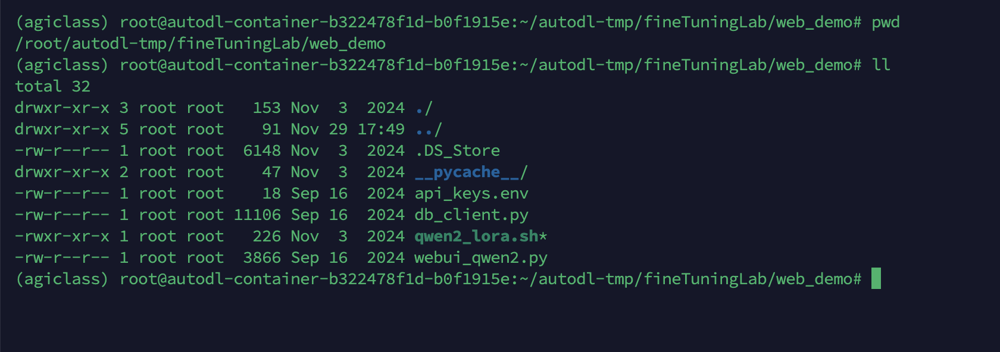
修改后保存退出，然后执⾏

```bash
bash qwen2_lora.sh
```
服务运⾏成功后，在AutoDL实例中可以通过⾃定义服务访问到web⻚(记得把之前打开的tensorboard服务关掉)，单击跳转后进⼊如下截图所示web测试⻚⾯

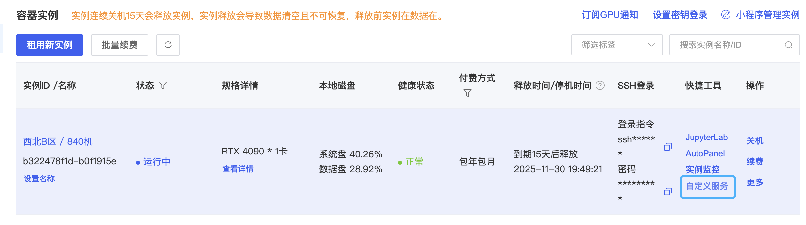
如:给我推荐⼀个不低于1000的酒店

原模型：

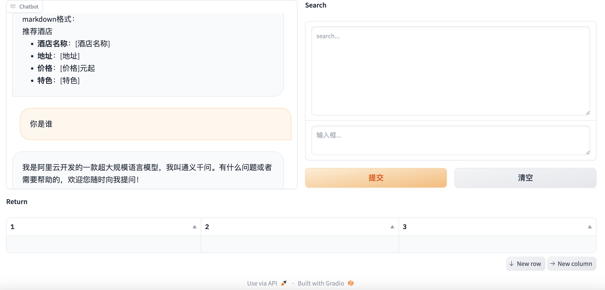
微调后：

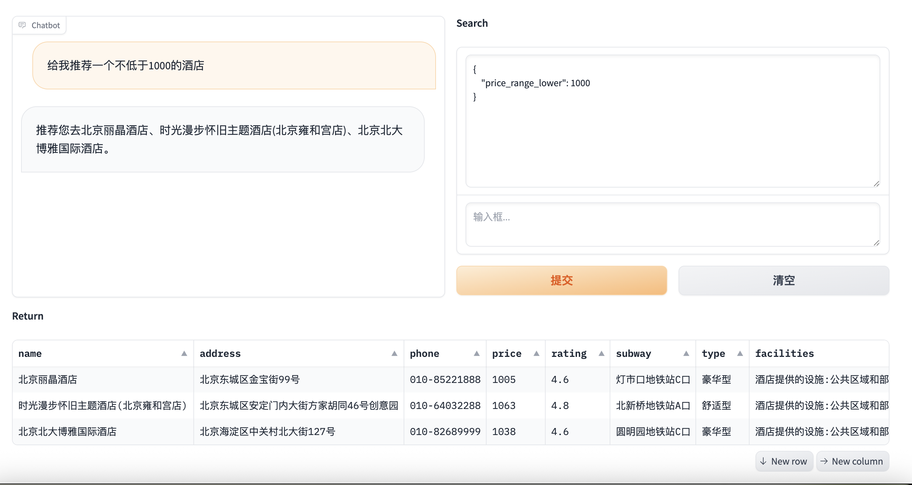