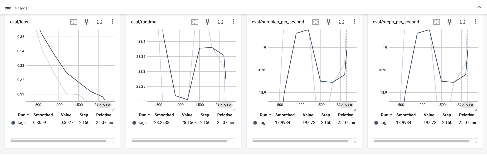
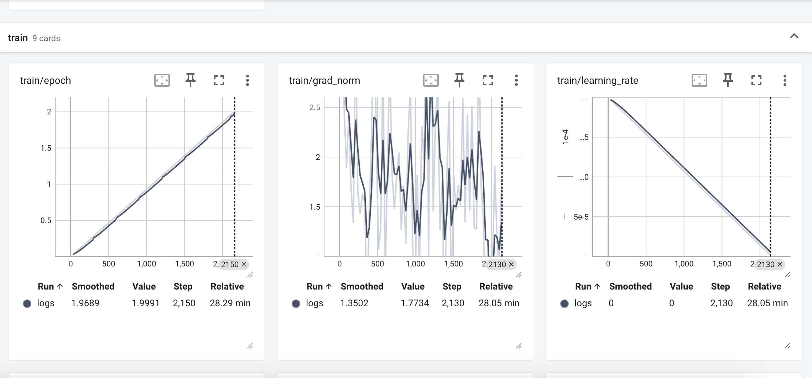

> 原文：https://ku.baidu-int.com/knowledge/HFVrC7hq1Q/pKzJfZczuc/noISsAmuLf/bkn1Rb-Wa6m-AM

模型微调可视化分析

## 一、Eva

这张图表展示的是模型在**验证集（Evaluation）**上的性能和效率指标，通常与您之前看到的训练指标图一起出现。

这张图共有四个部分，我们逐一进行分析和讲解：

---

## 📊 验证集性能与效率分析
### 1. **eval/loss (验证/损失)**
这个图表展示了模型在验证集上的**损失值（Loss）**变化。

* **X 轴 (Step/步数):** 训练迭代次数。
* **Y 轴 (Value/值):** 验证集上的损失值。
* **曲线趋势:** 损失值从初始的约 0.35 开始，**持续且稳定地下降**，最终稳定在约 0.30 附近。

#### **分析与解读**
* **含义:** 验证损失是衡量模型在**未见数据（新数据）**上泛化能力的指标。
* **关键信息:**
    * **持续下降:** 验证损失的稳定下降是一个**非常好的信号**。这表明模型在训练数据上学到的知识**有效地泛化**到了验证集上，模型在不断改进。
    * **未过拟合:** 如果验证损失开始上升而训练损失（根据您上一个图的假设，训练损失应该是下降的）仍在下降，则可能出现了**过拟合（Overfitting）**。目前来看，在这个时间段内，模型**没有**明显的过拟合迹象。

* **指标:**
    * **Smoothed (平滑值):** 0.3059
    * **Value (最终值):** 0.3027

---

### 2. **eval/runtime (验证/运行时长)**
这个图表展示了进行验证评估所花费的**总时间**。

* **X 轴 (Step/步数):** 训练迭代次数。
* **Y 轴 (Value/值):** 运行时间（以分钟计算）。
* **曲线趋势:** 曲线在初始阶段变化较大，但在后半段（从 1,500 步到 2,150 步）**保持稳定**，约为 28.35 分钟左右。

#### **分析与解读**
* **含义:** 每次评估所花费的总时间。
* **关键信息:**
    * **稳定:** 评估运行时长相对稳定，表明验证集的大小没有变化，且计算资源的分配（如 GPU 负载）保持一致。
    * **初始波动:** 初始阶段的波动可能与计算环境的预热、缓存或其他后台进程的干扰有关。

* **指标:**
    * **Smoothed (平滑值):** 28.2738 min
    * **Value (最终值):** 28.1568 min

---

### 3. **eval/samples_per_second (验证/每秒样本数)**
这个图表展示了模型在验证阶段**每秒处理的样本数量**，是衡量**吞吐量（Throughput）**的重要指标。

* **X 轴 (Step/步数):** 训练迭代次数。
* **Y 轴 (Value/值):** 每秒处理的样本数。
* **曲线趋势:** 曲线呈现**锯齿状波动**，主要在 18.9 到 19.1 之间震荡，整体较为稳定。

#### **分析与解读**
* **含义:** 衡量模型在验证评估时的**效率**。数值越高，效率越高。
* **关键信息:**
    * **波动性:** 这种波动性是常见的。它可能由以下因素引起：
        * **数据加载/IO 延迟:** 批量数据读取速度的微小变化。
        * **系统负载:** 后台任务或操作系统的随机干扰。
        * **模型并行/流水线差异:** 评估批次处理中细微的硬件 timing 差异。

    * **稳定性:** 尽管有波动，但吞吐量围绕一个中心值（约 19.0 样本/秒）波动，表明**评估环境和模型推理速度保持一致**。

* **指标:**
    * **Smoothed (平滑值):** 18.9934
    * **Value (最终值):** 19.072

---

### 4. **eval/steps_per_second (验证/每秒步数)**
这个图表展示了模型在验证阶段**每秒完成的评估步骤（Batch）数量**。这个指标与上一个指标 `samples_per_second` 密切相关。

* **X 轴 (Step/步数):** 训练迭代次数。
* **Y 轴 (Value/值):** 每秒评估的批次数量。
* **曲线趋势:** 与 `eval/samples_per_second` 的曲线**几乎完全相同**，呈现锯齿状波动，围绕约 19.0 步/秒震荡。

#### **分析与解读**

* **含义:** 衡量模型在验证评估时的**批量处理速度**。
* **关键信息:**
    * 关系: 由于验证集中的每个 Batch 大小通常是固定的，因此：$$\text{Steps per second} \approx \frac{\text{Samples per second}}{\text{Batch Size}}$$
    * **曲线一致性:** 两条曲线几乎一致，**进一步证实了验证阶段的 Batch Size 是固定的**。如果 Batch Size 是 1（每个 Step 只有一个 Sample），那么两条曲线会完全重合。即使 Batch Size 不为 1，只要它保持不变，两条曲线的形状也应相同。

---

## 总结

这张图表传达了关于模型**泛化能力**和**评估效率**的积极信息：

1. **模型泛化能力强（损失下降）：** 验证损失持续下降，表明模型在学习新知识的同时，有效地避免了过拟合，是一个非常理想的收敛状态。
2. **效率稳定：** 验证评估的运行时长、每秒样本数和每秒步数都保持稳定，显示出计算环境和评估流程的健康和一致性。

如果想进行更完整的评估，下一步通常是比较这个验证损失（0.3027）与实际的**基线（Baseline）损失或任务指标（如 F1-Score, BLEU 等）**，以确定这个损失值在业务上是否可接受。

您对验证损失的下降速度或者评估效率的波动原因希望做进一步的探讨吗？

## 二、train

这是一张常见的机器学习/深度学习训练过程可视化图表，通常来自 **Weights & Biases (W&B)** 或 **TensorBoard** 等工具。

这张图展示了训练过程中的三个关键指标，帮助我们评估模型的训练状态和健康程度。

---

## 📈 训练过程可视化图表分析
### 1. **train/epoch (训练/周期)**
这个图表展示了训练的**进度**。

* **X 轴 (Step/步数):** 表示训练过程中模型权重更新的次数（迭代次数）。总步数是 2,150 步。
* **Y 轴 (Value/值):** 表示训练周期 (Epoch) 的数量。
* **曲线趋势:** 曲线呈一条**完美的直线**，从 0 逐渐增加到约 2.0。

#### **分析与解读**
* **含义:** 这张图表明，训练过程中，每经过一定数量的 Step，就完成了一个 Epoch。
* **关键信息:** 在整个 2,150 步的训练中，模型总共完成了**两个完整周期** (Epoch)。它主要用来确认训练步数和周期数的映射关系是否正确。
* **指标:**
    * **Smoothed (平滑值):** 1.9991（接近 2.0 个 Epoch）
    * **Value (最终值):** 1.9689 (当前运行的实际 Epoch 值)

---

### 2. **train/grad_norm (训练/梯度范数)**
这个图表展示了训练过程中**梯度范数（Gradient Norm）的变化。梯度范数是模型所有可训练参数梯度的欧几里得范数，常用于梯度裁剪（Gradient Clipping）**。

* **X 轴 (Step/步数):** 训练迭代次数。
* **Y 轴 (Value/值):** 梯度范数的值。
* **曲线趋势:** 曲线**波动性极强**，在 1.0 到 2.5 之间剧烈震荡。最终的值在 1.5 左右。

#### **分析与解读**
* **含义:** 梯度范数衡量了**更新模型权重所需力的强度**。
    * **范数过大（发散）:** 可能发生**梯度爆炸**。
    * **范数过小（接近零）:** 可能发生**梯度消失**，或者学习接近停滞。

* **关键信息:**
    * **剧烈波动:** 如此剧烈的波动在深度学习训练中是**常见**的，尤其是在使用大型模型和较大学习率时。这表明模型的梯度在不同批次（Batch）之间变化很大。
    * **稳定性:** 尽管波动剧烈，但范数值**稳定在一个合理的范围内**（大部分在 1.0 到 2.5 之间），没有明显发散（冲到几百或几千），这表明梯度爆炸的风险得到了很好的控制，可能是由于启用了梯度裁剪。

* **指标:**
    * **Smoothed (平滑值):** 1.7734 (曲线的平均趋势)
    * **Value (最终值):** 1.3502

---

### 3. **train/learning_rate (训练/学习率)**
这个图表展示了训练过程中**学习率（Learning Rate, LR）**是如何变化的。

* **X 轴 (Step/步数):** 训练迭代次数。
* **Y 轴 (Value/值):** 学习率的值。注意 Y 轴单位是 1e-4（即 10^-4）。
* **曲线趋势:** 曲线呈一条**平滑的下降曲线**，从约 2.5 x10^-4 线性下降到接近 0。

#### **分析与解读**
* **含义:** 这表明训练使用了**学习率调度器（LR Scheduler）**，具体是 **Cosine Annealing (余弦退火)** 或**线性衰减（Linear Decay）**策略。
* **关键信息:**
    * **策略:** 模型从一个**较高的初始学习率**（约 2.5 x10^-4）开始训练。
    * **目的:** 随着训练步数的增加，学习率逐渐**衰减到接近 0**。这种策略有助于在训练初期快速收敛，并在后期（接近训练结束时）使用较小的步长进行精细调整，从而提高模型的最终性能和稳定性。
    * **健康性:** 学习率按计划平稳下降，表明学习率调度器工作正常。

* **指标:**
    * **Smoothed (平滑值):** 0
    * **Value (最终值):** 0 (在 2,150 步结束时，学习率已降为 0)

---

## 🚀 总结
总的来说，这份训练图表展示了一个**健康且有计划**的训练过程：

1. **进度清晰:** 完成了约 2 个 Epoch，总计 2,150 步。
2. **梯度可控:** 梯度范数虽然波动，但被限制在稳定范围内，没有出现灾难性的梯度爆炸。
3. **策略得当:** 采用了学习率衰减策略，这有助于模型在训练后期实现更好的收敛。

要全面评估模型的训练质量，还需要查看 **损失（Loss）** 和 **评估指标（如 Accuracy 或 Perplexity）** 的曲线图，它们通常会和这些图一起展示。

