> 原文：https://ku.baidu-int.com/knowledge/HFVrC7hq1Q/KeF15lNOtH/-UXFkEkRyR/tIsDIiBtf17_ge

2024-04业务分享

# 1.业务发展过程
# AI生态诞生的背景和前期的探索
22-11：

openAI推出ChatGPT

23-02：

微软new bing推出，Google推出Bard

23-03：

搜索的AI伙伴项目启动

阿拉丁灵感中心项目启动

openAI的plugin能力发布

23-06：

AI-app-engine引擎项目启动

23-08：

Bot框架

灵境平台启动

23-09：插件能力启动

23-10:灵境&灵感项目产品融合

23-11：AI生态项目组成立

23-12：agent项目正通过探讨立项

24-02：

agent1.0正式上线

24-04：

灵境平台正式升级为文心智能体平台(agent builder)

# 2.当前业务介绍
## 2.1文心智能体平台
### **AI原生应用的范式**
|**范式**|**说明**|基础能力|灵境支持程度|**归类**|
|-|-|-|-|-|
|基础LLM应用 【Prompt】|利用LLM基础能力搭建的应用|LLM|EB、EB4|人类专家知识来规划任务执行模板，组合新旧所有元素创建的应用|
|搜索增强型AI应用 【retrieve-augmented-generation】|利用搜索引擎、领域知识库等来弥补LLM的不足|数据集构建|见后面描述||
|工具增强型AI应用 【tool-augmented-generation】|将LLM与工具（计算器、日历等）相结合来扩展其功能|工具调用|见后面描述||
|Chain增强型AI应用 【Chain augmented】|人工组合多次LLM调用，来实现具体的功能|流程编排|* Retrieval -> Generate * 自定义编排||
|以AI为核心大脑的应用 【LLM Based Agent】|由LLM来规划任务执行路径，并调用工具完成任务|人物、工具设定 任务规划|* system-setting * ReAct范式规划任务|以LLM为大脑，它来控制感知、规划、决策、执行所有的步骤|

### B端平台
官网地址：[https://agents.baidu.com/](https://agents.baidu.com/)

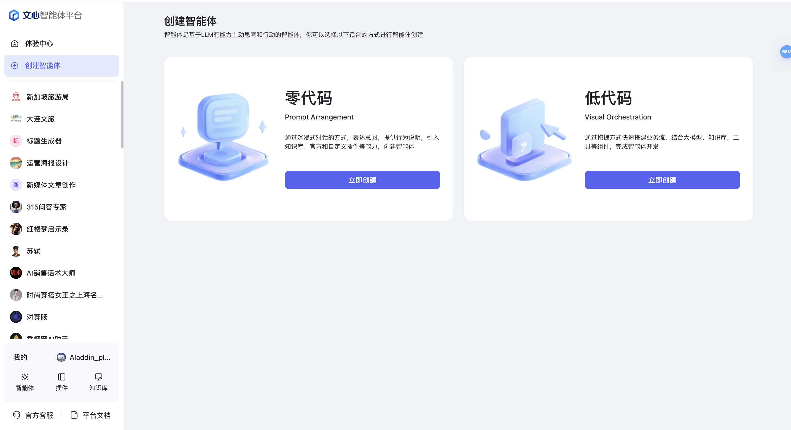
零代码

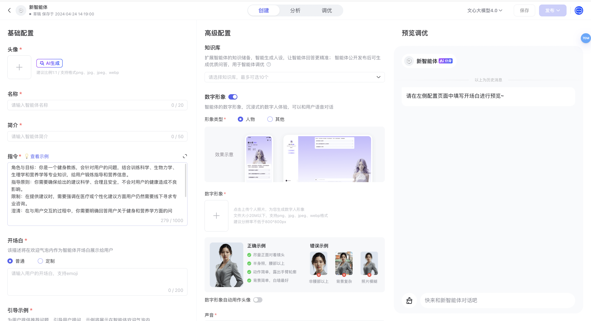
低代码

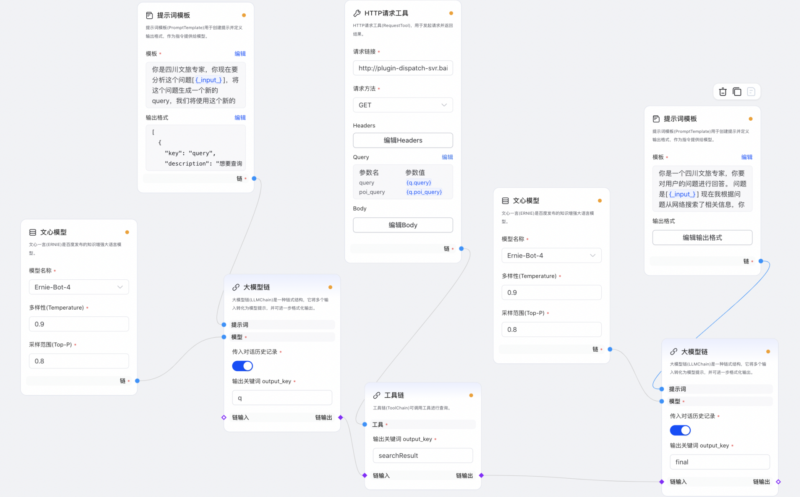
插件

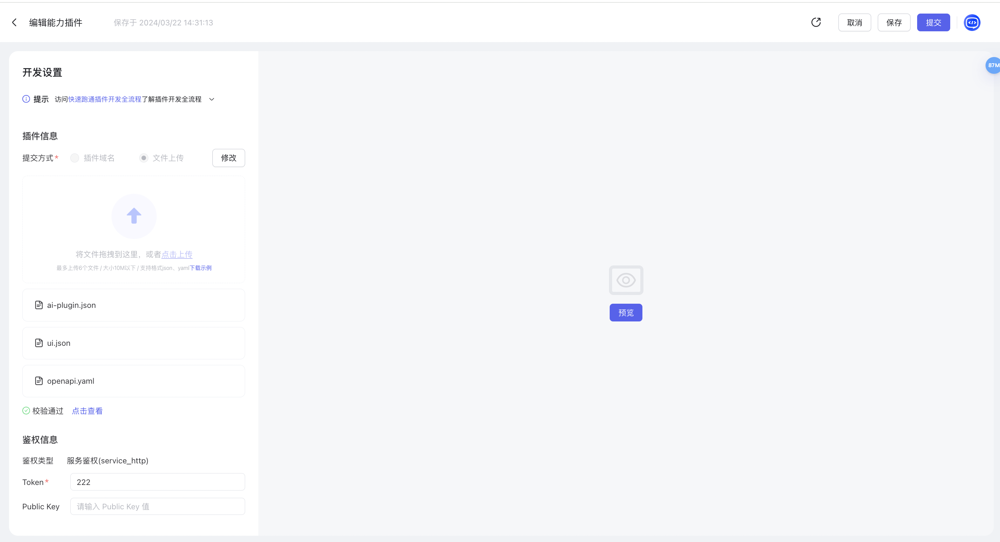
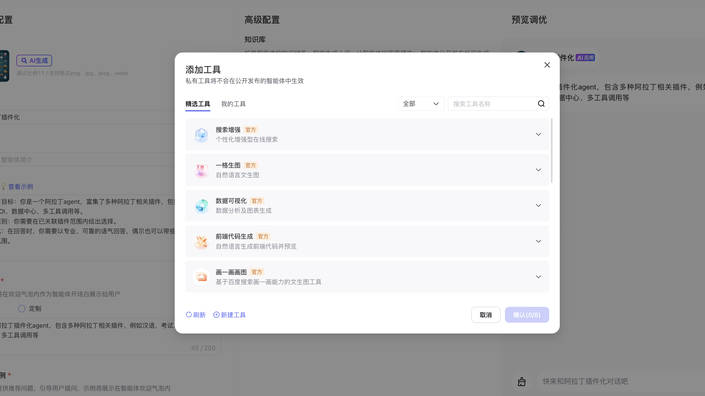
数据集

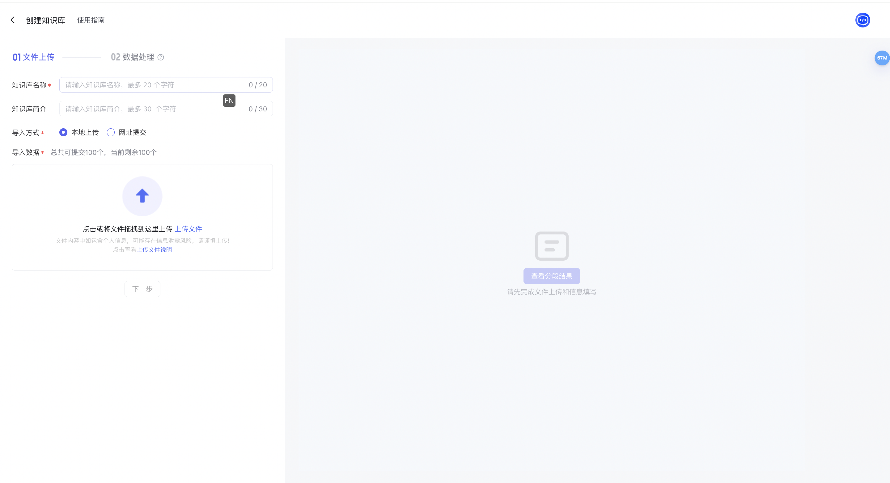
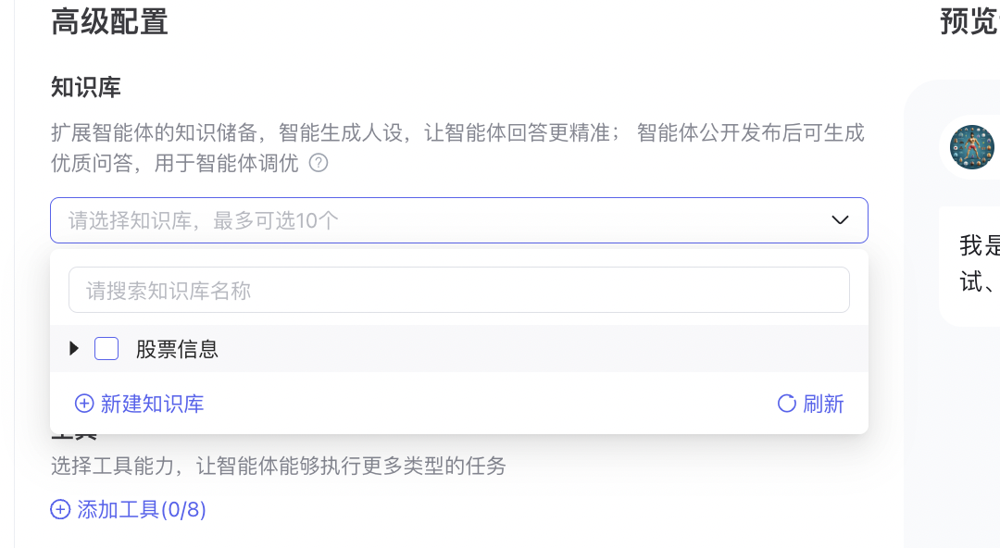
### O端平台
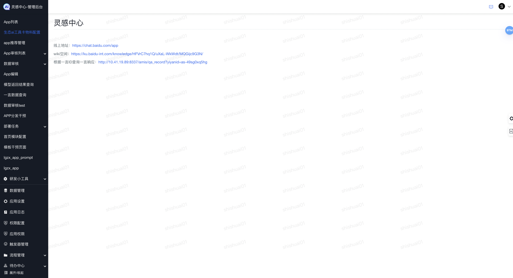
### 数据平台
[[TDA]文心智能体分发数据统计](https://tda.baidu-int.com/bi/superset/group/ecology/dashboard/8619/?t=mention&mt=doc&dt=sdk)

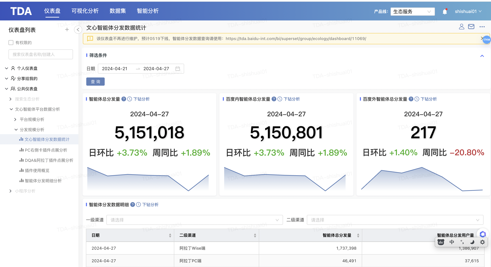
[http://showx.baidu.com/group/midpf_data/report/96161](http://showx.baidu.com/group/midpf_data/report/96161)

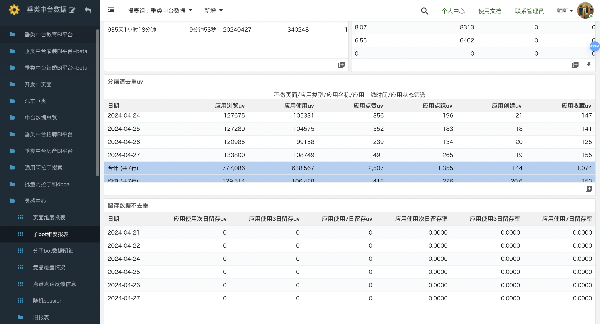

架构图（[agent1.0 实现方案详解](https://ku.baidu-int.com/knowledge/HFVrC7hq1Q/MYFIkxNl2o/-UXFkEkRyR/Q5CLpeWuTEISEn?t=mention&mt=doc&dt=doc)）

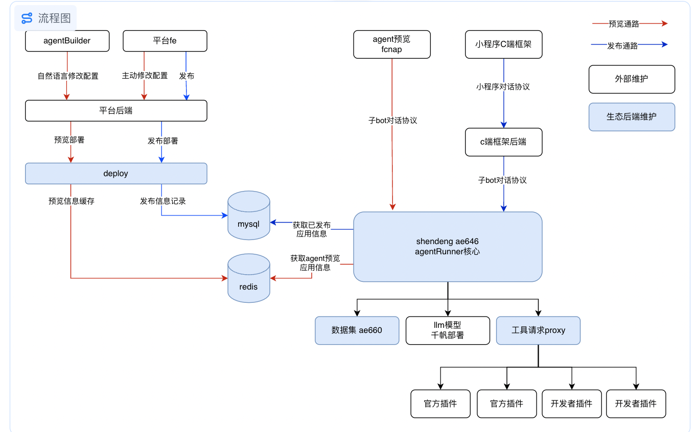
流程图

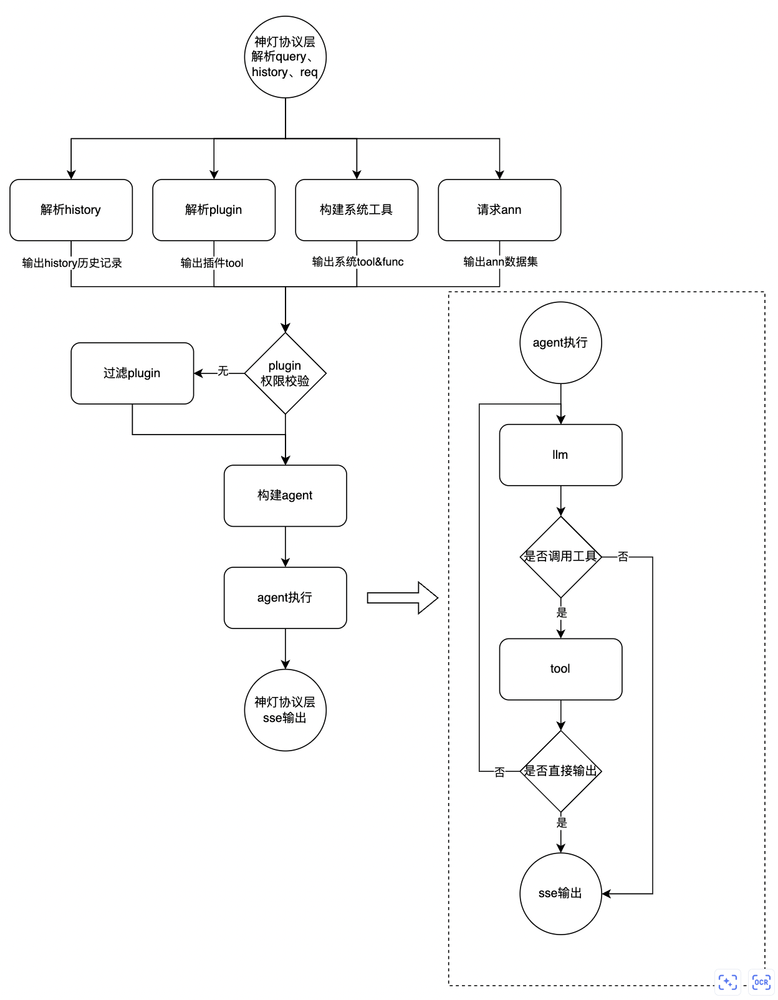
[agent1.0 实现方案详解](https://ku.baidu-int.com/knowledge/HFVrC7hq1Q/MYFIkxNl2o/-UXFkEkRyR/Q5CLpeWuTEISEn?t=mention&mt=doc&dt=doc)

## 2.2 agent在搜索分发
总体（[Agent分发系统整体设计](https://ku.baidu-int.com/knowledge/HFVrC7hq1Q/MYFIkxNl2o/-UXFkEkRyR/ZHwcH0mH7j0UOn?t=mention&mt=doc&dt=doc)）

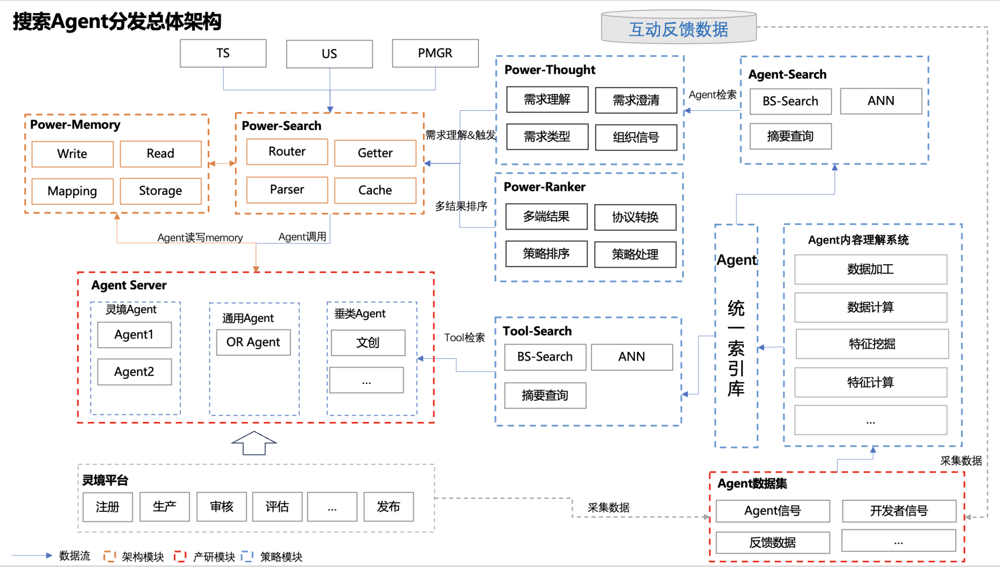
分发（[Agent分发系统整体设计](https://ku.baidu-int.com/knowledge/HFVrC7hq1Q/MYFIkxNl2o/-UXFkEkRyR/ZHwcH0mH7j0UOn?t=mention&mt=doc&dt=doc)）

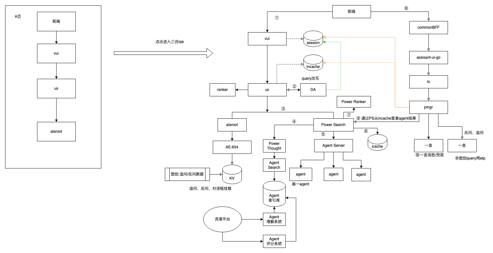
建库（[Agent统一索引库构建（含Tool）](https://ku.baidu-int.com/knowledge/HFVrC7hq1Q/MYFIkxNl2o/-UXFkEkRyR/7lVbowrvVsuDxq?t=mention&mt=doc&dt=doc)）

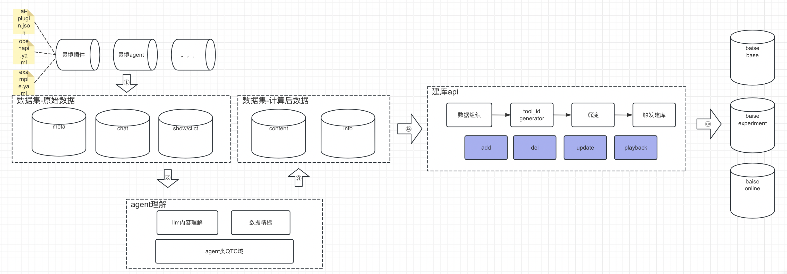

# 2.Q&A
|问题|回答|
|-|-|
|团队业务产品整体的形态和流程是什么？ 现有的业务范围，智能体从创建到分发的简要生命过程大体流程|文心智能体平台 搜索分发 如上 |
|各代码库具体功能，以及之间的关系，调用层级  各环节与对应模块的关联关系，方便确定后续可以深入理解的方向  代码库中的plugin-xxx相关的插件业务和agent的关系是什么？ |[代码库资源](https://ku.baidu-int.com/knowledge/HFVrC7hq1Q/MYFIkxNl2o/-UXFkEkRyR/Os8ZpiMzV9va4S?t=mention&mt=doc&dt=doc)  [Agent分发系统整体设计](https://ku.baidu-int.com/knowledge/HFVrC7hq1Q/MYFIkxNl2o/-UXFkEkRyR/ZHwcH0mH7j0UOn?t=mention&mt=doc&dt=doc)  插件相关代码库是插件服务相关的业务，目前处于维护状态，agent使用工具时复用了插件服务提供的相关能力；|
|开发上线流程|需求内审-》需求评审-》技术设计-》技术评审-》开发-》联调-》UE&PM 走查-》测试-》上线（0流量-》小流量-》全流量）  上线阶段-上线&问题排查参考手册（预计10分钟） [上线阶段-上线&问题排查参考手册](https://ku.baidu-int.com/knowledge/HFVrC7hq1Q/ghFSTZS67D/HG84lQDSsV/pTnaS1QFeQqbXK?t=mention&mt=doc&dt=doc) 测试阶段-前后端合作项目流程规范（预计10分钟） [测试阶段-前后端合作项目流程规范](https://ku.baidu-int.com/knowledge/HFVrC7hq1Q/ghFSTZS67D/HG84lQDSsV/wTWi9feigE_qsP?t=mention&mt=doc&dt=doc) 需求阶段-拆分story及提测规范（预计10分钟） [需求阶段-拆分story及提测规范](https://ku.baidu-int.com/knowledge/HFVrC7hq1Q/ghFSTZS67D/HG84lQDSsV/SbJzbVgqL-3s3z?t=mention&mt=doc&dt=doc) 在线问卷考试：8月5日后发布考试链接，尽情期待  技术评审规范：[AI生态产研技术评审规范（初稿）](https://ku.baidu-int.com/knowledge/HFVrC7hq1Q/MYFIkxNl2o/-UXFkEkRyR/4ziW9_rXjVS2FS?t=mention&mt=doc&dt=doc)|
|ai生态和灵境平台（小程序研发）是如何分工合作的？比如灵境平台和灵感中心都能创建agent，业务差异和技术差异是什么？|ai生态：agent运行相关能力+agent分发 平台研发（小程序）：b端平台相关开发 已无灵感中心和灵境平台品牌，升级为：文心智能体平台   |
|agent图调度框架（ai-agent-flow）和ai引擎（ai-appengine）的关系是什么？常说的agent runner的概念是什么，是指shengdeng+ai-appengine一套还是某一个具体的服务？|ai-appengine是agent开发 agent runner 是0代码agent的 APaaS 服务，是一套agent的 搭建、部署、使用、更新和管理的全套解决方案 神灯 即是agent APaaS能力的品牌名，也是agent 运行的代码库名称，shendeng代码库是基于ai-appengine开发；agent是基于阿拉丁线条孵化出的，2023年3月启动时 定的品牌名：神灯   |
|ai生态Q2在技术和产品上的重点事情/项目/里程碑有哪些？|产品规划：[2024-Q2-OKR拆解-开发者生态](https://ku.baidu-int.com/knowledge/HFVrC7hq1Q/aX31HWgyN_/1v_nfDnwbf/ynbMmTntpaowHG?t=mention&mt=doc&dt=doc) 技术规划：[2024Q2技术工作拆解【待完善】](https://ku.baidu-int.com/knowledge/HFVrC7hq1Q/MYFIkxNl2o/-UXFkEkRyR/48ab5aab88af4f?t=mention&mt=doc&dt=doc)|
|建议阅读的文档、代码库等|[Agent技术分享](https://ku.baidu-int.com/knowledge/HFVrC7hq1Q/MYFIkxNl2o/-UXFkEkRyR/C9d-Sl6Qm2bp2J?t=mention&mt=doc&dt=doc) [AI-生态分享-业务](https://ku.baidu-int.com/knowledge/HFVrC7hq1Q/MYFIkxNl2o/-UXFkEkRyR/40e611e9889043?t=mention&mt=doc&dt=doc) [代码库资源](https://ku.baidu-int.com/knowledge/HFVrC7hq1Q/MYFIkxNl2o/-UXFkEkRyR/Os8ZpiMzV9va4S?t=mention&mt=doc&dt=doc)|