> 原文：https://ku.baidu-int.com/knowledge/HFVrC7hq1Q/KeF15lNOtH/-UXFkEkRyR/pG2KbGukFPubTp

A2A协议分享

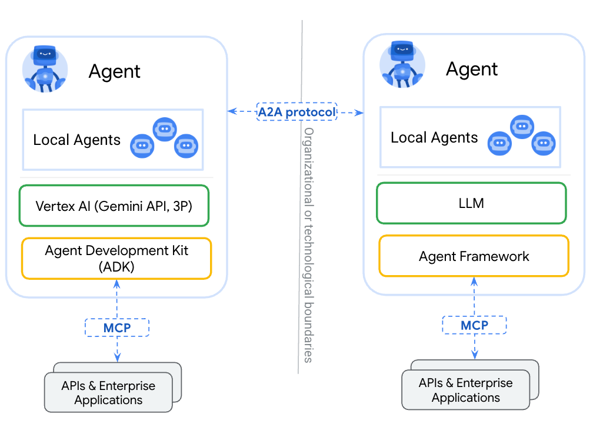
## A2A 协议的技术细节
A2A 是一个开放协议，旨在促进 AI Agent之间的协作，特别适用于大规模、多智能体系统的部署。

### 主要特点
标准化通信：基于 HTTP(S) 的 JSON-RPC 2.0。

代理发现：通过“代理卡”详细列出功能和连接信息。

灵活交互：支持同步请求/响应、流式传输 (SSE) 和异步推送通知。

丰富的数据交换：可处理文本、文件和结构化 JSON 数据。

企业级：设计时充分考虑了安全性、身份验证和可观察性。

### 关键组件
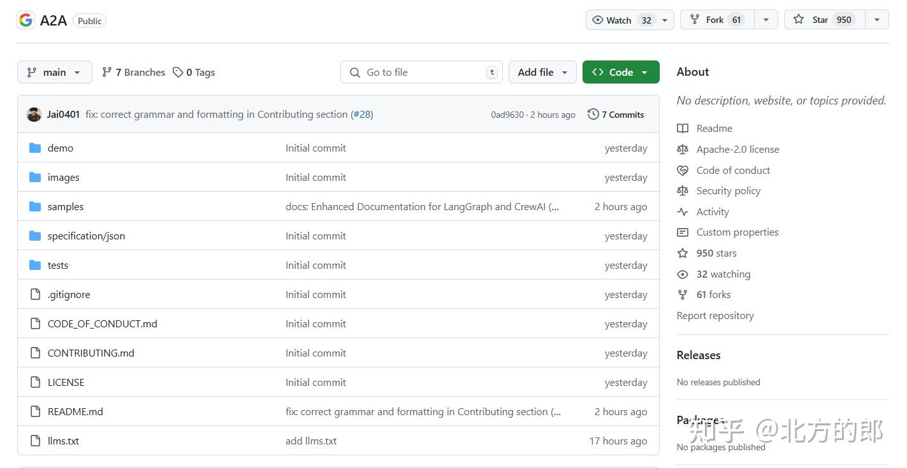
从 [GitHub 仓库](https://link.zhihu.com/?target=https%3A//github.com/google/A2A) 的技术细节中，A2A 包括以下组件(参考：[demo/ui/utils/agent_card.py](https://link.zhihu.com/?target=https%3A//github.com/google/A2A/blob/0ad9630e044d72c22428f129165fe4c0de385902/demo/ui/utils/agent_card.py%23L6))：

**Agent Card**：公共元数据文件，位于 /.well-known/agent.json，描述智能体的能力、技能、端点 URL 和认证要求，用于能力发现。

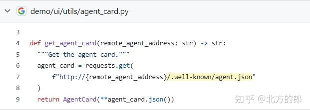
**A2A 服务器**：暴露 HTTP 端点，实现 A2A 协议方法（规格见 [A2A/specification at main · google/A2A](https://link.zhihu.com/?target=https%3A//github.com/google/A2A/tree/main/specification)），管理任务执行。

**A2A 客户端**：应用程序或智能体，消费 A2A 服务，通过发送 tasks/send 或 tasks/sendSubscribe 请求与服务器交互。

**任务（Task）**：工作的核心单位，有唯一 ID，可处于以下状态：

* submitted：已提交
* working：处理中
* input-required：需要更多输入
* completed：完成
* failed：失败
* canceled：取消

**消息（Message）**：通信单位，角色为 user 或 agent，包含“部分”（Parts）。

**部分（Part）**：消息或工件中的内容单位，包括：

* TextPart：文本内容。
* FilePart：文件（内联字节或 URI）。
* DataPart：结构化 JSON 数据（如表单）。

**工件（Artifact）**：任务生成的输出，也包含 Parts。

**流式传输**：对于长期任务，使用 tasks/sendSubscribe，服务器通过 SSE 发送事件，如 TaskStatusUpdateEvent（任务状态更新）或 TaskArtifactUpdateEvent（任务工件更新）。

**推送通知**：支持 pushNotifications 的服务器可通过 tasks/pushNotification/set 发送更新到客户端提供的 webhook。

以下表格总结了 A2A 的关键组件和技术细节：

|组件|描述|
|-|-|
|Agent Card|位于 /.well-known/agent.json，描述能力、技能、端点 URL 和认证要求，用于发现。|
|A2A 服务器|实现协议方法，管理任务执行，规格见 GitHub 规格。|
|A2A 客户端|发送请求如 tasks/send 或 tasks/sendSubscribe，消费 A2A 服务。|
|任务|核心工作单位，有唯一 ID，状态包括 submitted、working 等。|
|消息|通信单位，角色为 user 或 agent，包含 Parts。|
|部分|内容单位，包括 TextPart、FilePart、DataPart。|
|工件|任务输出，包含 Parts。|
|流式传输|使用 SSE 事件更新长期任务状态。|
|推送通知|通过 webhook 发送更新。|

### 
具体流程
A2A 的典型工作流程如下：

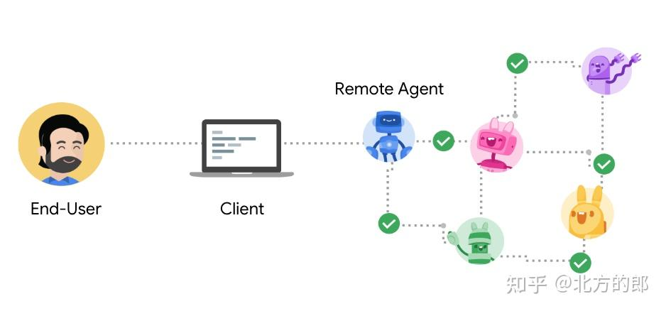
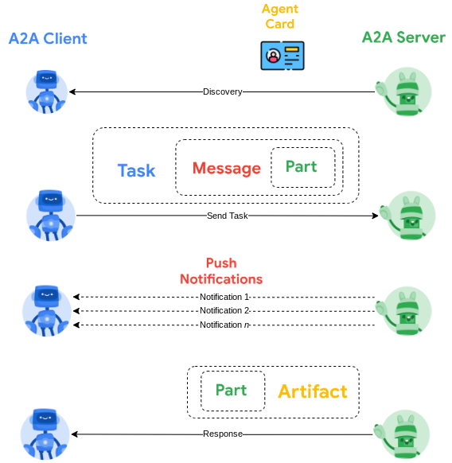
**1 发现**：客户端从 /.well-known/agent.json 获取 Agent Card，了解智能体的能力。

**2 启动**：客户端发送任务请求：

    * 使用 tasks/send 处理即时任务，返回最终 Task 对象。
    * 使用 tasks/sendSubscribe 处理长期任务，服务器通过 SSE 事件发送更新。

**3 处理**：服务器处理任务，可能涉及流式更新或直接返回结果。

**4 交互（可选）**：若任务状态为 input-required，客户端可发送更多消息，使用相同 Task ID 提供输入。

**5 完成**：任务达到终端状态（如 completed、failed 或 canceled）。

此流程支持简单任务和需要多次交互的复杂任务，特别适合多模态通信环境。

## A2A 与 MCP 的关系
### 标准化协议
标准化协议是实现智能体互操作性的关键，尤其在连接智能体与外部系统时。这一需求聚焦于两个相互关联的创新领域：**工具**与**智能体**。

* **工具**是具有结构化输入/输出和（通常）明确行为的原子单元。
* **智能体**是能通过工具调用、逻辑推理和用户交互完成新任务的自主应用。
要实现用户目标，智能体应用必须同时协调工具和智能体。

### **互补性协议**
A2A 与 Anthropic 的 Model Context Protocol (MCP) 是互补的，比喻的话就是一个是电话簿（A2A），一个是工具说明书（MCP）。具体关系如下：

**MCP 的角色**：MCP 于 2024 年 11 月由 Anthropic 发布，旨在标准化 AI 模型与外部数据源（如数据库、API、文件系统）的连接。它的目标是让 AI 助理能够访问和利用上下文数据，提升响应质量。MCP正在统一不同模型和框架的“函数调用”功能，这催生了一个工具服务商生态系统，大幅降低了智能体与工具/数据的对接复杂度。随着更多框架、服务商和平台采用MCP，这一趋势将持续深化。

**A2A 的角色：**A2A 协议旨在规范 AI 代理之间的通信，尤其是部署在外部系统中的代理。以前，为**工具**建立了名为 **Model Context Protocol (MCP)** 的此类协议，这是一种新兴标准，用于将 LLM 与数据和资源相关联。A2A 旨在补充 MCP，因为 A2A 侧重于解决其他问题，而 MCP 侧重于降低复杂性，以便将代理与工具和数据相关联，A2A 则侧重于如何让代理能够以自然的方式协作。这样，agent就可以作为agent（或用户）进行通信，而不是作为工具进行通信；例如，当您想订购商品时，支持来回沟通。

A2A 旨在对 MCP 进行补充。在[官方文档](https://google.github.io/A2A/topics/a2a-and-mcp)中，建议应用将 A2A 代理建模为 MCP 资源（由 ***AgentCard*** 表示，我们稍后会对此进行讨论）。然后，框架可以使用 A2A 与其用户、远程代理和其他代理进行通信。

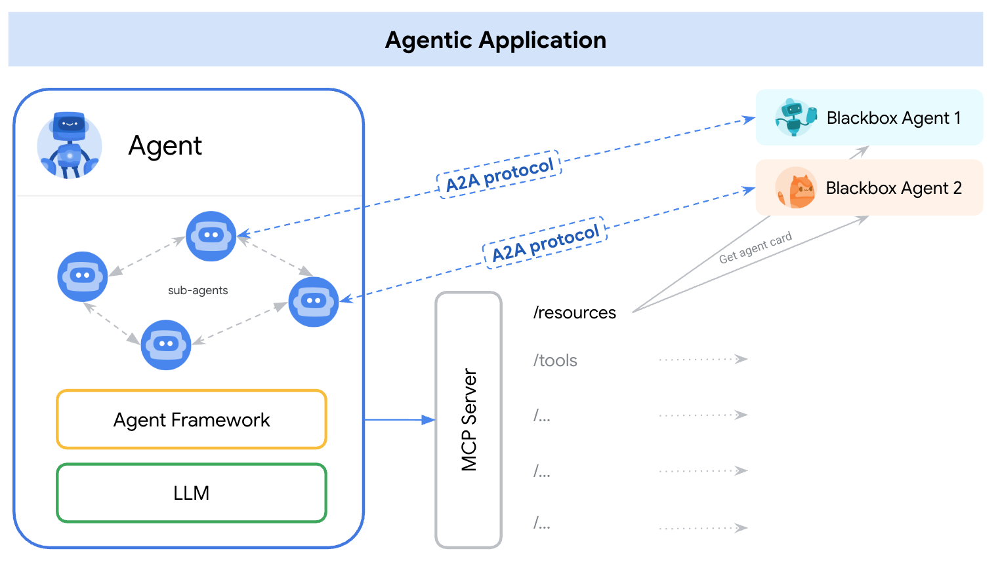
### **案例解析**
以汽车维修店为例：

* **现实场景**：维修店员工使用专用工具（如千斤顶、万用表、套筒扳手）诊断和修复故障。他们常需处理陌生问题，过程中涉及与客户沟通、研究解决方案，以及与零件供应商协作。
* **智能体映射**：
    * **MCP协议**：连接智能体与结构化工具（如“将平台升高2米”“将扳手向右旋转4毫米”）。
    * **A2A协议**：支持终端用户或其他智能体与维修工交互（如“我的车有异响”），实现动态对话（“请拍摄左轮照片”“发现液体渗漏，持续多久了？”），并协调零件供应商等外部智能体。

### 实操流程
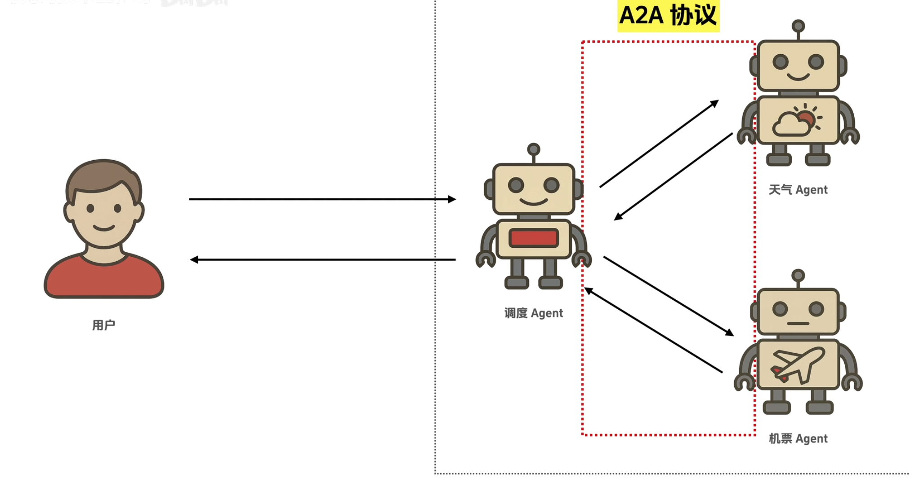

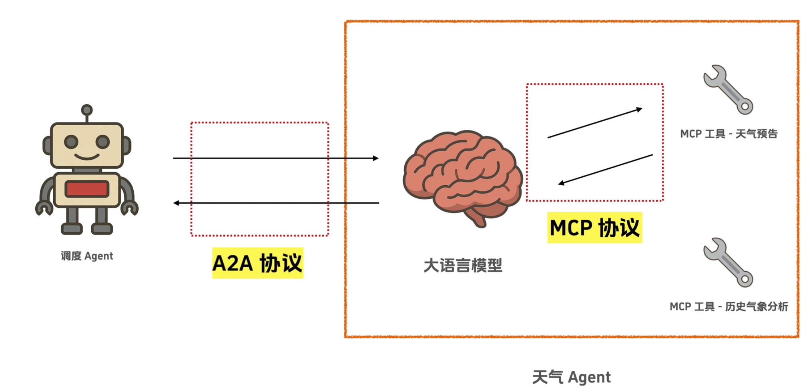

A2A通信流程：

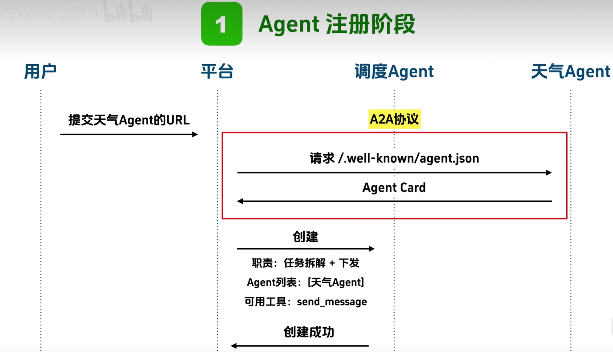
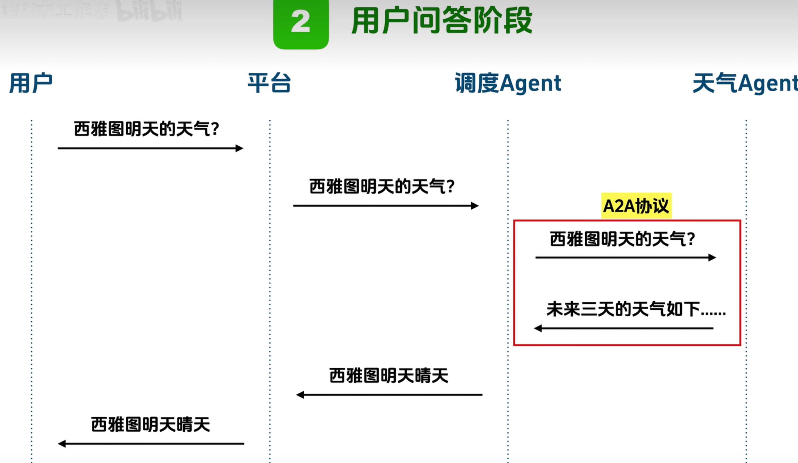

1、官方调度agent地址：[https://github.com/google-a2a/a2a-samples](https://github.com/google-a2a/a2a-samples) 

2、

天气agent地址：

[https://github.com/MarkTechStation/VideoCode/tree/main/A2A%E5%8D%8F%E8%AE%AE%E6%B7%B1%E5%BA%A6%E8%A7%A3%E6%9E%90(1)/weather](https://github.com/MarkTechStation/VideoCode/tree/main/A2A%E5%8D%8F%E8%AE%AE%E6%B7%B1%E5%BA%A6%E8%A7%A3%E6%9E%90(1)/weather) 

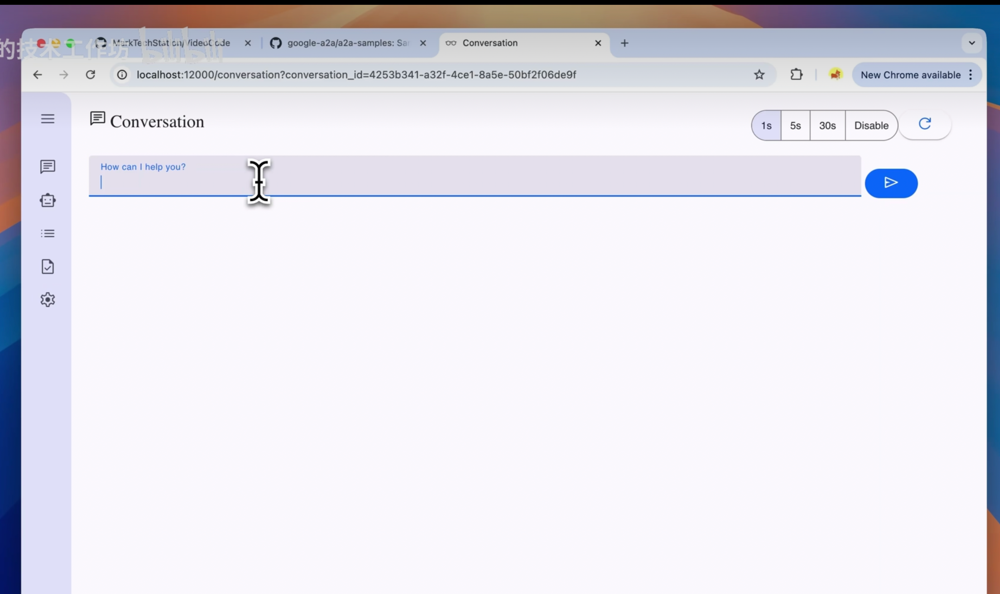
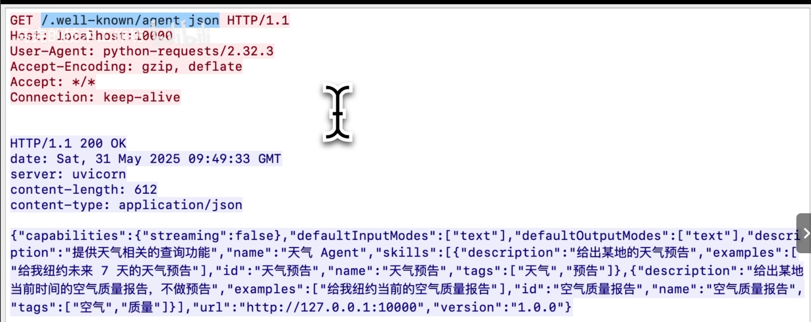
Agent Card

 

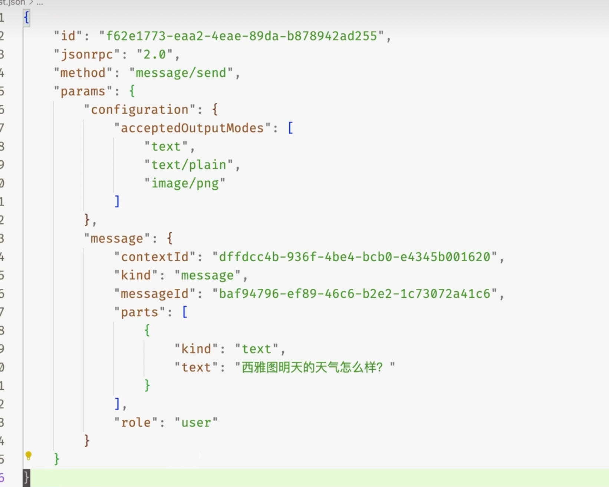

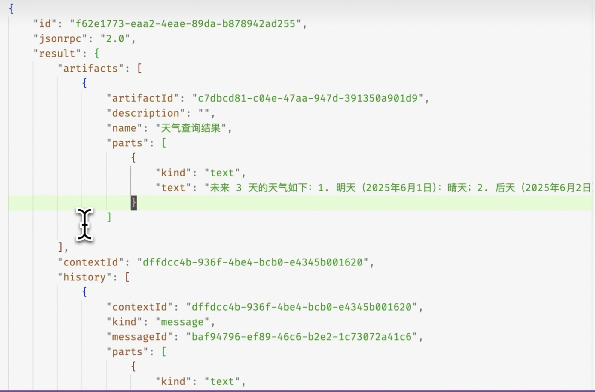
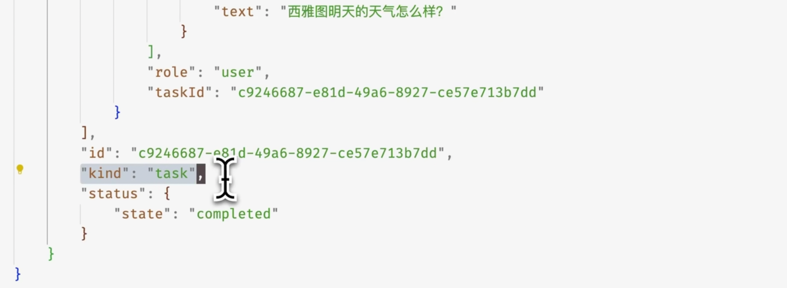

核心概念：

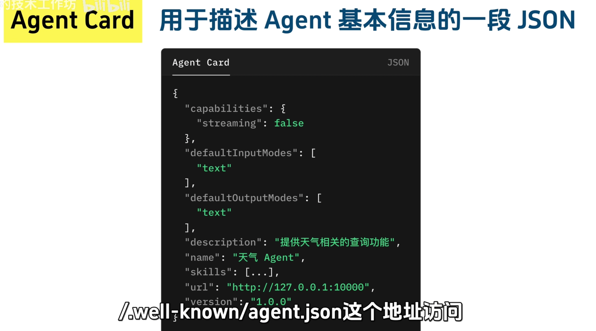

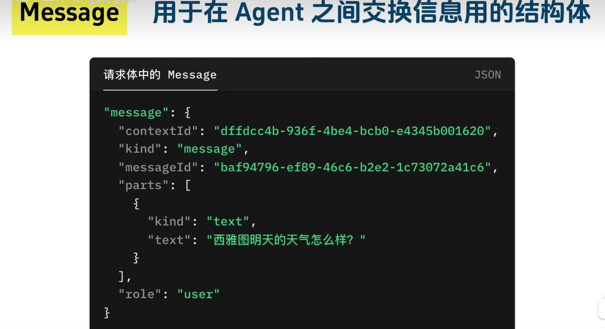
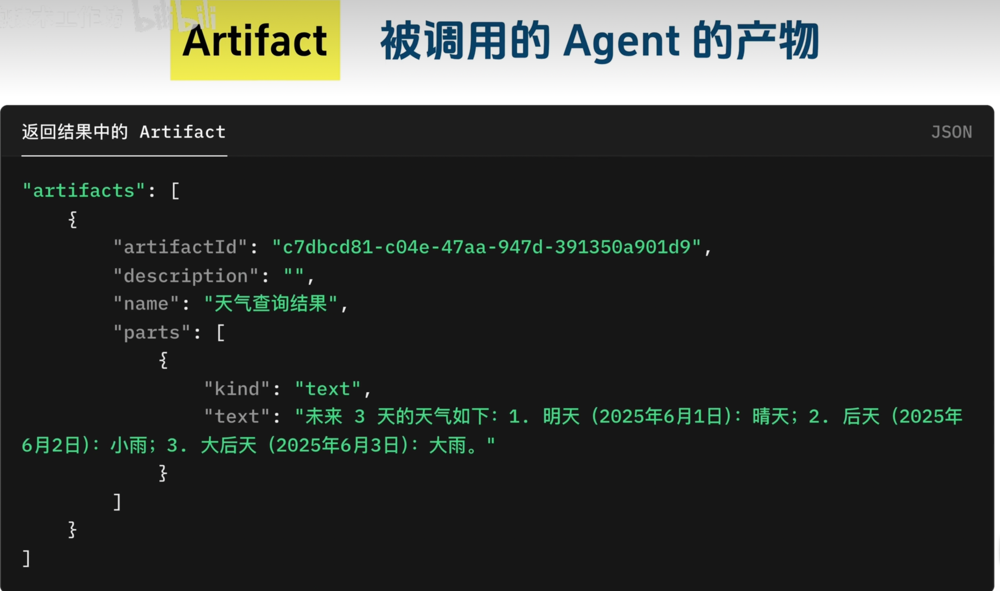
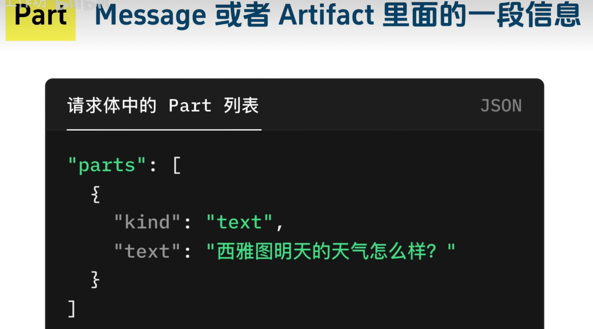
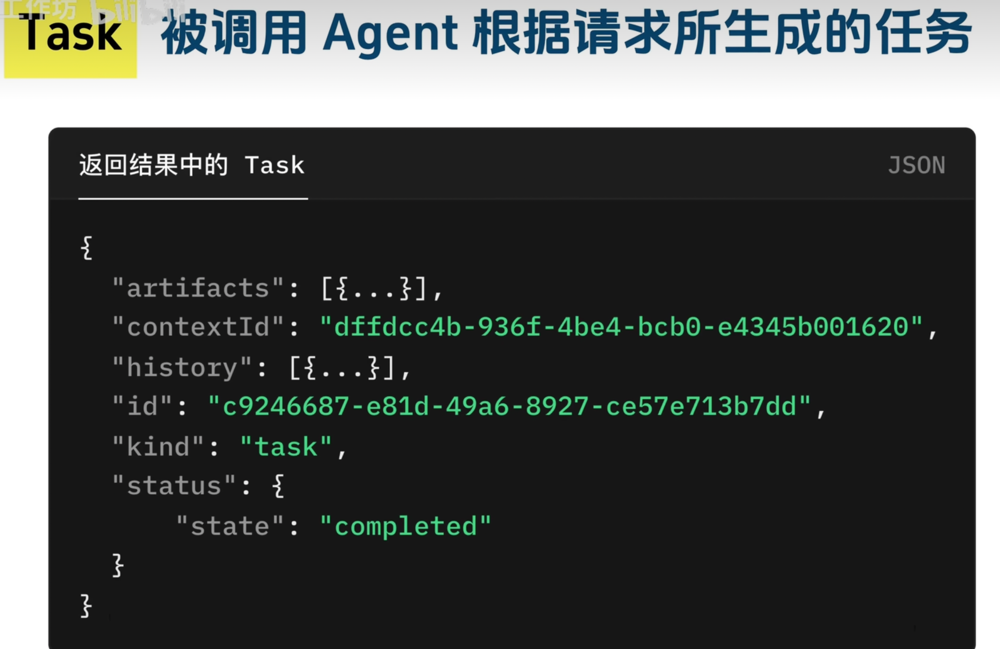

## 