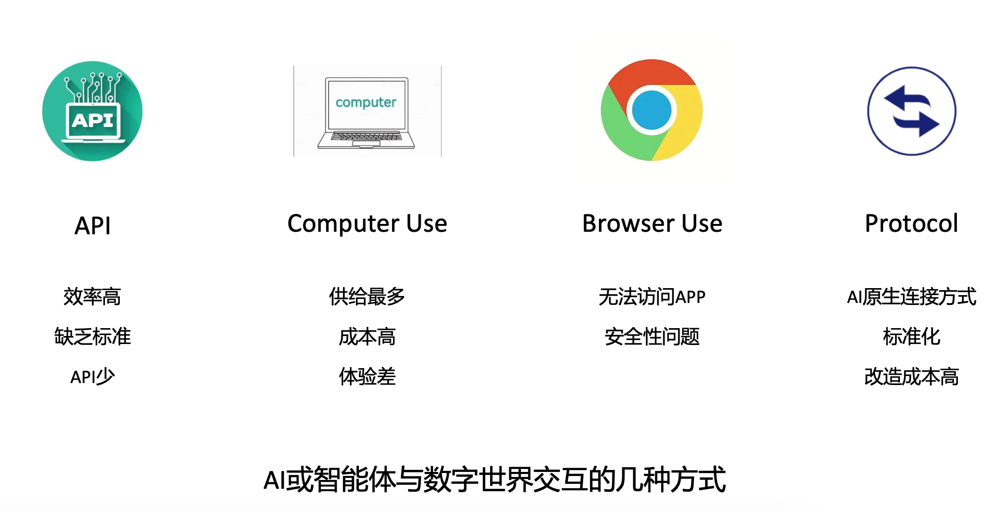
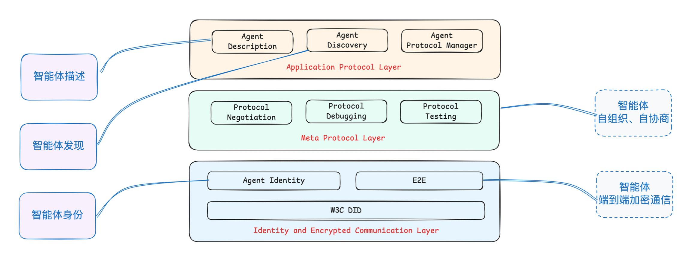
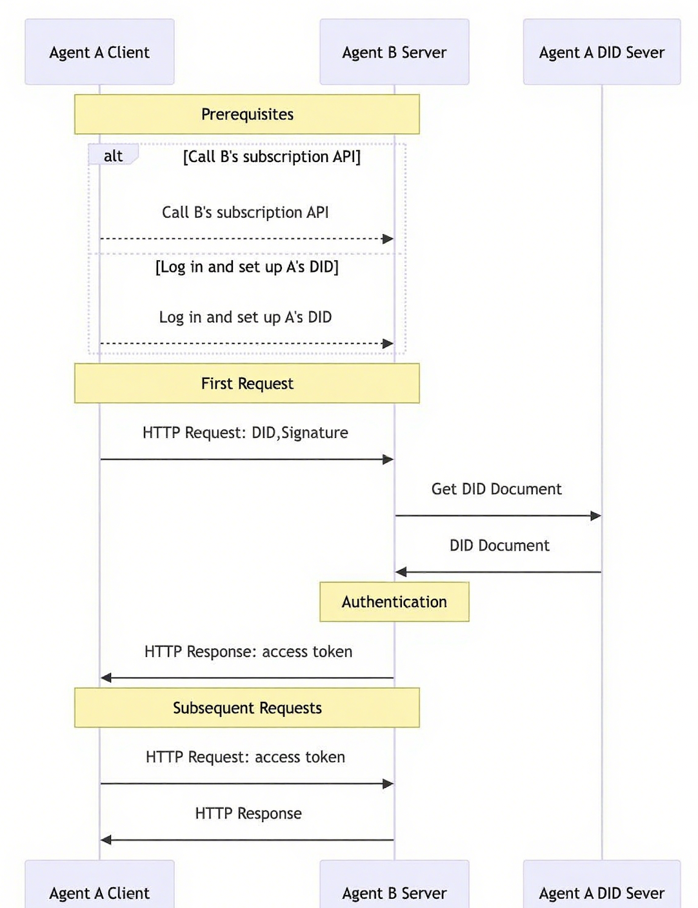
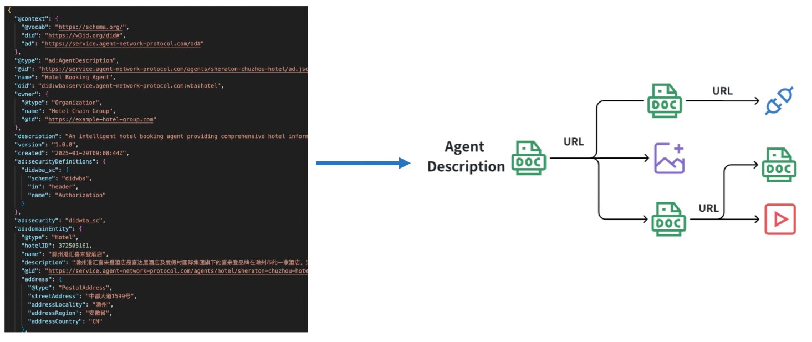
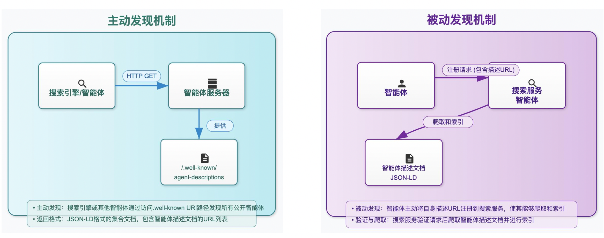
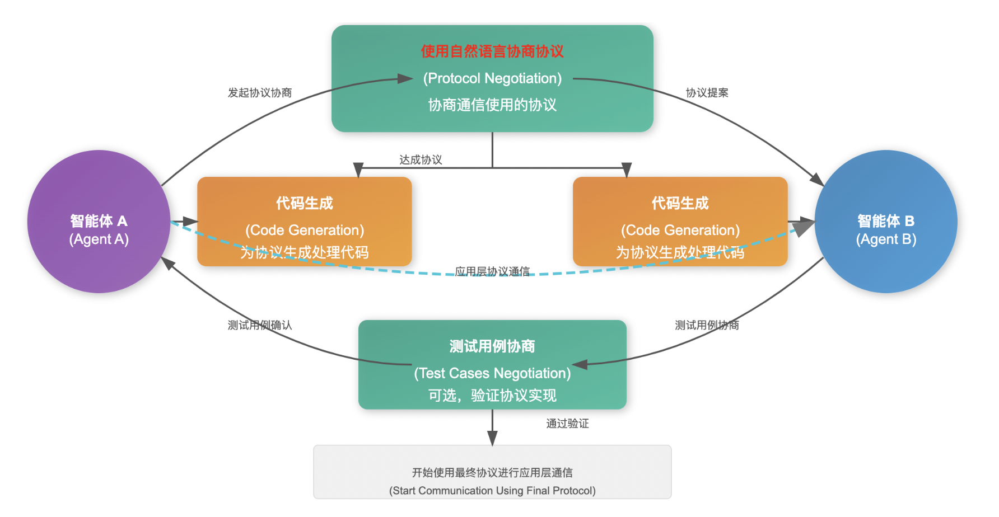
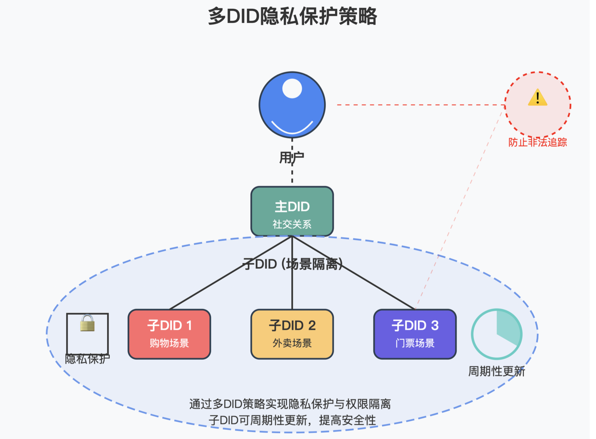
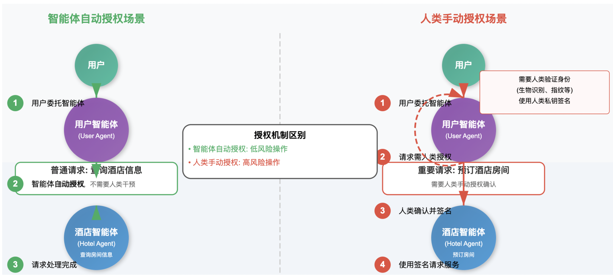
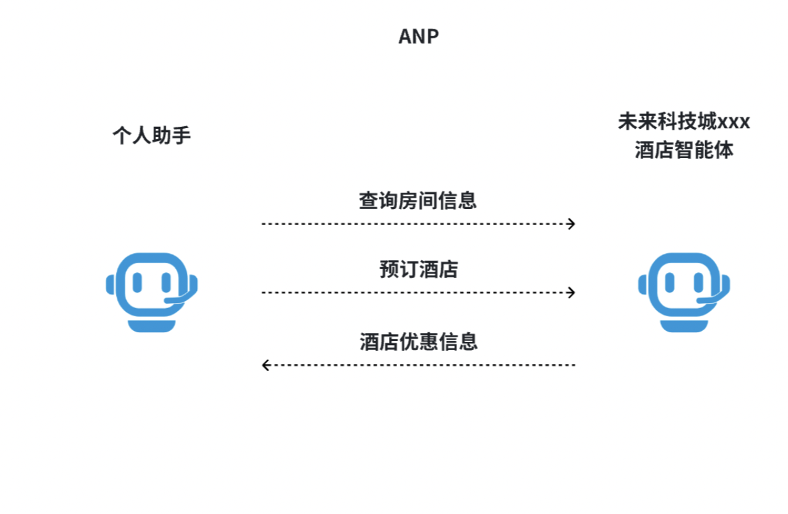
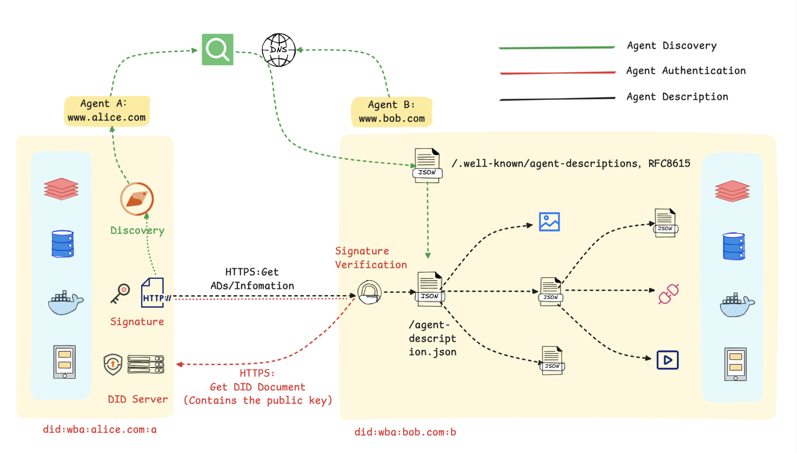

> 原文：https://ku.baidu-int.com/knowledge/HFVrC7hq1Q/KeF15lNOtH/-UXFkEkRyR/bXK-1BelVaThD2

ANP

# **ANP**
**Agent Network Protocol**

# 背景

# 愿景
ANP的愿景定义是Agent 之间的连接方式，为数十亿智能体构建一个开放、安全、高效的协作网络。

# 目标
* 成为智能体互联网时代的HTTP。
* 在智能体通信领域处于领先地位
* 让任意两个智能体都能够互联互通
* 构建便于AI访问的数据网络
* 让智能体能够自主组织、自主协商

# ANP分层架构

身份与加密通信层：基于W3C DID标准，我们构建了一个去中心化的身份认证方案，具有出色的扩展性，能支持数十亿用户规模。

元协议层：这是一个用于协商智能体之间通信协议的协议，是智能体网络进化为自组织、自协商、高效协作网络的关键。

应用协议层：基于语义网标准，使智能体能够描述自己的公开信息、可用能力和支持的接口，其他智能体可以据此发现并与之交互。

# 身份设计
### 目标
让所有智能体都能够相互认证对方的身份

### 遵循三个原则
* 去中心化，身份不应由少数厂商提供；
* 互操作性，不同系统间的身份应该能够轻松地相互认证；
* 可扩展性，系统应能支持大规模用户使用

最终选择基于W3C DID作为智能体身份方案的基础，正是因为它具有去中心化、互操作性和隐私安全特性

#### W3C DID
##### 定义
**DID全称Decentralized Identifier**，是一种用户自主管理、自主控制的数字身份标识符，在去中心化系统中广泛应用。它于2022年成为W3C正式推荐标准。

在此基础上，设计了**did:wba(****Web-Based Agent****)方法**。wba 方法能够充分利用现有的成熟技术和Web基础设施，在不需要彻底重构现有系统的情况下，轻松实现去中心化身份认证。各平台可以使用中心化方式管理自己的账户体系，同时为每个用户创建did:wba DID，以此实现平台之间的互联互通。

**类似email的业务特点**

##### **DID文档**
```json
{
    "@context": [
      "https://www.w3.org/ns/did/v1",
      "https://w3id.org/security/suites/jws-2020/v1",
      "https://w3id.org/security/suites/secp256k1-2019/v1",
      "https://w3id.org/security/suites/ed25519-2020/v1",
      "https://w3id.org/security/suites/x25519-2019/v1"
    ],
    "id": "did:wba:example.com%3A8800:user:alice",
    "verificationMethod": [
      {
        "id": "did:wba:example.com%3A8800:user:alice#WjKgJV7VRw3hmgU6--4v15c0Aewbcvat1BsRFTIqa5Q",
        "type": "EcdsaSecp256k1VerificationKey2019",
        "controller": "did:wba:example.com%3A8800:user:alice",
        "publicKeyJwk": {
          "crv": "secp256k1",
          "x": "NtngWpJUr-rlNNbs0u-Aa8e16OwSJu6UiFf0Rdo1oJ4",
          "y": "qN1jKupJlFsPFc1UkWinqljv4YE0mq_Ickwnjgasvmo",
          "kty": "EC",
          "kid": "WjKgJV7VRw3hmgU6--4v15c0Aewbcvat1BsRFTIqa5Q"
        }
      }
    ],
    "authentication": [
      "did:wba:example.com%3A8800:user:alice#WjKgJV7VRw3hmgU6--4v15c0Aewbcvat1BsRFTIqa5Q",
      {
        "id": "did:wba:example.com%3A8800:user:alice#key-1",
        "type": "Ed25519VerificationKey2020",
        "controller": "did:wba:example.com%3A8800:user:alice",
        "publicKeyMultibase": "zH3C2AVvLMv6gmMNam3uVAjZpfkcJCwDwnZn6z3wXmqPV"
      }
    ],
    "keyAgreement": [
      {
        "id": "did:wba:example.com%3A8800:user:alice#key-2",
        "type": "X25519KeyAgreementKey2019", 
        "controller": "did:wba:example.com%3A8800:user:alice",
        "publicKeyMultibase": "z9hFgmPVfmBZwRvFEyniQDBkz9LmV7gDEqytWyGZLmDXE"
      }
    ]
}
```
* authentication中的公钥用于身份验证。也就是说，只要对方能够安全的获取正确的DID文档，就可以获得正确的公钥。然后就可以使用公钥对用户的签名进行验证，从而验证用户的身份
* 文档的创建、更新、撤销有用户自己决定，比如用户可以选择将DID文档保存在自己的服务器上，也可以选择保存在第三方服务器上。无论存储在哪里，都要保证用户对DID文档的控制权
* 同时，用户还需要提供一个HTTP方法，用于让其他人安全的获取自己的DID文档。而获取DID文档的HTTP地址可以从DID转换得来。也就是说，只要用户有了DID，就可以使用HTTP获得对应DID文档。转换方法如下：

```json
did:wba:example.com:user:alice
 -> https://example.com/user/alice/did.json
```
##### 跨平台的身份认证过程
did:wba可以和HTTP协议结合使用，在一个HTTP请求中，完成身份认证、权限认证、数据交换等操作。他不增加额外的交互次数。下面是did:wba和HTTP协议结合的交互流程：


1. 前置条件：需要让Agent B知道Agent A的DID

* 用户A创建DID，并且将DID文档保存在Agent A 的DID server上。
* 用户A登录到Agent B的系统，并且设置A的DID。或者调用Agent B的订阅API，并设置订阅的DID为A的DID。

2. 身份验证流程：

* Agent A作为客户端发起HTTP请求，请求中除了请求数据外，还携带DID、nonce、时间戳、签名等信息。
* Agent B作为server收到请求后，从请求头中提取DID、nonce、时间戳、签名等信息。
* Agent B根据DID从Agent A的DID server中读取DID文档。
* Agent B使用DID文档中的公钥对客户端的签名进行验证。
* 验证通过后，Agent B处理客户端的业务请求，返回业务数据的同时，返回token。
* Agent A在后续请求中携带token，Agent B通过对token的验证，完成对客户端的身份认证。

从整个流程可以看出，使用HTTP，did:wba可以在不增加交互次数的情况下，完成身份认证。并且可以实现两个智能体（或应用）在互相通信的过程中，发起者直接调用对方的订阅接口订阅服务。而不用人工去对方系统注册。这降低了两个智能体之间互联互通的门槛。

[https://zhuanlan.zhihu.com/p/14740724544](https://zhuanlan.zhihu.com/p/14740724544)

# 智能体描述设计
基于语义网相关技术如JSON-LD、schema.org，让智能体能够对外公开其基本信息、能力、接口等，并且将这些信息链接成一个便于AI读取、便于AI理解的数据网络。

##### schema.org
是用于将结构化数据标记应用于网页和内容的词汇表的集合。(语义化的新华字典)

##### JSON-LD
在普通JSON数据基础上，通过添加少量的语义标注，逐步将其转换为具有丰富语义的链接数据（Linked Data）。这种渐进式的方法大大降低了语义网技术的学习门槛和采用成本

###### context机制
Context（上下文）是JSON-LD最核心的创新机制，它充当着JSON属性名与语义概念之间的映射字典。通过Context，开发者可以将简洁的JSON属性名映射到标准化的URI（Uniform Resource Identifier）或IRI（Internationalized Resource Identifier）

```json
{
  "@context": {
    "name": "http://schema.org/name",
    "age": "http://schema.org/age",
    "email": "http://schema.org/email"
  },
  "name": "张三",
  "age": 30,
  "email": "zhangsan@example.com"
}
```
在这个扩展版本中，`@context`对象将每个属性名映射到Schema.org词汇表中的对应概念。现在机器可以明确知道"name"属性指向的是Schema.org定义的姓名概念，而非任意的字符串标识符。

Context机制还支持更高级的特性，包括**类型强制**（Type Coercion）和**语言标记**（Language Tagging）。

```json
{
  "@context": {
    "name": "http://schema.org/name",
    "birthDate": {
      "@id": "http://schema.org/birthDate",
      "@type": "http://www.w3.org/2001/XMLSchema#date"
    },
    "description": {
      "@id": "http://schema.org/description",
      "@language": "zh"
    }
  },
  "name": "张三",
  "birthDate": "1990-01-01",
  "description": "软件工程师"
}

```
在这个示例中，类型强制确保"birthDate"的值被解释为日期类型，语言标记指明"description"的值使用中文。

###### 标识符&引用系统
JSON-LD通过`@id`关键字为数据对象提供全局唯一的标识符，这是实现**链接数据**的基础机制。标识符系统使得不同来源的数据可以通过引用关系相互连接，形成分布式的知识网络。

###### 类型系统与语义表达
`@type`关键字在JSON-LD中承担着语义分类的核心功能，它明确声明数据对象所属的**语义类别**。类型系统不仅提供了数据验证的基础，更重要的是为自动推理和知识发现创造了条件。



Agent（智能体）词汇表

|词汇术语|描述|是否必需|类型|
|-|-|-|-|
|@context|JSON-LD关键字，用于定义在AD文档中使用的简写名称（术语）。|必需|anyURI或Array|
|@type|JSON-LD关键字，用于为对象添加语义标签（或类型）。|可选|string或Array of string|
|@id|智能体的标识符，采用URI [RFC3986]格式（如稳定URI、临时和可变URI、带本地IP地址的URI、URN等）。|可选|anyURI|
|did|智能体的去中心化标识符（DID），用于唯一标识智能体的身份。|可选|string|
|name|提供基于默认语言的人类可读名称（如用于UI展示的文本）。|必需|string|
|description|基于默认语言提供额外的（人类可读）信息。|可选|string|
|version|提供版本信息。|可选|VersionInfo|
|created|提供AD实例创建时间信息。|可选|dateTime|
|modified|提供AD实例最后修改时间信息。|可选|dateTime|
|owner|提供智能体所有者信息。可以是个人或组织。|可选|Person或Organization|
|products|智能体提供的所有产品列表。|可选|Array of Product|
|services|智能体提供的所有服务列表。|可选|Array of Service|
|interfaces|智能体提供的所有接口定义。|可选|Array of Interface|
|security|安全定义名称集合，从securityDefinitions中选择。访问资源时必须满足所有安全要求。|必需|string或Array of string|
|securityDefinitions|命名安全配置集合（仅定义）。仅在security名称-值对中使用时才实际应用。|必需|Map of SecurityScheme|
|proof|完整性校验信息，防止AD文档被篡改|可选|Proof|

Interface（接口）

|词汇术语|描述|是否必需|类型|
|-|-|-|-|
|@type|接口类型。|必需|string|
|@id|接口的唯一标识符。|必需|anyURI|
|name|接口名称。|必需|string|
|description|接口的详细描述信息。|必需|string|
|protocol|接口使用的协议，当前支持YAML、JSON-RPC 2.0。|必需|string|
|url|接口定义文档的URL。|必需|anyURI|
|version|接口版本信息。|可选|string|
|security|接口的安全要求。|可选|SecurityScheme|

安全方案级别的词汇

|词汇术语|描述|是否必需|类型|
|-|-|-|-|
|@type|JSON-LD关键字，用于为对象添加语义标签。|可选|string或Array of string|
|description|基于默认语言提供额外的（人类可读）信息。|可选|string|
|scheme|安全机制的标识|必需|string|
|in|认证参数的位置。|必需|string|
|name|认证参数的名称。|必需|string|

# 发现设计
采用和Web站点类似的发现技术，基于DNS，搜索引擎就能够发现全网所有的智能体以及他们外的公开信息，便于智能体被访问、调用。



# 元协议设计 (理想化)
智能体先使用自然语言进行协议协商，协商出共识协议后，使用共识协议进行通信


# 权限细分控制
建议DID的提供者可以采用多DID的策略，即为一个用户生成多个DID，每个DID具有不同的角色和权限，使用不同的密钥对，从而实现隐私保护与细粒度的权限控制。


# 授权机制

# 整体交互


# A2A vs ANP
|特性/协议|A2A (Agent to Agent)|ANP (Agent Network Protocol)|
|-|-|-|
|解决的问题|智能体之间的协作|智能体在**互联网**上的连接与协作|
|设计原则|简单;复用现有协议;强调**Task**;|简单，复用现有协议;强调**身份**;|
|协议架构|P2P|P2P|
|传输层|HTTP|HTTP|
|智能体认证|OpenAPI支持的认证方式(HTTP<br/>认证、API Key、Cookie认证、<br/>OAuth 2.0、OpenID Connect)|W3C的DID方案|
|智能体描述|JSON (Agent Card)|JSON-LD, schema.org|
|智能体信息组织|JSON-RPC|Linked-Data (语义网)|
|适用场景|偏企业内部协作|智能体互联网，也可以用于企业内部协作|
|对行业影响|落地成本相对小，指导多智能体协作，与ANP为竞争关系|让行业更多的人关注智能体互联网， 让互联网从平台回归到连接|