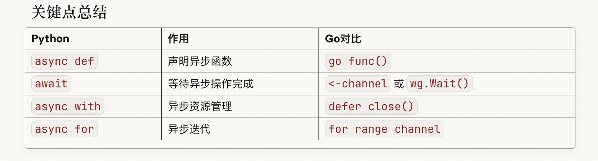
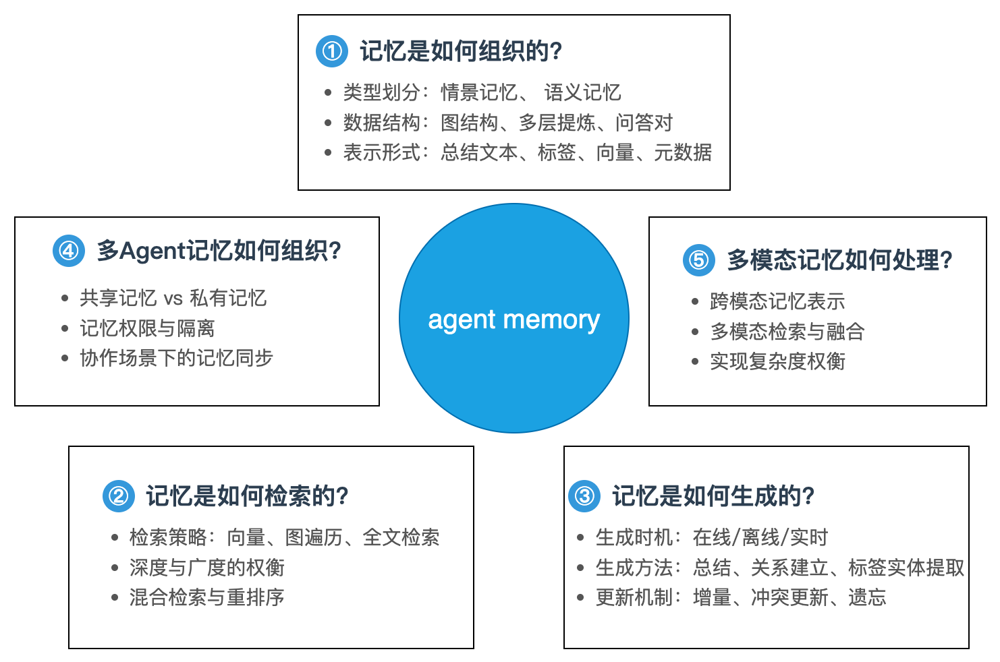
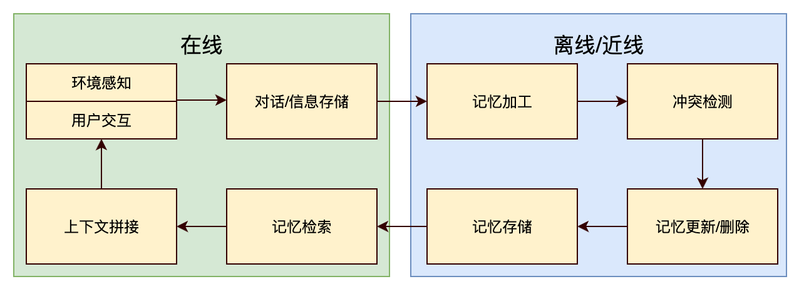
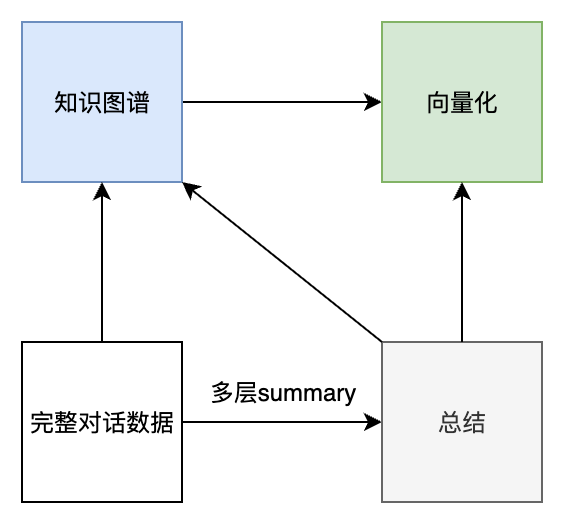
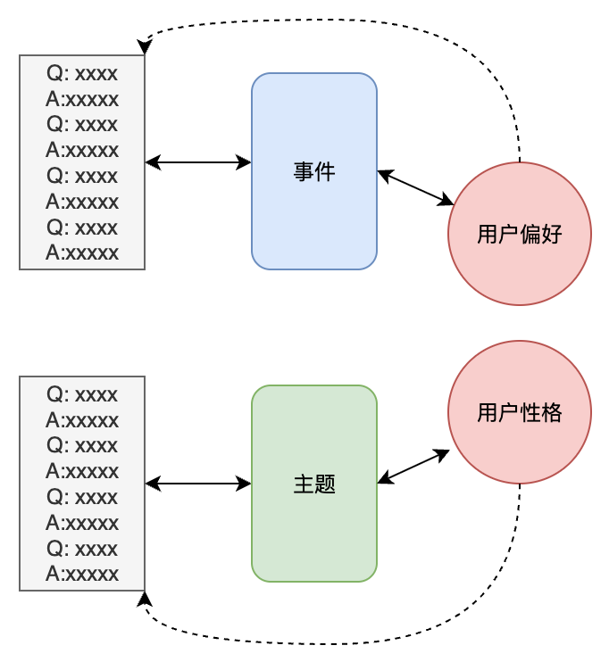

> 原文：https://ku.baidu-int.com/knowledge/HFVrC7hq1Q/KeF15lNOtH/-UXFkEkRyR/n1NH3dRUwTt8Yr

Agent User Memory分享

## 为什么需要agent memory?
* **突破上下文窗口限制**
    * 减少成本
    * 大量无关上下文会影响效果

* **提升个性化能力**
    * 记住用户偏好
    * 理解历史交互
    * 积累专家领域知识

* **支持复杂推理**
    * 多跳任务
    * 关联分散在不同会话的信息
    * 基于历史经验制定更优策略

* 举个🌰：
    * 打开claude记忆功能，长时间的交互让claude知道我是**Gopher**，在提及python相关语法时，会将go语言特性作对比，更容易理解新语法，加深印象



# 一、当我们在谈论Agent Memory的时候,我们在讨论什么?
## 1.1 agent memory的核心问题


## 1.2 memory系统的完整生命周期


# 二、记忆分类体系
> 建立清晰的记忆分类体系是设计Agent Memory系统的第一步。不同类型的记忆具有不同的特性,需要不同的存储、检索和更新策略。
## 2.1 按记忆类型分类
|分类|定义|内容|产生方式|
|-|-|-|-|
|情景记忆|情景记忆存储具体的、有时间和空间上下文的经验事件。它保留了"何时、何地、发生了什么"的完整信息。|* 完整的对话上下文<br/>* 时间戳、会话ID等元信息<br/>* 当时的环境信息<br/>* 基于多轮原始对话/环境的总结(仅总结描述当时的事件和环境信息)|用户交互数据实时生成|
|语义记忆|语义记忆存储抽象的、去情境化的知识和概念。它是从多次情景记忆中提炼出的规律性认知。|* 用户的长期偏好和信念(用户画像)<br/>* 抽象的知识、经验<br/>* 知识图谱<br/>* 领域专业知识|由情景记忆提炼而来|

* 情景记忆示例：

```json
{
    "interaction_index": 500,
    "observation": "我最近想开始长跑了，提供一些长跑建议",
    "system_response": "真的吗，太好了，长跑是xxxxx, 需要做好如下准备xxxxxxx",
    "memory_summarization": {
        "user_summary": "用户询问AI长跑的建议",
        "assistant_summary": "助手先对用户开始长跑的肯定，并提供了长跑建议"
        "summary": "用户询问长跑建议，AI给了相应的建议"
    },
    "timestamp": "2024-10-22T10:30:00Z"
}
```
* 语义记忆示例：

```json
{
  "user_portrait": "喜欢的运动：长跑",
  "entities": "[\"用户\"，\"长跑\"]",
  "edges": "[\"喜欢\"]"
}
```


### 2.2 按时间维度分类
|分类|定义|内容||
|-|-|-|-|
|短期记忆|当前会话或最近N轮交互|* 最近N条对话历史<br/>* 即时环境信息<br/>* 短期的会话总结|用户交互数据实时生成|
|长期记忆|跨会话,可能持续数天、数月甚至永久|* 用户画像<br/>* 知识图谱<br/>* 长时间跨度的会话总结|由短期记忆提炼而来|


### 2.3 按照显隐式分类
* 显示记忆：从用户对话可以直接看出
* 隐式记忆：需要挖掘当前/多轮交互后背后的意图，方法论、经验等


# 三、记忆的组织方式(数据结构)
> 记忆的组织方式是Agent Memory系统的核心架构选择,它决定了系统的能力边界、性能特征和工程复杂度。
> 记忆的组织方式主要有：
> * 图结构
> * summary
> * 完整的对话
> * 向量
> * 模型参数
> 


* 通过任何一种形式的数据都可以找到与之对应的其他形式的数据
* 一般情况完整的对话数据不做向量化处理，成本太高

## 3.1 主流数据组织形式
### 3.1.1 图结构
#### **核心思想**:
*  将记忆实体建模为图的节点,实体间的关系建模为边,形成一个可遍历的知识网络，一般用来表示语义记忆，但也可以将情景记忆作为知识图谱的一个顶点与语义信息关联

#### **数据结构**:
```
记忆图谱 G = (V1, E， V2)  

V: 语义顶点集合(实体对象)         如：人物、物体、爱好
E: 语义边集合(实体关系/三元组)     如：任务关系、用户喜好、位置信息
```
#### **典型实现:**
* ** AriGraph：一个用来解决多跳任务的研究**

AriGraph将认知科学的"情景记忆+语义记忆"思想映射到图结构:

1. **语义记忆**: 以三元组形式存储

```
(subject, relation, object)
例: ("金色钥匙", "位于", "厨房桌子")
    ("厨房", "连接", "餐厅")
    ("金色钥匙", "可以打开", "宝箱")
```
2. **情景记忆**: 完整的观察文本作为情景节点

```
Episode_42: "你在厨房看到一把金色钥匙在桌子上"
```
3. **情景边**: 连接情景节点与其包含的所有三元组(超边设计)

```
Episode_42 --[CONTAINS_TRIPLETS]--> {Triplet_1, Triplet_2, Triplet_3}
```
4. **存储实现**: 图 + 向量

```python
# Neo4j存储图结构
CREATE (key:Entity {name: "金色钥匙", type: "object"})
CREATE (table:Entity {name: "厨房桌子", type: "furniture"})
CREATE (key)-[:LOCATED_AT {
    confidence: 0.95,
    timestamp: 1698765432
}]->(table)

# Chroma/Faiss存储向量用于快速检索
{
    "id": "triplet_001",
    "vector": [0.23, -0.45, 0.67, ...],  # 768维
    "metadata": {
        "triplet_text": "金色钥匙 位于 厨房桌子",
        "confidence": 0.92
    }
}
```
#### **优劣势分析**
|优势|劣势|适用场景|
|-|-|-|
|1. **天然支持多跳查询**<br/>2. **能够表达复杂关系**<br/>    * 支持多种关系类型(空间、因果、时序等)<br/>    * 可以表示关系的属性(置信度、时效性等)<br/>    * 便于表达层次结构和分类<br/>3. **便于推理与知识发现**<br/>    * 通过图遍历发现隐含关系<br/>    * 支持路径查询、子图匹配等高级操作<br/>    * 可以应用图算法(如PageRank)计算实体重要性|1. **图构建复杂度高**<br/>    * 需要准确的实体识别和关系抽取<br/>    * 实体消歧和链接(同一实体的不同表述需要合并)<br/>    * 关系类型的设计和标准化<br/>2. **查询效率问题**<br/>    * 大规模图的遍历计算成本高<br/>    * 深度搜索可能导致指数级复杂度<br/>    * 需要设计有效的剪枝策略<br/>3. **关系维护成本**<br/>    * 信息更新时需要检测和解决冲突<br/>    * 关系的时效性管理(哪些关系会随时间失效)<br/>    * 图的增长控制(避免无限膨胀)|* 需要复杂推理的场景(如游戏Agent、问答系统)<br/>* 实体关系丰富、实体类型可枚举的领域(如社交网络)<br/>* 需要可解释性的系统(可以展示推理路径)|

* **多跳查询示例**

```
查询: "如何获得宝藏?"
推理链路:
宝藏 ← [需要] ← 金色钥匙 ← [位于] ← 厨房桌子 ← [在] ← 厨房

结论: 去厨房找桌子上的金色钥匙,就能打开宝箱获得宝藏

查询："小明的朋友的朋友都有谁？"
推理链路:
小明 ← [朋友] ← 小李 ← [朋友] ← 小刚
                           ← 小华
              小赵 ← [朋友] ← 小王
                           ← 小刚
                           

结论: 小明的朋友的朋友是小刚、小华、小王
```
### 3.1.2 总结文本
#### **核心思想**: 
* 通过LLM的总结能力,将原始对话逐层提炼为不同抽象层次的记忆,形成金字塔式的层次结构。

#### 数据结构:
```
【层级3】全局总结(最抽象)
    用户画像、长期偏好、核心知识
         ↑ [周期性总结]
【层级2】阶段性摘要(中等抽象)  
    每日/每周事件概要、主题聚类
         ↑ [定期总结]
【层级1】原始记录(最具体)
    完整的对话历史、详细的交互记录
```
#### **典型实现**
* ** MemoryBank**

1. **会话记录层**(Session Level)

```json
{
  "session_id": "20241022_001",
  "conversations": [
    {"user": "你还记得我喜欢什么运动吗?", 
     "assistant": "是的,你喜欢游泳、徒步和旅行..."},
    {...}
  ],
  "timestamp": "2024-10-22"
}
```
2. **事件摘要层**(Event Summary)

```json
{
  "date": "2024-10-22",
  "daily_summary": "用户询问其运动偏好,讨论了即将开始的跑步计划,分享了对户外活动的热爱",
  "key_topics": ["运动偏好", "跑步计划", "户外活动"],
  "important_facts": [
    "用户喜欢游泳、徒步和旅行",
    "计划开始跑步训练"
  ]
}
```
3. **用户画像层**(User Portrait)

```json
{
  "personality": "开放、好奇、乐于接受建议",
  "interests": ["户外运动", "阅读", "艺术"],
  "preferences": {
    "sports": ["游泳", "徒步", "跑步"],
    "communication_style": "友好详细"
  },
  "long_term_goals": ["保持健康", "提高绘画技能"]
}
```
#### **优劣势分析**:
|优势|劣势|适用场景|
|-|-|-|
|1. **不同粒度满足不同需求**<br/>    * 需要具体细节时查询原始层<br/>    * 需要快速概览时查询摘要层<br/>    * 需要长期理解时查询画像层<br/>2. **信息密度高**<br/>    * 通过层层压缩,去除冗余<br/>    * 高层记忆token消耗极低<br/>    * 示例: 数千条对话→数百token的画像<br/>3. **便于管理记忆容量**<br/>    * 可以对不同层级设置不同的保留策略<br/>    * 原始记录可以定期归档或删除<br/>    * 高层摘要长期保留|1. **总结质量依赖LLM能力**<br/>    * 总结可能遗漏关键信息<br/>    * 可能产生幻觉(hallucination)<br/>    * 多次总结会累积误差<br/>2. **层次划分需要经验**<br/>    * 层数太少:粒度不够灵活<br/>    * 层数太多:系统复杂度增加<br/>    * 每层的抽象程度难以精确控制<br/>3. **可能丢失细节信息**<br/>    * 总结过程不可逆<br/>    * 某些重要但"不常见"的信息可能被过滤<br/>    * 需要保留原始记录作为备份|* 长期对话系统(如个人助手、AI伴侣)<br/>* 大规模用户场景(需要控制每用户的存储成本)<br/>* 需要多粒度信息访问的应用|

### 3.1.3 完整问答对
#### **核心思想**: 
* 不做任何总结或提炼,直接保留完整的用户问题和Agent回答。

#### **数据结构**:
```python
memory_records = [
    {
        "id": 1,
        "user_query": "今天天气怎么样?",
        "agent_response": "今天北京天气晴朗,温度20-28°C,适合外出活动。",
        "timestamp": "2024-10-22 09:00:00",
        "session_id": "session_001"
    },
    {
        "id": 2,
        "user_query": "推荐一个适合跑步的公园",
        "agent_response": "奥林匹克森林公园非常适合跑步,有专门的跑道,空气好,景色美...",
        "timestamp": "2024-10-22 09:05:00",
        "session_id": "session_001"
    },
    # ... 更多记录
]
```
#### **检索方式**:
1. **时间序列检索**: 取最近N条记录

```python
recent_memories = get_recent_k_records(k=10)
```
2. **向量相似度检索**:

```python
# 将QA对拼接后编码
for record in memory_records:
    record['embedding'] = embedding_model.encode(
        record['user_query'] + " " + record['agent_response']
    )

# 检索相似记录
relevant_memories = vector_search(query_embedding, top_k=5)
```
3. **关键词过滤**:

```python
filtered_memories = [
    m for m in memory_records 
    if any(keyword in m['user_query'] or keyword in m['agent_response'] 
           for keyword in ['跑步', '运动', '公园'])
]
```
#### 优劣势分析:
|优势|劣势|适用场景|
|-|-|-|
|1. **实现简单**<br/>    * 无需复杂的总结逻辑<br/>    * 无需实体识别和关系抽取<br/>    * 存储和查询逻辑直观<br/>2. **信息完整**<br/>    * 保留所有原始上下文<br/>    * 不存在信息丢失或失真<br/>    * 可以精确还原历史对话<br/>3. **易于理解与调试**<br/>    * 系统行为可追溯<br/>    * 问题定位简单<br/>    * 便于人工审查和标注|1. **存储空间大**<br/>    * 未经压缩,占用大量存储<br/>    * 随着交互增多线性增长<br/>    * 成本随用户规模快速膨胀<br/>2. **语义冗余**<br/>    * 大量相似或重复的内容<br/>    * 信息密度低<br/>    * 检索时引入噪声<br/>3. **检索效率低**<br/>    * 向量数量庞大,检索变慢<br/>    * 难以快速定位关键信息<br/>    * Top-K可能miss重要但不相似的记录|* 小规模系统或POC阶段<br/>* 冷启动阶段(积累数据用于后续提炼)<br/>* 对信息完整性要求极高的场景(如法律、医疗)|

### 3.1.4 向量化表示
#### 核心思想：
* 目的：将记忆信息向量化，便于语义相关检索

#### 典型实现：
* 图结构：
    * 将记忆图三元组结构拼接成语义信息再向量化，用于检索


```json
对于一个三元组：[小明，喜欢，运动]
可以先拼成有语义的句子: 小明喜欢运动
将拼接后的句子 ”小明喜欢运动“ 向量化
```
    * 分别对三元组结构向量化，用于检索

```json
对于一个三元组：[小明，喜欢，运动]
可以分别对三元组对象向量化: 小明、喜欢、运动
查询时对query做相似性检索，如先找到小明这个向量，就可以找到与它临近的所有向量，根据语义关系做筛选
```
* summary：直接向量化，做相似性检索

### 3.1.5 模型参数的一部分
* 有的论文将用户的数据内置到模型参数中，如每个用户有一个lora模型参数，根据不同的用户动态加载

## 3.2 共性问题分析
无论选择哪种组织方式,都需要面对以下共性问题:

### 3.2.1 如何平衡结构复杂度与查询效率
**问题**: 更复杂的结构通常能表达更丰富的信息,但也带来更高的查询成本。

**解决思路**:

1. **分层索引**

```
L1: 快速索引(向量/关键词) → 粗筛候选
L2: 精细结构(图/层次) → 精排和推理
```
2. **缓存热点数据**

```python
class MemoryCache:
    def __init__(self):
        self.hot_cache = LRUCache(maxsize=1000)  # 最近访问的记忆
        self.cold_storage = Database()  # 完整存储
```
3. **按需加载**

    * 初次查询只返回摘要
    * 需要详情时再加载完整内容

### 3.4.2 如何处理记忆冗余
**问题**: 重复或高度相似的记忆占用空间且引入噪声。

**解决思路**:

1. **去重检测**

```python
def is_duplicate(new_memory, existing_memories, threshold=0.95):
    for existing in existing_memories:
        similarity = cosine_similarity(
            new_memory.embedding, 
            existing.embedding
        )
        if similarity > threshold:
            return True, existing
    return False, None
```
2. **合并策略**

```python
def merge_memories(memory1, memory2):
    # 保留更完整的内容
    # 合并时间范围
    # 提升重要性得分(被提及多次说明重要)
    return merged_memory
```
3. **定期压缩**

    * 将多条相似记忆总结为一条
    * 保留引用计数

### 3.4.3 如何维护记忆一致性
**问题**: 新信息可能与旧记忆冲突(如用户换了手机号、搬了家)。

**解决思路**:

1. **冲突检测**

```python
def detect_conflict(new_fact, old_facts):
    # 检测同一实体的同一属性是否有不同值
    # 例: ("用户", "手机号", "138****") vs ("用户", "手机号", "186****")
    conflicts = []
    for old_fact in old_facts:
        if (new_fact.subject == old_fact.subject and 
            new_fact.relation == old_fact.relation and
            new_fact.object != old_fact.object):
            conflicts.append(old_fact)
    return conflicts
```
2. **解决策略**

    * **时间优先**: 新信息覆盖旧信息
    * **可信度优先**: 保留更可信的信息
    * **LLM判断**: 让LLM决定哪个是正确的
    * **版本保留**: 同时保留多个版本,标注时间范围

3. **用户确认**

```python
if conflicts:
    ask_user(f"你的手机号是{old}还是{new}?")
```
### 3.4.4 如何选择合适的粒度
**问题**: 记忆太细碎导致检索困难,太粗糙导致信息丢失。

**最佳实践**:

|场景|推荐粒度|示例|
|-|-|-|
|事实性信息|单个三元组|("用户", "居住在", "北京")|
|事件|单次交互或会话|"用户询问运动推荐,讨论了跑步计划"|
|长期特征|多次交互提炼|"用户是运动爱好者,偏好户外活动"|

**动态粒度**:

```python
def determine_memory_granularity(content, context):
    if is_simple_fact(content):
        return "atomic"  # 原子级(三元组)
    elif is_complex_event(content):
        return "event"  # 事件级
    elif needs_summarization(content, context):
        return "summarized"  # 总结级
    else:
        return "full"  # 完整保留
```


# 四、记忆的生成机制
> 记忆的生成是Agent Memory系统的核心环节,它决定了原始交互数据如何转化为结构化的、可检索的记忆单元。本章将深入探讨生成的时机选择、方法论以及不同论文方案的对比。
## 4.1 生成时机的选择
记忆生成的时机直接影响系统的实时性、成本和质量。主要有三种模式:

#### 4.1.1 在线触发、离线更新
#### **核心思想**:
* 在线交互时快速收集数据,在离线时批量处理生成记忆,不阻塞用户体验。

#### **工作流程**
```
用户交互(实时) → 原始数据收集 → 消息队列 
                                      ↓
                          定时任务触发(如每日凌晨)
                                      ↓
                          批量调用LLM生成摘要
                                      ↓
                          更新记忆数据库
```
#### **典型实现: **
* **MemoryBank**

MemoryBank采用离线批处理模式,在对话结束后进行记忆提炼:

```python
class MemoryBankUpdater:
    def __init__(self, llm, vector_db, metadata_db):
        self.llm = llm
        self.vector_db = vector_db
        self.metadata_db = metadata_db
    
    def daily_update_job(self, user_id, date):
        """每日定时任务: 生成当天的记忆摘要"""
        # 1. 从原始日志中提取当天的对话
        conversations = self.get_daily_conversations(user_id, date)
        
        if not conversations:
            return
        
        # 2. 生成每日事件摘要
        daily_summary = self.generate_daily_summary(conversations)
        
        # 3. 更新或生成用户画像
        user_portrait = self.update_user_portrait(
            user_id, 
            daily_summary, 
            conversations
        )
        
        # 4. 生成嵌入向量
        summary_embedding = self.embed(daily_summary['text'])
        portrait_embedding = self.embed(user_portrait['text'])
        
        # 5. 存入数据库
        self.save_memory(
            user_id=user_id,
            date=date,
            conversations=conversations,
            daily_summary=daily_summary,
            user_portrait=user_portrait,
            embeddings={
                'summary': summary_embedding,
                'portrait': portrait_embedding
            }
        )
    
    def generate_daily_summary(self, conversations):
        """使用LLM生成每日摘要"""
        prompt = f"""
请总结以下一天的对话,提取关键事件和信息:

对话内容:
{self.format_conversations(conversations)}

请以JSON格式返回:
{{
  "daily_summary": "一句话概括当天的主要内容",
  "key_topics": ["主题1", "主题2"],
  "important_facts": ["事实1", "事实2"],
  "user_emotions": "用户的主要情绪状态"
}}
"""
        response = self.llm.generate(prompt)
        return json.loads(response)
    
    def update_user_portrait(self, user_id, daily_summary, conversations):
        """更新用户画像"""
        # 获取历史画像
        old_portrait = self.metadata_db.get_user_portrait(user_id)
        
        prompt = f"""
基于用户的历史画像和今天的对话,更新用户画像:

历史画像:
{json.dumps(old_portrait, ensure_ascii=False, indent=2)}

今日摘要:
{json.dumps(daily_summary, ensure_ascii=False, indent=2)}

请生成更新后的用户画像(JSON格式):
{{
  "personality": "性格特征",
  "interests": ["兴趣1", "兴趣2"],
  "preferences": {{"偏好类别": "具体偏好"}},
  "long_term_goals": ["目标1", "目标2"],
  "communication_style": "沟通风格描述"
}}
"""
        response = self.llm.generate(prompt)
        new_portrait = json.loads(response)
        
        return new_portrait
```
#### **触发机制**:
|触发条件|说明|适用场景|
|-|-|-|
|会话结束|用户结束对话后触发|明确的会话边界(如客服系统)|
|固定时间|每天凌晨定时处理|长期对话系统(如个人助手)|
|数量阈值|累积N条新对话后触发|高频交互场景|
|手动触发|管理员或用户主动触发|测试、调试场景|

**优劣势分析**:

|优势|劣势|
|-|-|
|1. 不影响在线响应速度: 用户交互时无需等待记忆生成<br/>2. 可以进行复杂处理:<br/>    * 有充足时间调用多次LLM<br/>    * 可以进行跨天、跨周的统计分析<br/>    * 可以执行计算密集型任务(如聚类、关系抽取)<br/>3. 批量处理更经济:<br/>    * 可以使用更便宜的批量推理API<br/>    * 可以在低峰期处理,降低成本，利用潮汐流量<br/>4. 容错性强: 处理失败可以重试,不影响用户体验|1. 记忆时效性差: 新信息无法立即用于响应<br/>2. 需要额外基础设施: 消息队列、定时任务调度系统<br/>3. 冷启动问题: 新用户初期缺乏记忆|

### 4.1.2 实时生成
#### **核心思想**: 
* 每次交互后立即生成记忆,保证记忆的实时性。

#### **工作流程**:
```
用户输入 → Agent响应 → 立即生成记忆摘要 → 存入数据库 → 返回响应给用户
```


**优劣势分析**:

|优势|劣势|
|-|-|
|1. 记忆时效性强: 新信息立即可用,下一轮对话就能检索<br/>2. 无需额外基础设施: 不需要消息队列和定时任务<br/>3. 逻辑简单: 生成和存储在同一个请求中完成|1. 增加响应延迟:<br/>    * 需要额外调用LLM生成摘要(~1-2秒)<br/>    * 需要生成嵌入向量(~0.1秒)<br/>    * 需要写入数据库(~0.1秒)<br/>    * 总延迟增加: ~1-2秒<br/>2. 成本较高:<br/>    * 每轮对话都要调用LLM生成摘要<br/>    * API调用次数翻倍(对话生成1次 + 摘要生成1次)<br/>3. 缺乏全局视角:<br/>    * 无法进行跨对话的聚合分析<br/>    * 难以生成高层次的用户画像|

## 4.2 生成方法论
> 无论采用哪种生成时机,都需要使用具体的技术方法将原始数据转化为 结构化记忆 和  易于检索的方式
### 4.2.1 LLM总结与提炼
#### **核心能力**:
* 利用LLM的理解和生成能力,从冗长的对话中提取核心信息，意在生成减少冗余信息、增加信息稠密度、生成结构化的数据、挖掘记忆之间的关联

#### 工作流程
* 确定记忆的组织方式、以及检索策略
* 确定要提取记忆的内容：事件类型、主题、用户偏好
* 设计prompt提取相关内容
* llm反思

### 4.2.2 关系建立
> 在记忆单元之间建立连接,形成网络结构,支持关联查询和推理。


#### 核心能力
* (基础) 建立完整对话历史和抽象记忆之间的链接，既可以回忆出完整对话、也可以使用简洁的上下文
* (提高) 抽象记忆之间的链接，增强单一相似性检索&全文检索的相关记忆丰富度，挖掘用户的隐藏需求

#### 实现方式：
* llm对原始记忆做总结时，默认增加session、用户ID、事件等参数关联
* 基于相似度建立连接

```python
def build_similarity_links(new_memory, existing_memories, threshold=0.75):
    """基于向量相似度自动建立连接"""
    links = []
    
    new_embedding = new_memory['embedding']
    
    for existing_memory in existing_memories:
        similarity = cosine_similarity(
            new_embedding, 
            existing_memory['embedding']
        )
        
        if similarity >= threshold:
            links.append({
                'from': new_memory['id'],
                'to': existing_memory['id'],
                'type': 'similar_to',
                'weight': similarity,
                'created_at': datetime.now()
            })
    
    return links
```
* 基于LLM判断的语义关系:

```python
def build_semantic_links(new_memory, existing_memories):
    """使用LLM判断语义关系"""
    links = []
    
    # 先用向量检索找出Top-K候选
    candidates = vector_search(new_memory['embedding'], top_k=10)
    
    for candidate in candidates:
        # 让LLM判断关系类型
        prompt = f"""
判断以下两条记忆之间的关系:

记忆A: {new_memory['content']}
记忆B: {candidate['content']}

可能的关系类型:
- cause_effect: A是B的原因或结果
- temporal: A和B有时间先后关系
- contradiction: A和B相互矛盾
- elaboration: A是B的详细说明
- none: 无明显关系

请回答关系类型和置信度:
"""
        response = llm.generate(prompt)
        relation = parse_relation(response)
        
        if relation['type'] != 'none' and relation['confidence'] > 0.7:
            links.append({
                'from': new_memory['id'],
                'to': candidate['id'],
                'type': relation['type'],
                'weight': relation['confidence'],
                'created_at': datetime.now()
            })
    
    return links
```
### 4.2.3 标签和元数据提取
> 为记忆打上标签,便于分类检索和过滤。 
通常使用LLM根据需求做标签，略


### 4.2.4 会话的分隔：
#### 核心思想
* 设计LLM总结历史对话记录的粒度，影响记忆总结模块的成本和效果

#### 分隔方式
* 固定策略：
    * 不同会话的历史记录
    * 同一会话限制N条记录

* LLM语义分割

```
指令

背景

• 目标：你的任务是根据语义将用户与聊天机器人之间的多轮对话分割成主题连贯的单元。同一主题的连续用户-机器人对话轮次应归为同一分段单元，当主题发生转换时应创建新的分段单元。  

• 数据：输入数据是一系列由“\n\n”分隔的用户-机器人对话轮次。每个轮次包含用户与聊天机器人之间的一轮对话，以“[Exchange (轮次编号)]: ”开头。  

输出格式

• 以 JSONL（JSON行） 格式输出分割结果。每个字典代表一个分段，包含一个或多个同一主题的用户-机器人对话轮次。  

每个字典应包含以下键：  
• segment_id：该分段的索引，从0开始。  

• start_exchange_number：该分段中第一个用户-机器人对话轮次的编号。  

• end_exchange_number：该分段中最后一个用户-机器人对话轮次的编号。  

• num_exchanges：该分段中的用户-机器人对话轮次数量，计算公式为：  

end_exchange_number - start_exchange_number + 1。  

以下是预期输出示例：  
‘‘‘  
<segmentation>  
{"segment_id": 0, "start_exchange_number": 0, "end_exchange_number": 5, "num_exchanges": 6}  
{"segment_id": 1, "start_exchange_number": 6, "end_exchange_number": 8, "num_exchanges": 3}  
...  
</segmentation>  
‘‘‘  

数据

{{待分割文本}}  

问题

请根据以下要求从输入数据生成分割结果：

• 无遗漏轮次：确保分段覆盖对话中的所有轮次，无遗漏。  

• 无重叠轮次：确保连续分段之间无重叠的轮次。  

• 准确计数：所有分段的 num_exchanges 之和应等于用户-机器人对话轮次的总数。  

• 请将分割结果置于以下标签之间：  

<segmentation></segmentation>。  

输出

请根据以上指令生成分割结果。
```
* 混合分隔方式
    * 不同会话历史记录
    * 同一个会话记录使用LLM语义分割


# 五、记忆的检索机制
> 记忆检索是Agent Memory系统的关键环节,直接决定了系统能否在海量记忆中快速准确地找到相关信息。本章将深入探讨各种检索方式及其优化策略。
## 5.1 检索方式的分类
### 5.1.1 向量相似度检索
#### **核心原理**: 
* 将查询和记忆都编码为高维向量,通过计算向量间的距离(如余弦相似度)来衡量语义相关性。

#### **数学基础**:
```
余弦相似度 = cos(θ) = (A · B) / (||A|| × ||B||)

其中:
A = 查询向量
B = 记忆向量
```
#### **实现流程**:
```python
class VectorMemoryRetriever:
    def __init__(self, vector_db, embedding_model):
        self.vector_db = vector_db  # Chroma/Pinecone/Milvus
        self.embedding_model = embedding_model  # text-embedding-ada-002
    
    def retrieve(self, query, top_k=5, threshold=0.7):
        """基于向量相似度检索记忆"""
        
        # 1. 查询向量化
        query_vector = self.embedding_model.encode(query)
        # 输出: np.array([0.23, -0.45, 0.67, ...])  # 768维或1536维
        
        # 2. 向量相似性搜索
        results = self.vector_db.similarity_search(
            query_vector=query_vector,
            top_k=top_k,
            metric='cosine'  # 或 'euclidean', 'dot_product'
        )
        
        # 3. 过滤低相似度结果
        filtered_results = [
            r for r in results 
            if r['similarity'] >= threshold
        ]
        
        # 4. 获取完整记忆内容
        memories = []
        for result in filtered_results:
            memory = self.get_memory_by_id(result['memory_id'])
            memory['similarity_score'] = result['similarity']
            memories.append(memory)
        
        return memories
```
#### **相似度计算示例**:
```
查询: "我最喜欢什么运动?"
查询向量: [0.15, 0.32, -0.21, 0.45, ...]

记忆1: "用户喜欢游泳、徒步和旅行"
记忆1向量: [0.18, 0.35, -0.19, 0.42, ...]
相似度: 0.92 ✓ 高度相关

记忆2: "用户计划开始跑步训练"
记忆2向量: [0.14, 0.28, -0.15, 0.38, ...]
相似度: 0.85 ✓ 较相关

记忆3: "今天天气很好"
记忆3向量: [-0.12, 0.08, 0.35, -0.22, ...]
相似度: 0.23 ✗ 不相关
```
#### 优劣势分析：
|优势|劣势|
|-|-|
|1. **语义理解能力强**: 能够匹配同义词、改写表达<br/>    * 查询"我爱好什么" 能匹配到 "用户喜欢游泳"<br/>2. **跨语言检索**: 多语言embedding可以支持跨语言查询<br/>3. **检索速度快**: ANN(近似最近邻)算法,亚秒级响应|1. **依赖embedding质量**:<br/>    * 不同embedding模型效果差异大<br/>    * 需要选择适合领域的模型<br/>2. **难以处理复杂逻辑**:<br/>    * 无法处理"非"、"或"、"且"等逻辑关系<br/>    * 例: "喜欢游泳但不喜欢跑步" 难以准确检索<br/>3. **上下文窗口限制**:<br/>    * Embedding模型通常有最大token限制(512-8192)<br/>    * 超长文本需要切分|

### 5.1.2 最近N条检索
#### **核心原理**:
* 简单地按时间戳排序,返回最近的N条记忆,不考虑语义相关性。

#### 流程
* 总结的记忆最近N条
* 详细对话最近N条

#### 优劣势
* 优势：能详细还原最近的对话数据
* 劣势： 
    * 最近的不一定是最相关的
    * 可能包含大量无关内容


### 5.1.3 图关系检索
#### **核心原理**: 
沿着知识图谱中的关系边进行遍历,发现间接关联的记忆。

#### **遍历策略**:
* 深度遍历，需指定最大深度
* 广度遍历，需指定最大宽度

#### 典型示例
* **AriGraph的多跳查询示例**

```
def arigraph_multi_hop_query(query):
    """AriGraph的多跳推理检索"""
    
    # 1. 阶段1: 向量检索初始节点
    initial_triplets = vector_search(query, top_k=5)
    # 结果: [("金色钥匙", "位于", "厨房桌子"), ...]
    
    # 2. 阶段2: 图遍历扩展
    all_entities = set()
    all_triplets = set(initial_triplets)
    
    for triplet in initial_triplets:
        # 提取实体
        entities = [triplet[0], triplet[2]]  # subject, object
        
        # 从这些实体出发,进行BFS
        for entity in entities:
            expanded = bfs_retrieve(entity, max_depth=2)
            all_entities.update(expanded)
    
    # 获取所有扩展节点相关的三元组
    for entity in all_entities:
        related_triplets = graph_db.get_related_triplets(entity)
        all_triplets.update(related_triplets)
    
    # 3. 阶段3: 检索相关情景
    episodic_memories = []
    for triplet in all_triplets:
        episodes = graph_db.get_episodes_containing(triplet)
        episodic_memories.extend(episodes)
    
    # 4. 计算相关性并排序
    scored_episodes = []
    for episode in episodic_memories:
        score = calculate_episodic_relevance(episode, initial_triplets)
        scored_episodes.append((episode, score))
    
    scored_episodes.sort(key=lambda x: x[1], reverse=True)
    
    return {
        'triplets': list(all_triplets),
        'episodes': [e for e, s in scored_episodes[:10]]
    }
```


### 5.1.4 时间衰减策略
#### 核心原理
* 对于没有用到的记忆，时间越久远记忆的权重就越低
* 一般的时间衰减函数

|衰减函数|公式|特点|适用场景|
|-|-|-|-|
|**指数衰减**|`e^(-t/τ)`|快速衰减,符合遗忘曲线|一般对话系统|
|**线性衰减**|`max(0, 1 - t/T)`|均匀衰减|固定时间窗口|
|**对数衰减**|`1 / log(t+2)`|缓慢衰减,长期有效|知识型记忆|
|**阶梯衰减**|分段常数|明确的时间界限|时效性严格的场景|

## 5.2 检索策略：
### 5.2.1 混合检索(效果提升)
* 全文检索+相似性检索检索出抽象记忆、总结记忆
* 添加时间衰减系数变量，考虑时间因素
* 最近N条完整历史记录
* 图数据库设置深度、广度参数

### 5.2.2 分阶段检索(检索速度)
* 先组排筛选掉大量无关记忆(耗时比较快)
* 再精排寻找相关记忆(耗时相对慢)

```
【粗排】向量ANN检索
  检索规模: 1M → 召回100
  方法: IVF索引 + 余弦相似度
  耗时: ~50ms
     ↓
【中排】多因素打分
  过滤规模: 100 → 20
  方法: 语义+时间+重要性综合评分
  耗时: ~10ms
     ↓
【精排】LLM判断
  精选规模: 20 → 5
  方法: LLM逐一评分相关性
  耗时: ~200ms
     ↓
最终返回: Top-5
```
## 5.3 检索效率优化
### 5.3.1 索引创建
#### 全文检索
略 全文检索一般很快

#### 向量检索
[向量数据库字段索引策略完整指南](https://ku.baidu-int.com/knowledge/HFVrC7hq1Q/pKzJfZczuc/LZyqAdXD6P/3t3tf_Duc3K_WJ?t=mention&mt=doc&dt=doc)

* **量字段必须建索引** - ANN检索的基础，无替代方案
* **过滤字段必须建索引** - 支持 Filters 查询的前提条件
* **ID字段根据需求决定** - 有管理操作就建索引，纯检索可不建 记忆更新场景一定要哟
* **显示字段通常不需要** - 通过 BindFields 返回，节省存储成本

### 5.3.2 缓存策略
#### 多级缓存
```python
class MemoryCacheSystem:
    """多级缓存系统"""
    
    def __init__(self):
        # L1: 内存缓存(最热)
        self.l1_cache = LRUCache(maxsize=100)
        
        # L2: Redis缓存(热)
        self.l2_cache = redis.Redis(host='localhost', port=6379)
        
        # L3: 数据库(冷)
        self.l3_storage = DatabaseConnection()
    
    def get_memory(self, memory_id):
        """三级缓存查找"""
        
        # 1. 尝试L1缓存
        memory = self.l1_cache.get(memory_id)
        if memory:
            return memory
        
        # 2. 尝试L2缓存
        memory_json = self.l2_cache.get(f"memory:{memory_id}")
        if memory_json:
            memory = json.loads(memory_json)
            # 提升到L1
            self.l1_cache.put(memory_id, memory)
            return memory
        
        # 3. 从L3数据库加载
        memory = self.l3_storage.query(
            "SELECT * FROM memories WHERE id = ?", 
            (memory_id,)
        )
        
        if memory:
            # 写入L2和L1
            self.l2_cache.set(
                f"memory:{memory_id}", 
                json.dumps(memory),
                ex=3600  # 1小时过期
            )
            self.l1_cache.put(memory_id, memory)
        
        return memory
```
### 5.3.3 并行检索
并行检索多个数据源

## 5.4 检索深度与广度
> 检索数量K
### 5.4.1 精确率 vs 召回率
```
精确率(Precision) = 检索出的相关记忆数 / 总检索数
召回率(Recall) = 检索出的相关记忆数 / 所有相关记忆数

高K值 → 召回率↑, 精确率↓ (可能引入噪声)
低K值 → 精确率↑, 召回率↓ (可能遗漏信息)
```
**场景化选择**:

|场景|优先指标|K值选择|理由|
|-|-|-|-|
|事实性问答|精确率|小(3-5)|错误答案比没答案更糟|
|探索性对话|召回率|大(10-20)|需要全面的信息|
|关键决策|精确率|小(2-3)|必须保证正确性|
|背景了解|召回率|大(15-30)|尽可能多的上下文|

### 5.4.2 成本与效果的平衡


# 六、记忆的更新与维护
> 记忆系统不是静态的,需要持续更新以反映最新信息,同时维护数据质量。本章探讨记忆的更新策略、遗忘机制和质量控制。
> 一般来说需要更新修改的都指的是语义记忆
> 情景记忆属于是事实类的记忆，不能更新
## 6.1 触发条件
|判断方式||示例|
|-|-|-|
|向量相似度|与已有记忆的相似度<阈值|用户提到从未讨论的新话题|
|LLM|LLM判断重要性>阈值<br/>用户明确指示 包含"记住"等关键词|用户表达强烈的偏好或禁忌|
|时间间隔|距离上次更新>N小时|定期保存会话快照|

## 6.2 记忆冲突管理与解决
### 6.2.1 判断记忆冲突
* 基于向量相似度、明确标签检索后通过相似度阈值 或者 LLM判断记忆是否冲突

### 6.2.2 记忆更新
|方式||示例|
|-|-|-|
|向量相似度|与已有记忆的相似度<阈值|用户提到从未讨论的新话题|
|LLM|LLM判断重要性>阈值<br/>用户明确指示 包含"记住"等关键词|用户表达强烈的偏好或禁忌|
|时间间隔|距离上次更新>N小时|定期保存会话快照|

### 6.2.3 记忆版本管理
* 保留历史版本,支持回溯和审计


## 6.3 记忆的遗忘机制
### 6.3.1 为什么需要遗忘?
1. **避免记忆膨胀**

    * 记忆无限增长导致检索变慢
    * 存储成本线性增加
    * 检索结果信噪比下降

2. **去除过时信息**

    * 旧信息可能不再准确(如过期的联系方式)
    * 过时的偏好会误导系统

3. **保护隐私**

    * 遵守数据保留政策
    * 用户有"被遗忘"的权利

### 6.3.2 遗忘策略
* **时间衰减**: 根据时间距离降低权重
* **访问频率**：根据被回忆的次数/时间做权重
* **重要性评分**: 保留高价值记忆
* **主动遗忘：**用户主动明确要求
* 示例

```python
def memorybank_forgetting(memory, current_time):
    """
    MemoryBank的遗忘机制
    
    公式: R = e^(-t/S)
    R: 活力分数(Retention Score)
    t: 时间衰减因子(自上次强化后的时间)
    S: 记忆强度(每次被回忆时增强)
    """
    
    # 计算时间衰减
    last_access = memory.get('last_access_time', memory['timestamp'])
    t = (current_time - last_access).total_seconds() / 3600  # 小时
    
    # 获取记忆强度(每次被回忆时+1)
    S = memory.get('strength', 1.0)
    
    # 计算活力分数
    R = math.exp(-t / S)
    
    # 更新记忆
    memory['vitality_score'] = R
    memory['is_active'] = R >= 0.1
    
    return memory

def reinforce_memory(memory):
    """记忆被回忆时,增强记忆强度"""
    memory['strength'] = memory.get('strength', 1.0) + 1.0
    memory['last_access_time'] = datetime.now()
    memory['access_count'] = memory.get('access_count', 0) + 1
    return memory
```


## 6.4 记忆质量控制
> 定时扫描记忆库，查看相似的记忆是否有冲突、是否有可以合并的
### 6.4.1 记忆冲突检查
* 使用聚类将所有向量化的记忆分类，判断这些记忆是否有冲突的

### **6.4.2 记忆重复检查**
> 由于记忆是从多个会话总结而来，会出现记忆重复或者记忆信息度过低的情况，因此需要考虑相关记忆是否需要去重或者合并


# 七、基础设施与工程实现
> Agent Memory系统的工程实现涉及多个技术栈的协同工作。本章将深入探讨必要的基础设施组件、技术选型、性能优化以及可扩展性设计。
### 7.1 核心存储中间件
|种类|作用||
|-|-|-|
|向量数据库|存储和检索高维向量,支持高效的**语义相似度搜索**|* 记忆相似度检索|
|图数据库|知识图谱, 关系推理|* 记忆关系推理，设置深度广度挖掘用户需求|
|关系型数据库|存储交互的原始数据, 统计分析|* 最近几轮详细的对话放入prompt<br/>* 原始数据存储|
|全文检索数据库|全文检索|* 相关记忆检索|
|消息队列|离线记忆总结任务处理异步处理、解耦组件、流量削峰。|* 记忆生成、更新、遗忘<br/>* 统计任务|
|缓存|加速频繁访问的数据,减少数据库负载。|* 记忆缓存|

#### 7.2 Embedding服务
> 将文本转换为向量表示，用于向量检索，与向量数据库搭配使用
# 八 总结与思考：
本文主要以工程技术视角介绍 用户记忆系统 需要考虑的问题，并不涉及agent自己执行过程的相关记忆(如思考模式、执行经验等)。

总结如下

* **没有银弹**: 不存在适用所有场景的完美方案,需根据实际需求(实时性、成本、复杂度)选择。
* **混合方案**: 实际工程中往往需要结合多种方案的优势,如SCM+MemoryBank混合。
* **成本控制**: 通过分层存储、缓存、批量操作、模型选择等手段优化成本。
* **持续优化**: Agent Memory系统需要持续监控、A/B测试、性能优化和故障恢复机制。


记忆系统已经成为智能体系统的重要部分，以下是MemOS 针对记忆系统的愿景：

* 记忆作为系统资源 ：将记忆抽象为可调度管理的一流系统资源，构建跨平台的记忆路径网络。
* 演进作为核心能力 ：构建记忆与模型协同进化的基础设施，实现智能体的持续学习和自我升级。
* 治理作为安全基础 ：建立全生命周期的记忆治理机制，确保智能体系统的安全性、可信性和合规性


# 九 参考文档
*  [SCM: Enhancing Large Language Model with Self-Controlled Memory Framework](https://arxiv.org/abs/2304.13343)
* [In Prospect and Retrospect: Reflective Memory Management for Long-term Personalized Dialogue Agents](https://arxiv.org/abs/2503.08026)
* [AriGraph: Learning Knowledge Graph World Models with Episodic Memory for LLM Agents](https://arxiv.org/abs/2407.04363)
* [MemoryBank: Enhancing Large Language Models with Long-Term Memory](https://arxiv.org/pdf/2305.10250)
* [PRIME: Large Language Model Personalization with Cognitive Dual-Memory and Personalized Thought Process](https://arxiv.org/abs/2507.04607)
* [A-MEM: Agentic Memory for LLM Agents](https://arxiv.org/abs/2502.12110)
* [MemOS: A Memory OS for AI System](https://arxiv.org/abs/2507.03724)
* [The Rise and Potential of Large Language Model Based Agents: A Survey](https://arxiv.org/pdf/2309.07864)
* [https://zhuanlan.zhihu.com/p/1940091301249909899](https://zhuanlan.zhihu.com/p/1940091301249909899)
* [https://yuanbao.tencent.com/](https://yuanbao.tencent.com/)
* [https://claude.ai/](https://claude.ai/)
* [一文全解析：AI 智能体 8 种常见的记忆（Memory）策略与技术实现](https://mp.weixin.qq.com/s/29SXiWyRgIZNGgpY3E0jdw?t=mention&mt=doc&dt=sdk)

