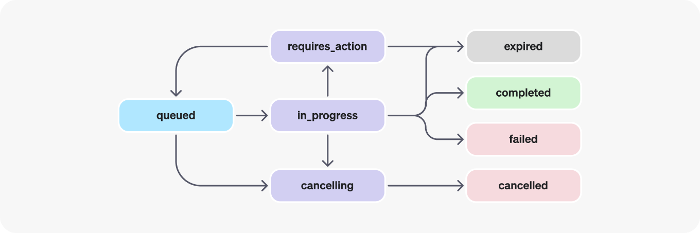
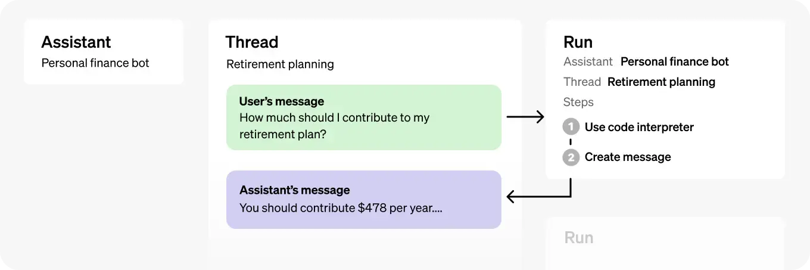

> 原文：https://ku.baidu-int.com/knowledge/HFVrC7hq1Q/KeF15lNOtH/-UXFkEkRyR/XUAjP4hkbA86rt

Assistants API是什么

意义：代替了langchain框架，使开发者可以用非常简单的方式就能创建大模型agent

或者说，gpts是在openai平台上访问的，而Assistants API允许开发者把gpts搬到自己的应用程序/网站上提供给用户


openai定义：

开发者在自己的应用程序中构建Assistants（其实就是agent）

助手由指令（prompt）生成，可以利用大模型、工具和知识库来响应用户查询

目前支持的工具有

* 代码解释器
* 知识库检索工具
* Function Call工具

未来会支持更多工具以及开发者自定义工具


## Assistants API使用流程


1. 定义agent的指令，并选择使用的模型创建agent

```python
assistant = client.beta.assistants.create(
    name="Math Tutor",
    instructions="You are a personal math tutor. Write and run code to answer math questions.",
    tools=[{"type": "code_interpreter"}],
    model="gpt-4-1106-preview"
)
```
2. 当用户开始对话时创建一个线程

```python
thread = client.beta.threads.create()
```
3. 当用户提问时将消息添加到线程中。

```python
message = client.beta.threads.messages.create(
    thread_id=thread.id,
    role="user",
    content="I need to solve the equation `3x + 11 = 14`. Can you help me?"
)
```
4. 在线程上运行以触发响应。这会自动调用相关工具。

```python
run = client.beta.threads.runs.create(
  thread_id=thread.id,
  assistant_id=assistant.id,
  instructions="Please address the user as Jane Doe. The user has a premium account."
)
```
运行后会进入queued状态，需要定期查询状态。完成后可以列出agent返回后的消息

```python
#查询
run = client.beta.threads.runs.retrieve(
  thread_id=thread.id,
  run_id=run.id
)
#列出消息
messages = client.beta.threads.messages.list(
  thread_id=thread.id
)
```
线程运行后的状态如下


|状态|定义|
|-|-|
|`queued`|当首次创建运行或完成了`required_action`，它们将转至排队状态。然后会立即转到`in_progress`。|
|`in_progress`|在 in_progress 期间，助手使用模型和工具来执行步骤。[您可以通过检查运行步骤](https://platform.openai.com/docs/api-reference/runs/step-object)来查看运行所取得的进度。|
|`completed`|此次运行圆满结束！您现在可以查看助手添加到线程的所有消息以及运行所采取的所有步骤。您还可以通过向线程添加更多用户消息并创建另一个运行来继续对话。|
|`requires_action`|使用[函数调用](https://platform.openai.com/docs/assistants/tools/function-calling)`required_action`工具时，一旦模型确定了要调用的函数的名称和参数，运行就会进入某种状态。然后，您必须运行这些函数并在运行继续之前[提交输出。](https://platform.openai.com/docs/api-reference/runs/submitToolOutputs)如果在时间戳过去之前（创建后大约 10 分钟）未提供输出`expires_at`，则运行将转为过期状态。|
|`expired`|当函数调用输出之前未提交`expires_at`并且运行过期时，就会发生这种情况。此外，如果运行执行时间过长且超出 中规定的时间`expires_at`，我们的系统将使运行过期。|
|`cancelling`|您可以尝试`in_progress`使用[取消运行](https://platform.openai.com/docs/api-reference/runs/cancelRun)端点取消运行。一旦尝试取消成功，运行的状态就会变为`cancelled`。已尝试取消，但不保证。|
|`cancelled`|运行已成功取消。|
|`failed`|`last_error`您可以通过查看Run中的对象来查看失败的原因。失败的时间戳将记录在 下`failed_at`。|

轮询更新

为了使运行状态保持最新，您必须定期检索 Run对象。您可以在每次检索对象时检查运行状态，以确定应用程序下一步应该执行的操作。我们计划在不久的将来添加对流媒体的支持，以使这一切变得更简单。


线程锁

当运行处于in_progress终止状态但未处于终止状态时，线程将被锁定。这意味着：

* 无法将新消息添加到线程中。
* 无法在线程上创建新的运行。


## Assistants API是如何工作的

这张图中，Assistant是一个个人金融助手，Thread是关于退休计划的一个会话。用户提问后，thread进入run，调用工具并添加输出消息到thread。

Assistant可以访问持久线程，thread会存储消息历史记录并且在上下文过长时有截断策略

Assistant可以并行访问多个工具

*Assistants API 会自动管理上下文窗口，这样您就不会超过模型的上下文长度。一旦线程中的消息大小超过模型的上下文窗口，线程将尝试包含尽可能多的适合上下文窗口的消息并删除最旧的消息。请注意，这种截断策略将随着时间的推移而发展变得更加复杂。*

Assistant可以访问多种格式的文件（使用file_ids上传）

```python
#打开文件
file = client.files.create(
  file=open("speech.py", "rb"),
  purpose='assistants'
)
#给助手提供文件
assistant = client.beta.assistants.create(
  name="Data visualizer",
  file_ids=[file.id]
)
```


## 局限性和不足
openai未来计划

* 支持流输出（包括消息和运行步骤）。
* 支持通知以共享对象状态更新，而无需轮询。
* 支持 DALL·E 或浏览器作为工具。
* 支持创建图像用户消息。

