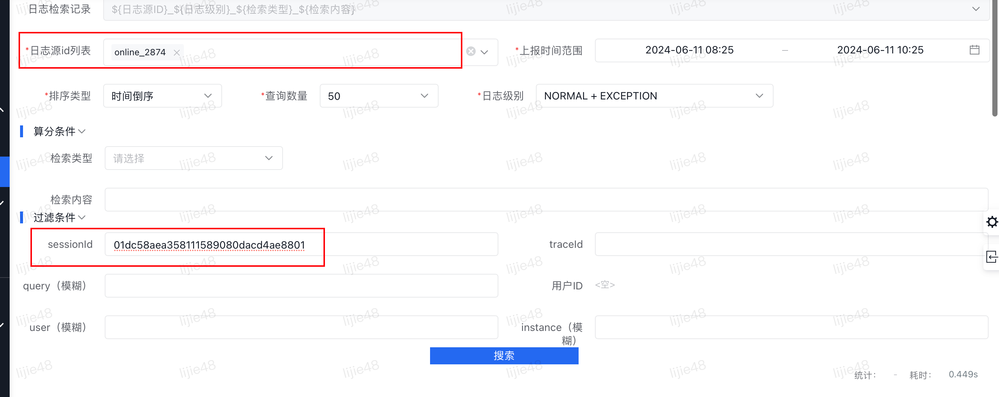
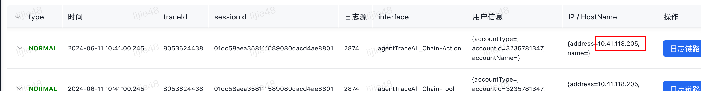
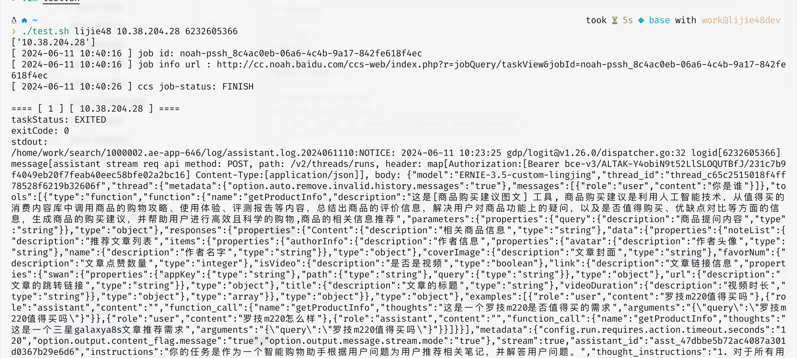

> 原文：https://ku.baidu-int.com/knowledge/HFVrC7hq1Q/KeF15lNOtH/-UXFkEkRyR/4wRoQjSgM2Ln99

Assitant Log 捞取

# 平台通过 SessionID 捞到机器
[https://aisuda.baidu-int.com/company/smartprogram/app/tianyan/searching/Trace%E6%97%A5%E5%BF%97%E6%A3%80%E7%B4%A2](https://aisuda.baidu-int.com/company/smartprogram/app/tianyan/searching/Trace%E6%97%A5%E5%BF%97%E6%A3%80%E7%B4%A2)


# 记录 IP & TraceID (LogID)

# 使用捞取脚本
**==脚本只能在开发机上使用== 且你的账号必须申请了 gniao 权限**

## 先运行 login 命令在手机上允许登录账号
```bash
baas login --baas_user=lijie48 --enable_hi_beep
```
## 保存如下脚本
```bash
#!/bin/bash

# 定义变量
USER=$1
IP_ADDRESS=$2
SEARCH_STRING=$3

# 检查是否提供了足够的参数
if [ "$#" -ne 3 ]; then
    echo "Usage: $0 <user> <ip_address> <search_string>"
    exit 1
fi

# 运行 noah-pssh 命令
noah-pssh run -u "$USER" -S -p 5 -i "$IP_ADDRESS" -c "fgrep '$SEARCH_STRING' /home/work/search/*.ae-app-646/log/assistant.log.\$(date +'%Y%m%d')*"
```
## 执行脚本
```bash
# 用户名 目标机器IP 扫描的 LogID
./assistant_log_search.sh lijie48 10.38.204.28 6232605366
```


## 效果


