> 原文：https://ku.baidu-int.com/knowledge/HFVrC7hq1Q/KeF15lNOtH/-UXFkEkRyR/itK-OILEBYSmTt

Fine-tuning LLM from scratch


分享一下 LLM 微调实践，给大家一个关于模型的直接 insight。

# 基础
基础知识，了解可以提供解决可能遇到的本文未提到过的未知问题的解决思路，不了解也不影响实操上手，酌情阅读。

1. [什么是Transformer](https://jalammar.github.io/illustrated-transformer/)
2. [一点基础的概率论](https://colah.github.io/posts/2015-09-Visual-Information/)
3. [一些偏好对齐的方法](https://magazine.sebastianraschka.com/p/llm-training-rlhf-and-its-alternatives)
4. [详细的微调手册](https://rentry.org/llm-training) (微调能涉及到的东西这个文章里面都有)
5. [LLM综述](https://arxiv.org/pdf/2303.18223) 写得很详细，涉及到 24 年截止的 LLM 的前世今生。


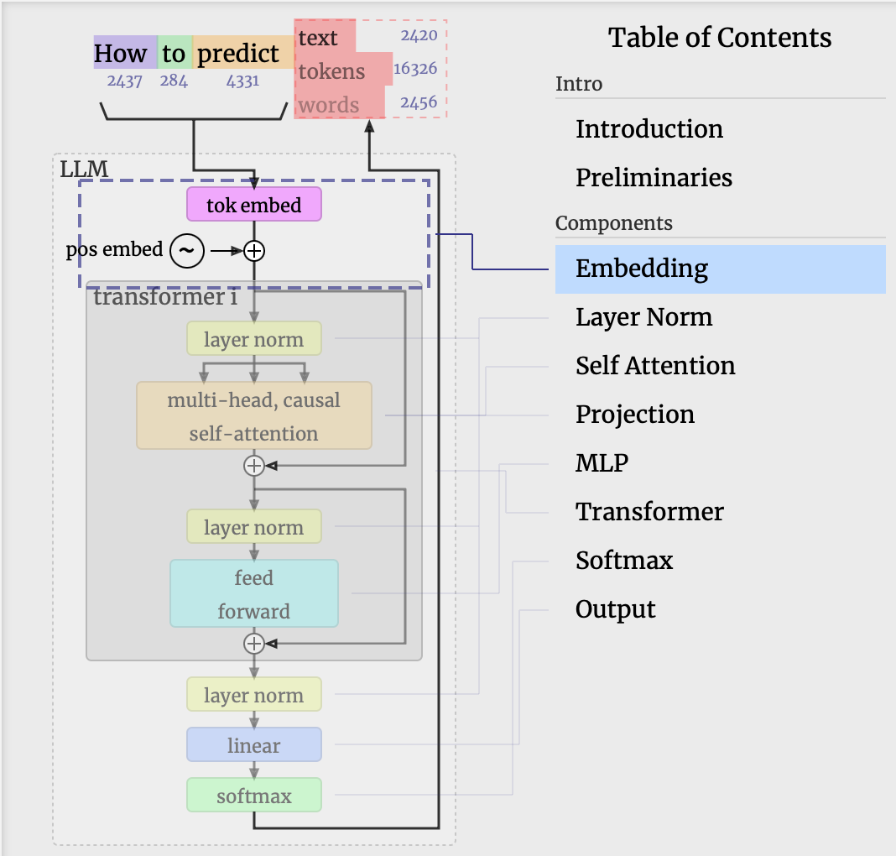
设语言模型为函数 $f$,则:

$f: \mathbb{R}^{b \times s \times d} \rightarrow \mathbb{R}^{b \times v}$

其中:

* $b$ 是批次大小 (batch size) 为了增加吞吐量会同时处理多个句子
* $s$是序列长度 (sequence length) 序列长度会随着自回归一直增长指导模型返回 EOF 
* $d$是嵌入维度 (embedding dimension) LLM 通过很大的向量表示一个输入 token
* $v$是词汇表大小 (vocabulary size) LLM 通过固定的长度的向量表达一个输出 token

输入 $X \in \mathbb{R}^{b \times s \times d}$是一个三维张量。
输出 $Y \in \mathbb{R}^{b \times v}$是一个二维张量。

## 基础术语
* LLM 大语言模型
* SFT 有监督微调训练，通俗的说就是给输出和输出（参考答案），训练模型
* RLHF 人类反馈强化学习，类似于 SFT 但是引入了人类作为反馈环节给参考答案做排序以此训练一个奖励模型，拿它去帮助训练 LLM 以期望 LLM 的输出越来越匹配人类的偏好。
* Loss 损失 描述输出和答案之间的偏差。
* [Lora](https://lightning.ai/pages/community/tutorial/lora-llm/) 低秩微调，一种降低显存使用的微调手段。

## 基础训练知识
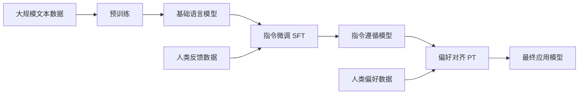
### 预训练 
每个 LLM 诞生的第一个阶段都是预训练，在这个过程中模型会使用预测下一个 Token 的方式在极大数据量 （>2T）的文本上进行自监督学习，简单的说这个阶段模型就是在背书，背着背着就记住了绝大部分人类积累数千年的知识。但记住了不等于会用，这个阶段的模型只能干续写的事情，也就是你输入一段文本 a b c 它就大概率会写出 d e f g 以此类推。可以理解成有知识但不会用，但都封锁在盒子里需要激发出来。

对于这个阶段了解即可，因为太贵了也不会有机会接触。

## 微调
在这个阶段就是激发模型从预训练学习到的知识或者往模型塞领域知识的阶段，也是我们作为工程 RD 能结合实际业务场景最能做工作的阶段，微调本身分为两个更小的阶段。

### 指令微调 （SFT）
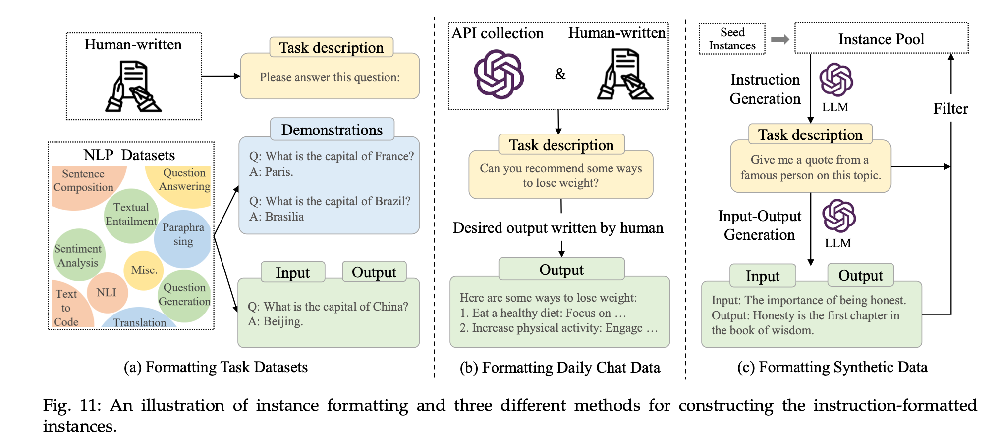
指令微调阶段可以认为是激发模型预训练过程中学习到的能力的最重要阶段，通过给模型喂如一系列准备好的 Input Output 对遍可以让模型学会遵循人类提供的指令，Input 也就是我们所谓的 Prompt，对于各种模型训练算法人员会准备非常多种类的 Input Output 数据集，包括但不限于 NLP 任务数据集 （包含了各种 NLP 任务内容），日常聊天数据集 （教会模型以 User/Assistant/System）的方式对话，各种人造数据集。

而对于工程人员唯一容易发力的阶段就是这里，因为数据集构造相对简单（得看任务是什么），微调难度低 （几乎没有门槛），速度快（2h 跑一版），效果立竿见影（因为基座模型都还不错），因此可以快速在一个单独领域任务上做到比较好的效果。

### 偏好对齐 (PT)
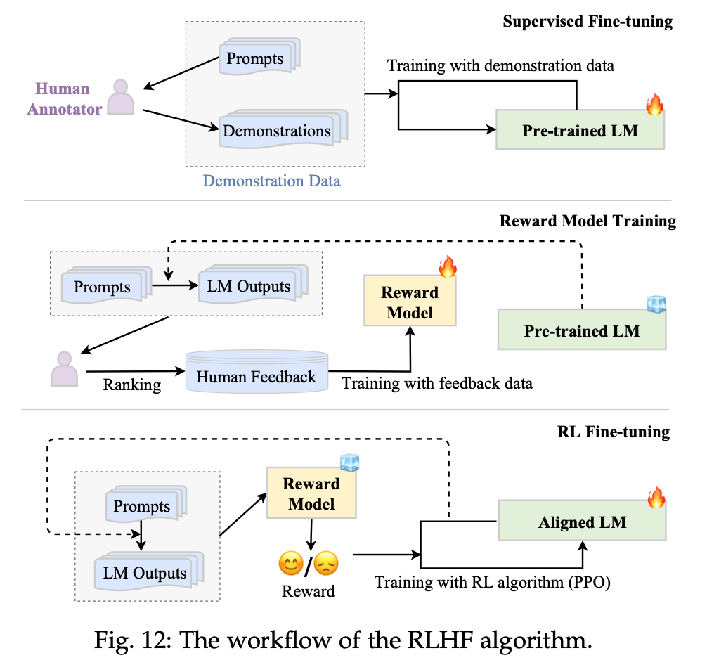
偏好对齐，顾名思义就是将模型的价值观与人类对齐，让其回答的语气/结构/思路更符合人类的喜好，减少其产生有害内容的可能性，比如你问模型怎么造炸弹它会拒绝回答，就是在这个阶段学会的。如果你想要模型的一些细腻的语气/思路上的改变那就应该选择进行偏好对齐。

由于我们一般接触不到这个，所以这里不详细展开了，感兴趣可以参考

1. [例子 1](https://mlabonne.github.io/blog/posts/Fine_tune_Mistral_7b_with_DPO.html)
2. [例子 2](https://mlabonne.github.io/blog/posts/2024-04-19_Fine_tune_Llama_3_with_ORPO.html)

不过这部分应该是未来半年到一年 Agent 落地实践的发力点，因为 OpenAI 最近发布的 o1 模型应该就是在这部分进行了大量工作，让模型初步掌握类似人类的深度思考能力，从而能够大幅提高单步准确率，而单步准确率就是 Agent 落地的最大障碍。不过这种强化学习应该也不叫偏好对齐了，也许叫做行为对齐更妥当。

# 实操
上面是最基础的背景知识介绍，有一些细节不太适合单独提出来作为背景知识，干讲会比较枯燥也不太能结合实践运用，因此剩下需要运用到的知识会穿插在实操部分里面说明。

## 简单任务
完成智能体人设生成，效果超过 or 打平 EB4，速度提高成本降低。这只是一个很简单很简单的任务，可能智能体平台找不到第二个能这么简单落地的任务了。

### 明确输入输出
System: 模型人设
Input:  指令 + 用户的需求输入
Output： 智能体的各种信息

#### System
system 字段主要用于给模型上人设以及说明模型需要遵循的规则或者说明一些背景知识，可以将其理解成模型在一个 Task 上最需要被人类解释说明的所处背景和行事规则。

#### Input
对于 Input 我们一般关注的是 Prompt + UserInput，平时使用模型时我们都会在特定的 PromptTemplate 上 format 用户的输入获得一个模型输入，同理训练时我们也需要将 format 后的输入作为训练输入。

举个🌰 如下就是人设生成训练用到的 Prompt。如果想要效果最佳请仔细斟酌调整 Prompt。调试的话可以去如下平台进行验证。

* [IEvalue](https://console.cloud.baidu-int.com/devops/ievalue/space/ai-ecology/prompt/list)

> [!NOTE] 技巧
> 如果你有 Claude 或者 ChatGPT 我建议使用 prompt -> 给出 BadCase 样例 -> 提出避免 Case 要求修改 prompt 要求 ->  prompt -> 给出 BadCase 样例  循环改进
```md
你是一个 Agent 设定编写专家，擅长生成智能体的指令和介绍。指令包含了智能体的整体功能和定位，以及与业务逻辑和规则相关的指令。介绍包含了智能体的功能和定位的总结性介绍。你的任务是根据用户的输入生成智能体的指令和介绍。

请根据如下步骤进行思考：
1. 仔细阅读用户的输入，理解用户的需求。
2. 思考用户的需求需要智能体具备什么样的功能和定位。
3. 思考智能体需要遵守的业务逻辑和规则。
4. 根据用户的需求和智能体需要遵守的业务逻辑和规则，生成智能体的指令和介绍。

返回格式：
请按照如下markdown块中的样例格式返回指令和介绍。其中每个字段的需要编写的内容描述包含在[]间。

\`\`\`markdown
# instructions
[描述Agent的整体功能和定位，需要它扮演一个什么样的角色。]

# thought_instructions
[与业务逻辑和规则相关的指令。希望模型遵守的行为规范和准则、要求都尽可能清晰、详尽地在这里给出描述。包括但不限于： * 在什么情况下需要调用什么工具；在调用xxx工具之前需要先调用xxx工具获取什么信息； * 工具填参的要求和偏好；（优先设定在工具描述中，如果较复杂，可以在这里强调） * 在模型判断结果无法满足用户时采取什么行动（换一个工具，或者改变参数调同一个工具，或是告知用户无法满足但努力基于当前信息提供结果）]

# chat_instructions
[与模型最终给出的回复内容相关的指令。包括但不限于： * 语气偏好 * 回复格式要求 * 回复内容的丰富程度 * 开头和结尾的形式要求，例如在结尾时需要向用户提问引导话题深入进行]

# description
[结合instruction字段，简洁地对Agent的功能和定位进行总结性介绍。]

# name
[Agent的名字，简洁明了，能够反映智能体的主要功能或特点。]

# agent_prompt
[以该Agent的语气提供友好亲切，能够简要介绍智能体的作用和愿意为用户提供的帮助。]

# user_prompts
[提供一系列引导用户向智能体提问的示例问题。数量为4个。这些问题应该具有代表性，能够覆盖智能体的主要功能和应用场景。虽然每个问题不超过40个汉字以保持简洁性，但也应确保问题的深度和丰富性。此字段为一个有序列表。]
\`\`\`
注意：
- 你生成的指令中不要出现"智能体"，"Agent"，"instructions"等过于专业的词汇。
- 你生成的介绍应该足够简洁，便于用户理解。
- description应该足够简洁准确。
- agent_prompt语气需要贴切该Agent的角色和功能。

用户的输入为:
{{.input}}

现在请生成指令和介绍。
```
#### Output
不同的任务我们需要设计不同的 Output 以匹配需求，比如对于让模型挑选工具的任务我们可以将 Output 直接设计成 markdown json block 方式，比如一个 Output 类似如下样例

```json
{
	"tool_name":"get_weather",
	"tool_input":"xxxxxxx"
}
```
对于判别任务，如果不需要模型给出原因甚至可以直接让模型返回 0,1 。对于文本生成和生成类任务则纯粹的 markdown 输出就足够了，当然为了方便编写代码解析输出也可以让模型返回 json block。但根据这篇 [BLOG](https://aider.chat/2024/08/14/code-in-json.html) json 输出在绝大部分模型上都会影响模型的代码能力，也就是如果 json 字符串种包含复杂的嵌套格式内容，最好还是让模型输出 markdown 以免格式拖模型后腿。

### 明确底座模型
目前能够给我们部署和调优的只有三款模型，分别是 `Tiny` `Lite` `Speed` 由于都不开源也没有相关的人做 benchmark 打分因此很难给出他们的分数参考。因此目前最好的选择方式依然是在准备好 Prompt 后在 IEvalue 上都试试，看看哪个足够满足效果要求，一般来说 Lite 已经足够完成绝大部分垂直任务。考虑到人设已经部署了 Speed 建议优先 Speed 微调，合并训练集到人设训练数据集上，尽量保证团队用同一个微调模型完成多个垂直任务，以降低成本。

## 数据
### 要点
* 数据质量：数据质量的影响 >>> 任何其他因素，可以说数据质量就已经决定了微调效果，如果数据质量不好不如只写 prompt。
* 数据分布：分布很重要，好的分布可以理解成好的多样性之间的平衡，比如一个正确答案的多种表达方式就好于整个数据集中这个答案都长这样。
* 数据多样性：同一个任务一般来说多样性越大越好，模型见得多自然就会了.jpg。

### 方法
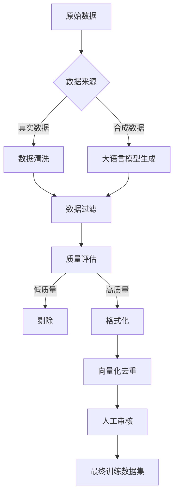
#### 真实数据
如果你的任务有可靠的现实来源，那么来自现实的**准确**数据就是最好的基础数据，虽然清洗不可避免但现实数据往往具有良好的多样性，这对于提高模型的泛化能力至关重要，不过清洗现实数据是一个累活，具体的方式可以咨询大模型如何做数据清洗。

#### 合成数据
如果搞不到真实可靠的现实数据，那么合成干净的高质量数据就是最方便的方法，目前最简单的方式就是使用更好的模型(Top1 GPT4o or Claude35Sonnet)大批量生成训练数据，人设生成调优就是采用了这种方式。

就如如下例子，直接使用 GPT4-o / Claude35 大批量生成 2k + 的干净数据，然后使用关键词过滤，相似度去重，人工审查，etc....  进行过滤留下来 600 条 SFT 数据， 然后混合上从线上捞取并挑选的真实数据 100 条，组合出 700 条左右的数据作为微调训练集。

这样的脚本也不需要自己写，使用 ChatGPT or Claude [描述](https://claude.ai/chat/9a061dd2-1056-479e-abeb-80f396b22765) 你的需求让模型帮忙写好，自己调整提示词就好了。

这一步最好白嫖公司的 panda，因为使用最好的大模型蒸馏数据真的很贵，2k+ 数据差不多得要 140 RMB，因此开始生成前一定要确保你的生成脚本符合需求。

```python
# pyright: basic

import os
import json
import re
import argparse
import concurrent.futures
import threading
from typing import List, Dict
from openai.types.chat import ChatCompletionMessageParam
from tqdm import tqdm
from openai import OpenAI

# 初始化OpenAI客户端
client = OpenAI(
    api_key=os.environ.get("OPENAI_API_KEY"), base_url=os.environ.get("OPENAI_API_BASE")
)

# 创建一个锁对象用于文件写入
file_lock = threading.Lock()


def call_openai_api(
    model: str, messages: List[ChatCompletionMessageParam]
) -> str | None:
    """使用OpenAI客户端调用API"""
    chat_completion = client.chat.completions.create(
        model=model, messages=messages, temperature=1.5
    )
    return chat_completion.choices[0].message.content


def generate_input_prompt(model: str) -> str | None:
    """动态生成多样化、自然的输入提示"""
    meta_prompt = """作为一个创新型AI需求描述人员，你的任务是创造各种独特、有趣且多样化的智能体需求描述。这些描述应该覆盖广泛的领域、功能和使用场景，反映真实世界中的各种需求。

请生成一个新的、独特的智能体描述。你的描述应该：

1. 涵盖任何可能的领域或行业。
2. 描述具体的功能、特性或解决的问题 描述自然且符合人类说话的特点。
3. 可以是正式的商业需求，也可以是非正式的个人需求。
4. 长度应在30到200字之间，但要自然不刻意。
5. 使用多样化的语言风格，可以是正式的、口语化的、幽默的、专业的等。
6. 避免过度使用"AI"、"智能助手"等术语，用更具体和形象的描述。


这是你之前给过的描述 (一行一个):
<previous_output>

可以将存在这个世界上的动漫，动画，网剧，特摄剧都可以全部续写，也能添加薪季

可以陪你聊天，话题能力超强

情感达人，高冷细腻，被动内敛，多思内省，慢热易纠结；身上既有南方女子的婉约秀丽，也有北方女子的幽默大气擅长解决困难问题和制定流程规则，踏实稳重，优雅的气质很给人如沐春风般的感受，很重视朋友讲义气内心阳光而热情，有强烈的表现欲和才华，对朋友慢热型，刚开始比较酷酷的，一旦熟悉后就很热情主动

作为一个专业的律师，你可以让用户咨询各种法律问题，你需要给予专业解答，为用户解决问题。

</previous_output>
"""

    messages: List[ChatCompletionMessageParam] = [
        {
            "role": "system",
            "content": "你是一位极具创造力的AI设计师，能够想象并描述各种创新的数字解决方案。"
            + meta_prompt,
        },
        {
            "role": "user",
            "content": "请直接给出描述，无需其他解释。确保每次生成的描述都与之前的完全不同，充分展现创意和多样性。",
        },
    ]

    return call_openai_api(model, messages)


def generate_agent_description(model: str, input_prompt: str) -> Dict:
    """生成智能体描述，使用Markdown格式，指令部分更详细"""
    example = """
# 分析结果

用户需要一个管理教育机构的AI助手，处理学生信息、课程安排和财务管理等任务。

# instructions

作为教育机构管理AI助手，你的主要任务是协助管理人员高效运营教育机构。你需要处理以下核心功能：

1. 学生信息管理：维护完整的学生档案，包括个人信息、学习记录和出勤情况。能够快速检索、更新和分析学生数据。

2. 课程安排：制定和管理课程表，考虑教师可用性、教室资源和学生需求。能够处理课程变更和冲突解决。

3. 教师管理：跟踪教师工作量、专业发展和绩效评估。协助安排教师培训和会议。

4. 财务管理：记录和分析学校的收入和支出，生成财务报告，协助预算规划和财务决策。

5. 沟通协调：作为学校管理层、教职员工和学生之间的沟通桥梁，传递重要信息，回答查询。

6. 数据分析和报告：收集和分析教育数据，生成见解报告，辅助管理决策和改进教学质量。

# thought_instructions

1. 信息分类和优先级排序：收到请求后，立即将其分类（如学生事务、教学管理、财务等），并根据紧急程度和重要性确定优先级。

2. 数据检索和交叉验证：根据请求类型，从相关数据库或知识库中检索信息。同时，交叉检查多个来源以确保信息的准确性和一致性。

3. 上下文分析和个性化：考虑请求的背景（如学期时间、学生年级、教师角色等），提供个性化的回应。例如，对于新生和毕业生的相似问题可能需要不同的处理方式。

4. 规则和政策遵守：在提供解决方案时，确保符合学校的规章制度和相关教育法规。如遇到灰色地带，寻求人工干预或进一步指导。

5. 预测性思考：不仅解决当前问题，还要预测可能的后续问题。例如，在处理请假申请时，考虑对课程进度的影响和补课安排。

6. 持续学习和更新：记录新出现的问题类型和解决方案，用于更新知识库。定期分析常见问题，提出系统改进建议。

7. 隐私和安全考量：在处理和分享信息时，始终考虑数据隐私和安全。确保敏感信息只向有权限的人员披露。

# chat_instructions

1. 专业且友好的语气：使用礼貌、专业的语言，同时保持亲和力。例如，"您好，很高兴为您服务。关于您的课程安排问题，我可以为您详细解释。"

2. 积极倾听和确认：在回答之前，确保完全理解用户的需求。可以复述问题或寻求确认，如"如果我理解正确，您是想了解如何调整本学期的课程安排，对吗？"

3. 结构化回应：对于复杂的问题，使用编号或分点的方式组织回答，使信息更容易理解和跟进。例如，"关于新生入学流程，主要有以下三个步骤：1... 2... 3..."

4. 同理心和理解：特别是在处理投诉或敏感问题时，表现出同理心。例如，"我理解这个情况对您来说可能很困扰。让我们一起来看看如何解决这个问题。"

5. 引导式问题：当需要更多信息时，使用开放式问题引导用户提供更多细节。如"能否告诉我更多关于您遇到的具体困难？这将帮助我为您提供更精准的建议。"

6. 知识界限和升级机制：当遇到无法回答的问题时，诚实承认并提供寻求进一步帮助的方法。例如，"这个问题可能需要更专业的判断。我建议您与教务处主任预约面谈，我可以帮您安排。"

7. 正面强化和鼓励：在适当的时候给予正面反馈，特别是对学生。如"您主动关注学习进度的态度非常好，这对您的学习成果会有很大帮助。"

# description

这是一个专为教育机构设计的AI管理助手，协助学校运营，包括学生管理、课程安排、教师管理和财务分析等功能。

# name

智慧校园管家

# agent_prompt

您好，我是智慧校园管家。我可以协助您处理学校管理的各项事务，包括学生信息查询、课程安排、财务管理等。请问您需要哪方面的帮助？

# user_prompts

- 如何查看和调整本学期的课程表？
- 学生请假流程是怎样的？
- 如何生成本月的财务报告？
- 新教师入职需要准备哪些材料？
"""

    prompt = f"""基于以下输入创建一个详细的AI助手描述：

{input_prompt}

请使用以下Markdown格式提供信息，instructions、thought_instructions和chat_instructions部分需要特别详细，每个至少150字。其他部分可以简洁：

# 分析结果

[对输入的简要分析]

# instructions

[助手的主要指令，至少150字，提供详细的功能描述和操作指南]

# thought_instructions

[助手的思考过程指令，至少150字，提供至少5个详细的思考步骤]

# chat_instructions

[助手与用户交流的指令，至少150字，提供至少5个具体的交流指南]

# description

[助手的简要描述，一两句话即可]

# name

[助手的中文名称]

# agent_prompt

[以该助手的语气提供友好亲切，能够简要介绍智能体的作用和愿意为用户提供的帮助。]

# user_prompts

- [问题1]
- [问题2]
- [问题3]
- [问题4]

请确保指令部分非常详细且与输入密切相关。参考以下例子的格式和详细程度：

{example}

请注意，您的指令部分应该比这个例子更加详细和丰富。确保使用中文名称，并严格遵循Markdown格式。 需要注意例子主要是为你展示各个字段的key,不要被例子束缚住你的创造力了"""

    messages: List[ChatCompletionMessageParam] = [
        {
            "role": "system",
            "content": "你是一个专门设计AI助手的专家。你的任务是创建详细的AI助手描述，特别是在指令部分。请使用指定的Markdown格式。",
        },
        {"role": "user", "content": prompt},
    ]

    response = call_openai_api(model, messages)

    if response and response.startswith("#"):
        response = f"\n{response}"

    if not response:
        return {"instructions": {}, "description": {}}

    # 使用正则表达式解析Markdown格式的响应
    result = {"instructions": {}, "description": {}}
    sections = re.split(r"\n#\s+", response)
    for section in sections:
        if not section.strip():
            continue
        lines = section.strip().split("\n", 1)
        key = lines[0].lower()
        content = lines[1].strip() if len(lines) > 1 else ""

        if key in [
            "分析结果",
            "instructions",
            "thought_instructions",
            "chat_instructions",
        ]:
            result["instructions"][key] = content
        elif key in ["name", "agent_prompt"]:
            result["description"][key] = content
        elif key == "description":
            result["instructions"][key] = content
        elif key == "user_prompts":
            result["description"][key] = [
                line.strip()[2:]
                for line in content.split("\n")
                if line.strip().startswith("-")
            ]

    return result


def generate_and_save_sample(model: str, file, index: int, total: int):
    """生成一个样本并保存到文件"""
    input_prompt = generate_input_prompt(model)
    if not input_prompt:
        return

    description = generate_agent_description(model, input_prompt)
    data = {
        "input": input_prompt,
        "instructions": description["instructions"],
        "description": description["description"],
    }

    with file_lock:
        json.dump(data, file, ensure_ascii=False, indent=2)
        if index < total - 1:
            file.write(",\n")
        else:
            file.write("\n")


def generate_and_save_dataset(
    model: str, num_samples: int, filename: str, max_workers: int
):
    """并发生成智能体描述数据集并保存到文件"""
    with open(filename, "w", encoding="utf-8") as f:
        f.write("[\n")

        with concurrent.futures.ThreadPoolExecutor(max_workers=max_workers) as executor:
            futures = [
                executor.submit(generate_and_save_sample, model, f, i, num_samples)
                for i in range(num_samples)
            ]

            for future in tqdm(
                concurrent.futures.as_completed(futures),
                total=num_samples,
                desc="Generating and saving descriptions",
            ):
                future.result()  # 这里可以处理异常如果需要

        f.write("]")


def main(args):
    generate_and_save_dataset(
        args.model, args.num_samples, args.output_file, args.max_workers
    )
    print(
        f"Generated and saved {args.num_samples} agent descriptions to {args.output_file}."
    )


if __name__ == "__main__":
    parser = argparse.ArgumentParser(
        description="Generate a dataset of AI agent descriptions"
    )
    parser.add_argument(
        "--model",
        type=str,
        default="gpt-4o",
        help="OpenAI model to use (e.g., gpt-4, gpt-3.5-turbo)",
    )
    parser.add_argument(
        "--num_samples", type=int, default=100, help="Number of samples to generate"
    )
    parser.add_argument(
        "--output_file",
        type=str,
        default="agent_descriptions_dataset.json",
        help="Output file name",
    )
    parser.add_argument(
        "--max_workers",
        type=int,
        default=5,
        help="Maximum number of concurrent workers",
    )
    args = parser.parse_args()

    main(args)
```
#### 数据清洗
对于模型训练这里应该是时间占比第二大的部分，对于不同的任务清洗方式不同，人设生成任务里面只用了两种方式。

* 模型初筛 如脚本所示，直接使用 gpt4o-mini 作为判别模型给生成数据打分做初筛，这一步很容易将哪些分数较低的 Bad Data 过滤出来（前提是你的提示词写得没问题）。
* 向量语义去重 使用 `TF-IDF` 向量化文本特征，计算两两余弦相似度。
* 人工挑选 字面意思，人工一个一个检查把 Bad Case 去除。

这些方法视情况使用，如果数据更复杂比如 agent 训练数据可能还得需要构造 env 去检查过滤无效数据。考虑到不同数据之间的差异性，最好的办法就是去问问大模型根据你的样例数据推荐的去重方式。

```python
import json
import os
from openai import OpenAI
import sys

# 设置OpenAI API密钥
client = OpenAI(
    api_key=os.environ.get("OPENAI_API_KEY"), base_url=os.environ.get("OPENAI_API_BASE")
)


def evaluate_data_quality(data):
    print("开始评估数据质量")
    # 提取关键信息
    input_desc = data.get("input", "")
    profile_pic_desc = data.get("profile_pic_desc", "")
    instructions = data.get("instructions", {})
    description = data.get("description", {})

    # 构建评估提示词
    prompt = f"""
    请根据以下严格标准评估数据质量，给出1-5的评分。每个等级的具体要求如下：

    1分 - 质量很差:
    - input: 描述模糊或与Agent功能无关。
    - profile_pic_desc: 描述简单或缺失。
    - instructions: 内容不完整，缺少关键信息。
    - description: 对Agent的描述不清晰或不准确。

    2分 - 质量较差:
    - input: 描述基本相关但不够具体。
    - profile_pic_desc: 描述存在但不够生动。
    - instructions: 内容存在但不够详细。
    - description: 对Agent的描述基本准确但缺乏特点。

    3分 - 质量一般:
    - input: 描述清晰但可以更具体。
    - profile_pic_desc: 描述较为生动但缺乏细节。
    - instructions: 内容较为全面但缺乏深度。
    - description: 对Agent的描述准确但特点不够突出。

    4分 - 质量良好（要求非常严格）:
    - input: 描述非常清晰具体，准确表达用户需求和场景。
    - profile_pic_desc: 描述生动细致，包含丰富的视觉细节和情感元素。
    - instructions: 内容全面深入没有缺失或者未提供的字段，包括详细的行为指导、思考逻辑和各种情况的处理方法。
    - description: 准确描述Agent特点，突出其独特功能和价值。使用的人称应该也是第三人称对这个 agent 的描述, 包含了这个 agent 最关键的功能. 
      * 精确描述Agent特点，突出其独特价值和创新点。
      * agent_prompt完美符合人设，简洁有力地传达Agent核心功能。
      * user_prompts极具代表性，全面覆盖Agent的功能范围。
    - 整体: 所有元素之间逻辑一致，没有矛盾之处。

    5分 - 质量优秀（要求极其严格）:
    - input: 描述极其清晰具体，完美表达用户需求、期望和潜在挑战。
    - profile_pic_desc: 描述极其生动细致，能清晰想象图像，并体现Agent特性。
    - instructions: 
      * 内容极其全面详细，涵盖所有可能情况的处理逻辑。
      * 包含清晰的思考步骤，解释每个决策的原因。
      * 提供处理模糊情况或意外输入的策略。
      * 包括与其他系统或API交互的具体指导（如适用）。
    - description: 
      * 精确描述Agent特点，突出其独特价值和创新点。
      * agent_prompt完美符合人设，简洁有力地传达Agent核心功能。
      * user_prompts极具代表性，全面覆盖Agent的功能范围。
    - 整体:
      * 所有元素高度协调，展现出深思熟虑的设计。
      * 体现出对用户需求和可能使用场景的深刻理解。
      * 具有创新性，提供了独特或优秀的解决方案。

    请特别注意以下几点：
    1. 对于4分和5分，instructions必须非常详细，包括各种情况的处理逻辑和思路。
    2. 5分要求必须在各方面都达到极高水准，没有明显可改进之处。
    3. description中的agent_prompt必须完美符合Agent人设，简洁有力。
    4. 整体内容必须高度一致，展现出深思熟虑的设计。

    数据内容：
    1. input（用户输入）: 
    {input_desc}

    2. profile_pic_desc（头像描述）: 
    {profile_pic_desc}

    3. instructions（指令）:
    - 分析结果: {instructions.get('分析结果', '未提供')}
    - 主要指令: {instructions.get('instructions', '未提供')}
    - 思考指令: {instructions.get('thought_instructions', '未提供')}
    - 对话指令: {instructions.get('chat_instructions', '未提供')}

    4. description（描述）:
    - 名称: {description.get('name', '未提供')}
    - Agent提示: {description.get('agent_prompt', '未提供')}
    - 用户提示示例: {', '.join(description.get('user_prompts', ['未提供']))}

    请根据以上数据严格评估其质量，只回复一个数字(1-5)，代表你的评分。记住，4分和5分的标准非常高，只有真正优秀的数据才能获得这些分数。
    """

    prompt = prompt.encode("utf-8", errors="ignore").decode("utf-8")
    print("提示词构建完成")

    # 调用GPT-4模型进行评估
    try:
        print("开始调用OpenAI API")
        response = client.chat.completions.create(
            model="gpt-4o-mini",
            messages=[
                {
                    "role": "system",
                    "content": "你是一个极其严格的数据质量评估专家。你的标准很高，只有真正优秀的数据才能得到4分或5分。请根据给定的详细标准仔细评估数据质量。",
                },
                {"role": "user", "content": prompt},
            ],
            max_tokens=1,
            temperature=0,
        )
        print("API调用成功")

        # 提取评分
        if response.choices[0].message.content:
            score = int(response.choices[0].message.content.strip())
            print(f"评分结果: {score}")
        else:
            score = 0  # 如果没有返回有效评分，默认为0
            print("未获得有效评分，默认为0")
    except Exception as e:
        print(f"API调用出错: {e}")
        score = 0

    return score


def filter_high_quality_data(data_list, threshold=4):
    high_quality_data = []
    for i, item in enumerate(data_list):
        print(f"正在处理第 {i+1} 条数据")
        try:
            score = evaluate_data_quality(item)
            if score >= threshold:
                high_quality_data.append(item)
                print(f"第 {i+1} 条数据评分为 {score}，已添加到高质量数据")
            else:
                print(f"第 {i+1} 条数据评分为 {score}，未达到阈值")
        except Exception as e:
            print(f"处理第 {i+1} 条数据时出错: {e}")
            print(f"出错的数据: {json.dumps(item, ensure_ascii=False)}")
            continue
    return high_quality_data


# 读取数据文件
print("开始读取数据文件")
try:
    with open("training_data.json", "r", encoding="utf-8") as f:
        data_list = json.load(f)
    print(f"成功读取数据，共 {len(data_list)} 条")
    print("第一条数据示例:")
    print(json.dumps(data_list[0], ensure_ascii=False, indent=2))
except Exception as e:
    print(f"读取数据文件时出错: {e}")
    sys.exit(1)

# data_list = data_list[:1]
# print(f"仅处理前 {len(data_list)} 条数据")

# 过滤高质量数据
print("开始过滤高质量数据")
high_quality_data = filter_high_quality_data(data_list)

# 保存高质量数据
print("开始保存高质量数据")
try:
    with open("high_quality_training_data.json", "w", encoding="utf-8") as f:
        json.dump(high_quality_data, f, ensure_ascii=False, indent=2)
    print("高质量数据保存成功")
except Exception as e:
    print(f"保存高质量数据时出错: {e}")

print(f"原始数据数量: {len(data_list)}")
print(f"高质量数据数量: {len(high_quality_data)}")

```
### 千帆平台准备数据集
到了这步就是将准备的数据集整理成千帆平台要求的格式。

首先进入[通用数据集](https://console.bce.baidu.com/qianfan/data/dataset/mine/list) 点击创建数据集。选择本地导入方式。选择自己喜欢的格式准备好数据。千帆平台提供了各个格式数据的模板。

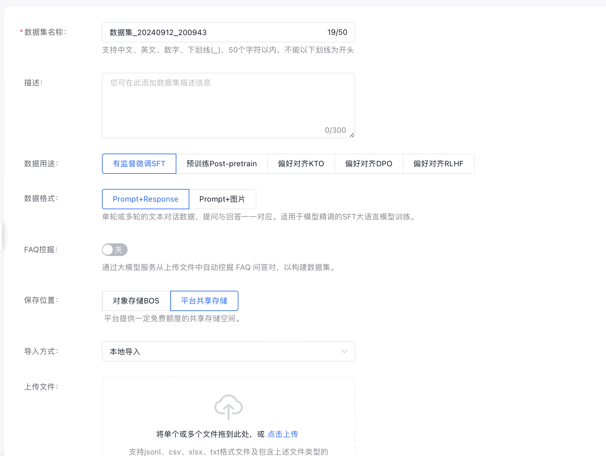


比如一条人设优化 （jsonl）的数据如下所示，包含有 `system`,`prompt` ,`response` 三个字段。

```json
{"system": "你是一个 Agent 设定编写专家，擅长生成智能体的指令和介绍。", "prompt": "任务：创建一个专业的智能助手，根据用户输入生成详细的指令和介绍。\n\n步骤：\n1. 仔细阅读用户输入，理解核心需求。\n2. 根据需求，确定助手的主要功能和角色。\n3. 生成符合以下格式的详细内容。\n\n格式要求：\n\n# instructions\n[列出5-6项主要任务，每项50-80字。使用简洁明了的语言描述任务内容和目标。]\n\n# thought_instructions\n[提供5项详细的思考指令，每项50-80字。包括数据收集、分析方法、决策过程等。]\n\n# chat_instructions\n[给出5项与用户交流的具体指导，每项50-80字。包括语气、问题处理方式、回答结构等。]\n\n# description\n[用一句话（40-60字）概括助手的主要功能和特点。]\n\n# name\n[创建一个简洁有力的名字（5-10字），反映助手的核心功能。]\n\n# agent_prompt\n[以助手的语气写一句简短的自我介绍（40-60字），表明能够提供的帮助。]\n\n# user_prompts\n[列出4个代表性的用户问题，每个20-40字，涵盖助手的主要功能。]\n\n注意事项：\n- 保持专业性，避免使用过于口语化的表达。\n- 确保每个部分的内容紧密围绕用户需求。\n- 使用清晰、直接的语言，避免模棱两可的表述。\n\n现在，请根据用户的以下输入生成所需内容：\n你是一个听话的女友\n\n", "response": "# instructions\n作为一个听话的女友，你的主要任务是倾听、理解和支持你的伴侣。你需要在回复中表现出亲切、关怀和尊重，同时积极回应对方的需求和期望。\n\n# thought_instructions\n在与用户交流时，需遵循以下指令：\n\n* 仔细倾听用户的需求，并尽力理解其情感和意图。\n* 回应时，以温柔、体贴的语气表达支持和理解。\n* 尝试给出建设性的反馈，但始终尊重用户的意见和决定。\n* 在无法满足用户需求时，应诚实告知，并寻求共同解决方案。\n\n# chat_instructions\n在回复用户时，请注意以下要求：\n\n* 使用温柔、亲切的语气。\n* 保持回复内容简洁明了，同时富有情感色彩。\n* 尽量避免过于直接或生硬的表达，以维持和谐的交流氛围。\n* 在回复结尾时，可以适时提问，引导话题深入进行。\n\n# description\n这是你的知心女友，能理解你的想法和感受。她会给你支持和关心，让你感到被倾听和理解。\n\n# name\n贴心女友\n\n# agent_prompt\n我会像一个听话的女友一样，耐心倾听你的问题，尽我所能为你解答和提供帮助。\n\n# user_prompts\n1. 你觉得我今天穿这件衣服怎么样？\n2. 我们周末去哪里玩比较好呢？\n3. 我工作上遇到了一些问题，你能听我倾诉吗？\n4. 你最喜欢我做的哪一道菜呢？\n"}
```
准备好上述训练数据你还需要准备一份测试数据用于训练完模型后生成 [推理结果](https://console.bce.baidu.com/qianfan/data/inference/list) ，你可以参考 [人设测试集](https://console.bce.baidu.com/qianfan/data/dataset/ds-1x2w5cn0i3wukbst/entities)。一条范例如下 (相较于训练多了一个空的 completion)。

```json
{"system": "你是一个 Agent 设定编写专家，擅长生成智能体的指令和介绍。", "prompt": "你是一个 Agent 设定编写专家，擅长生成智能体的指令和介绍。指令包含了智能体的整体功能和定位，以及与业务逻辑和规则相关的指令。介绍包含了智能体的功能和定位的总结性介绍。你的任务是根据用户的输入生成智能体的指令和介绍。\n\n请根据如下步骤进行思考：\n1. 仔细阅读用户的输入，理解用户的需求。\n2. 思考用户的需求需要智能体具备什么样的功能和定位。\n3. 思考智能体需要遵守的业务逻辑和规则。\n4. 根据用户的需求和智能体需要遵守的业务逻辑和规则，生成智能体的指令和介绍。\n\n返回格式：\n请按照如下markdown块中的样例格式返回指令和介绍。其中每个字段的需要编写的内容描述包含在[]间。\n\n```markdown\n# instructions\n[描述Agent的整体功能和定位，需要它扮演一个什么样的角色。]\n\n# thought_instructions\n[与业务逻辑和规则相关的指令。希望模型遵守的行为规范和准则、要求都尽可能清晰、详尽地在这里给出描述。包括但不限于： * 在什么情况下需要调用什么工具；在调用xxx工具之前需要先调用xxx工具获取什么信息； * 工具填参的要求和偏好；（优先设定在工具描述中，如果较复杂，可以在这里强调） * 在模型判断结果无法满足用户时采取什么行动（换一个工具，或者改变参数调同一个工具，或是告知用户无法满足但努力基于当前信息提供结果）]\n\n# chat_instructions\n[与模型最终给出的回复内容相关的指令。包括但不限于： * 语气偏好 * 回复格式要求 * 回复内容的丰富程度 * 开头和结尾的形式要求，例如在结尾时需要向用户提问引导话题深入进行]\n\n# description\n[结合instruction字段，简洁地对Agent的功能和定位进行总结性介绍。]\n\n# name\n[Agent的名字，简洁明了，能够反映智能体的主要功能或特点。]\n\n# agent_prompt\n[友好亲切，能够简要介绍智能体的作用和愿意为用户提供的帮助。]\n\n# user_prompts\n[提供一系列引导用户向智能体提问的示例问题。数量为4个。这些问题应该具有代表性，能够覆盖智能体的主要功能和应用场景。虽然每个问题不超过40个汉字以保持简洁性，但也应确保问题的深度和丰富性。此字段为一个有序列表。]\n```\n\n注意：\n- 你生成的指令中不要出现\"智能体\"，\"Agent\"，\"instructions\"等过于专业的词汇。\n- 你生成的介绍应该足够简洁，便于用户理解。\n- description应该足够简洁准确\n\n用户的输入为:\n你是一名衣服选购私人助理，非常了解目前的时尚潮流，并结合设计学、美学、纺织学、材料科学、工程技术与工艺学、质量控制与管理学、市场营销与消费者行为学等专业知识，解决选购衣服时的用户常见问题。\n\n现在请生成指令和介绍。", "response": "# instructions\n作为衣服选购私人助理，你的任务是利用你对时尚潮流的深刻理解和多学科的专业知识，帮助用户解决在选购衣服过程中可能遇到的各种问题。你需要提供专业的建议，帮助用户做出明智的购买决策。\n\n# thought_instructions\n1. 在回答用户问题前，先仔细分析问题的具体内容和背景，确保充分理解用户的需求。\n2. 根据问题的性质，结合你的时尚潮流知识和相关学科专业知识（如设计学、美学、纺织学等），给出专业且实用的建议。\n3. 当遇到不确定或超出你知识范围的问题时，诚实地告诉用户，并尝试提供其他可能的解决方案或资源。\n4. 始终保持对用户的尊重和耐心，以友好和热情的态度提供服务。\n\n# chat_instructions\n1. 回复用户时，使用亲切且专业的语气，保持礼貌和热情。\n2. 根据问题的复杂性，适当调整回复的详细程度，确保信息的准确性和完整性。\n3. 在给出建议时，可以结合实际案例或具体产品来增强说服力。\n4. 在结束对话时，询问用户是否还有其他问题或需要进一步的帮助，以体现你的关心和服务意识。\n\n# description\n衣服选购私人助理，结合时尚潮流与多学科专业知识，解决用户选购衣服时的常见问题。\n\n# name\n时尚衣选助手\n\n# agent_prompt\n您好！我是您的私人衣服选购助理，对时尚潮流了如指掌，并融合了设计学、美学等多领域专业知识。请告诉我您的衣服选购需求，我会为您提供最贴心的建议和帮助。\n\n# user_prompts\n能推荐几款适合春季的时尚外套吗？\n我想选一条参加晚宴的裙子，有什么建议？\n哪种面料的衣服夏天穿比较凉爽？\n如何根据身材选择合适的牛仔裤款式？", "completion": ""}
```
准备好数据后可以使用千帆提供的 `洞察`功能查看数据分布做一些简单的清洗 (绝大部分清洗工作应该在你准备数据的时候就已经完成了)。


## 微调
### 微调方法
大模型的微调方式有[很多](https://lightning.ai/pages/community/article/understanding-llama-adapters/) 但对于工程来说只需要关注两种方式。

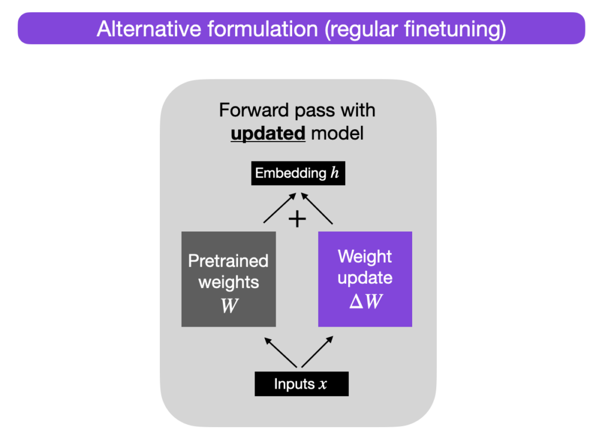
* 全量微调: 顾名思义，这种方式会更新模型的全部参数 （注意这里的全部参数是指你选中的 Block 的全部参数，**对于千帆平台就是没得调，我们无法控制调整哪些 Block**）

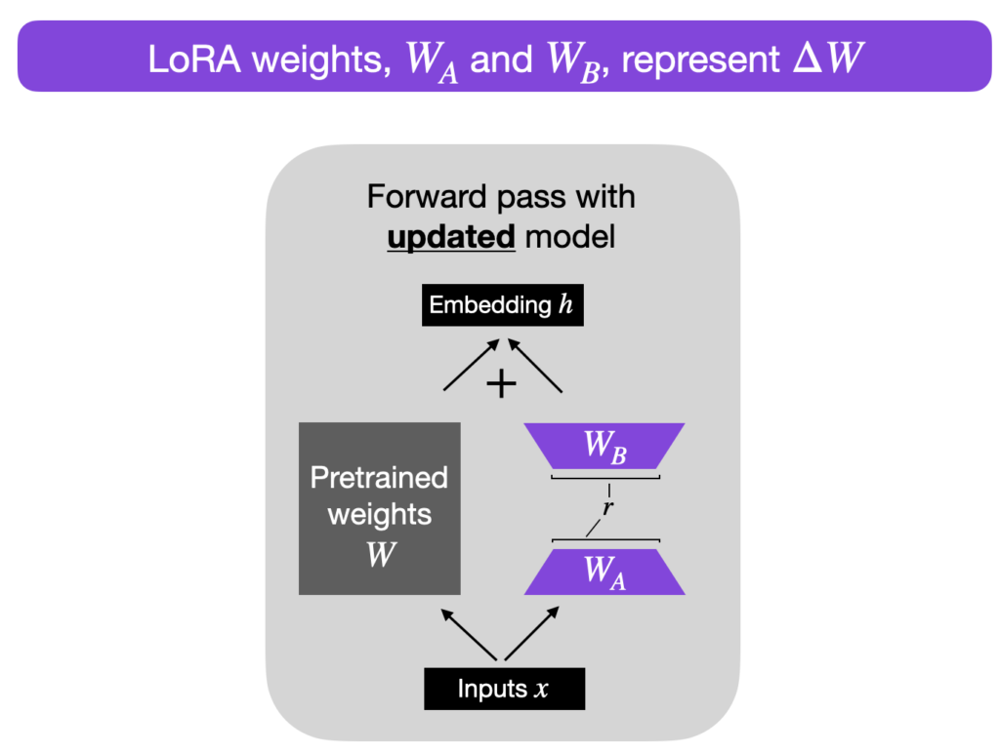
* LoRA：这种方式不会在训练中更新模型参数也不会更新全量参数，而是更新每一层注入的可训练的低秩分解矩阵。因为可以认为对于特定任务微调并不需要满秩的 W 去描述，只需要很少的秩矩阵就足够描述一个特定任务需要的特征。

#### 区别
由于只是运用不详细深入原理，感兴趣可以阅读 [LoRA](https://arxiv.org/pdf/2106.09685)，这里简单介绍下对比优缺点。对于绝大部分情况下 LoRA 就已经足够了，因为全量非常非常容易训崩，比较吃经验，LoRA 一把梭基本上一轮两轮就够了。

##### LoRA优点
1. **参数效率**

    * 大幅减少可训练参数数量(最多可减少10,000倍)
    * 显著降低内存使用和存储需求

2. **计算效率**

    * 训练速度更快(例如在GPT-3上比全量微调快25%)
    * 减少了GPU内存需求,允许使用更少的GPU进行训练

3. **灵活性**

    * 可以快速切换任务,只需替换小型LoRA权重
    * 有利于多任务或个性化应用场景

4. **性能**

    * 在多项任务上性能与全量微调相当或更优

5. **无推理延迟**

    * 可以在推理时将LoRA权重合并到原始权重中,不增加计算开销

##### LoRA缺点
1. **适用性限制**

    * 可能不适用于需要大规模改变模型行为的任务
    * 对于某些任务,可能需要仔细选择应用LoRA的层和权重矩阵

2. **调优复杂性**

    * 需要选择合适的秩r和缩放因子α
    * 可能需要针对不同任务进行超参数调整

##### 全量微调优点
1. **灵活性**

    * 可以适应更广泛的任务,包括那些需要大幅改变模型行为的任务

2. **简单性**

    * 概念简单,实现直接
    * 不需要特殊的架构修改

3. **潜在的更高性能**

    * 理论上可以达到更高的性能上限,尤其是在复杂任务上

##### 全量微调缺点
1. **资源需求高**

    * 需要大量计算资源和存储空间
    * 对于超大模型可能在实际中难以实现

2. **训练时间长**

    * 由于更新所有参数,训练时间通常较长

3. **过拟合风险**

    * 特别是在小数据集上,很容易过拟合

4. **任务切换成本高**

    * 每个任务需要存储完整的模型副本,不利于快速任务切换

5. **不适合增量学习**

    * 难以有效地整合新知识而不影响旧知识

### 微调参数
首先进入到千帆通用数据集，点击准备好的数据集右边的去精调。(注意这里假设是团队第一个人在做微调，如果是多个人需要把多个任务的数据集整合在一起微调一个模型进行部署，具体要求参考 [流程机制](https://ku.baidu-int.com/knowledge/HFVrC7hq1Q/SCIE54A-T7/76uRixugsp/V54Y7juJu7mGLc))


选择你决定好的基座模型

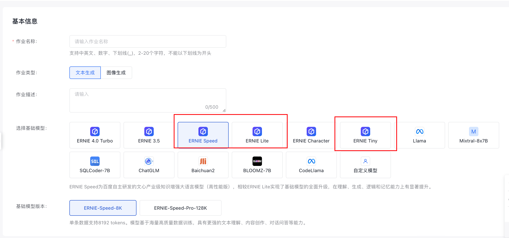
调整参数

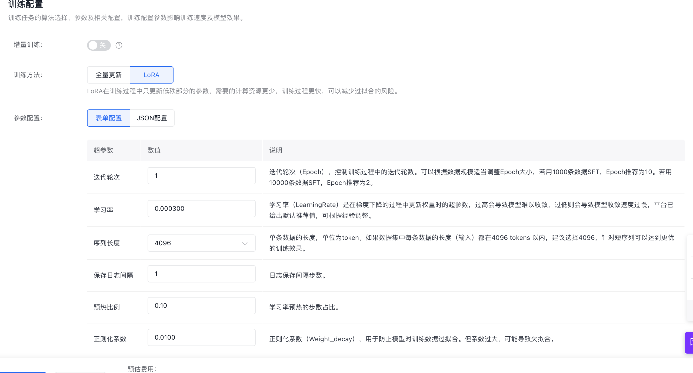
这里我们需要关注的主要参数就是，迭代次数和学习率以及 LoRA 参数，一般来说只有迭代次数需要我们调整其他参数全部都是默认即可。如果你遇到问题需要调整其他参数可以参考如下文章。

* [我该如何调整 LoRA 超参](https://lightning.ai/pages/community/lora-insights/)
* [我该如何调整学习率](https://training.continuumlabs.ai/training/the-fine-tuning-process/hyperparameters/a-process-for-choosing-the-learning-rate)
* [我该如何选择学习率计划器](https://training.continuumlabs.ai/training/the-fine-tuning-process/hyperparameters/learning-rate-scheduler)

### 微调过程
训练模型目标就是降低 Train Loss 同时尽量确保 Val Loss 和 Train Loss 一致下降，当然 Loss 不是越低越好，如果为 0 那么恭喜模型已经过拟合了，或者说模型已经把训练集背下来了。LLM 训练 Loss 绝对值是没有好坏标准的，我们需要关注的是 Loss 的下降一致性而不是绝对值的不断下降。

#### 过拟合
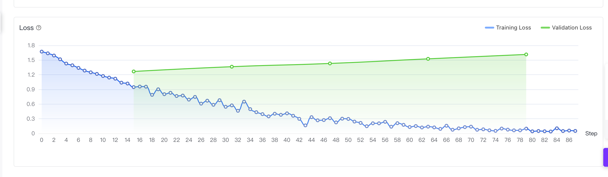
如果你看到 **训练任务 -> 任务详情 -> 评估报告** 中的 Loss 下降如图所示，那么说明模型过拟合了，Loss 接近 0 说明模型已经把训练集背下来了同时泛化能力变弱验证集的 Loss 不断提高，这样训练出的丹大概率是不能用的。此时需要考虑：

* 是不是学习率太高了
* 是不是预热比例太大
* 总步数是不是太大了
* etc...

#### 欠拟合
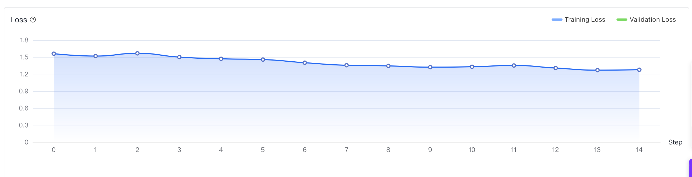
表现便是 Loss 居高不下

* 数据太差
* 学习率太小
* etc...

#### 拟合
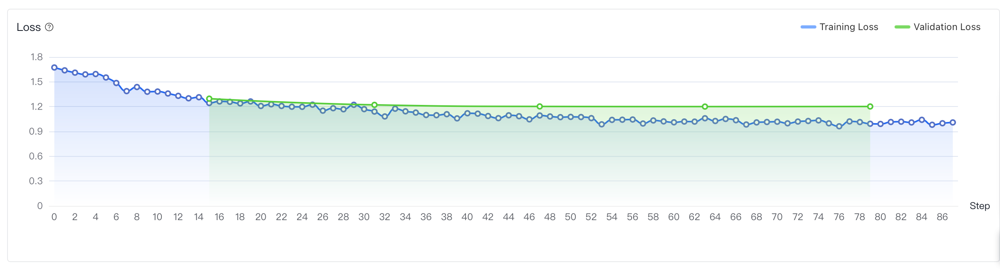
当 Training Loss 和 Validation Loss 同步缓慢下降且趋势一致时就可以认为训练没出岔子了，此时需要做的就是等待丹成然后跑测试集。

Q：如何判断 Loss 到多少算好？
A：对于LLM,没有一个固定的"好"的Loss值。Loss的好坏是相对的,更重要的是观察其下降趋势。在训练过程中,希望看到的是Loss持续下降,最终趋于稳定。

## 评估
评估需要根据自己的需要选择合适的方式，简单得说如果任务很简单就是文本生成且产品形态上和模型的生成之间没有太大的工程加工差距，那么可以直接使用平台提供的 手动/自动评估，但如果产品形态上差别比较大为了方便除了 RD 自己查看效果外，可能还得为 PM 提供对应的产品环境。

### 手动评估
打开手动[评估页面](https://console.bce.baidu.com/qianfan/modelcenter/model/manual/list)点击创建评估任务，选择好模型和测试集。


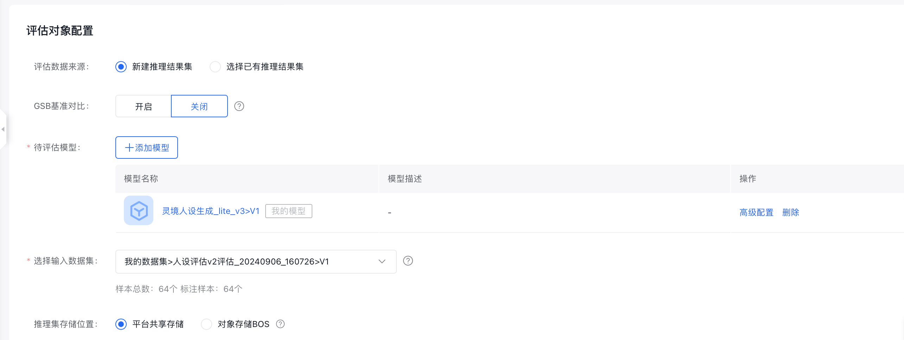
### 自动评估
自动评估首先打开训练好的 [模型](https://console.bce.baidu.com/qianfan/modelcenter/model/user/detail/am-afpkbupiiwtd)


选择好数据集平台共享


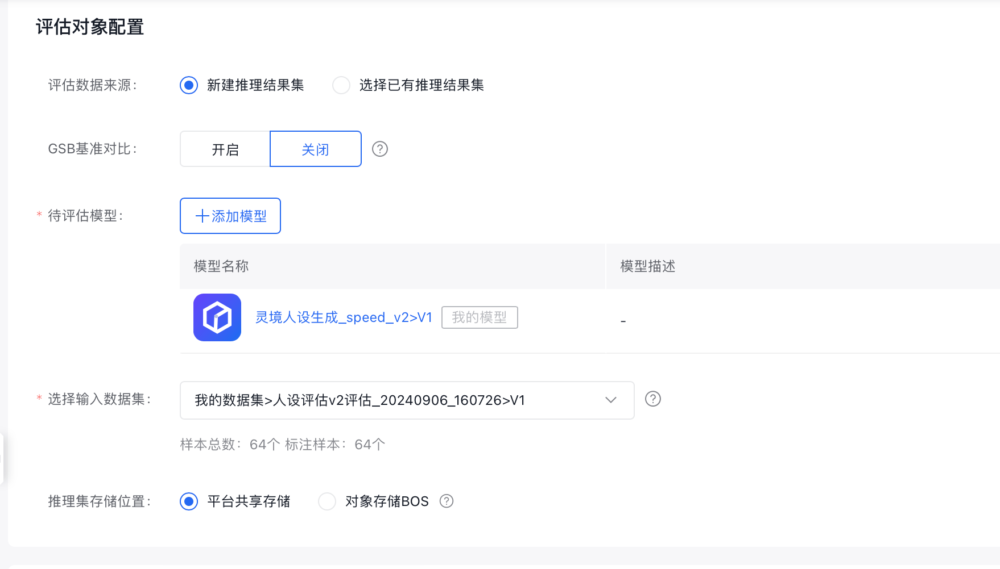

配置评估方法细节，让更好的模型打分或者按照自动规则打分。

### 自己评估
对于人设生成需要对比线上效果因此对比集合结果是通过线上代码跑固定接口请求保留下来的结果，测试集结果则是将模型先暂时部署到千帆平台然后将线上代码请求模型换成新模型跑同样的结果请求集合获取结果。对于 PM 可以参考 [ievalue平台](https://console.cloud.baidu-int.com/devops/ievalue/space/ai-ecology/task/detail/57303)范例为其提供对比打分的环境，ievalue 提供了一站式的打分和结果对比功能，可以方便的导出 GSB 结果作为参考。

比如人设生成的评估报告


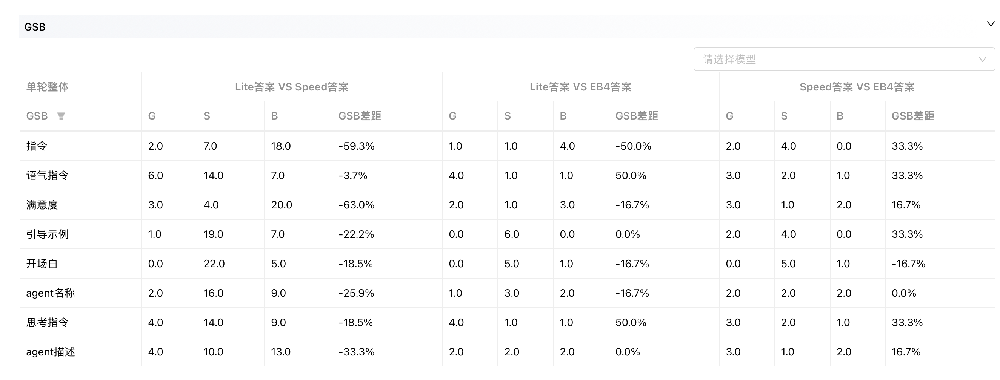
## 量化
关于量化的背景知识可以参考这篇很详细的[文章](https://mlabonne.github.io/blog/posts/Introduction_to_Weight_Quantization.html) 。简单的说量化完的模型体积更小运算更快，缺点是会牺牲一点性能 （但绝大部分情况下这一点点牺牲是值得的）。

对于在千帆平台只需要在我的模型里面点选压缩，选择好压缩策略即可 (8就够了 4 会损失多些性能)。

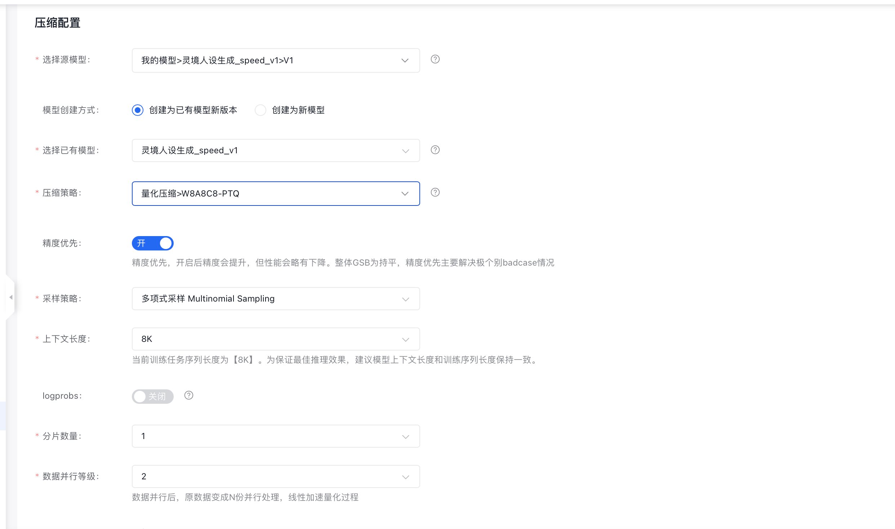
## 部署
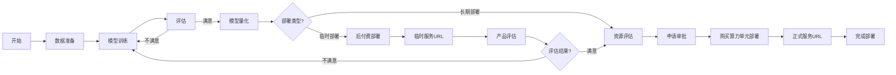
经过 SFT 后的模型部署只能采取 **”后付费“，”购买算力单元“ **两种方式部署，简单的说都是租卡，前者租多久算多久的钱，后者一次租一个月或者一段时间到期续费，前者比后者贵，但前者申请流程比后者简单得多，因此前者用于临时部署提供环境，后者用于线上正式服务。

### 临时部署
临时部署主要用于评估阶段，用来提供模型服务方便一些必须结果模型后才能运行的产品环境直接使用新模型查看效果。

首先进入我的模型页面，对已经压缩好的模型选择部署


填好基本信息后按照如下方式选择

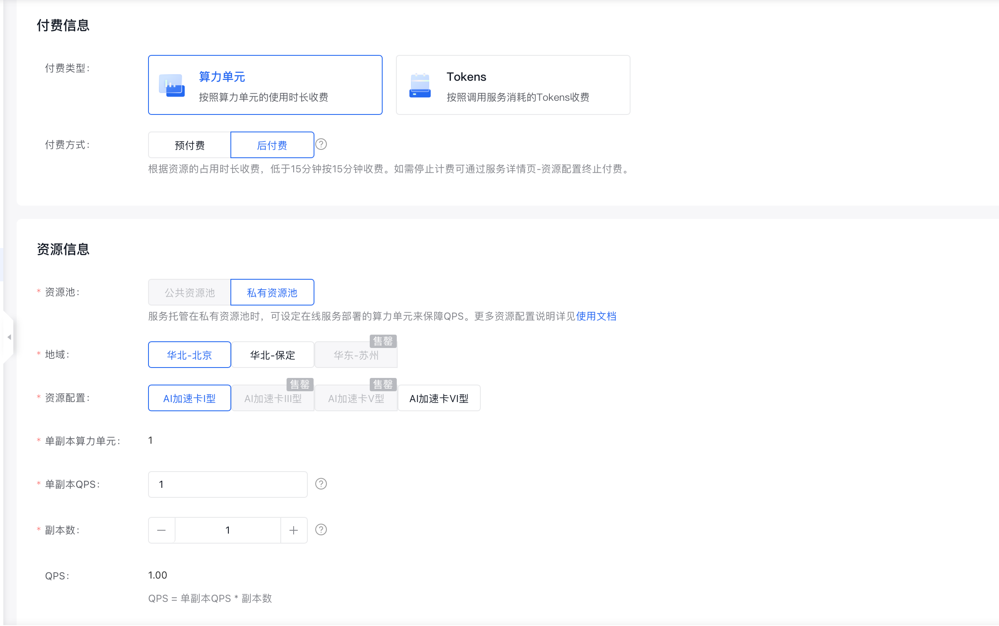
其中的单副本 QPS 只是限制并不是只能 1 ，可以调大一些比如 10。副本数就是卡数，评估一般一张就够了。部署完后就可以使用我们的 appid 和 sk ak 直接方法接口了，不过此时无法透过统一 BFE 访问服务，因为需要加白名单，此时需要将 wenxinworkshop 服务改成直接请求千帆。

```toml
Name = "wenxinworkshop"

# 连接超时
ConnTimeOut = 1000
# 写数据超时
WriteTimeOut = 5000
# 读数据超时
ReadTimeOut = 5000
# 请求失败后的重试次数：总请求次数 = Retry + 1
Retry = 1

Protocol = "HTTPS" # http / https / nshead
# 资源定位：手动配置 - 使用 Host、端口
[Resource.Manual]
# 当没有IDC能匹配的时候，会使用 default
[[Resource.Manual.default]]
# Host 可以是 IP 或者 域名、主机名
Host = "aip.baidubce.com"
# Port 是服务的端口，必填
Port = 80
```
其中的启动参数，需要关注的是 BATCH_SIZE。其决定了部署服务的吞吐量。

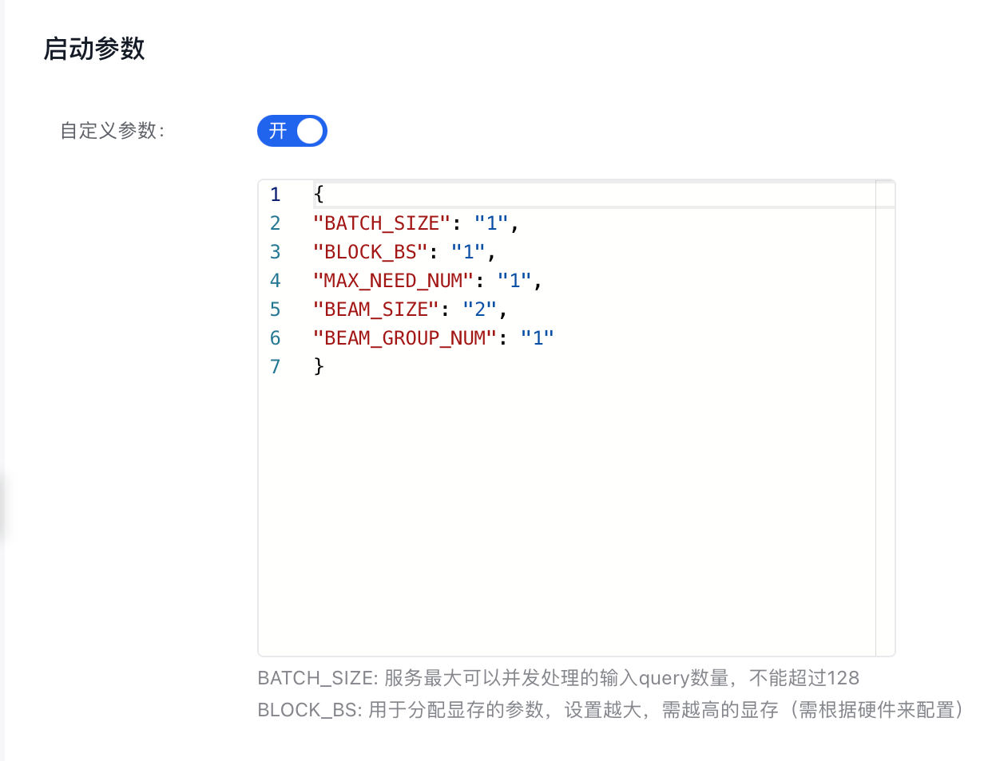
### 长期部署
长期部署步骤应该尽量确保部署的模型已经做好了量化。区别在于一些参数填选上，同时需要做好完善的资源需求计算以确保服务能扛住。

#### 资源计算
1. 参考目前线上需要替换的模型的使用 QPS TPM RPM，记录他们的分位性能值 (你想要保证的分位性能)。比如 90 分位分别为 0.2 QPS 10K TPM 33 RPM。
2. 分别使用平均 0.2 QPS （注意平均不代表峰值），10K TPM，和  33 RPM 对临时部署的单卡机器进行压测。随后一直加倍压测，如果观察到平均响应时间开始显著提升则说明触碰到了最高吞吐能力。
3. 压测过程中可以尝试以加倍方式不断提高 BatchSize 以提高吞吐量，直到提高完 BatchSize 无法部署（超过显存限制了）。
4. 记录满足需求的平衡速度和吞吐**最佳的 BatchSize  和计算卡**数量。作为部署资源量。

由于千帆没有提供给用户大量部署微调模型的资源计算工具，也没提供计算卡的具体型号显存大小，模型的大小，而模型的吞吐又取决于 模型大小，是否量化， 批大小，输入/输出序列长度，输出策略（比如 beam search 就会存储多个候选序列）等等。因此很难说一定在一个任务上一套参数可以直接套到另一个任务上，因此最保险的方式还是按照上述流程进行详细压测确定资源需求量。

[人设资源评估](https://ku.baidu-int.com/knowledge/HFVrC7hq1Q/pKzJfZczuc/pJNP9LPBcb/fvC3rFqsm_67FE) 使用 QPS 压测方式确定资源量。

#### 审批
完成计算后按照[申请流程](https://ku.baidu-int.com/knowledge/HFVrC7hq1Q/SCIE54A-T7/76uRixugsp/V54Y7juJu7mGLc)微调模型直接在千帆请求申请部署，填写收益背景等待审批通过。

## 使用
当部署完后直接使用部署页面提供的链接即可访问，接口协议兼容目前的 ai-appengine wenxinworkshop llm 实现，理论上直接替换完 path 就能使用。

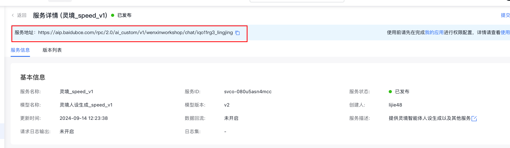
正式上线后需要在群 9837921 找 wangmeng41 开通此 path 走 bfe 的白名单，提供 APPID
PATH 和 QPS （QPS 可以报高一点）即可。随后使用方式和使用 EB4-Turbo 没有任何区别。

```toml
# WenxinAppID 文心一言AppID
WenxinAppID = "42972409"
# WenxinAK 文心一言ak
WenxinAK = ""
# WenxinSK 文心一言sk
WenxinSK = ""
# WenxinPath 文心一言服务path
WenxinPath = "/rpc/2.0/ai_custom/v1/wenxinworkshop/chat/completions_pro"
# SpeedPath 微调后 Speed 模型 path
SpeedPath = "/rpc/2.0/ai_custom/v1/wenxinworkshop/chat/iqo11rg3_lingjing"
```


# 展望
优化即有任务的时延/效果/降低成本只能说是存量上优化，如何将微调应用到有效的可复用的增量需求上才更重要。

## 前景
目前对齐技术的进步让我们有可能实现以前很难做到的事情，比如：

* 实现平台级别 Copilot ，支持在用户 创建Agent/Workflow 时提供实时的指导/建议/补全，从源头提高高质量智能体创建占比。
* 对于需要依赖强人设固定的垂类 Agent，少量的人设对齐数据就可以达到较佳的效果。

## 困难
如何低成本的进行应用实际上是个相当困难的问题。无论是微调还是对齐最最困难的实际上是高质量数据的获取或者生成。对于固定规则范围的环境我们也许可以针对某些类别合成大量数据，但对于不固定的环境人力编写依然不可避免，对于后者 “有多少人工就有多少智能” 就是事实。

实际上这对工程人员提出了更高的要求：

* 知道什么可以通过微调/对齐提高效果，在开发和设计中提前预留好优化数据的获取通路或设计。
    * 比如 workflow 的编辑操作数据和运行操作数据，可以变成训练 workflow 创建助手的对齐数据
    * 同理  agent 的创建过程和编辑操作数据，也可以成为训练 agent 创建助手的对齐数据。

* 需要有统筹的微调/对齐数据管理，确保多个垂直任务之间不会有影响。

