> 原文：https://ku.baidu-int.com/knowledge/HFVrC7hq1Q/KeF15lNOtH/-UXFkEkRyR/68kNveYzCOQb0I

Go TUI 开发

## 1、什么是 TUI？
### 1.1 定义
* **TUI**（Text User Interface）是“文本用户界面”的缩写。它是一种用户界面，允许用户通过文本输入和输出与计算机程序进行交互。TUI 通常在命令行界面（CLI）中使用，提供比基本的命令行更丰富的交互体验，支持窗口、菜单、按钮和其他图形元素，但仍然是基于文本的。
* 与 GUI 相比，TUI 不依赖操作系统接口，只要终端支持 ANSI 转义码即可工作，因此**轻量、跨平台、适合服务器/容器场景**。
* 典型代表：`htop`、`vim`、`lazygit`、`docker`。

### 1.2 优点
* **轻量、快速**: TUI 应用几乎不消耗图形资源，启动快，响应迅速。
* **环境无关性**: 只要有终端，就能运行。这使得 TUI 应用在服务器管理、SSH 远程操作等场景下无可替代。
* **专注高效**: TUI 通常没有干扰性的弹窗和动画，让用户能更专注于核心任务，并且大量操作可通过键盘完成，效率极高。
* **极客美学**: TUI 带有强烈的复古风格和黑客文化气息，能创造出简洁而美观的应用

### 1.3 工作原理
TUI 的界面看起来很神奇，它到底是如何在纯文本的终端里实现的呢？核心在于 **ANSI 转义序列**。

#### 1.3.1 ANSI 转义序列 (ANSI Escape Codes)
ANSI 转义序列（ANSI Escape Sequences）是一种用于控制终端文本显示格式的标准编码，通过插入特定的字符序列来实现颜色、光标移动、清屏等终端控制功能。它最初由 **ANSI（美国国家标准协会）** 标准化，现被广泛支持于 Unix/Linux 终端、Windows 10+ 的终端（如 PowerShell、WT）等。

这是 TUI 的魔法核心。它是一些特殊的、以 `ESC` (`\x1b`) 字符开头的字节序列。当终端模拟器接收到这些序列时，它不会把它们当成普通文本显示出来，而是会将其解释为一条条**指令**。

**基本语法**

所有 ANSI 转义序列都遵循一个通用的格式，以两个特殊字符开头：

1. **ESC (Escape)**: ASCII 码中的 `\e`、`\x1b` 或 `\033`。这是一个非打印字符，标志着转义序列的开始。
    1. `\e` - 这是 ESC 字符的直接转义序列表示法
        1. 主要用于支持 ANSI 转义序列的语言和环境中
        2. 是一种更现代和直观的表示方法

    2. `\x1b` - 这是 ESC 字符的十六进制表示法
        1. "\x" 表示后面跟着的是十六进制数
        2. 1b 是十进制 27 的十六进制表示（27 = 1×16 + 11 = 1b)
        3. 这种表示法在几乎所有编程语言中都得到支持

    3. `\033` - 这是 ESC 字符的八进制表示法
        1. 开头的 "0" 表示这是八进制数
        2. 十进制 27 转换为八进制是 33（27 = 3×8 + 3 = 33)
        3. 这是较传统的表示方法，在 C 语言等早期编程语言中常见


2. `[`** (左方括号)**: 这个字符紧跟在 `ESC` 之后，表示这是一个 **CSI (Control Sequence Introducer，控制序列引导符)** 序列。绝大多数常用的 ANSI 代码都属于 CSI 类型。

因此，一个典型的 ANSI 序列看起来像这样：`ESC [ <参数> <命令>`

* `<参数>`** (Parameters)**: 这是由分号 `;` 分隔的一个或多个可选数字。它们用来指定具体的样式、颜色或位置。如果省略，通常会有一个默认值（大多是 0 或 1）。
* `<命令>`** (Command)**: 这是一个或多个字母，位于序列的末尾，决定了这个序列要执行什么操作（例如，设置颜色、移动光标等）。


##### 最常用的序列类型：SGR (Select Graphic Rendition，图形渲染选择)
SGR 是用于设置文本样式和颜色的序列，它的**命令**是 `m`。这是迄今为止最常用的一种 ANSI 序列。

**语法**: `\x1b[<参数>m`

* 如果有多个参数，用分号隔开：`\x1b[<参数1>;<参数2>;...m`


这些指令可以做到：

* **移动光标**: 向上、向下、向左、向右，或移动到屏幕任意 `(x, y)` 位置。
* **修改样式**: 改变文本的前景色、背景色、设置粗体、下划线等。
* **屏幕操作**: 清空屏幕、清空当前行等。

```bash
# \x1b 是 ESC 的十六进制表示
# [31m 是设置前景为红色的指令
# [0m 是重置所有样式的指令
# m 表示设置颜色或文本样式
echo "\x1b[31m这是红色的文字\x1b[0m这是白色的字"

# [1;34m 是设置粗体(1)和蓝色(34)，多个代码使用分号隔开
echo "\033[1;34m这是粗体的蓝色文字\033[0m这是白色的字"

# 将光标移动到第 10 行第 5 列，并打印文字
echo "\e[10;5HHello, TUI"
```
##### 文本样式指令
|样式|代码|示例|
|-|-|-|
|重置|0|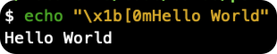|
|粗体|1|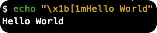|
|暗淡|2|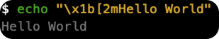|
|斜体|3|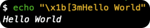|
|下划线|4|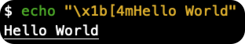|
|闪烁|5|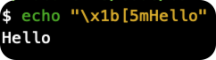|
|反显|7|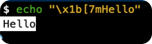|
|隐藏|8|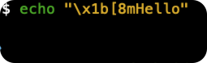|
|删除线|9|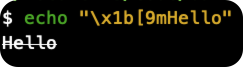|

##### 颜色指令：
这是最基础、兼容性最好的颜色方案，通常支持 8 种标准颜色和 8 种高亮颜色。

背景色代码 = 前景色代码 + 10

|颜色|前景色代码|背景色代码|前景色示例|背景色示例|
|-|-|-|-|-|
|黑色|30|40|||
|红色|31|41|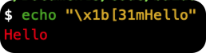|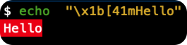|
|绿色|32|42|||
|黄色|33|43|||
|蓝色|34|44|||
|紫色|35|45|||
|青色|36|46|||
|白色|37|47|||
|默认|39|49|||
|亮黑|90|100|||
|亮红|91|101|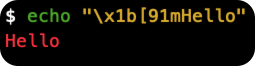|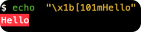|
|...|||||
|亮白|97|107|||

##### 扩展颜色 (8-bit, 256 色)
现代终端大多支持 256 色。

**语法**:

* 前景色: `\x1b[38;5;<颜色代码>m`
* 背景色: `\x1b[48;5;<颜色代码>m`

其中 `<颜色代码>` 是 0 到 255 之间的一个数字。

**颜色编号分布:**

0-255的颜色编号分为几个部分：

* 标准颜色（0-15）：
    * 0-7: 标准ANSI颜色（黑、红、绿、黄、蓝、洋红、青、白）
    * 8-15: 高亮ANSI颜色

* 216色立方体（16-231）：
    * 由6×6×6的RGB立方体组成
    * 计算公式：16 + 36×r + 6×g + b （其中r,g,b为0-5的值）

* 24级灰度（232-255）：从深灰到浅灰的24个级别

```bash
# 使用颜色代码 208 (一种橙色) 作为前景色
echo "\x1b[38;5;208m橙色文本\x1b[0m"

# 使用颜色代码 27 (一种蓝色) 作为背景色
echo "\x1b[48;5;27m蓝色背景\x1b[0m"
```
##### 真彩色 (24-bit, 約 1600 万色)
最新的终端还支持真彩色。

**语法**:

* 前景色: `\x1b[38;2;<R>;<G>;<B>m`
* 背景色: `\x1b[48;2;<R>;<G>;<B>m`

其中 `<R>`, `<G>`, `<B>` 是 0 到 255 之间的 RGB 颜色值。

```bash
# 设置前景色为 RGB(255, 105, 180)，即 粉色
echo "\x1b[38;2;255;105;180m粉色文本\x1b[0m\n"
```


##### 光标控制
除了文本样式，ANSI 序列还能控制光标在屏幕上的位置。

|序列|代码|描述|
|-|-|-|
|`\x1b[<n>A`|A|光标**向上**移动 `n` 行|
|`\x1b[<n>B`|B|光标**向下**移动 `n` 行|
|`\x1b[<n>C`|C|光标**向右**移动 `n` 行|
|`\x1b[<n>D`|D|光标**向左**移动 `n` 行|
|`\x1b[<n>;<m>H`|H|将光标移动到第 `n` 行，第 `m` 列|
|`\x1b[2J`|J|**清空整个屏幕**，并将光标移动到左上角|
|`\x1b[K`|K|清除从光标到行尾的内容|

```bash
# 移动到第 5 行第 10 列并打印文本
echo "\x1b[5;10HHello from a specific location"

# 向上移动 1 行，然后清除该行内容
echo "\x1b[1A\x1b[K"
```
### 注意事项
* 不同的终端可能对 ANSI 颜色的支持有所不同。
* 使用时确保终端支持 ANSI 转义序列。


#### 1.3.2  终端模拟器 (Terminal Emulator)
我们通常使用的不是真正的“终端”，而是一个“终端模拟器”，例如 `iTerm2`, `Windows Terminal`。这个程序模拟了早期物理终端的行为，负责解释我们输入的内容，并显示程序的输出。

这些模拟器有两个核心职责：

1. **接收文本流**: 从程序（通过 `stdout`）接收普通文本并显示出来。
2. **解释控制序列**: 接收特殊的字节序列（即 **ANSI 转义序列**），不把它们当成文本显示，而是将其作为**命令**来执行，例如“移动光标”、“改变颜色”、“清空屏幕”等。

TUI 程序就是利用了第二点，它不是输出简单的文本，而是精心构造一个包含文本和大量控制命令的字节流，来精确地“绘制”界面。

****

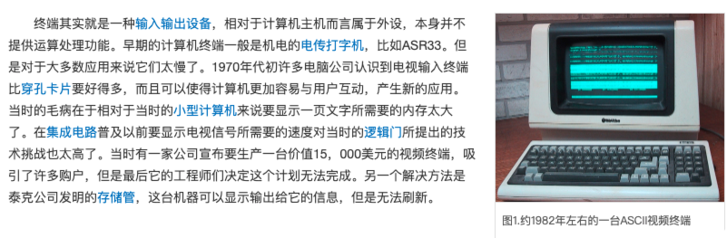


#### 1.3.3 输入处理 （Input)
默认情况下，终端工作在**规范模式 (Canonical Mode)** 或称“行缓冲模式”下。

* **特点**: 终端会自己处理用户的输入，包括退格、左右移动光标等。它会将输入缓存起来，直到用户按下 `Enter` 键，才把一整行数据发送给程序的 `stdin`。
* **适用场景**: 简单的命令行工具，如 `ls`, `grep`。

但 TUI 需要实时响应每一个按键（比如在 `vim` 中按 `j` 就立刻下移），所以它必须关闭规范模式，进入**原始模式 (Raw Mode)**。

* **特点**: 在原始模式下，终端的行缓冲和内置编辑功能被禁用。**每一个按键（包括 **`Ctrl+C`**、方向键、**`Tab`** 等）都会被立即、未经处理地作为原始字节发送给程序的 **`stdin`。
* **实现**: 程序通过系统调用（如 POSIX 系统中的 `tcsetattr`）来修改终端的属性，将其设置为原始模式。这是 TUI 实现实时交互的**最核心前提**。


#### 1.3.4  核心循环 (The Event Loop)
一个典型的 TUI 应用生命周期如下：

1. **初始化 (Init)**: 进入原始模式，清空屏幕，准备应用的初始状态。
2. **渲染 (Render/View)**: 根据当前状态，生成界面的字符串（包含大量 ANSI 转义序列）。
3. **显示 (Display)**: 将生成的字符串打印到标准输出，终端解释并显示界面。
4. **等待事件 (Wait for Event)**: 阻塞并等待用户输入（键盘、鼠标、窗口大小变化等）。
5. **处理事件 (Update)**: 收到事件后，更新应用的状态。
6. **循环**: 回到第 2 步，根据新的状态重新渲染界面。
7. **退出**: 恢复终端的默认模式，程序结束。

这个 `Render -> Wait -> Update` 的循环就是所有 TUI 应用的灵魂。

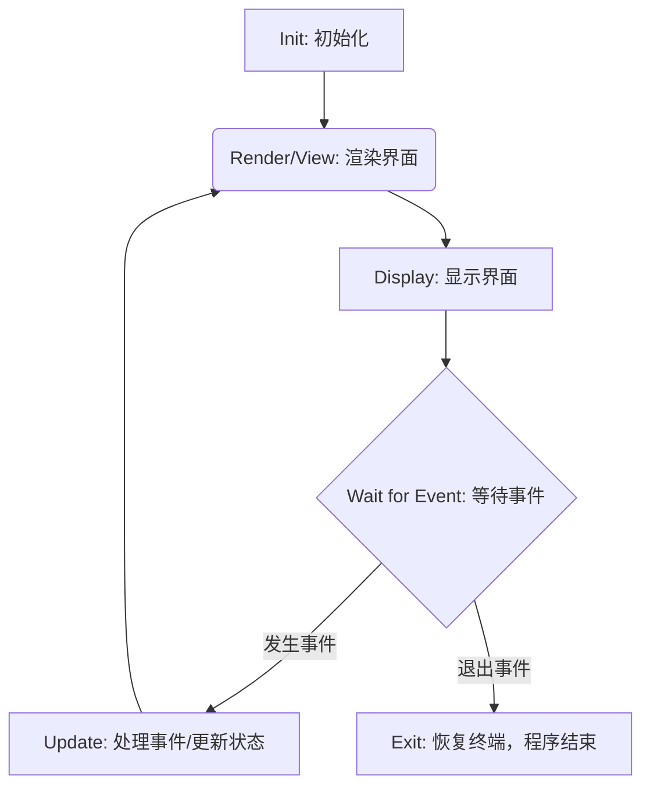
## 2.  Go TUI 开发
### 2.1 Go TUI 开发的优势
go 语言特性与 TUI 开发的需求非常契合

* go 的高性能保证了 TUI 界面的流畅刷新
* 强大的并发能力可以轻松处理后台任务而不阻塞
* 静态编译与交叉编译，意味着 TUI 程序可以轻松编译成一个无任何依赖的二进制文件，从而分发到任何平台， 这对工具类应用的传播和部署来说都非常有优势；

### 2.2 Go TUI 开发库
手动管理 ANSI 序列和事件循环非常繁琐，因此我们通常会使用 TUI 库。Go 的生态非常丰富，有很多优秀的 TUI 库，可以帮我们处理这些底层细节问题，我们只需要专注业务逻辑开发即可；

|名称|定位|特点|适合场景|
|-|-|-|-|
|**bubbletea**|框架|Elm 架构、函数式、并发安全、官方组件丰富|状态机复杂、需要动画/进度条/表格|
|**tview**|组件库|预置 UI 组件（form/table/tree/modal），基于 tcell|快速搭建后台管理系统、配置向导|
|**lipgloss**|样式库|独立使用，也可与任意库搭配；类似 CSS 的声明式样式|需要美观彩色边框、对齐、渐变|
|**bubbles**|官方组件|与 bubbletea 配套：textinput、viewport、spinner、list、table…|直接 import 即可|
|**termui**|已归档|2019 停止维护，不建议新项目使用|—|
|**termbox-go**|底层驱动|极简，仅提供 cell 级绘制|想自己造轮子|
|**promptui**|交互 prompt|单行选择/输入，适合 CLI 脚本|轻量级问答|

### 2.3 使用 BuubleTea 开发 TUI 程序
#### 2.3.1 为什么选择 BuubleTea
* **模式清晰**: 强制使用 `Model-View-Update` (MVU) 模式，使代码结构清晰，易于维护。
* **声明式**: 你只需要关心“在当前状态下，界面应该长什么样”，而不用去写“先把光标移到这，再把颜色改成红”这样的指令式代码。
* **生态强大**: 配套的 `Bubbles` (组件库) 和 `Lip Gloss` (样式库) 让开发和美化 TUI 应用变得极其简单。

#### 2.3.2 核心概念 MVU
* `Model`: 一个 Go `struct`，代表了你应用在某一时刻的 **所有状态**。例如，计数器的当前数字、列表的所有选项、当前光标的位置等。
* `Update`: 一个方法，签名为 `(msg tea.Msg) (tea.Model, tea.Cmd)`。它的职责是接收一个消息 `msg`（例如一次按键），并根据这个消息来 **更新 **`Model`** 的状态**。它返回更新后的 `Model`。
* `View`: 一个方法，签名为 `() string`。它的职责是读取当前 `Model` 的状态，并返回一个 **描述当前界面的字符串**。`Bubble Tea` 会负责将这个字符串渲染到终端。

此外，还有 `Init` 方法用于初始化和 `Cmd` 用于执行异步/IO 操作。

#### 2.3.3 关键特性
Bubble Tea 提供了多项特性，使终端 UI 开发更加易于上手：

* **终端管理**：自动处理原始模式、替代屏幕和终端恢复
* **输入处理**：以平台无关的方式处理键盘和鼠标输入
* **渲染**：高效地**仅更新屏幕的变更部分**
* **命令**：通过简单的命令模式管理异步操作
* **跨平台**：在类 Unix 系统和 Windows 上一致工作

#### 2.3.4 生命周期
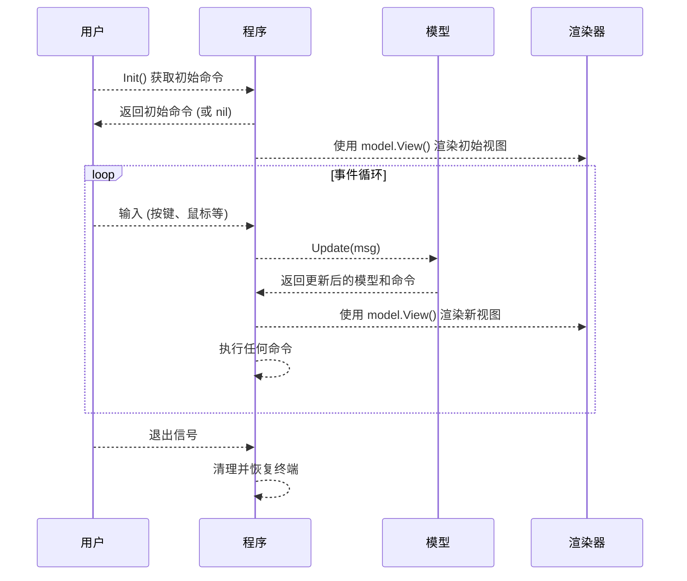
## 3 示例
### 3.1 示例 1：一个简单的计数器
让我们创建一个程序，显示一个数字，按 `+` 或 `→` 增加，按 `-` 或 `←` 减少，按 `q` 或 `esc` 退出。

```go
package main

import (
	"fmt"
	"os"

	tea "github.com/charmbracelet/bubbletea"
)

// Model 定义了应用的状态
type model struct {
	counter int
}

// Init 是初始化的函数，可以在这里执行一些初始命令
func (m model) Init() tea.Cmd {
	return nil
}

// Update 处理所有的事件和消息
func (m model) Update(msg tea.Msg) (tea.Model, tea.Cmd) {
	// 将消息转换为按键消息
	switch msg := msg.(type) {
	case tea.KeyMsg:
		// 判断具体是哪个按键
		switch msg.String() {
		// 退出程序的按键
		case "q", "esc", "ctrl+c":
			return m, tea.Quit

		// 增加计数的按键
		case "+", "l", "right":
			m.counter++

		// 减少计数的按键
		case "-", "h", "left":
			m.counter--
		}
	}
	// 返回更新后的 model
	return m, nil
}

// View 负责渲染界面
func (m model) View() string {
	s := "一个简单的计数器\n\n"
	s += fmt.Sprintf("当前计数: %d\n\n", m.counter)
	s += "使用 ->, <-, +, - 来增减计数.\n"
	s += "按 'q' 或 'esc' 退出.\n"
	return s
}

func main() {
	// 创建一个初始化的 model
	initialModel := model{counter: 0}
	
	// 创建一个新的 Bubble Tea 程序
	p := tea.NewProgram(initialModel)
	
	// 运行程序
	if _, err := p.Run(); err != nil {
		fmt.Printf("程序运行出错: %v", err)
		os.Exit(1)
	}
}
```
### 3.1 示例 2：一个可交互的选择列表
```go
package main

import (
	"fmt"
	"os"

	tea "github.com/charmbracelet/bubbletea"
)

type model struct {
	choices  []string // 列表选项
	cursor   int      // 光标位置
	selected map[int]struct{} // 已选择的项
}

func initialModel() model {
	return model{
		choices:  []string{"购买胡萝卜", "购买芹菜", "购买甘蓝"},
		selected: make(map[int]struct{}),
	}
}

func (m model) Init() tea.Cmd {
	return nil
}

func (m model) Update(msg tea.Msg) (tea.Model, tea.Cmd) {
	switch msg := msg.(type) {
	case tea.KeyMsg:
		switch msg.String() {
		case "ctrl+c", "q":
			return m, tea.Quit // 退出程序

		case "up", "k":
			if m.cursor > 0 {
				m.cursor--     // 向上移动光标
			}

		case "down", "j":
			if m.cursor < len(m.choices)-1 {
				m.cursor++    // 向下移动光标
			}

		case "enter", " ":
			_, ok := m.selected[m.cursor]
			if ok {
				delete(m.selected, m.cursor)
			} else {
				m.selected[m.cursor] = struct{}{}
			}
		}
	}
	return m, nil
}

func (m model) View() string {
	s := "你的购物清单有什么？\n\n"

	for i, choice := range m.choices {
		cursor := " " // 光标默认是空格
		if m.cursor == i {
			cursor = ">" // 光标在当前行时
		}

		checked := " " // 默认未选中
		if _, ok := m.selected[i]; ok {
			checked = "x" // 选中时
		}

		s += fmt.Sprintf("%s [%s] %s\n", cursor, checked, choice)
	}

	s += "\n按 'q' 退出。\n"
	return s
}

func main() {
	p := tea.NewProgram(initialModel())
	if _, err := p.Run(); err != nil {
		fmt.Printf("运行出错: %v", err)
		os.Exit(1)
	}
}
```
### 3.3 示例 3：文件浏览器
```go

package main

import (
    "fmt"
    "io"
    "log/slog"
    "net/http"
    "os"
    "path/filepath"
    "strings"

    tea "github.com/charmbracelet/bubbletea"
    "github.com/charmbracelet/lipgloss"
)

var logger *slog.Logger

/* ---------- 通用 Split 组件 ---------- */

type split struct {
    ratio    float64 // 0~1
    minLeft  int
    minRight int
}

// 根据当前终端尺寸返回两条矩形
func (s split) calc(w, h int) (a, b rect) {

    splitCol := int(float64(w) * s.ratio)

    if splitCol < s.minLeft {
        splitCol = s.minLeft
    }

    if w-splitCol < s.minRight {
        splitCol = w - s.minRight
    }

    return rect{0, 0, splitCol, h}, rect{splitCol, 0, w - splitCol, h}
}

type rect struct{ x, y, w, h int }

/* ---------- 数据 ---------- */

type model struct {
    split split

    left      []string // 文件列表
    leftPaths []string // 文件路径列表

    right string // 正文

    leftSel int // 左栏高亮行

    focus bool // false=left true=right

    termW, termH int

    currentPath string // 当前浏览的路径

    rightScroll int // 右侧窗口滚动位置
}

func initialModel(path string) model {
    // 如果没有提供路径，使用当前目录
    if path == "" {
        path = "."
    }

    // 获取绝对路径
    absPath, err := filepath.Abs(path)
    if err != nil {
        absPath = path
    }

    // 读取目录内容
    files, paths := readDir(absPath)

    return model{
        split: split{
            ratio:    0.3,
            minLeft:  15,
            minRight: 20,
        },
        left:        files,
        leftPaths:   paths,
        right:       "Select a file on the left side...",
        currentPath: absPath,
        rightScroll: 0, // 初始化滚动位置为0
    }
}

// 读取目录内容
func readDir(path string) ([]string, []string) {
    var files []string
    var paths []string

    // 读取目录
    entries, err := os.ReadDir(path)
    if err != nil {
        return []string{fmt.Sprintf("Error reading directory: %v", err)}, []string{}
    }

    // 添加父目录选项
    if path != "/" {
        files = append(files, "..")
        paths = append(paths, filepath.Dir(path))
    }

    // 添加文件和目录
    for _, entry := range entries {
        name := entry.Name()
        if entry.IsDir() {
            name += "/"
        }
        files = append(files, name)
        paths = append(paths, filepath.Join(path, entry.Name()))
    }

    return files, paths
}

// 检查文件是否为文本类型
func isTextFile(path string) bool {
    // 读取文件的前512字节用于类型检测
    buffer := make([]byte, 512)
    file, err := os.Open(path)
    if err != nil {
        return false
    }
    defer file.Close()

    n, err := file.Read(buffer)
    if err != nil && err != io.EOF {
        return false
    }

    // 使用http.DetectContentType检测内容类型
    contentType := http.DetectContentType(buffer[:n])

    // 检查是否为文本类型
    return strings.HasPrefix(contentType, "text/") ||
        contentType == "application/json" ||
        contentType == "application/xml" ||
        contentType == "application/javascript" ||
        contentType == "application/x-sh"
}

// 读取文件内容
func readFileContent(path string) string {
    // 检查是否是目录
    info, err := os.Stat(path)
    if err != nil {
        return fmt.Sprintf("Error accessing file: %v", err)
    }

    if info.IsDir() {
        // 如果是目录，列出目录内容
        entries, err := os.ReadDir(path)
        if err != nil {
            return fmt.Sprintf("Error reading directory: %v", err)
        }

        var content strings.Builder
        content.WriteString(fmt.Sprintf("Directory: %s\n\n", path))

        // 添加父目录选项（如果不是根目录）
        if path != "/" {
            content.WriteString(".. (Parent directory)\n")
        }

        for _, entry := range entries {
            if entry.IsDir() {
                content.WriteString(fmt.Sprintf("%s/\n", entry.Name()))
            } else {
                content.WriteString(fmt.Sprintf("%s\n", entry.Name()))
            }
        }

        return content.String()
    }

    // 检查是否为文本文件
    if !isTextFile(path) {
        return "Unsupported file type. Only text files can be viewed."
    }

    // 如果是文件，读取内容
    content, err := os.ReadFile(path)
    if err != nil {
        return fmt.Sprintf("Error reading file: %v", err)
    }

    // 检查文件大小，避免显示过大的文件
    if len(content) > 100000 { // 100KB限制
        return fmt.Sprintf("File is too large to display (size: %d bytes)", len(content))
    }

    return string(content)
}

func init() {
    // 记录ui到日志文件
    logFile, err := os.OpenFile("./ui.log", os.O_TRUNC|os.O_CREATE|os.O_WRONLY, 0644)

    if err != nil {
        logger = slog.New(slog.NewTextHandler(os.Stderr, nil))
    } else {
        logger = slog.New(slog.NewTextHandler(logFile, nil))
    }
}

/* ---------- Init ------------- */

// Init 初始化模型，返回初始命令
// 进入替代屏幕模式，这是 Bubble Tea 应用的标准做法
func (m model) Init() tea.Cmd {
    // tea.EnterAltScreen 用于将终端切换到备用屏幕缓冲区（alternate screen buffer）。
    // 备用屏幕缓冲区是终端的一个特性，它允许程序在不覆盖当前终端内容的情况下显示全屏界面。
    // 当你退出程序时，终端会自动恢复到进入程序之前的状态，这样就不会丢失之前在终端中输入的内容。
    return tea.Batch(tea.EnterAltScreen)
}

/* ---------- Update ---------- */
func (m model) Update(msg tea.Msg) (tea.Model, tea.Cmd) {

    switch msg := msg.(type) {
    case tea.KeyMsg:
        switch msg.String() {
        case "ctrl+c", "q":
            return m, tea.Quit
        case "tab":
            m.focus = !m.focus
            return m, nil

        }

        if !m.focus { // 左栏控制
            switch msg.String() {
            case "up", "k":
                if m.leftSel > 0 {

                    m.leftSel--

                    // 更新右侧内容
                    if len(m.leftPaths) > m.leftSel {
                        m.right = readFileContent(m.leftPaths[m.leftSel])
                        m.rightScroll = 0 // 重置滚动位置
                    }

                }

            case "down", "j":
                if m.leftSel < len(m.left)-1 {
                    m.leftSel++
                    // 更新右侧内容
                    if len(m.leftPaths) > m.leftSel {
                        m.right = readFileContent(m.leftPaths[m.leftSel])
                        m.rightScroll = 0 // 重置滚动位置
                    }
                }

            case "enter":
                // 进入选中的目录或显示文件内容
                if len(m.leftPaths) > m.leftSel {
                    path := m.leftPaths[m.leftSel]

                    // 检查是否是目录
                    info, err := os.Stat(path)
                    if err == nil && info.IsDir() {
                        // 进入目录
                        m.currentPath = path
                        m.left, m.leftPaths = readDir(path)
                        m.leftSel = 0
                        m.rightScroll = 0 // 重置滚动位置

                        // 显示新目录的内容
                        if len(m.leftPaths) > 0 {
                            m.right = readFileContent(m.leftPaths[0])
                        } else {
                            m.right = "Empty directory"
                        }
                    } else {
                        // 显示文件内容
                        m.right = readFileContent(path)
                        m.rightScroll = 0 // 重置滚动位置
                    }
                }

            }

        } else if m.focus { // 右栏控制（滚动）

            switch msg.String() {
            case "j", "down": // 向下滚动
                // 计算右侧内容的行数
                rightLines := strings.Split(m.right, "\n")
                // 右侧窗口可见行数（减去边框和padding）
                visibleLines := m.termH - 3 // 边框(2) + padding(1) = 3

                // 如果还有内容可以向下滚动
                if m.rightScroll < len(rightLines)-visibleLines {
                    m.rightScroll++
                }

            case "k", "up": // 向上滚动
                // 如果还可以向上滚动
                if m.rightScroll > 0 {
                    m.rightScroll--
                }
            }
        }

    case tea.MouseMsg:
        switch {
        // 鼠标移动
        case msg.Action == tea.MouseActionMotion:
            // 只要左键按住拖动，就实时改比例
            // Button 字段在纯 motion 时返回 MouseButtonNone
            if msg.Button == tea.MouseButtonLeft {
                newRatio := float64(msg.X) / float64(m.termW)
                // 记录新窗口比例
                if newRatio > 0.1 && newRatio < 0.9 {
                    m.split.ratio = newRatio
                }
            }
        }
    case tea.WindowSizeMsg:
        m.termW, m.termH = msg.Width, msg.Height
    }

    return m, nil

}

/* ---------- View：只画脏区域（这里为了简单全画，但用 lipgloss 只拼差异字符串） ---------- */

func (m model) View() string {
    if m.termW == 0 || m.termH == 0 {
        return "resizing..."
    }

    leftRect, rightRect := m.split.calc(m.termW, m.termH)

    // 左栏
    var leftLines []string
    for i, name := range m.left {
        style := lipgloss.NewStyle().Width(leftRect.w - 1)
        if i == m.leftSel {
            // ansiColor: 57：深蓝色（Dark Blue）230：浅灰色（Light Gray）
            style = style.Background(lipgloss.Color("57")).Foreground(lipgloss.Color("230"))
        }

        leftLines = append(leftLines, style.Render(" "+name))
    }

    leftStr := strings.Join(leftLines, "\n")

    leftBox := lipgloss.NewStyle().
        Border(lipgloss.NormalBorder()).
        BorderRight(true).
        Width(leftRect.w).
        Height(m.termH - 1).
        PaddingTop(1).
        Render(leftStr)

    // 右栏 - 实现滚动功能
    rightLines := strings.Split(m.right, "\n")

    // 计算右侧窗口可见行数（减去边框和padding）
    visibleLines := m.termH - 3 // 边框(2) + padding(1) = 3

    // 确保滚动位置不会超出范围
    if m.rightScroll > len(rightLines)-visibleLines {
        m.rightScroll = len(rightLines) - visibleLines
    }
    if m.rightScroll < 0 {
        m.rightScroll = 0
    }

    // 只显示可见部分的内容
    var visibleRightLines []string
    if len(rightLines) > 0 {
        start := m.rightScroll
        end := start + visibleLines
        if end > len(rightLines) {
            end = len(rightLines)
        }
        visibleRightLines = rightLines[start:end]
    }

    // 添加滚动提示
    rightContent := " " + strings.Join(visibleRightLines, "\n")

    // 如果内容可以滚动，添加提示信息
    if len(rightLines) > visibleLines {
        scrollInfo := fmt.Sprintf("[Scroll: %d/%d]", m.rightScroll, len(rightLines)-visibleLines)
        if len(visibleRightLines) > 0 {
            // 将滚动信息添加到右下角
            if len(visibleRightLines) > 1 {
                visibleRightLines[len(visibleRightLines)-1] = visibleRightLines[len(visibleRightLines)-1] + " " + scrollInfo
            } else {
                visibleRightLines = append(visibleRightLines, scrollInfo)
            }
        } else {
            visibleRightLines = append(visibleRightLines, scrollInfo)
        }
        rightContent = " " + strings.Join(visibleRightLines, "\n")
    }

    rightBox := lipgloss.NewStyle().
        Border(lipgloss.NormalBorder()).
        Width(rightRect.w - 1).
        Height(m.termH - 1).
        PaddingTop(1).
        Render(rightContent)

    // 手工拼成一行：左边固定宽度，右边自动占满
    ui := lipgloss.JoinHorizontal(lipgloss.Top, leftBox, rightBox)

    logger.Info("UI rendered", "content", ui)

    return ui
}

/* ---------- main ---------- */

func main() {
    // 获取命令行参数
    path := ""
    if len(os.Args) > 1 {
        path = os.Args[1]
    }

    p := tea.NewProgram(initialModel(path),
        tea.WithAltScreen(),
        tea.WithMouseAllMotion(),
    )

    if _, err := p.Run(); err != nil {
        fmt.Println("Error:", err)
        os.Exit(1)
    }
}

```
一个基于 Go 和 BubbleTea 的终端文件浏览器，可以在左侧窗口显示指定目录下的文件列表，在右侧窗口显示选中文件的内容。

#### 功能特性
* 接收命令行参数指定要浏览的目录路径
* 在左侧窗口显示目录下的文件和子目录列表
* 在右侧窗口显示选中文件的内容
* 支持目录导航（Enter进入目录，..返回上级目录）
* 支持鼠标拖拽调整窗口分割比例
* 支持键盘快捷键操作

#### 键盘操作
* `↑` / `↓` : 在左侧文件列表中上下移动选择
* `Enter` : 进入选中的目录或在右侧显示文件内容
* `Tab` : 在左右窗口间切换焦点
* `Ctrl+C` 或 `Q` : 退出程序

当焦点在右侧窗口时：

* `J` 或 `↓` : 向下滚动文件内容
* `K` 或 `↑` : 向上滚动文件内容

#### 鼠标操作
* 点击并拖拽左右窗口之间的分隔线可以调整窗口比例

#### 注意事项
* 对于大于100KB的文件，程序会显示文件过大提示而不显示具体内容
* 程序只会显示文本类型的文件内容，对于非文本文件会提示不支持查看
* 程序会在当前目录生成 `ui.log` 日志文件用于调试

# 参考资料
1. [终端的 Raw Mode](https://erzbir.com/archives/terminal-raw-mode)
2. [BubbleTea](https://zread.ai/charmbracelet/bubbletea)