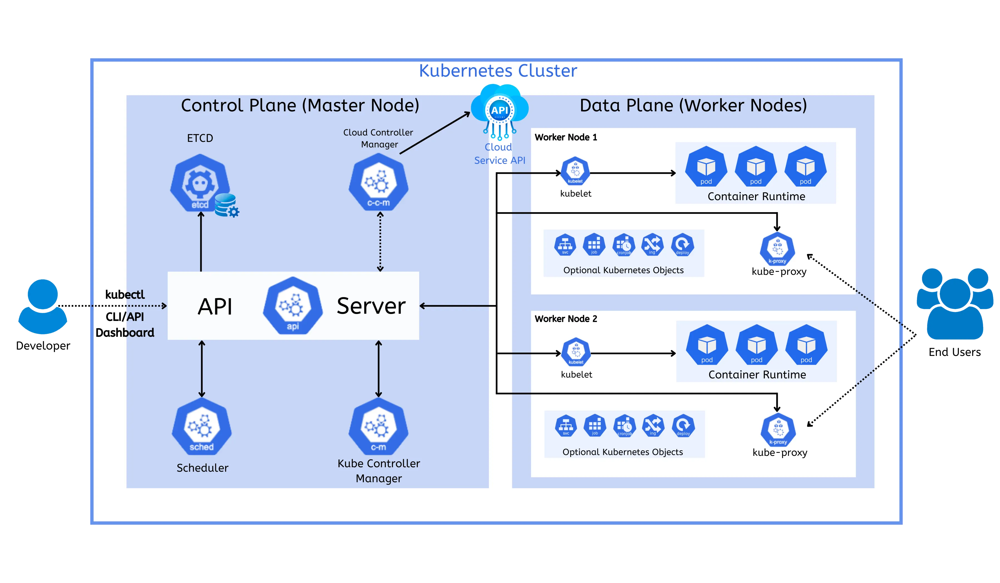
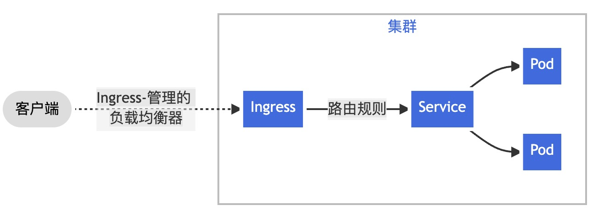
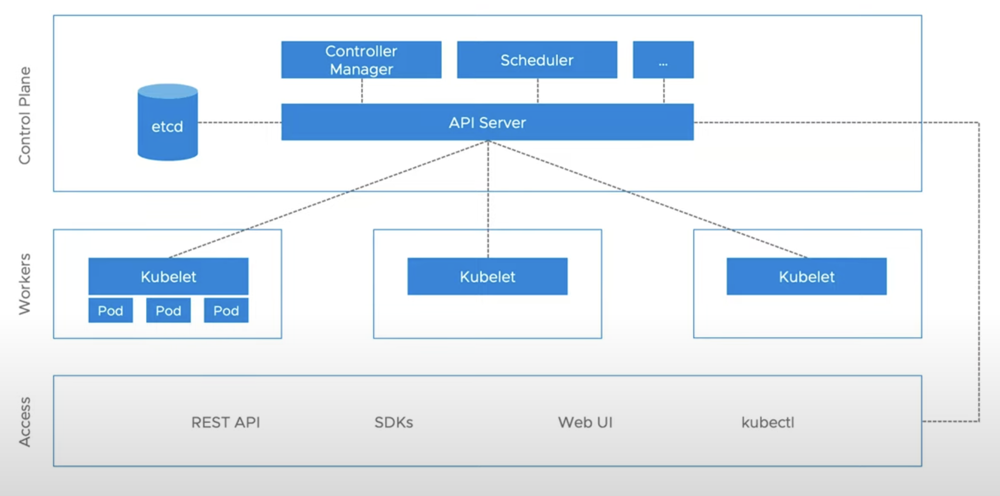
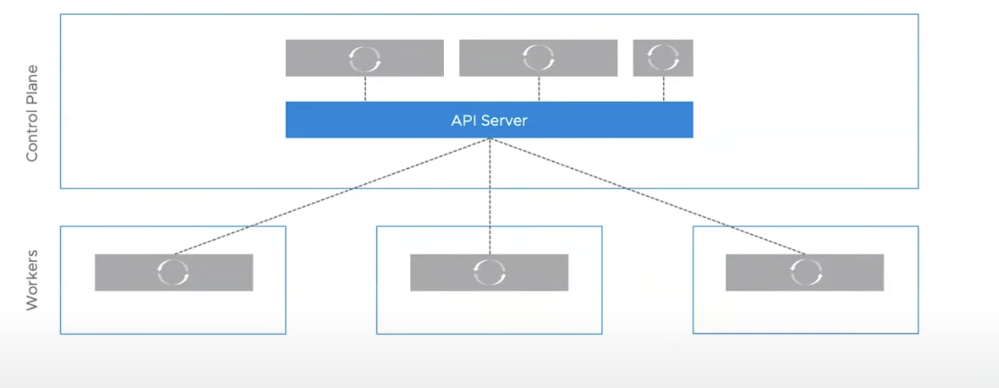
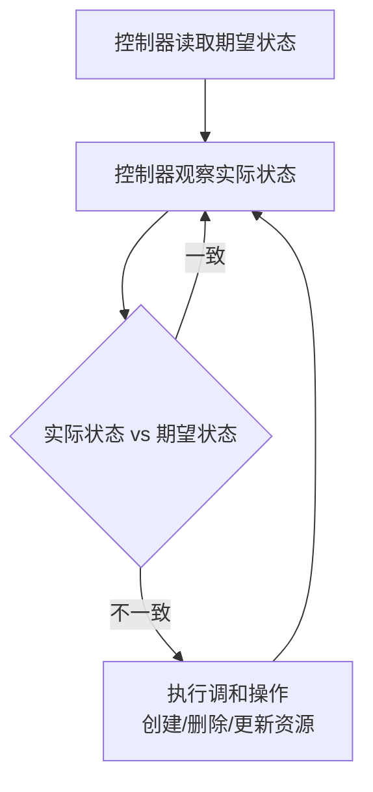
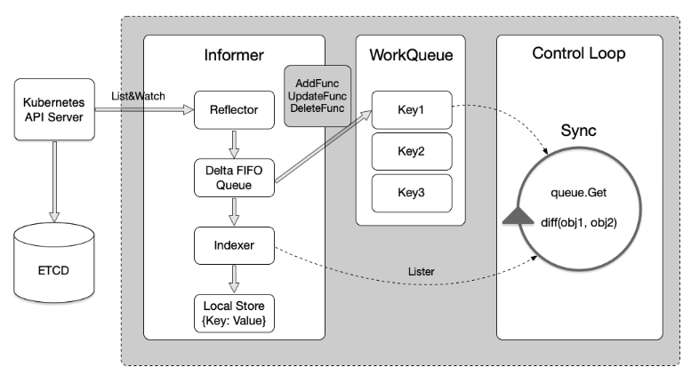
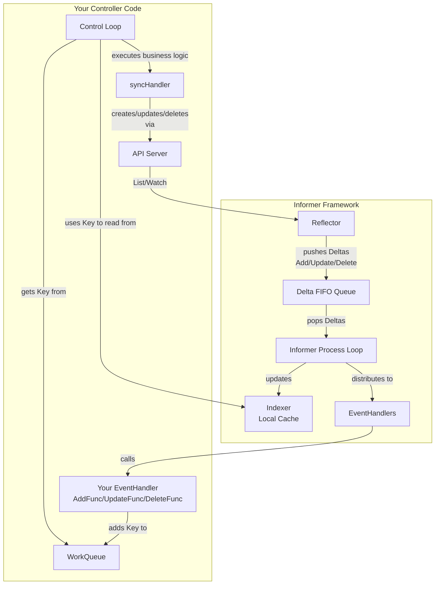
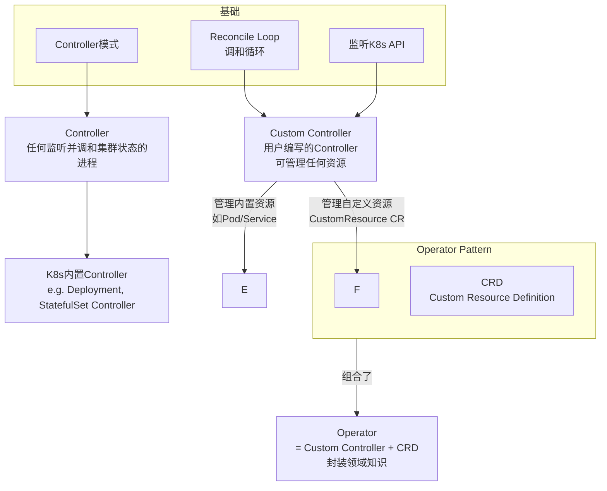

> 原文：https://ku.baidu-int.com/knowledge/HFVrC7hq1Q/KeF15lNOtH/-UXFkEkRyR/sCEb_PbEtoFlhy

It's all about reconciliation：k8s架构及控制器模式的复制

# **Kubernetes 是什么？**
## 1.why k8s
在容器技术（如 Docker）普及之前，应用部署经历了从物理机到虚拟机的演进。虽然虚拟机解决了隔离和环境一致性的部分问题，但依然存在资源利用率不高、启动慢、迁移复杂等痛点。

容器的出现带来了更轻量级的解决方案，但当我们试图在成百上千台主机上运行成千上万个容器时，新的挑战出现了：

* **编排难题：** 如何调度容器到合适的主机？挂了如何自动恢复？
* **服务发现：** 容器 IP 动态变化，客户端如何找到它们？
* **资源管理：** 如何分配和限制 CPU、内存等资源，避免“踩踏”？
* **滚动更新：** 如何实现零宕机的应用发布和回滚？
* **配置与密钥管理：** 如何安全地将配置、密码等注入到容器中？

## 2.定义和核心价值
Kubernetes 是一个开源的**容器编排引擎**，用于自动化部署、扩展和管理容器化应用。由 Google 开发。
Kubernetes 这个名字源于希腊语，意为“舵手”或“飞行员”。k8s 这个缩写是因为 k 和 s 之间有八个字符的关系。 Google 在 2014 年开源了 Kubernetes 项目。

它的核心价值在于：

* **服务发现与负载均衡：** 自动暴露容器服务，并分配网络流量。
* **存储编排：** 自动挂载你选择的存储系统（本地、云存储等）。
* **自动部署和回滚：** 描述应用的目标状态，K8s 会以可控的速率将实际状态变更至目标状态。
* **自动装箱（调度）：** 根据资源需求和其他约束，自动将容器放置到最佳节点。
* **自我修复：** 重启失败的容器、替换容器、杀死不健康的容器。
* **密钥与配置管理：** 存储和管理敏感信息与应用配置，无需重新构建容器镜像。

# **Kubernetes 的核心 API 对象**
Kubernetes 的一切都是“声明式”的。你不需要告诉 K8s “怎么做”，你只需要告诉它“你想要什么状态”。你通过创建一些**对象（Objects）** 来**描述**你应用的目标状态。这些对象是 K8s 系统中的持久化实体，它们共同协作，定义了你的应用的部署和运行方式。它们通过一个叫 **spec**** **的字段来描述*期望状态*，而 K8s 会不断地调整*实际状态*以匹配期望状态，并将当前状态记录在 **status** 字段中。

```go
kubectl apply -f myconfig.yaml
```
## 1.**Pod：Kubernetes 的最小调度单元**
Pod 是 K8s 中可以创建和管理的最小、最简单的计算单元。一个 Pod 代表集群中正在运行的一个**进程组**。

* **关键细节：**
    * **1:1还是1:n：** 一个 Pod 可以包含一个或多个**紧密耦合**的容器。这些容器共享网络命名空间（拥有相同的 IP 地址和端口空间）和存储卷（Volumes）。最常见的模式是“单容器 Pod”，但辅助容器（Sidecar）模式（如日志收集器、服务网格代理）也非常普遍。
    * **生命周期：** Pod 是“短暂”的。它们被创建、被调度、被销毁，且**不可重生**。如果节点宕机，上面的 Pod 就永远消失了。这就引出了下一个概念——Controller。


```go
apiVersion: v1
kind: Pod
metadata:
  name: test-pod
spec:
  # 定义容器，可以多个
  containers:
    - name: test-k8s # 容器名字
      image: ccr.ccs.tencentyun.com/k8s-tutorial/test-k8s:v1 # 镜像
```
## 2.**Controller：Pod的老板**
Pod 本身很脆弱，我们需要更高级的对象来管理 Pod 的生命周期，确保应用始终以期望的状态运行。这些对象统称为 Controller。

### 2.1 **Deployment**
用于部署和管理**无状态应用**的最常用控制器。它定义了 Pod 的模板和副本数量，并负责 Pod 的滚动更新、回滚和扩缩容。

* **核心功能：**
    * **多副本：** 确保始终运行着指定数量（replicas）的 Pod 副本。
    * **滚动更新：** 以一种可控的方式（如逐个替换 Pod）更新 Pod 的版本，实现零宕机部署。
    * **回滚：** 如果新版本有问题，可以立即回滚到之前的版本。
    * 限定 CPU、内存总量：[文档](https://kubernetes.io/zh/docs/concepts/policy/resource-quotas/#%E8%AE%A1%E7%AE%97%E8%B5%84%E6%BA%90%E9%85%8D%E9%A2%9D)

* **工作流程：** 你修改 Deployment 的 Pod 模板（如镜像版本） -> Deployment Controller 会创建一个新的 **ReplicaSet** -> 新的 ReplicaSet 逐步创建新 Pod，旧的 ReplicaSet 逐步减少旧 Pod -> 更新完成。
* **适用场景：** Web 服务器、API 服务、微服务等任何可以水平扩展、不依赖本地状态的应用。

```go
apiVersion: apps/v1
kind: Deployment
metadata:
  # 部署名字
  name: test-k8s
spec:
  replicas: 2
  # 用来查找关联的 Pod，所有标签都匹配才行
  selector:
    matchLabels:
      app: test-k8s
  # 定义 Pod 相关数据
  template:
    metadata:
      labels:
        app: test-k8s
    spec:
      # 定义容器，可以多个
      containers:
      - name: test-k8s # 容器名字
        image: ccr.ccs.tencentyun.com/k8s-tutorial/test-k8s:v1 # 镜像
```
### 2.2 **StatefulSet**
用于管理**有状态应用**的控制器，如数据库、中间件（Kafka, Zookeeper）。

**适用场景：** MySQL 集群、Redis 集群、Elasticsearch 集群、Etcd 等。

### 2.3 **DaemonSet**
确保集群中所有（或部分）节点上都运行一个 Pod 的副本。

**适用场景：** 集群存储守护进程、日志收集器（如 fluentd/fluentbeat）、节点监控代理（如 prometheus）。

### **2.4 Job & CronJob**
* **Job：** 创建一个或多个 Pod，并确保指定数量的 Pod 成功终止。用于运行一次性任务（如数据处理、备份任务）。
* **CronJob：** 基于 Cron 格式的时间计划，周期性地创建 Job 对象。相当于 Linux 中的 crontab。

#### **2.5 Service**
*  Pod 是短暂的，它们的 IP 地址会随着重启、调度而变化。客户端如何找到一个由多个动态 Pod 组成的应用？
*  Service 定义了一个逻辑集合（通常是一组 Pod，由 **Label Selector** 选择）和访问这组 Pod 的策略。它为这组 Pod 提供一个**稳定的 IP 地址、DNS 名称和端口**，并负责负载均衡到后端的 Pod。
* **核心类型：**
    * **ClusterIP（默认）：** 为服务提供一个集群内部的虚拟 IP，只能在集群内部访问。
    * **NodePort：** 在 ClusterIP 基础上，在每个节点的相同端口上暴露服务，使得可以从集群外部通过 ip+port 访问。
    * **LoadBalancer：** 在 NodePort 基础上，利用云服务商（AWS, 腾讯云等）的负载均衡器，将服务暴露到公网。这是暴露服务到外部的标准方式。
    * **ExternalName：** 将服务映射到一个外部域名，用于将集群外部的服务引入集群内部 DNS。


# 架构（高层视角）
一个 K8s 集群由一组节点（机器）组成，分为两类：

* **控制平面 (Control Plane / Master)：** 集群的大脑，负责调度和管理整个集群。
    * 核心组件：kube-apiserver（API 入口）、etcd（键值数据库，存储集群所有数据）、kube-scheduler（调度器）、kube-controller（控制器管理器）。

* **工作节点 (Worker Nodes)：** 真正运行容器的工作机器。
    * 核心组件：kubelet（与控制平面通信的代理，管理本节点容器）、kube-proxy（网络代理，实现服务发现）、**容器运行时**（如 Containerd ）。


所有集群操作，无论是内部管理还是用户指令，最终都通过  kube-apiserver 这个唯一的入口，以 **RESTful API** 的形式进行。而我们接下来要讲的所有“对象”，都是通过这个 API 来创建、读取、更新和删除的。


#### 3.1. 控制平面 (Control Plane)
控制平面是一组管理集群状态和流程的进程。它可以运行在单个主节点上（用于学习或开发环境），也可以部署在多个节点上以实现高可用（生产环境）。图中将其简化为一个方框，但它内部实际上包含以下几个核心组件：

* **API Server (kube-apiserver)**:
    * **是什么**： 整个集群的**唯一入口**和**通信枢纽**。所有内部组件（如控制平面其他组件、工作节点）以及外部用户（通过`kubectl`命令行工具）发出的所有指令都必须通过API Server。
    * **有什么用**： 它负责验证请求、处理请求（如创建、删除、更新Pod等），并将集群的当前状态写入到后端存储（etcd）中。

* **Scheduler (kube-scheduler)**:
    * **是什么**： 调度器。
    * **有什么用**： 它监听API Server，发现新建的、还未被分配到一个节点上的Pod（Pod是Kubernetes中最小的部署单元，通常包含一个或多个容器）。然后根据一系列的调度策略（如资源需求、节点亲和性、数据位置等），为这个Pod选择一个最合适的工作节点来运行。**它只做决策，不实际执行**。

* **Controller Manager (kube-controller-manager)**:
    * **是什么**： 运行着许多**控制器（Controller）** 的守护进程。
    * **有什么用**： 每个控制器都是一个独立的控制**循环**，负责监控集群的某一特定方面状态，并不断地驱动当前状态向期望状态转变。例如：
        * **节点控制器（Node Controller）**： 负责监控节点的健康状况（节点宕机了怎么办）。
        * **副本控制器（Replication Controller）**： 负责确保任何时候都有指定数量的Pod副本在运行（比如你要求3个，如果只剩2个，它会命令再启动1个）。


* **etcd**:
    * **是什么**： 一个轻量级、分布式的**键值对（key-value）数据库**。虽然在图中没有明确画出，但它绝对是控制平面的核心组成部分，通常与API Server部署在一起。
    * **有什么用**： Kubernetes用它来**存储集群的所有关键数据**（集群状态、配置信息、服务发现信息等）。它是集群的“唯一可信数据源”，所有组件的状态数据都来源于此。它的高可用性直接决定了整个集群的可靠性。


#### 3.2. 工作节点 (Node)
节点可以是虚拟机或物理机。每个节点上都运行着必要的服务来管理容器并与控制平面通信。

* **Kubelet**:
    * **是什么**： 运行在每个节点上的**代理（Agent）**。
    * **有什么用**： 从API Server接收指令（比如“请在这个节点上运行一个Pod”），然后负责管理本节点上Pod的生命周期，包括创建、启停容器等。它还会持续向控制平面报告本节点和其上Pod的运行状态。

* **Kube Proxy**:
    * **是什么**： 运行在每个节点上的网络代理。
    * **有什么用**： 它负责维护节点上的网络规则，实现了Kubernetes的**Service**概念。Service是一组Pod的抽象访问入口。Kube Proxy通过配置防火墙规则或使用IPVS，确保发往Service的流量能够正确地负载均衡到后端的Pod上。它是实现服务发现和负载均衡的基础。



* **容器运行时 (Container Runtime)**:
    * **是什么**： 负责真正运行容器的软件。
    * **有什么用**： Kubelet通过容器运行时接口（CRI）与容器运行时交互，来拉取镜像、启动和停止容器。最常见的例子是**Docker**、**containerd**、**CRI-O**。


# Kubernetes 的核心设计理念：**控制器模式（Controller Pattern）**
**控制器模式是 Kubernetes 的大脑和自动化引擎。** 它是一个无限循环（Control Loop），持续地观察系统的当前状态（*Actual State*），并将其与用户声明的期望状态（Desired State）**进行对比。如果两者不一致，控制器就会执行操作（如创建、删除Pod），驱动当前状态向期望状态收敛。**

## 无限循环，持续调和 WATCH AND RECONCILE!!!




## **声明式 vs. 命令式**
* **命令式**：关注“如何做”（How）。`运行这个容器` -> `扩容到3个` -> `重启那个Pod`。
* **声明式**：关注“做什么”（What）。`我需要3个nginx实例始终健康`。
* Kubernetes是**声明式系统**。用户只关心最终状态，系统负责如何达到和维护这个状态

## Kubernetes 控制器模式的核心组件
在 Kubernetes 中，这个模式由几个关键部分组成：

1. **期望状态**：由用户通过 YAML 清单文件定义 spec。
2. **实际状态**：来自 Kubernetes 集群的当前状态，通过查询 API Server 获得（例如，当前只有 2 个 Pod 在运行）。
3. **控制器**：一个主动的协调进程，运行着**调和循环**。
4. **API Server**：控制器通过它来**观察**（Watch）资源的变化（如 Pod 的创建、删除）和**操作**（Create/Delete/Patch）资源。
5. **etcd**：集群的“唯一可信数据源”，存储着所有资源的期望状态和最新已知的实际状态。

## 工作流程

以一个 **Deployment Controller** 为例，详细拆解这个过程：

1. **你声明期望状态**：你提交一个 Deployment 的 YAML 文件，其中 replica:3。API Server 将这个期望状态存入etcd。
2. **Deployment Controller 被唤醒**：Deployment Controller 一直在**监听**（Watch）API Server 上是否有 Deployment 资源的变化。它发现了你新创建的 Deployment。
3. **对比状态**：

    * 控制器读取**期望状态**：需要 3 个 Pod。
    * 控制器通过 API Server 查询**当前状态**：现在有多少个属于这个 Deployment 的 Pod？假设它只找到 2 个。

4. **执行调和操作**：控制器发现当前状态（2个Pod）与期望状态（3个Pod）**不一致**。它不需要关心那2个Pod为什么少了，它只负责“弥补差距”。于是，它通过 API Server **创建**一个新的 Pod。
5. **更新状态**：新 Pod 被调度到某个节点上运行，Kubelet 会向 API Server 报告其状态。这个新的“实际状态”又被存入 etcd。
6. **循环继续**：Deployment Controller 继续监听。如果它发现现在有 3 个 Pod 了，它就什么都不做（进入“睡眠”，直到下一次状态变化唤醒它）。如果其中一个 Pod 突然崩溃了（实际状态又变成了 2 个），控制器会再次检测到差异，并立即创建一个新的 Pod。


### informer机制

**关键问题：成百上千个控制器**如何高效、可靠地监听API Server中资源的变化？如果每个控制器都直接去轮询（Poll）API Server，API Server会被**压垮**。

Kubernetes的答案是：**Informer机制**。它是client-go库提供的工具，是所有控制器的标准配置。


1. **Reflector & List/Watch**

    * Reflector 是一个客户端对象，它负责与API Server交互。
    * 它首先执行**List**操作，获取某类资源（如所有Pod）的完整列表，用于全量同步。
    * 然后，它启动一个**Watch**长连接，监听该类资源的所有后续变化（ADD, UPDATE, DELETE事件）。
    * **Watch**是基于HTTP长连接的，API Server在有变化时会主动推送事件，这比反复的轮询**高效得多**。

2. **Delta FIFO Queue**

    * Reflector将从Watch接收到的事件转换成**Delta**对象（包含事件类型和资源对象本身），并将其推入一个**先进先出（FIFO）** 队列中。
    * FIFO保证了事件的处理顺序与发生顺序一致，这对于保证状态的一致性至关重要。

3. **Informer核心处理循环**

    * Informer从Delta FIFO中弹出事件进行处理。
    * 对于每一个Delta，它做两件事：
        * **更新本地缓存 (Indexer)**：根据事件类型（Add/Update/Delete）更新内存中的缓存。这使得控制器查询数据时无需访问API Server，**极大减轻了API Server的压力，并加快了控制器的响应速度**。
        * **分发事件给处理器 (EventHandler)**：调用用户事先注册的回调函数（`AddFunc`, `UpdateFunc`, `DeleteFunc`）。


4. **Indexer (本地缓存)**

    * 这是一个带索引的内存缓存，存储了所有监听资源的最新状态。
    * 控制器可以通过`Lister()`方法方便地查询缓存，例如：`podLister.Pods("namespace").Get("pod-name")`。这个操作是**本地内存操作**，速度极快。

5. **ResourceEventHandler (事件处理器)**

    * 这是**用户编写控制器代码时注册回调函数的地方**。
    * 当资源发生变化时，对应的`AddFunc`, `UpdateFunc`,或`DeleteFunc`会被调用。

6. **Workqueue (工作队列)**

    * 这是控制器模式中实现**解耦**和**重试**的关键。
    * 事件处理器负责快速接收事件并入队，而控制循环则可以从队列中取出项目从容处理。
    * 工作队列不是普通的Go Channel，它提供了诸多高级功能：
        * **去重 (Deduplication)**：同一个Key的多个事件在被处理前可能被合并，避免重复工作。
        * **速率限制 (Rate Limiting)**：控制重试的速率，防止错误循环拖垮系统。
        * **重试 (Retry)**：如果处理一个Key失败，它可以被重新放回队列，等待稍后重试。


7. **Control Loop (控制循环)**

    * 这是**控制器业务逻辑的核心**，即`sycHandler`函数。
    * 它从工作队列中取出一个Key。
    * 使用这个Key，从**Indexer（本地缓存）** 中获取该对象的最新信息。**再次强调，它不直接访问API Server。**
    * 执行业务逻辑：计算期望状态与实际状态的差异，并通过客户端调用API Server来驱动集群状态收敛。

**总结Informer的优势：**

* **性能**：本地缓存 + Watch长连接，极大减轻API Server压力。
* **可靠性**：工作队列机制支持去重和重试，保证事件最终能得到处理。
* **解耦**：事件接收与事件处理异步进行，系统更健壮。


## 常见的 Kubernetes 控制器及其职责
Kubernetes 内置了许多控制器，每个都负责管理一种或多种资源：

|控制器|职责|管理的资源|
|-|-|-|
|**Deployment Controller**|管理 Pod 的**发布**、**扩缩容**和**回滚**。|ReplicaSet|
|**ReplicaSet Controller**|确保指定数量的 **Pod 副本**持续运行。|Pod|
|**StatefulSet Controller**|管理**有状态应用**的 Pod，提供稳定的网络标识和持久存储。|Pod|
|**DaemonSet Controller**|确保**每个节点**上都运行一个指定的 Pod（如日志收集器、网络插件）。|Pod|
|**Job/CronJob Controller**|管理**一次性任务**和**定时任务**，保证任务运行完成。|Pod|
|**Service Controller**|在云平台上为 LoadBalancer 类型的 Service **创建负载均衡器**。|Service|


# Operator
**Kubernetes Operator 是一种特定的、更高级的 Controller。**[https://kubernetes.io/docs/concepts/extend-kubernetes/operator/](https://kubernetes.io/docs/concepts/extend-kubernetes/operator/)

Operator = Custom Resource Definitions (CRDs) + Custom Controller + 领域特定的运维知识




