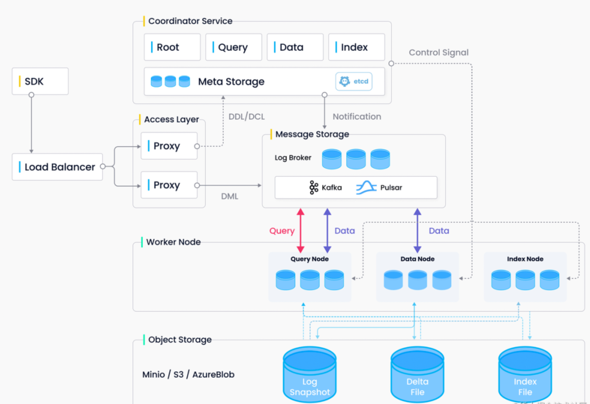
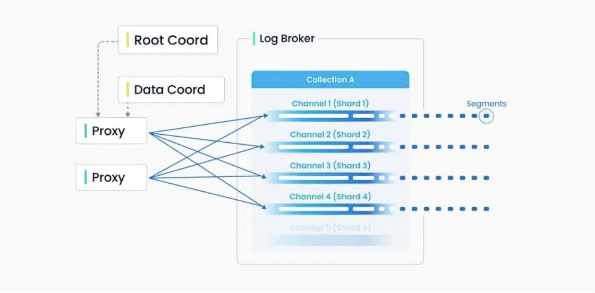
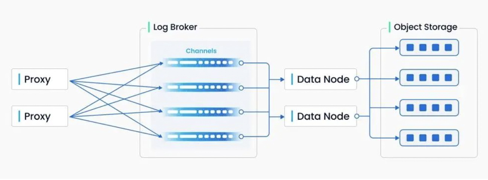
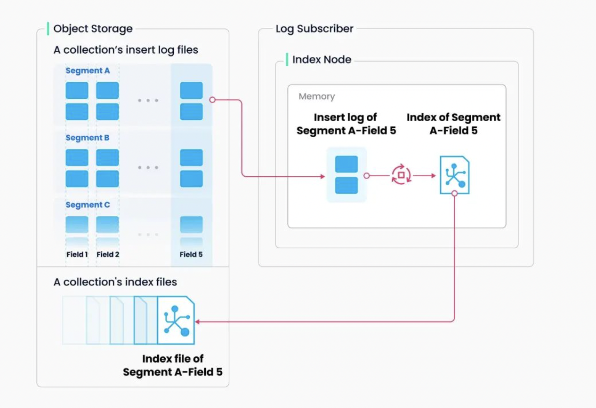
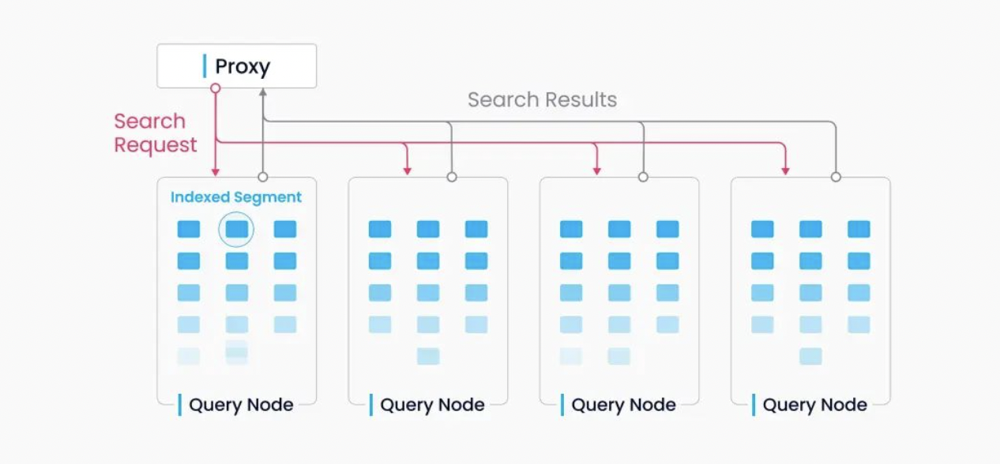
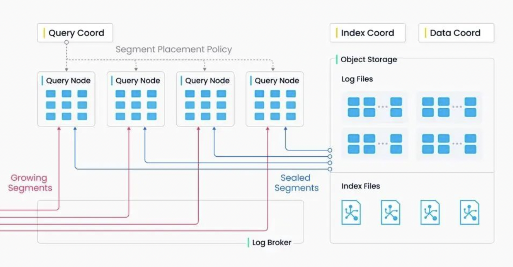

> 原文：https://ku.baidu-int.com/knowledge/HFVrC7hq1Q/KeF15lNOtH/-UXFkEkRyR/BmQvvxouyqgaM5

Milvus向量数据库介绍

## 一.什么是 Milvus
Milvus 是一款云原生向量数据库，它具备高可用、高性能、易拓展的特点，用于海量向量数据的实时召回。

Milvus 基于向量搜索库构建，核心是解决稠密向量相似度检索的问题。在向量检索库的基础上，Milvus 支持**数据分区分片**、**数据持久化**、**增量数据摄取**、**标量向量混合查询**、**time travel** 等功能，同时大幅优化了向量检索的性能，可满足任何向量检索场景的应用需求。

Milvus 采用共享存储架构，**存储计算完全分离**，计算节点支持横向扩展。从架构上来看，整体分为了四个层次，分别为**接入层（access layer）**、**协调服务（coordinator service）**、**执行节点（worker node）**和**存储层（storage）**。各个层次相互独立，独立扩展和容灾。

## 二.为什么需要 Milvus
随着互联网不断发展，电子邮件、论文、物联网传感数据、社交媒体照片、蛋白质分子结构等非结构化数据已经变得越来越普遍。如果想要使用计算机来处理这些数据，需要使用 embedding 技术将这些数据转化为向量。随后，Milvus 会存储这些向量，并为其建立索引。Milvus 能够根据两个向量之间的距离来分析他们的相关性。如果两个向量十分相似，这说明向量所代表的源数据也十分相似。

Milvus 向量数据库专为向量查询与检索设计，能够为万亿级向量数据建立索引。

与现有的主要用作处理结构化数据的关系型数据库不同，Milvus 在底层设计上就是为了处理由各种非结构化数据转换而来的 Embedding 向量而生。

### Milvus 应用场景
你可以使用 Milvus 搭建符合自己场景需求的向量相似度检索系统。Milvus 的使用场景如下所示：

* 图片检索系统：以图搜图，从海量数据库中即时返回与上传图片最相似的图片。
* 视频检索系统：将视频关键帧转化为向量并插入 Milvus，便可检索相似视频，或进行实时视频推荐。
* 音频检索系统：快速检索海量演讲、音乐、音效等音频数据，并返回相似音频。
* 分子式检索系统：超高速检索相似化学分子结构、超结构、子结构。
* 推荐系统：根据用户行为及需求推荐相关信息或商品。
* 智能问答机器人：交互式智能问答机器人可自动为用户答疑解惑。
* DNA 序列分类系统：通过对比相似 DNA 序列，仅需几毫秒便可精确对基因进行分类。
* 文本搜索引擎：帮助用户从文本数据库中通过关键词搜索所需信息。

## 三.Milvus基本概念
### 非结构化数据
非结构化数据指的是数据结构不规则，没有统一的预定义数据模型，不方便用数据库二维逻辑表来表现的数据。

非结构化数据包括图片、视频、音频、自然语言等，占所有数据总量的 80%。

非结构化数据的处理可以通过各种人工智能（AI）或机器学习（ML）模型转化为向量数据后进行处理。

### 特征向量
向量又称为 embedding vector，是指由 embedding 技术从离散变量（如图片、视频、音频、自然语言等各种非结构化数据）转变而来的连续向量。

在数学表示上，向量是一个由浮点数或者二值型数据组成的 n 维数组。

通过现代的向量转化技术，比如各种人工智能（AI）或者机器学习（ML）模型，可以将非结构化数据抽象为 n 维特征向量空间的向量。这样就可以采用最近邻算法（ANN）计算非结构化数据之间的相似度。

### 向量相似度检索
相似度检索是指将目标对象与数据库中数据进行比对，并召回最相似的结果。同理，向量相似度检索返回的是最相似的向量数据。

近似最近邻搜索（ANN）算法能够计算向量之间的距离，从而提升向量相似度检索的速度。如果两条向量十分相似，这就意味着他们所代表的源数据也十分相似。

### Collection-集合
包含一组 entity，可以等价于关系型数据库系统（RDBMS）中的表。

### Entity-实体
包含一组 field。field 与实际对象相对应。field 可以是代表对象属性的结构化数据，也可以是代表对象特征的向量。primary key 是用于指代一个 entity 的唯一值。

**注意：** 你可以自定义 primary key，否则 Milvus 将会自动生成 primary key。请注意，目前 Milvus 不支持 primary key 去重，因此有可能在一个 collection 内出现 primary key 相同的 entity。

### Field-字段
Entity 的组成部分。Field 可以是结构化数据，例如数字和字符串，也可以是向量。

### **Milvus与关系型数据库的对应关系如下：**
|**Milvus向量数据库**|**关系型数据库**|
|-|-|
|Collection|表|
|Entity|行|
|Field|表字段|

### 字段Schema
字段Schema是字段的逻辑定义。在创建集合之前需要去定义Schema。

注：Milvus 2.0 只支持一个集合中的一个主键字段。

字段schema属性

|属性|描述|注释|
|-|-|-|
|name|集合中字段的名称|数据类型：String。必须|
|datatype|字段的数据类型|必须|
|description|字段的描述|数据类型: String。可选的|
|is_primary|是否将该字段设置为主键字段|数据类型: Boolean (`true` or `false`)。主键字段为必填项|
|dim|向量的维数|数据类型: Integer ∈[1, 32768]。对于向量字段是必需的|

`DataType` 定义字段包含的数据类型。不同的字段支持不同的数据类型。

* 主键字段支持的数据类型:
    * INT8: numpy.int8
    * INT16: numpy.int16
    * INT32: numpy.int32
    * INT64: numpy.int64

* 标量字段支持的数据类型:
    * BOOL: Boolean (`true` or `false`)
    * INT8: numpy.int8
    * INT16: numpy.int16
    * INT32: numpy.int32
    * INT64: numpy.int64
    * FLOAT: numpy.float32
    * DOUBLE: numpy.double

* 向量字段支持的数据类型:
    * BINARY_VECTOR: Binary vector 二值型向量
    * FLOAT_VECTOR: Float vector 浮点型向量

### Partition-分区
分区是集合（Collection）的一个分区。Milvus 支持将收集数据划分为物理存储上的多个部分。这个过程称为分区，每个分区可以包含多个段。

### Segment-段
Milvus 在数据插入时，通过合并数据自动创建的数据文件。一个 collection 可以包含多个 segment。一个 segment 可以包含多个 entity。在搜索中，Milvus 会搜索每个 segment，并返回合并后的结果。

### Sharding-分片
Shard 是指将数据写入操作分散到不同节点上，使 Milvus 能充分利用集群的并行计算能力进行写入。默认情况下，单个 Collection 包含 2 个分片（Shard）。目前 Milvus 采用基于**主键哈希**的分片方式，未来将支持随机分片、自定义分片等更加灵活的分片方式。

**注意：** 分区的意义在于通过划定分区减少数据读取，而分片的意义在于多台机器上并行写入操作。

### 索引
索引基于原始数据构建，可以提高对 collection 数据搜索的速度。Milvus 支持多种索引类型。为提高查询性能，你可以为每个向量字段指定一种索引类型。目前，一个向量字段仅支持一种索引类型。切换索引类型时，Milvus 自动删除之前的索引。

**相似性搜索引擎的工作原理**是将输入的对象与数据库中的对象进行比较，找出与输入最相似的对象。索引是有效组织数据的过程，极大地加速了对大型数据集的查询，在相似性搜索的实现中起着重要作用。对一个大规模向量数据集创建索引后，查询可以被路由到最有可能包含与输入查询相似的向量的集群或数据子集。在实践中，这意味着要牺牲一定程度的准确性来加快对真正的大规模向量数据集的查询。

### PChannel
PChannel 表示物理通道。每个 PChannel 对应一个日志存储主题。默认情况下，将分配一组 256 个 PChannels 来存储记录 Milvus 集群启动时数据插入、删除和更新的日志。

### VChannel
VChannel 表示逻辑通道（虚拟通道）。每个集合将分配一组 VChannels，用于记录数据的插入、删除和更新。VChannels 在逻辑上是分开的，但在物理上共享资源。

## 四.Milvus 系统架构

整个系统分为四个层次：

* **接入层（Access Layer）**：系统的门面，由一组无状态 proxy 组成。对外提供客户端请求，负责验证客户端请求并合并返回结果。
* **协调服务（Coordinator Service）**：系统的大脑，负责分配任务给执行节点。协调服务共有四种角色，分别为 root coord、data coord、query coord 和 index coord。
* **执行节点（Worker Node）**：系统的四肢，负责完成协调服务下发的指令和 proxy 发起的数据操作语言（DML）命令。执行节点分为三种角色，分别为 data node、query node 和 index node。
* **存储服务 （Storage）**：系统的骨骼，负责 Milvus 数据的持久化，分为元数据存储（meta store）、消息存储（log broker）和对象存储（object storage）三个部分。

各个层次相互独立，独立扩展和容灾。

### 接入层
接入层由一组无状态 proxy 组成，是整个系统对外交互的统一出入口，接入层负责验证客户端请求并合并处理返回结果。

* Proxy 本身是无状态的，一般通过负载均衡组件（Nginx、Kubernetes Ingress、NodePort、LVS）对外提供统一的访问地址并提供服务。
* 由于 Milvus 采用大规模并行处理（MPP）架构，proxy 会先对执行节点返回的中间结果进行全局聚合和后处理后，再返回至客户端。

### 协调服务
协调服务是系统的大脑，负责向执行节点分配任务。它承担的任务包括集群拓扑节点管理、负载均衡、时间戳生成、数据声明和数据管理等。

协调服务共有四种角色：

* **Root coordinator（root coord）**：负责处理数据定义语言（DDL）和数据控制语言（DCL）请求。比如，创建或删除 collection、partition、index 等，同时负责维护中心授时服务 TSO 和时间窗口的推进。
* **Query coordinator (query coord）**：负责管理协调 query node ，将 growing segment 切换到 sealed segment，数据整合后进行查询。Query node 中的 segment 只存在两种状态：growing 和 sealed，分别对应增量数据(在log broker中，流数据)和历史数据（在对象存储中，称为批数据）。
* **Data coordinator (data coord）**：负责管理协调 data node ，维护数据的元信息以及触发 数据flush等后台数据操作。
* **Index coordinator (index coord）**：负责管理协调 index node ，构建索引和维护索引元信息。

### 执行节点
执行节点是系统的四肢，负责完成协调服务下发的指令和 proxy 发起的数据操作语言（DML）命令。

由于采取了存储计算分离，执行节点是无状态的，可以配合 Kubernetes 快速实现扩缩容和故障恢复。

执行节点分为三种角色：

* **Query node：** Query node 通过订阅消息存储（log broker）获取增量日志数据并转化为 growing segment，基于对象存储加载历史数据，提供标量+向量的混合查询和搜索功能。
* **Data node：** Data node 通过订阅消息存储获取增量日志数据，处理更改请求，将数据从log broker中写到最终的对象中，并将日志数据打包存储在对象存储上实现日志快照持久化。
* **Index node：** Index node 负责执行索引构建任务。

### 存储服务
存储服务负责 Milvus 数据的持久化，分为元数据存储（meta store）、消息存储（log broker）和对象存储（object storage）三个部分。

#### 元数据存储
负责存储元信息的快照，比如：集合 schema 信息、节点状态信息、消息消费的 checkpoint 等。元信息存储需要极高的可用性、强一致和事务支持，因此，etcd （成熟的元数据存储产品）是这个场景下的不二选择。除此之外，etcd 还承担了服务注册和健康检查的职责。

#### 对象存储
负责存储日志的快照文件、标量/向量索引文件以及查询的中间处理结果。Milvus 采用 MinIO 作为对象存储，另外也支持部署于 AWS S3 和Azure Blob 这两大最广泛使用的低成本存储。但是，由于对象存储访问延迟较高，且需要按照查询计费，因此 Milvus 未来计划支持基于内存或 SSD 的缓存池，通过冷热分离的方式提升性能以降低成本。

#### 消息存储
消息存储是一套支持回放的发布订阅系统，日志数据持久化后，当执行节点(主要是data node 、index node)宕机恢复时，通过回放消息存储保证增量数据的完整性。

# 五.数据与索引的处理流程
## 数据写入
创建 collection 时可以指定 shard 数量，**每个 shard 对应一个虚拟通道 （vchannel）**。如下图所示，在日志代理（ log broker）内，每个 vchannel 被分配了一个对应的物理通道（pchannel）。Proxy 基于主键哈希决定输入的增删请求进入哪个 shard。

由于没有复杂事务，DML 的检查与确认工作被提前至 Proxy。对于所有的增删请求，Proxy 会先通过请求位于 root coord 的 TSO 中心授时模块获取时间戳。这个时间戳决定了数据最终可见和相互覆盖的顺序。除了分配时间戳，Proxy 也为每行数据分配全局唯一的 Primary key。

Primary key 以及 entity 所处的 segmentID （段ID）均从 data coord 批量获取，批量有助于提升系统的吞吐，降低 data coord 的负载。

### 数据插入流程
第一步：insert message 从sdk发送到proxy之后，proxy会把这个insert message插到相应的log broker中，插入到log broker中的每条消息都有唯一的主键和一个时间戳

第二步：插入到log broker之后，数据会被data node消费

第三步：data node会把数据写入持久化存储当中，最终数据在持久化存储中是基于segment的粒度来组织的，也就是说这个消息除了主键和时间戳，还会被额外赋予一个segment ID，以标识出这条数据最终会属于哪个segment

第四步：在数据被持久化之后，如果基于这些数据直接查询的话，查询速度会比较慢，因此一般情况下会考虑构建一些索引来加速查询速度。这时index node就会把信息从持久化存储中拉出来并构建索引，而构建的索引文件又会被回写到持久化存储中。

## 索引构建
### 索引创建机制
构建索引的任务由 index node 执⾏。为了避免数据更新导致的索引频繁重复构建，Milvus 将 collection 分成了更⼩的粒度，即 segment，Segment 是 Milvus 中储存数据的最小单位。在建立索引时，Milvus 为每个 Segment 单独创建索引文件。

 Milvus 可以对每个向量列、标量列和主键列构建索引。索引构建任务的输⼊与输出都是对象存储。Index node 拉取 segment 中需要构建索引的日志快照，在内存中进⾏数据与元信息的反序列化，构建索引。索引构建完成后，将索引结构序列化并写回对象存储。

创建索引是一个组织数据的过程，是向量数据库实现快速查询百万、十亿、甚至万亿级数据集所依赖的一个巨大组成部分。在查询或检索数据前，必须先指定索引类型及距离计算公式。**如未指定索引类型，Milvus 将默认执行暴力搜索。**

为提高查询性能，milvus支持可以为每个向量字段指定一种索引类型。目前，一个向量字段仅支持一种索引类型。切换索引类型时，Milvus 自动删除之前的索引。

默认设定下，Milvus 不会对插入的数据少于 1024 行的 segment 创建索引。如修改此项参数，需修改 `milvus.yaml` 中的 `rootCoord.minSegmentSizeToEnableIndex`配置项。

 

### 索引类型
Milvus 目前支持的向量索引类型大都属于 ANNS（Approximate Nearest Neighbors Search，近似最近邻搜索）。

ANNS 的核心思想是不再局限于只返回最精确的结果项，而是仅搜索可能是近邻的数据项，即以牺牲可接受范围内的精度的方式提高检索效率。

根据实现方式，ANNS 向量索引可分为五大类：

* 基于树的索引
* 基于图的索引
* 基于哈希的索引
* 基于量化的索引
* 基于量化和图的索引

Milvus 支持的索引类型如下，我们可以根据应用场景选择具体的索引：

* **FLAT**：适用于需要**100% 召回率**且**数据规模相对较小**（百万级）的向量相似性搜索应用。Flat索引类型是指对向量进行原始文件存储，搜索时，所有向量都会与目标向量进行距离计算和比较。FLAT索引类型提供100%的检索召回率，与其他索引相比，当查询数量较少时是最精准的索引方式。
* **IVF_FLAT**：基于量化的索引，适用于追求查询准确性和查询速度之间理想平衡的场景（高速查询、要求高召回率）。通过类聚方法把向量划分为nlist个单元，查询时先把目标向量与所有单元的中心做距离比较，选出nprobe个最近单元，然后比较这些被选中单元里的所有向量，得到最终结果。
* **IVF_SQ8**：基于量化的索引，适用于磁盘或内存、显存资源有限的场景（高速查询、磁盘和内存资源有限、接受召回率的小幅妥协）。在IVF_FLAT基础上对放入单元中的每条向量做一次标量量化，标量量化会把原始向量中的每个维度从4个字节的浮点数转换为一个字节的无符号整数，因此IVF_SQ8索引文件占用的存储空间远小于IVF_FLAT。缺点是标量化会导致查询时的精度损失。
* **IVF_PQ**：基于量化的索引，适用于追求高查询速度、低准确性的场景（超高速查询、磁盘和内存资源有限、接受召回率的实质性妥协）
* **HNSW**：基于图的索引，适用于追求高查询效率的场景（高速查询、要求尽可能高的召回率、内存资源大的情景）
* **ANNOY**：基于树的索引，适用于追求高召回率的场景（低维向量空间）
* **IVF_HNSW**：基于量化和图的索引，高速查询、需要尽可能高的召回率、内存资源大的情景
* **RHNSW_FLAT**：基于量化和图的索引，高速查询、需要尽可能高的召回率、内存资源大的情景
* **RHNSW_SQ**：基于量化和图的索引，高速查询、磁盘和内存资源有限、接受召回率的小幅妥协
* **RHNSW_PQ**：基于量化和图的索引，超高速查询、磁盘和内存资源有限、接受召回率的实质性妥协

### 距离计算公式
Milvus 基于不同的距离计算方式比较向量间的距离。根据插入数据的形式，选择合适的距离计算方式能极大地提高数据分类和聚类性能。

浮点型向量主要使用以下距离计算公式：

* **欧氏距离 (L2)**: 主要运用于计算机视觉领域。
* **内积 (IP)**: 主要运用于自然语言处理（NLP）领域。

二值型向量主要使用以下距离计算公式：

* **汉明距离 (Hamming)**: 主要运用于自然语言处理（NLP）领域。
* **杰卡德距离 (Jaccard)**: 主要运用于化学分子式检索领域。
* **谷本距离 (Tanimoto)**: 主要运用于化学分子式检索领域。
* **超结构 (Superstructure)**: 主要运用于检索化学分子式的相似超结构。
* **子结构 (Substructure)**: 主要运用于检索化学分子式的相似子结构。

Milvus 目前支持的距离计算方式与数据格式、索引类型之间的兼容关系以下表格所示。

|**数据格式**|**距离计算方式**|**索引类型**|
|-|-|-|
|浮点型向量|欧氏距离 (L2)
内积 (IP)|FLAT
IVF_FLAT
IVF_SQ8
IVF_PQ
HNSW
IVF_HNSW
RHNSW_FLAT
RHNSW_SQ
RHNSW_PQ
ANNOY|
|二值型向量|杰卡德距离 (Jaccard)
谷本距离 (Tanimoto)
汉明距离 (Hamming)|BIN_FLAT
BIN_IVF_FLA|
|二值型向量|超结构 (superstructure)
子结构 (substructure)|BIN_FLAT|

    

## 数据查询
数据查询指在一个指定 collection 中查找与目标向量最近邻的 *k* 个向量或满足距离范围的全部向量的过程。结果返回满足条件的向量及其对应的 primary key 和 field。

一个 collection 中的数据被分为多个 segment，query node 以 segment 为粒度加载索引。查询请求会广播到全部的 query node，所有 query node 并发执行查询。每个 query node 各自对本地的 segment 进行剪枝并搜索符合条件的数据，同时将各 segment 结果进行聚合返回。

上述过程中 query node 并不感知其他 query node 的存在，每个 query node 只需要完成两件任务：首先是响应 query coord 的调度，加载/卸载 segment；其次是根据本地的 segment 响应查询请求。**Proxy 负责将每个 query node 返回的数据进行全局聚合返回给客户端。**

Query node 中的 segment 只存在两种状态，分别对应增量数据（growing）和历史数据（sealed）。对于 growing segment，query node 通过订阅 *vchannel* 获取数据的近期更新。

当 data coord 已经flush完log broker中的数据到 segment ，会通知 query coord 进行 handoff 操作，将增量数据转换为历史数据。

当data coord 还未flush完log borker中的数据，此时query node会和并增量和历史数据后进行查询，合并策略展开讲篇幅较长，感兴趣可参考[如何使用 Milvus 向量数据库实现实时查询](https://zhuanlan.zhihu.com/p/491030589?t=mention&mt=doc&dt=sdk)

# 六.milvus接入
[文件页：baidu/ps-se/ai-appengine  *master](https://console.cloud.baidu-int.com/devops/icode/repos/baidu/ps-se/ai-appengine/tree/master/vectorstores/milvus?t=mention&mt=doc&dt=sdk)

[VectorStore](https://ku.baidu-int.com/knowledge/HFVrC7hq1Q/MYFIkxNl2o/vwLOmsuPCU/b1BU4uE40O8D2t?t=mention&mt=doc&dt=doc)

                                        

                                            

               