> 原文：https://ku.baidu-int.com/knowledge/HFVrC7hq1Q/KeF15lNOtH/-UXFkEkRyR/s3xsfRtW-johXz

RAG详解

# **一、 开场白与引言**
1. **LLM应用面临的痛点:**
在我们日常工作中，大家或多或少都接触过大语言模型（LLM）。它们很强大，但在实际应用中，我们常常会遇到一些头疼的问题：

    * **知识截止 (Knowledge Cutoff):** LLM的知识是基于其训练数据的，训练完成后，它就无法感知之后发生的新事件或新知识。比如，你问个2023年初训练的模型关于2024年发生的大事，它大概率会“一本正经地胡说八道”。
    * **幻觉 (Hallucination):** LLM有时会“编造”看似合理但实际上是错误的信息。这在需要高事实准确性的场景下是致命的。
    * **领域知识缺乏 (Lack of Domain-Specific Knowledge):** 通用LLM在特定行业或公司的内部知识方面表现不佳，无法满足专业的业务需求。
    * **事实一致性差 (Poor Factual Consistency):** 对于同一个问题，LLM可能在不同时间或不同上下文中给出不一致甚至矛盾的答案。
    * **缺乏可追溯性 (Lack of Traceability):** 当LLM给出一个答案时，我们很难知道它是基于哪些信息得出的，这使得答案的验证和信任度大打折扣。

2. **RAG——解决上述痛点的有效范式RAG (Retrieval Augmented Generation)**，就是这样一种强大的范式。简单来说，RAG允许LLM在生成答案之前，先从一个外部知识库中检索相关信息，然后基于这些检索到的信息来生成更准确、更可靠、更具时效性的内容。


# **二、 什么是RAG？**
## 1.**核心概念：**
    * **定义：** RAG，全称Retrieval Augmented Generation，即“检索增强生成”。它是一种将信息检索（Information Retrieval）系统与大语言模型（LLM）的生成能力相结合的技术框架。其核心思想是，在LLM生成回答之前，先从一个大规模的、可更新的外部知识库中检索出与用户问题相关的文档片段，然后将这些片段作为上下文信息（Context）一同提供给LLM，引导LLM基于这些最新的、领域特定的、可信的知识来生成答案。
    * **类比：开卷考试 vs. 闭卷考试**
        * **传统的LLM应用（无RAG）：** 就像让学生参加“闭卷考试”。学生只能依赖自己脑中已有的知识（即模型训练时学到的参数）来回答问题。如果问题超出了学生的知识范围，或者学生记忆不清，就可能答错或编造答案。
        * **RAG赋能的LLM应用：** 则像是让学生参加“开卷考试”。学生可以查阅指定的参考资料（即外部知识库），找到与问题相关的信息，然后综合这些信息来组织答案。这样，答案的准确性和时效性就大大提高了。


## 2.**RAG的优势：**
    * **提升事实准确性，减少幻觉：** 通过引入外部知识源，LLM的回答被“锚定”在这些真实、可查证的信息上，从而显著减少模型凭空捏造内容的“幻觉”现象。
    * **引入最新知识，克服知识截止：** 外部知识库可以随时更新，包含最新的信息。RAG使得LLM能够利用这些动态更新的知识，回答关于新近事件或数据的查询，有效克服了LLM自身的知识截止问题。
    * **领域知识注入，适配特定业务场景：** 可以将特定行业、企业内部的专业文档、数据库等构建成知识库，让通用LLM也能具备强大的领域知识能力，而无需对模型本身进行昂贵且复杂的领域微调。
    * **提高透明度和可解释性：** RAG系统可以明确指出答案是基于哪些检索到的文档片段生成的。这种“引用来源”的能力大大增强了用户对答案的信任度，也便于进行事实核查和错误溯源。
    * **成本效益：**
        * 相较于针对新知识或领域知识对整个大模型进行全量微调（Fine-tuning），RAG通常更经济高效。更新知识库远比重新训练模型便宜和快速。
        * 对于某些场景，使用较小的、经过RAG增强的LLM，其表现可能媲美甚至超过没有RAG的、参数量更大的LLM。


## 3.**RAG 与其他技术的对比：**
### **FULL Fine-tuning**
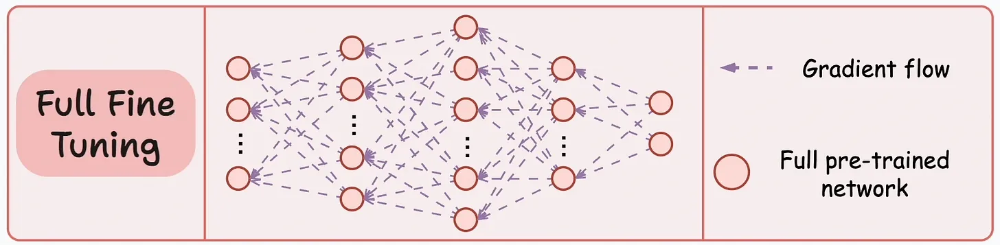
**核心思想**：调整预训练语言模型的**所有权重参数**来达到更好的效果。

这通常是一种非常有效的方式，但是在**大**模型上会有一些问题：

1. 直接修改原始权重。
2. 大模型下训练成本高。

### **Lora Fine-tuning**
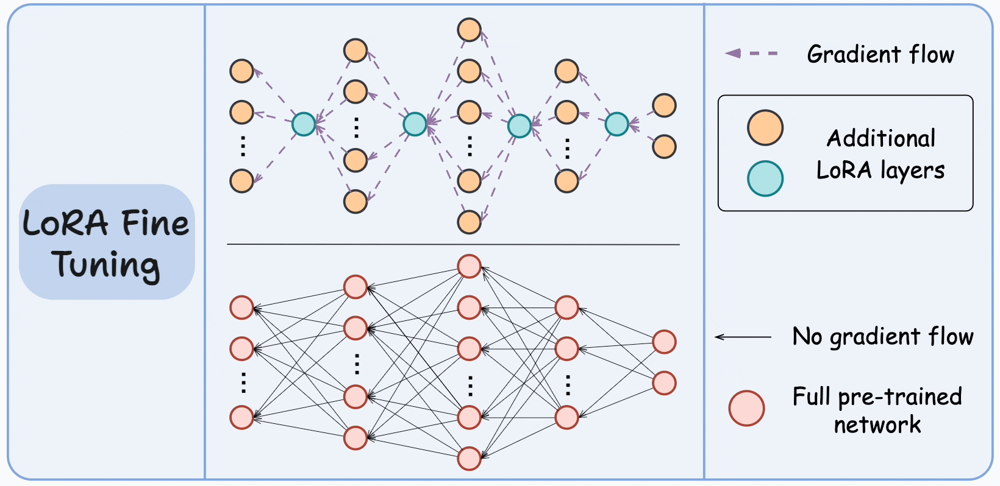
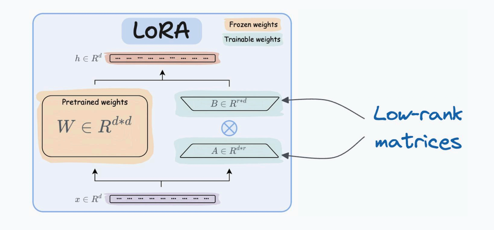
LoRA微调解决了传统微调的局限性。

**核心思想**：冻结预训练权重，通过注入**低秩分解矩阵**在特定层（如Attention）进行参数高效微调。

**技术原理**：

1. **低秩参数化**：

    * 对于预训练权重矩阵 $W \in \mathbb{R}^{d \times k}$，其增量更新 $\Delta W$ 被约束为低秩分解：$\Delta W = \underbrace{B}_{d \times r} \cdot \underbrace{A}_{r \times k}, \quad \text{其中} \quad r \ll \min(d,k)$

（$r$ 为秩，通常取4~64；$A$ 初始化为高斯噪声，$B$ 初始化为零）

    * 微调时，模型的前向计算变为：$h = Wx + \Delta W x = Wx + BAx$

2. **参数高效性**：

    * 可训练参数量从 $d \times k$ 降至 $r \times (d + k)$。**示例**：对 $d=1024, k=1024$ 的矩阵，若 $r=8$，参数量从1M降至16K（**减少98.4%**）。

### 差异的本质
|**维度**|Full Fine-Tuning|LoRA|RAG|
|-|-|-|-|
|**知识存储**|隐式编码在权重中|权重增量低秩编码|显式存储在外部检索库|
|**更新方式**|梯度覆盖原始参数|加性低秩扰动|检索时动态拼接|
|**能力边界**|受限于训练数据分布|受限于低秩逼近能力|受限于检索库覆盖度|


# **三、 RAG系统核心架构与工作流程 **
## 1.**整体架构图：**
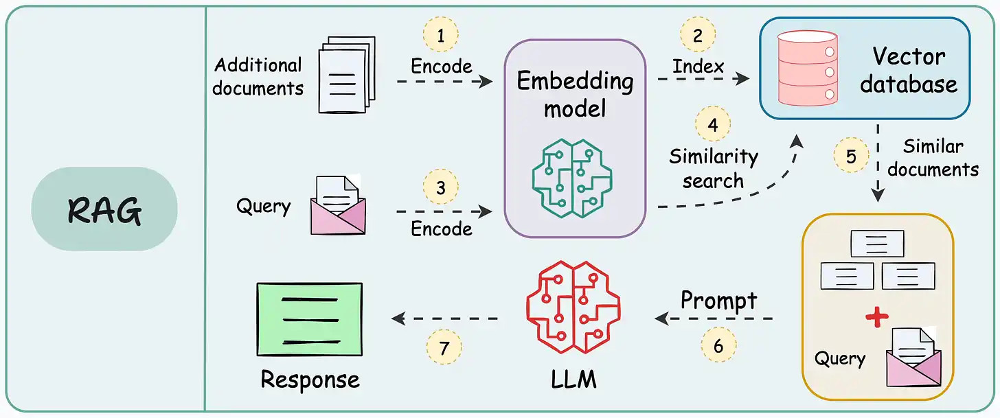
    * 一个典型的RAG系统通常包含以下核心组件：
        * **向量化模型（Embedding Model）**: 对非结构化数据进行编码使我们能够对其进行许多复杂的操作，如相似性搜索、聚类和分类等操作。
        * **向量数据库 (Vector Database):** 存储外部知识的源头，可以是文档集合、数据库、API等。
        * **检索器 (Retriever):** 负责根据用户查询从知识库中找到最相关的N段信息。通常集成在向量数据库中。
        * **大语言模型 (LLM):** 负责基于原始查询和检索到的信息生成最终答案。


## 2.**关键步骤详解：**
> RAG的工作流程可以大致分为两个阶段：离线的数据准备与索引构建，和在线的检索与生成。
### 2.1.**数据准备与索引构建**
#### 2.1.1.**文档加载 (Document Loading):**
* 从各种数据源（如PDF, TXT, HTML, DOCX, 数据库, API）加载原始文档。
* 常用的库：LangChain的`DocumentLoaders` (如`PyPDFLoader`, `TextLoader`, `WebBaseLoader`)。

#### 2.1.2.[文档切分 (Chunking / Splitting)](https://blog.dailydoseofds.com/p/5-chunking-strategies-for-rag)**:**
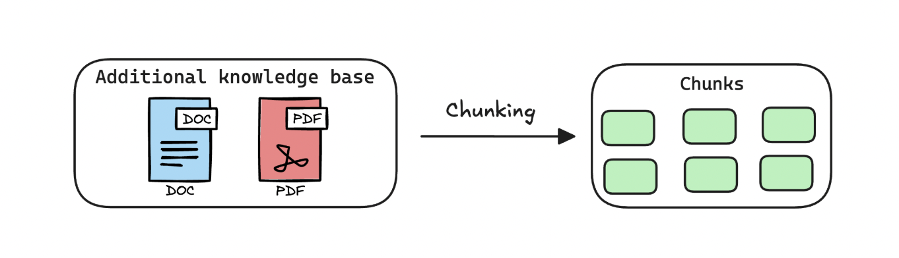
> 由于LLM的上下文窗口（Context Window）有限，不能一次性处理非常长的文档。同时，为了更精确地检索，需要将长文档切分成较小的、语义连贯的文本块（Chunks）。
##### 切分策略
* 固定大小切分 

> 生成块的最直观和直接的方法是将文本分割成基于预定义字符数、单词数或标记的均匀段。
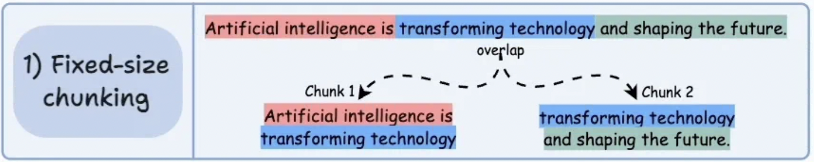
* 语义分段

> 根据句子、段落或主题部分等有意义的单位对文档进行分段。
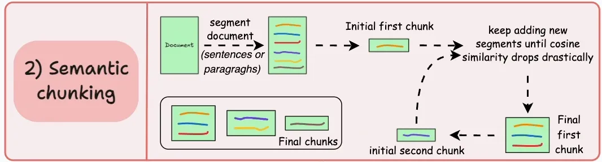
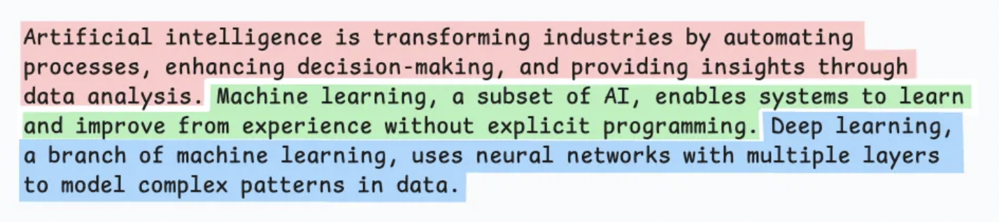
* 递归字符切分

> 首先，根据段落或章节等固有分隔符进行分块。
> 接下来，如果每个块的大小超过预定义的块大小限制，则将其拆分为更小的块。然而，如果块的大小符合块大小限制，则不再进行进一步拆分。
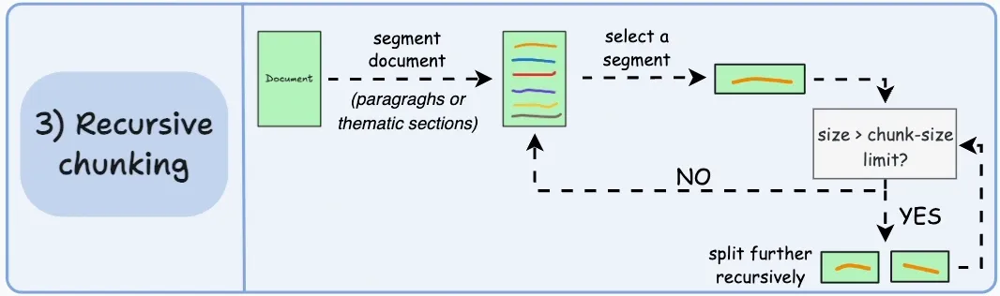
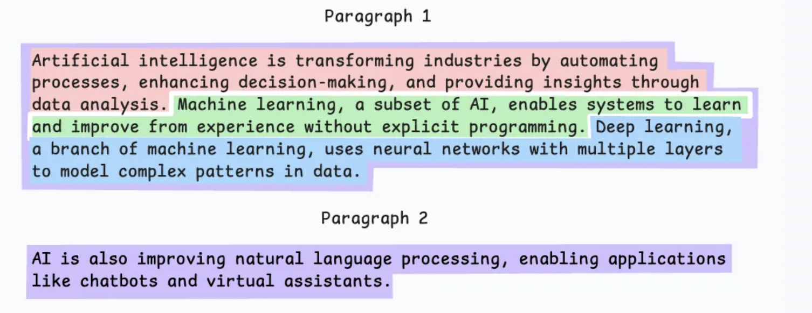
* 按句子/段落切分

> 它利用文档固有的结构，如标题、部分或段落，来定义块边界。这样，它通过与文档的逻辑部分保持一致来保持结构完整性。
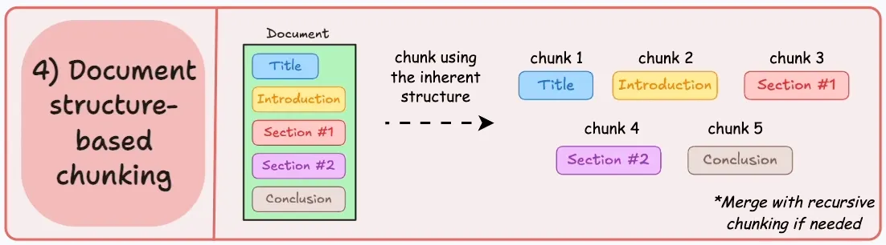
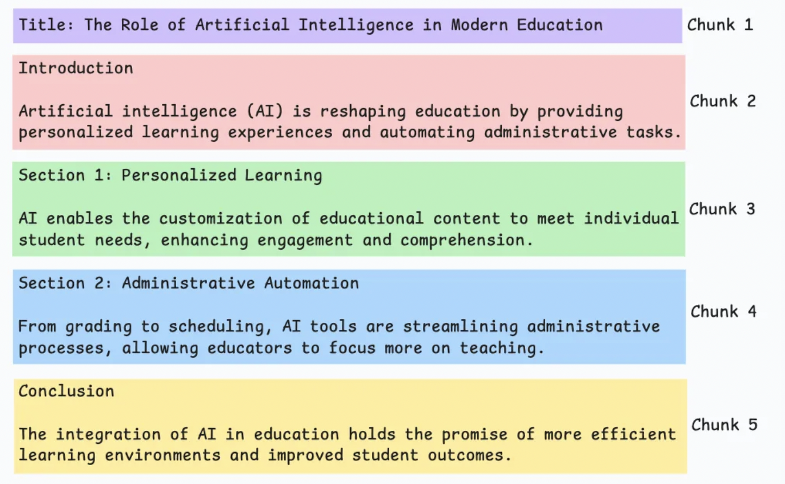
* 大模型切分

> 直接使用大模型做语义切分
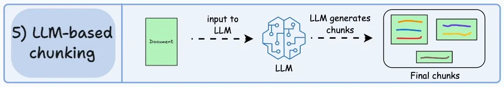
##### 重要的参数
* ` chunk_size`：（块大小）
* ` chunk_overlap`：（块之间的重叠字符数，有助于保持语义连续性）。

#### 2.1.3.**文本嵌入 (Text Embedding):**
* 将每个文本块（Chunk）转换为一个固定长度的数值向量（Vector Embedding）。这个向量能够捕捉文本块的语义信息。语义相似的文本块在向量空间中的距离会更近。

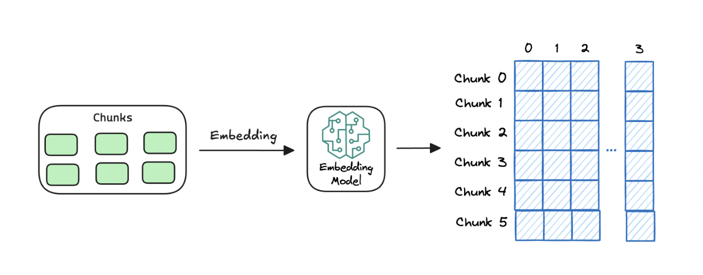
* 选择合适的Embedding模型至关重要：
    * 例如：OpenAI的`text-embedding-ada-002`，开源的如`moka-ai/m3e-base` (M3E), `BAAI/bge-large-zh` (BGE), Sentence Transformers系列模型等。


#### 2.1.4.**向量存储与索引 (Vector Store & Indexing)**
> 将生成的文本块向量及其对应的原始内容存储到专门的向量数据库（Vector Database）或向量索引中。
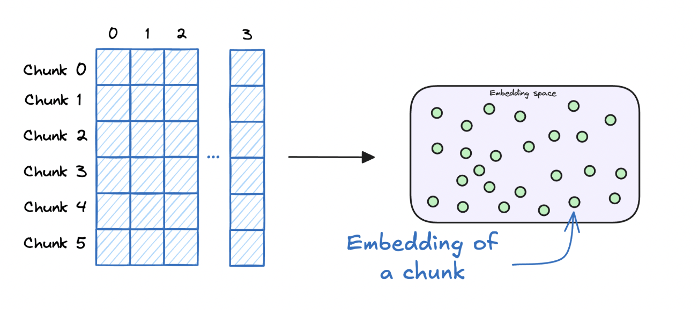
##### 2.1.4.1.[常见的索引结构](https://zhuanlan.zhihu.com/p/27399676042)
###### 2.1.4.1.1.扁平（Flat）索引
不会对输入的向量进行任何修改，将搜索查询向量 $X_q$ 与索引中的每个其他向量进行比较，返回其中最近的 k 个向量作为最匹配的结果，这就是 k 近邻（kNN）搜索。

扁平索引的准确性**极高**，但速度**极慢。**

###### 2.1.4.1.2. 倒排文件（IVF ：**Inverted File Index**）索引
1. **训练阶段（离线）：**

    * 从数据集中选取向量数据，使用聚类算法（如k-means）将它们划分成 k (或 nlist) 个簇。每个簇都有一个中心点（centroid）。
    * 创建一个倒排文件结构：每个质心对应一个列表（inverted list），该列表存储所有被分配到该簇的原始向量的ID或其完整向量。

2. **添加阶段（离线/在线）：**

    * 当新的向量加入数据库时，计算它与所有 k 个质心的距离，将其分配给最近的质心，并将其ID（或向量）添加到对应质心的倒排列表中。

3. **查询阶段（在线）：**

    * 将查询向量与所有 k 个质心进行比较。
    * 选择与查询向量最接近的 nprobe 个质心。nprobe 是一个可调参数，表示要搜索的簇的数量。
    * 只在选定的 nprobe 个簇对应的倒排列表中的向量进行精确的暴力搜索（即Flat搜索），找出最终的Top-K结果。

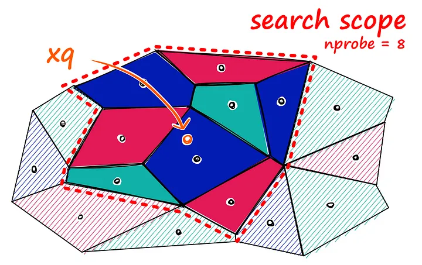
* **优点：**
    * **显著减少搜索空间：** 将全量N个向量的搜索范围缩小到约 (N/k) * nprobe 个向量，大大提高了查询速度。
    * **相对简单，易于理解和实现。**
    * 可以通过调整 nlist (聚类数) 和 nprobe (查询时探测的簇数) 来平衡速度和召回率。nprobe 越大，召回率越高，但速度越慢。

* **缺点：**
    * **性能依赖聚类质量：** 如果聚类效果不好（例如，簇的划分不均匀或不合理），会导致搜索效率低下或召回率下降。
    * **空簇或数据倾斜问题：** 某些簇可能包含过多或过少的向量。
    * **边界问题：** 如果查询向量或其最近邻位于簇的边界，选择较小的 nprobe 可能会错过真正的最近邻。
    * **训练阶段需要数据：** 需要一个代表性的数据集来训练质心。

* **适用场景：**
    * 大规模向量数据集（百万级到十亿级）。
    * 对速度有较高要求，同时可以接受一定的召回率损失。
    * FAISS库中非常基础且重要的索引类型。


###### 2.1.4.1.3.分层可导航小世界图索引：**HNSW (Hierarchical Navigable Small World)**
* **原理：**
    * HNSW是一种基于图的ANN索引方法。它构建一个多层的图结构。
    * **层级结构：** 每一层都是一个近邻图（Navigable Small World graph）。顶层图最稀疏，边连接距离较远的点，提供快速的“高速公路”导航。越往底层，图越密集，连接更近的点，用于更精细的搜索。底层（第0层）包含所有数据点。
    * **插入：** 新向量插入时，会为其随机选择一个最大层数 L_max（层数越高，概率越低，保证高层稀疏）。然后从 L_max 层开始逐层向下，在每一层为其找到若干最近的邻居并建立连接（边的数量有上限，如参数 M）。
    * **查询：** 从顶层的某个固定入口点开始。在当前层，贪婪地向查询点方向移动（选择邻居中离查询点最近的那个），直到找不到更近的邻居（到达局部最优）。然后将该局部最优点作为下一层的入口点，重复此过程，直到到达最底层（第0层）。第0层的搜索结果作为最终候选。efSearch (或 ef) 参数控制搜索过程中维护的动态候选列表的大小，影响搜索广度和精度。


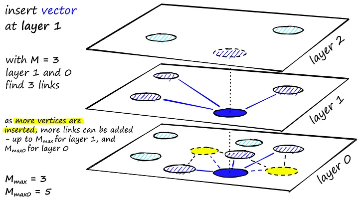
* **优点：**
    * **优异的性能：** 在召回率和查询速度之间取得了非常好的平衡，通常是目前性能最好的ANN算法之一。
    * **鲁棒性好：** 对数据分布和维度不那么敏感。
    * **支持动态增量添加数据点：** 尽管批量构建可能更优，但它天然支持逐个添加。
    * **不需要显式的训练数据：** 索引是直接从插入的数据点构建的。

* **缺点：**
    * **索引构建时间较长且计算密集：** 特别是对于大规模数据集和较大的 M 或 efConstruction 参数。
    * **内存占用较大：** 需要存储图的连接关系，通常比IVF系列占用更多内存（除非IVF不压缩）。
    * **参数调优重要：** M (每层最大连接数), efConstruction (构建时邻居搜索深度), efSearch (查询时搜索深度) 对性能影响显著。
    * 删除操作相对复杂，可能影响图的质量。

* **适用场景：**
    * 对召回率和查询速度都有较高要求的场景。
    * 中等到大规模数据集。
    * 许多现代向量数据库（如Weaviate, Qdrant, Milvus的新版本）将其作为核心或推荐索引。FAISS也提供了HNSW的实现。


###### 2.1.4.1.4.Annoy（Approximate Nearest Neighbor Oh Yeah）
**核心原理：随机投影森林**

Annoy使用了一种叫做"随机投影森林"的数据结构，工作原理可以这样理解：

**1. 空间分割游戏**

* 想象你在一个房间里放了很多球（向量点）
* Annoy会随机选择一个方向，用一面镜子（超平面）把房间一分为二
* 继续在每个子房间里重复这个过程，直到每个小房间里的球足够少

**2. 多棵树的智慧**

* 由于分割是随机的，单棵树可能会把相似的点分到不同区域
* Annoy建立多棵这样的树（通常10-100棵）
* 搜索时在所有树中寻找候选点，然后合并结果

**技术细节深入**
建索引过程：
对于每个节点：

1. 随机选择两个样本点A和B
2. 计算A和B的中点作为分割点
3. 用垂直于AB连线的超平面进行分割
4. 左子树：到A更近的点
5. 右子树：到B更近的点
6. 递归直到叶子节点包含≤K个点

**搜索过程**：

1. 遍历每棵树，找到查询点应该落在的叶子节点
2. 收集所有叶子节点中的候选点
3. 计算查询点与候选点的真实距离
4. 返回距离最小的Top-K个结果

```
示例树结构：
        [超平面1]
       /         \
   [超平面2]   [超平面3]
    /    \      /    \
[叶节点] [叶节点] [叶节点] [叶节点]
```
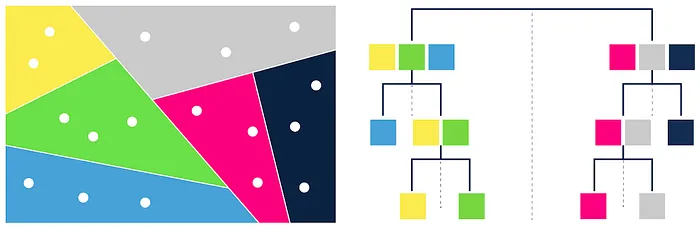
###### 2.1.4.1.5.局部敏感哈希（LSH）
局部敏感哈希（LSH）的工作原理是通过一个哈希函数对向量进行处理，将相似的向量分组到同一个桶中，这个哈希函数的目的是最大化哈希冲突，而不是像通常的哈希函数那样最小化冲突。

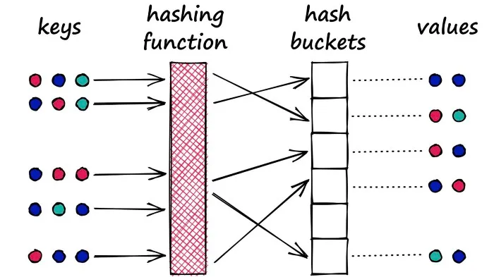
###### 2.1.4.1.6.乘积量化（PQ）
乘积量化(PQ)是一种将**高维向量压缩为紧凑编码**的技术，其核心是通过**分治思想**将高维空间分解为多个低维子空间的笛卡尔积。PQ 的过程可以分为四个步骤：分割、训练、编码和查询。

* **分割**：将D维向量分割为m个D/m维子向量[x₁,x₂,...,xₘ]。
* **训练**：对每个子空间进行k-means聚类，得到m个“码本”，每个码本包含k个中心向量。
* **编码**：

    1. **向量映射**：对于新向量x，分割为m个子向量
    2. **最近邻搜索**：每个子向量xᵢ找到对应子空间最近的聚类中心ID
    3. **生成编码**：组合所有子空间的中心ID，形成m字节的编码

* **查询**：

    1. **查询向量预处理**：分解查询向量并计算距离表
    2. **查表操作**：快速计算查询向量与库中所有压缩向量的近似距离
    3. **结果筛选**：返回Top-K最近邻结果

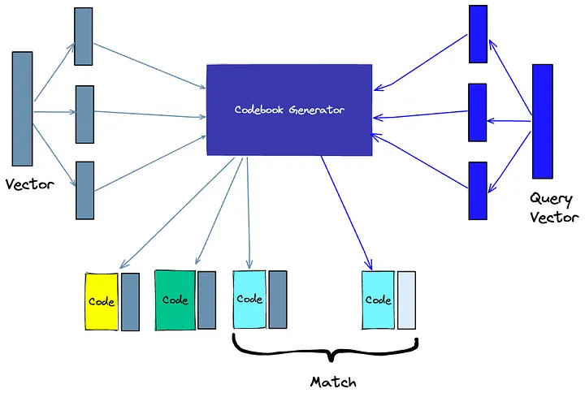


##### 常用向量数据库/库：
* **FAISS (Facebook AI Similarity Search):** 一个高效的相似性搜索库，通常需要自己管理元数据。
* **Pinecone:** 托管的向量数据库服务。
* **Weaviate:** 开源的向量搜索引擎，支持GraphQL。
* **ChromaDB:** 开源的、为AI应用设计的嵌入式数据库。
* **Milvus, Qdrant, Elasticsearch (with vector search capabilities)** 等。

### 2.2.**检索与生成：**
#### 2.2.1.**查询转换/扩展:**
* 对用户的原始查询进行改写、扩展或分解，以提高检索效果。
* 例如：将一个复杂问题分解为多个子问题分别检索；使用LLM生成多个相似的查询语句（HyDE - Hypothetical Document Embeddings）；提取关键词等。

#### 2.2.2.**查询向量化 (Query Embedding):**
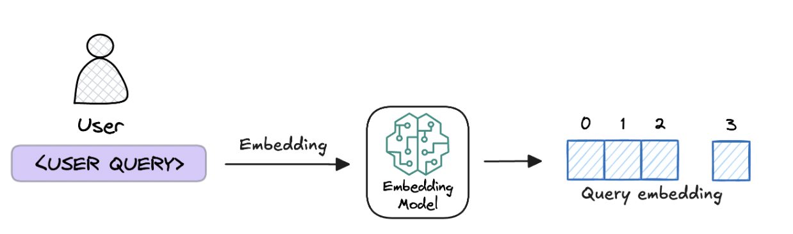
    * 使用与文档嵌入**相同的Embedding模型**，将用户的查询（或转换后的查询）也转换为一个向量。

#### 2.2.3.**相似度检索 (Similarity Search):**
> 在向量数据库中，使用查询向量搜索与之最相似的Top-K个文本块向量，召回的这些文本块就是与用户问题最相关的上下文信息
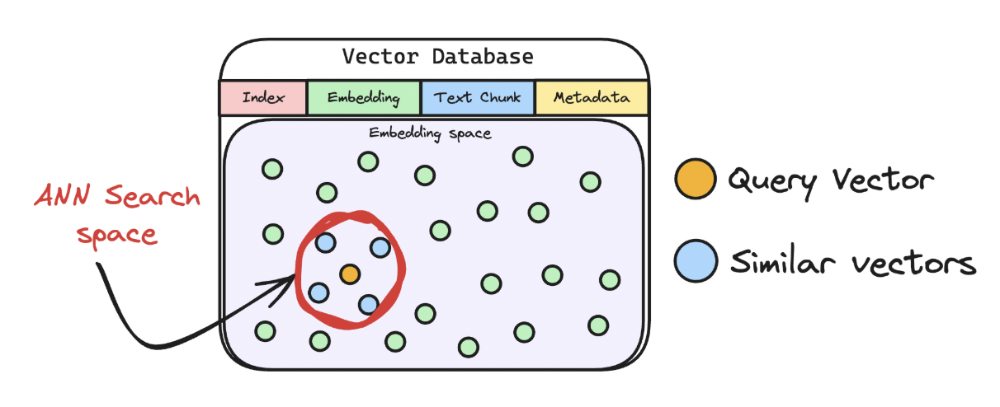
##### 常用的相似度/距离度量
* 余弦相似度 (Cosine Similarity)：**Cosine Similarity(A, B) = cos(θ) = (A · B) / (||A|| * ||B||)**
* 欧氏距离 (Euclidean Distance)：distance(a, b) = √(Σ(aᵢ - bᵢ)²)
* 点积 (Dot Product)：a · b = Σ(aᵢ * bᵢ)

##### 常见的相似度检索算法
###### 2.2.3.1.1.**精确相似度检索 (Exact Similarity Search)**
1. **暴力搜索 (Brute-force Search / Exhaustive Search)**

**原理：** 这是最简单直接的方法。计算查询向量与数据集中每一个向量之间的距离（或相似度），然后对这些距离进行排序，选出最小（或最大）的K个。

###### 2.2.3.1.2.**近似最近邻检索 (Approximate Nearest Neighbor, ANN) Search**
> ANN算法的核心思想是通过构建特定的索引结构，在查询时避免与所有数据点进行比较，从而加速检索。
1. **基于树的划分方法 (Tree-based Partitioning)**
    1. 递归地沿着某个维度将数据点分割成两部分，每个节点代表一个超矩形区域。分割点通常是该维度上的中位数

2. **基于哈希的方法 (Hashing-based)**
    1. 设计一组特殊的哈希函数（LSH族），使得原始空间中相似（距离近）的点以高概率映射到相同的哈希桶（bucket）中，而距离远的点以高概率映射到不同的哈希桶中。

3. **基于量化的方法 (Quantization-based)**
    1. 将原始向量切分成m个子向量，然后对每一组子向量分别进行矢量量化（如使用k-means找到k*个质心，即码本）。原始向量就用m个质心的ID来表示。

4. **基于图的导航方法 (Graph-based Navigation)**
    1.  构建一个多层的图。顶层图稀疏，连接距离较远的点（用于快速跳转，类似高速公路）；底层图密集，连接距离较近的点（用于精确查找，类似本地道路）。搜索时从顶层图的入口点开始，贪婪地走向查询点的方向，逐层向下，直到在最底层找到最近邻。

5. **基于聚类的方法 (Clustering-based)**
    1. 类似于传统信息检索中的倒排索引。首先通过聚类算法（如k-means）将数据集中的向量划分成k个簇。每个簇有一个中心点（centroid）。查询时，先找到与查询向量最近的nprobe个簇中心，然后只在这些簇包含的向量中进行精确搜索（或进一步使用PQ等方法加速）。


#### 2.2.4.**上下文构建 (Contextualization)**
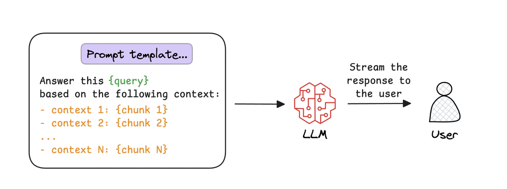
* 将检索到的Top-K个文本块（Chunks）的内容，与用户的原始查询一起，按照预设的模板（Prompt Template）组装成一个增强的Prompt。
* 这个Prompt通常会包含明确的指令，告诉LLM如何利用提供的上下文来回答问题。
* 例如："基于以下上下文信息：\n{retrieved_chunks}\n\n请回答用户的问题：{user_query}"

#### 2.2.5.**LLM生成 (LLM Generation):**
* 将这个增强的Prompt输入给大语言模型（如GPT-4, Claude, Llama等）。
* LLM会基于提供的上下文信息和自身知识来生成最终的答案。由于有了相关的、具体的上下文，LLM产生幻觉的概率降低，答案的相关性和准确性得到提升。

# **四、评估RAG系统：**
    * **评估是迭代优化RAG系统的基础，但也是一个难点。**
    * **常用指标（通常需要人工标注或使用自动化评估工具）：**
        * **检索阶段评估：**
            * **命中率 (Hit Rate):** 检索到的Top-K结果中，有多少包含了正确答案所需的文档。
            * **MRR (Mean Reciprocal Rank):** $\mathrm{MRR}=\frac{1}{|Q|}\sum_{i=1}^{|Q|}\frac{1}{\mathrm{rank}}_i$第一个相关文档排名的倒数的平均值。

        * **生成阶段评估 (端到端评估):**
            * **上下文相关性/精确度 (Context Relevance / Precision):** 检索到的上下文与用户问题的相关程度。低相关性的上下文是噪声。
            * **答案忠实度/可信度 (Faithfulness / Groundedness):** 生成的答案是否完全基于提供的上下文，没有捏造或与上下文矛盾的内容。
            * **答案相关性 (Answer Relevance):** 生成的答案是否直接回答了用户的问题，并且是有用的。
            * **答案正确性 (Answer Correctness):** (如果存在标准答案) 生成的答案是否正确。


    * **评估框架/工具：**
        * **RAGAS (RAG Assessment):** 一个流行的开源框架，提供多种自动化评估指标（如faithfulness, answer_relevancy, context_recall, context_precision）。它通常需要LLM作为评估者。
        * **TruLens:** 提供应用可观测性和评估工具，包括RAG三元组（Query, Context, Response）的评估。
        * **LangSmith (by LangChain):** 用于LLM应用开发和调试的平台，包含跟踪、评估和监控功能。
        * **DeepEval, Arize AI, Galileo** 等。

    * **构建评估集：** 需要准备一组有代表性的（问题，理想上下文，[可选]标准答案）对来进行评估。


# **五、 RAG关键技术点的常见面试考点**
## 1.**文档处理与切块 (Chunking Strategies):**
    * **为什么重要？** 切块的质量直接影响检索效果。太大的块可能包含过多无关信息，稀释相关性；太小的块可能缺乏足够的上下文。
    * **常见策略：**
        * **固定大小切分 (Fixed-size chunking):** 按固定字符数或Token数切分。简单粗暴，但可能切断语义。
        * **按语义切分 (Semantic chunking):** 例如按句子、段落切分，或使用NLP库（如spaCy, NLTK）进行更智能的边界识别。效果通常更好，但实现略复杂。
        * **递归切分 (Recursive character text splitter - LangChain常用):** 尝试按一系列分隔符（如`\n\n`, `\n`, ` `）递归切分，直到块大小符合要求。是一种折中方案。

    * **Overlap（重叠）的重要性：**
        * 在切块时，让相邻的块之间有一部分内容重叠（e.g., 10-20%的块大小）。
        * **目的：** 避免重要的语义信息正好在切分边界被切断，保证语义的连续性和完整性。如果一个完整的想法跨越了两个非重叠块的边界，那么单独检索到任何一个块都可能无法完整理解这个想法。

    * **元数据 (Metadata) 的附加与利用：**
        * 在切块时，为每个块附加元数据，如源文件名、文档ID、章节标题、页码、创建日期等。
        * **作用：**
            * **过滤检索：** 可以在检索时基于元数据进行预过滤（如只检索某个特定来源的文档）。
            * **结果呈现：** 在展示答案时，可以引用元数据（如“根据文档A第3页所述...”），增强可追溯性。
            * **多样化检索：** 某些高级检索策略可能会用到元数据。


## 2.**Embedding模型选型：**
    * **选择合适的Embedding模型是RAG系统的基石。**
    * **常见模型：**
        * **OpenAI Embeddings:** `text-embedding-ada-002`, `text-embedding-3-small`, `text-embedding-3-large`。性能好，但需API调用，有成本。
        * **M3E (Moka Massive Mixed Embedding):** 如 `moka-ai/m3e-base`, `moka-ai/m3e-large`。优秀的开源中英文Embedding模型，性价比高。
        * **BGE (BAAI General Embedding):** 如 `BAAI/bge-large-zh-v1.5` (中文), `BAAI/bge-large-en-v1.5` (英文)。由智源研究院推出，在C-MTEB等榜单表现优异。
        * **Sentence Transformers:** 一个Python框架，提供了大量预训练的句子/文本嵌入模型，如`all-MiniLM-L6-v2`（轻量级），`paraphrase-multilingual-mpnet-base-v2`（多语言）。
        * **Cohere Embeddings, Voyage AI Embeddings** 等商业模型。

    * **考虑因素：**
        * **性能 (Retrieval Quality):** 在相关评测基准（如MTEB, C-MTEB）上的表现。能否准确捕捉语义相似性。
        * **成本：** 商业模型的API调用费用；开源模型的部署和推理资源消耗。
        * **中英文及多语言支持：** 根据你的知识库和用户查询的语言选择。
        * **领域适应性：** 通用Embedding模型在特定专业领域的表现可能不如在该领域数据上微调过的Embedding模型。可以考虑对开源Embedding模型进行领域微调。
        * **向量维度：** 维度越高通常能携带更多信息，但存储和计算成本也更高。
        * **推理速度与资源占用：** 对于需要本地部署或有实时性要求的场景，模型的推理速度和大小很重要。


## 3.**检索策略优化：**
    * **Top-K选择：**
        * 检索最相似的K个文档块。K值需要根据经验和实验调整。
        * K太小可能漏掉关键信息；K太大可能引入过多噪声，并增加LLM处理的上下文长度和成本。

    * **相似度阈值 (Similarity Threshold):**
        * 只选择相似度得分高于某个阈值的文档块。有助于过滤掉不相关的结果，但阈值设定比较tricky。

    * **重排序 (Re-ranking):**
        * **两阶段检索：**


            1. **召回 (Recall):** 先用高效的向量检索（如FAISS, HNSW）快速召回一个相对较大数量（比如Top-20或Top-50）的候选文档块。这个阶段注重“快”和“全”。
            2. **重排 (Re-rank):** 然后使用一个更精确但计算成本更高的模型（如Cross-encoders，如`BAAI/bge-reranker-large`或基于LLM的重排器）对这些候选块进行打分和重新排序，选出最终的Top-N（比如Top-3或Top-5）个块。这个阶段注重“准”。

        * **Cross-encoders** 会将查询和每个候选文档块拼接起来输入模型，直接判断其相关性，通常比单纯的向量相似度更准确。

    * **混合检索 (Hybrid Search):**
        * **结合关键词检索与向量检索。**
        * **原因：**
            * 向量检索擅长捕捉语义相似性（同义词、概念相关），但在精确匹配关键词（如产品型号、专有名词）方面可能不如传统关键词检索（如BM25, TF-IDF）。
            * 混合检索可以取长补短，提升整体检索效果。

        * **实现：** 通常是将两种检索方式的结果进行加权融合排序。许多现代搜索引擎和向量数据库（如Weaviate, Elasticsearch）都支持混合检索。


## 4.**Prompt工程在RAG中的应用：**
> **Prompt是RAG系统中“最后一公里”的关键，它指导LLM如何利用检索到的上下文。**
1. **如何设计有效的Prompt模板：**

    * **清晰指令：** 明确告诉LLM其角色、任务以及如何使用上下文。
        * 例如："你是一个智能问答助手。请根据下面提供的上下文信息来回答用户的问题。确保你的回答完全基于这些信息，不要使用你自己的知识。如果上下文中没有足够的信息来回答问题，请明确说明。"

    * **上下文占位符：** 清晰标出上下文信息插入的位置。
        * `Context: {retrieved_chunks}`

    * **问题占位符：**
        * `User Question: {user_query}`

    * **输出格式要求：** 可以指定答案的格式、长度、风格等。
    * **引用要求：** 可以要求LLM在回答时引用信息来源（如果元数据可用）。

2. **处理检索结果为空或不相关的情况：**

    * **在Prompt中指导：** "如果提供的上下文中找不到答案，请回答‘根据我目前掌握的信息，无法回答您的问题。’"
    * **系统层面处理：** 在检索器返回空结果时，可以选择不调用LLM直接返回预设答案，或者调用LLM但不提供上下文（退化为普通问答，但要小心幻觉）。
    * **让LLM判断相关性：** 可以设计Prompt让LLM先判断检索到的上下文是否与问题相关，如果LLM认为不相关，则不基于此生成答案。

## 5.进阶的效果调优思路
1. **多路召回 (Multi-Query Retriever, HyDE):**

    * **思路：** 用户的原始查询可能不够好，或者角度单一。
    * **Multi-Query Retriever:** 使用LLM将用户的原始查询改写成多个不同角度、不同表述的子查询，然后分别对这些子查询进行检索，最后合并和重排检索结果。
    * **HyDE (Hypothetical Document Embeddings):** 先让LLM针对用户查询生成一个“假设性”的答案/文档，然后对这个假设性文档进行Embedding和检索。其思想是假设性文档在语义上可能比原始短查询更接近目标文档。
    * **目的：** 提升召回的多样性和准确性，减少因查询表述不佳导致的检索失败。

2. **迭代式RAG / 自我修正RAG (Self-Correction / Iterative RAG):**

    * **思路：** 一次检索可能不够，或者检索到的内容质量不高。
    * **过程：**

        1. 初始检索并生成答案。
        2. 让LLM（或另一个LLM/模块）评估检索到的上下文是否足够好，或者生成的答案是否满足要求。
        3. 如果不足够好，LLM可以生成新的查询、或者对已有信息进行反思，然后进行新一轮的检索（可能针对不同部分或补充信息）。
        4. 重复此过程，直到满足条件或达到最大迭代次数。

    * **代表性工作：** Self-RAG, Corrective RAG (CRAG)。
    * **目的：** 提高答案质量和鲁棒性，让系统能主动发现并弥补信息不足。

3. **融合型RAG (RAG-Fusion):**

    * **思路：** 结合多种检索策略或多个来源的结果。
    * **例如：**
        * 同时使用稀疏检索（如BM25（Best Matching 25））和稠密检索（向量检索），然后融合结果。
        * 针对用户查询生成多个变体，分别检索，然后使用Reciprocal Rank Fusion (RRF) 等算法智能地合并和重排序来自不同查询的文档列表。

    * **目的：** 提高检索的召回率和鲁棒性，综合不同检索方法的优势。

## 6.现在大模型的上下文窗口越来越长（比如128K、200K甚至百万Token），这是否意味着RAG（检索增强生成）变得不那么重要了？
恰恰相反。我认为在大模型上下文窗口不断扩大的趋势下，RAG的核心价值不仅没有减弱，反而得到了**强化和重新定位**。它从最初主要解决上下文长度限制的“补丁”，演进为提升模型能力、优化效率与成本、保障数据安全的核心架构范式。其关键意义体现在几个核心维度：

1. **超越长度，聚焦精准与效率：**

    * **解决信息淹没：** 即使窗口巨大，盲目塞入海量数据也会导致模型难以定位关键信息（大海捞针问题）。RAG通过精准检索注入**高价值片段**，提升信息密度和处理效率。
    * **克服位置衰减：** 长上下文中模型对中间信息记忆会减弱。RAG确保关键信息位于提示词显著位置，规避衰减。
    * **减少知识混淆：** 避免不同/矛盾知识源直接输入导致的模型混淆。RAG支持对检索结果进行筛选和排序。

2. **突破静态知识边界：**

    * **动态知识接入：** 模型训练知识是**静态**的。RAG无缝连接外部知识源（数据库、文档、实时API），提供**最新、私有、专业化**信息，这是单纯扩大上下文**无法实现**的核心能力。
    * **安全访问专有知识：** 敏感数据不能全量上传云端。RAG支持在安全环境检索，仅传递**脱敏/授权后的相关片段**，平衡利用与安全。

3. **显著优化成本与性能：**

    * **降低成本：** 处理超长上下文（尤其百万Token级）计算开销巨大。RAG传递少量相关文本，**大幅降低单次推理成本**（计算资源 & API费用）。
    * **降低延迟：** 检索+小片段处理通常比处理整个超长文档**快得多**，提升用户体验。

4. **增强可信度与可解释性：**

    * **来源追溯：** 明确标注答案来源文档片段，提升可信度和可验证性。
    * **抑制幻觉：** 答案严格基于检索证据，减少模型“捏造”事实。

5. **实现海量知识管理：**

    * **连接浩瀚知识库：** PB级知识库或互联网无法塞入任何上下文窗口。RAG的检索系统（如向量数据库）是高效搜索海量数据的**必备桥梁**。
    * **模块化更新：** 知识更新只需更新检索索引，**无需重新训练/微调**昂贵模型，灵活高效。

**总结来说：** 长上下文解决的是“模型能看多长文档”，而RAG解决的是“如何从海量信息中**智能找到并精准利用最相关**的知识”。两者是**互补关系**：

* **长上下文** 擅长处理**单个/少量长文档内的复杂推理**（总结、连贯写作）。
* **RAG** 是处理**超大规模、动态、私有/外部知识源**任务的**核心支柱**，在**效率、成本、精准度、安全性和可解释性**上具有**不可替代**的优势。

因此，在长上下文时代，**RAG的意义已升级为“智能信息接入与管理”的基础架构**，是构建强大、实用、可信赖AI应用的**必备组件**。


# **六、 挑战与未来展望**
1. **技术发展趋势：**

    * **GraphRAG技术：**
        * 利用知识图谱（Knowledge Graphs）进行检索，而不仅仅是文本块。
        * 知识图谱能提供更结构化、关系更明确的信息，有助于进行更精准、更具推理性的检索。
        * 例如，微软最近提出的GraphRAG，通过构建语义知识图谱并在其上进行社区检测和摘要生成，实现更深入的知识洞察。

    * **Agent-based RAG / 主动式RAG：**
        * 如前面提到的迭代式RAG和自我修正RAG，RAG系统将更具“智能”，能主动判断信息质量，进行多轮交互式检索，甚至主动向用户提问以澄清意图。
        * RAG将更深度地融入Agent框架，成为Agent理解世界、获取知识的核心能力之一。

    * **多模态RAG发展：**
        * 当前的RAG主要处理文本信息。未来的RAG将扩展到多模态数据，如图像、音频、视频等。
        * 用户可以用图片提问，RAG系统可以检索相关的图片、文本、视频片段，并生成多模态的答案。
        * 这需要多模态Embedding模型和多模态LLM的支持。

    * **端侧RAG部署：**
        * 随着更小、更高效的LLM和Embedding模型的出现，以及端侧计算能力的增强，未来可能会有更多轻量级的RAG系统直接在用户设备（如手机、PC）上运行。
        * 这有助于保护用户隐私、降低延迟、减少对云服务的依赖。


