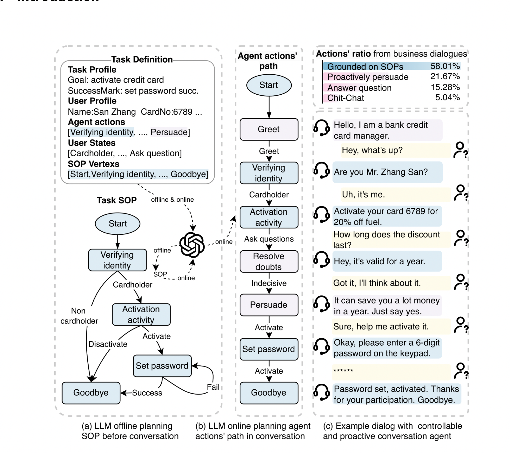
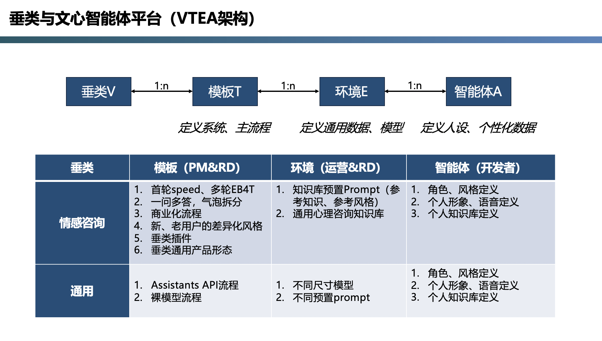
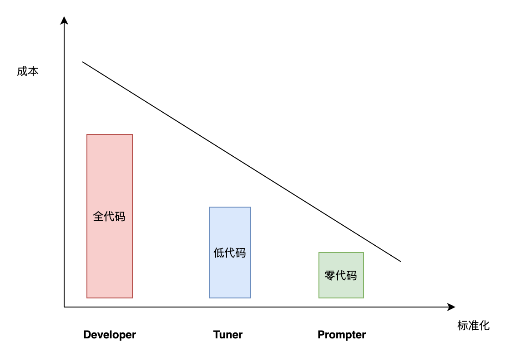
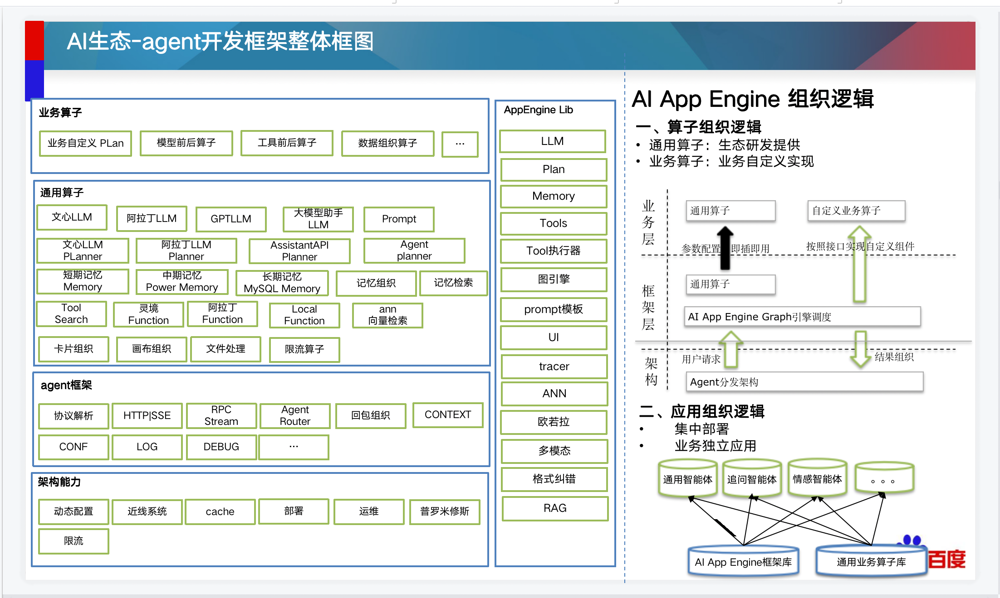
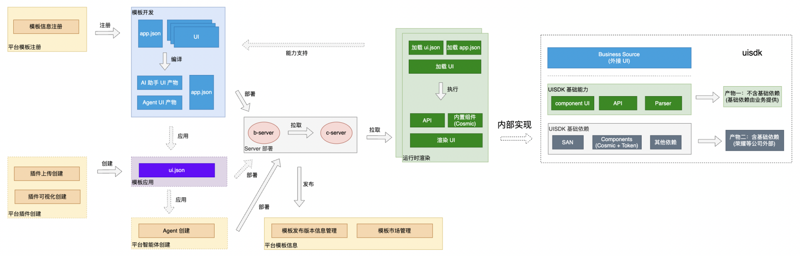
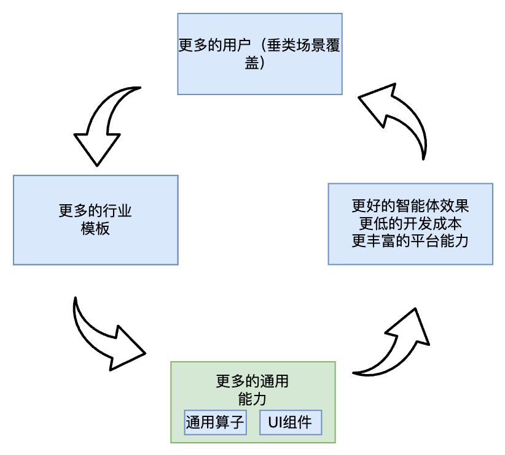

> 原文：https://ku.baidu-int.com/knowledge/HFVrC7hq1Q/KeF15lNOtH/-UXFkEkRyR/mREyvy_8lhs214

VETA架构

#### **一、背景**
随着垂类和开发者在智能体业务的更一步各种深耕探索，平台通用模板（COT/SOP/套路）已经无法满足垂类开发者各种特殊需求，文心智能体搜索需要为开发者内容**提供执行流程、平台配置、展现样式的有开发新范式**，支撑『需求满足-多轮互动-商业转化』三步打法落地，助力平台和重点垂类目标达成。

#### **二、目标**
* 执行流程（TASKSOP/套路）可开发
* 平台配置可开发
* 展现样式可开发

> VTEA架构目标是实现一个**人和 LLM 协作的****架构**，人和LLM 共同影响和控制 agent 的执行流程。基于这个架构，通过人的介入通过多次、分阶段的 LLM 调用实现TASK SOP的**更好且稳定的效果**，实现LLM+0.5
#### **二、名词解释**
**V：Vertical（垂类）**

**T：Template（行业模板）**

    * 行业模板，通过垂类牵引创建行业模板（套路），满足行业场景的定制化需求，且能输出给平台，供广大开发者使用

**E：Environment（环境）**

    * 运行环境、如prompt tpl、资源、各类子功能配置项

**A：Agent（智能体）**

**TASK SOP**：任务流程/套路 [https://arxiv.org/html/2407.03884v1](https://arxiv.org/html/2407.03884v1)

**LLM+0.5**:

OpenAI参考自动驾驶对AGI从L1到L5分了5级，LLM+0.5的含义是指通过**人和 LLM协作的智能体实现比LLM高半代的AGI水平**

---

#### **三、VTEA 架构**

**开发者分层**

||**Prompter 平台用户** 改prompt+工具即可满足需求 主要面向大众开发者，快速体验智能体能力|**Tuner 调优用户** 主要面向调优开发者，对智能体对话效果有较高要求，且能通过模型调优、流程干预等方式，在现有的运行模式上进行优化和定制化，以实现更好的智能体对话效果 有低代码开发能力，能通过workflow调优提升效果|**Developer 深度开发用户（如情感垂类）** 对业务有高度自定义需求，需要自定义执行流程，改变下游存储等 主要面向内部垂类开发者，有独特的运行模式，对流程、交互有深度的定制化需求|**Provider 服务提供者（api接入）** 无法复用当前所有智能体能力，开发只希望接入智能体分发和展示，不希望使用平台任何能力|
|-|-|-|-|-|
|开发层|**A（agent）层**|**E（Environment）层**|**T（Template）层**|**T（Template）层**|
|**特点**|1. 简单快速，只需要填写调试prompter即可实现60分的智能体 2. 同步升级，跟随平台能力升级自动升级|1. **执行流程自定义**，如插件是否润色，是否可以获取更多用户级别信息，调用插件的最大次数等；或者在workflow使用提供的预置功能定制化执行流程。 2. **模型自定义**，支持指定模型提高对话效果。（后续会支持私有模型的调用） 3. **模板自定义**，支持给大模型的prompt模板自定义，可自行调优模板，提高模型对话效果。 4. 同步升级，也可以跟随平台能力升级自动升级 5. 统一的资源管理、托管请求。|1. **流程自维护**，完全接管对话逻辑，对话流程可自定义开发，独立发展线条 2. **能力复用**，平台已有运行模式支持的能力都可以复用 3. 统一资源管理，托管请求 4. 开发前端组件|1. **完全独立**能力实现，实现api即可快速接入|
|**应用级别功能** 名称、简介、开场白、声音、背景|平台支持，默认实现|平台支持，默认实现|平台支持，默认实现|平台支持，默认实现|
|**智能体周边能力** 追问、链接挂载、线索转化、商业挂载、上下文管理等|平台支持，默认实现，平台简单配置|平台支持，默认实现，平台简单配置 |当前默认实现，未来升级成自定义算子，可在自定义模式下自行选择|**api接入，不使用平台提供的任何基础框架**|
|**效果能力** 知识库、联网搜索、插件、长期记忆、插件等|平台支持，默认实现，平台简单配置|平台支持，默认实现，平台简单配置 |可复用通用算子复刻平台能力，也可以自定义实现逻辑||
|**运行模式** 零代码：assistant、functionCall、纯模型 低代码：workflow 全代码：自定义模式|**平台托管** 根据插件选择自行选择assistant、functionCall、纯模型模式，且跟随平台升级自行变更（可使用一言内置工具，强化效果）|**人工干预运行模式** 1. 主动选择assistant、functionCall、纯模型，使用workflow增强执行流程 2. 干预执行模型，可选独立模型 3. 干预预设对话模板 4. 干预预设执行流程|**自定义图模式** 1. 流程完全自主开发，高度自定义 2. 可复制平台已有能力算子二次开发||
|**自定义算子**|无|无|支持自定义业务逻辑算子||
|**运行维护** 历史记录、trace、资源统计、数据统计等|平台统一维护|平台统一维护|模型算子、打点需按照规范实现，可复用平台能力||
|**分发**|平台统一分发|平台统一分发|平台统一分发|平台统一分发|

#### **核心难点/问题**
行业模板的开发成本高

多行业重复开发

LLM在进化，能力逐渐提高，要随时根据LLM能力的进化提升智能体效果

**解决方案：**

**后端：图化开发框架**

标准化技术框架：通过一个统一的技术框架，定义agent业务的标准流程，确保开发的一致性和效率。

抽象通用技术组件：持续抽象和优化技术组件，形成可在不同业务之间通用和可插拔的技术中间件，这些中间件作为AI生态的技术沉淀

插拔式业务算子：设计业务算子的插拔机制，使其能够随大模型能力的进化灵活添加或移除

支持动态子图：根据LLM自主规划能力强弱，LLM 参与任务规划出更复杂的子图

**前端：****Assistant 行业模板机制**

提供面向开发者设计一套AI助手/智能体标准机制，提升行业模板接入人效，满足内外部业务便捷定制 AI助手/Agent 模板行业模板

* **业务开发自主**，在框架安全约束范围下，仅关注业务层需求即可，可自主实现不同效果，无需过度关注基础层组件及框架的内在实现
* **框架接入高效**：与组件及框架部署上线解耦，行业组件独立部署上线，框架根据使用情况自动加载执行，无需人工介入

[Assistant(行业模板)方案设计](https://ku.baidu-int.com/knowledge/HFVrC7hq1Q/76YVMWYfJM/YTLhlw6TTE/2TY0vQiLPZ0JLQ?t=mention&mt=doc&dt=doc)

#### **四、合作模式**

||平台|垂类|
|-|-|-|
|后端|**运行维护** 历史记录、trace、资源统计、数据统计、性能分析等 **模型资源** **调优支持** **开发工具支持** **通用算子开发/维护**|**行业模板开发** 自定义图开发**、**自定义算子开发、效果保障、通用算子贡献   |
|前端|**一次开发多端分发接入** **CLI 工具支持** 开发、编译部署 **DSL 输出** API、组件、框架等能力 **运行时渲染** 资源加载、渲染支持 **智能体应用** 行业模板 -> 插件UIJSON ->  Agent等接入使用|**垂类定制化 UI 开**发 模板、样式、逻辑|

# 