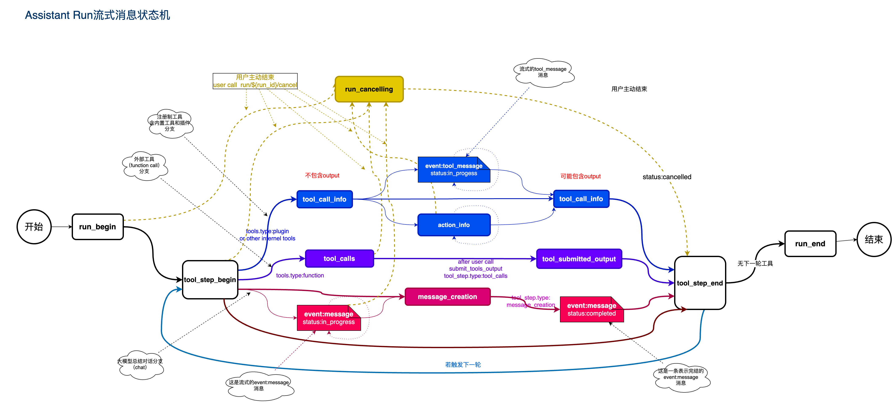
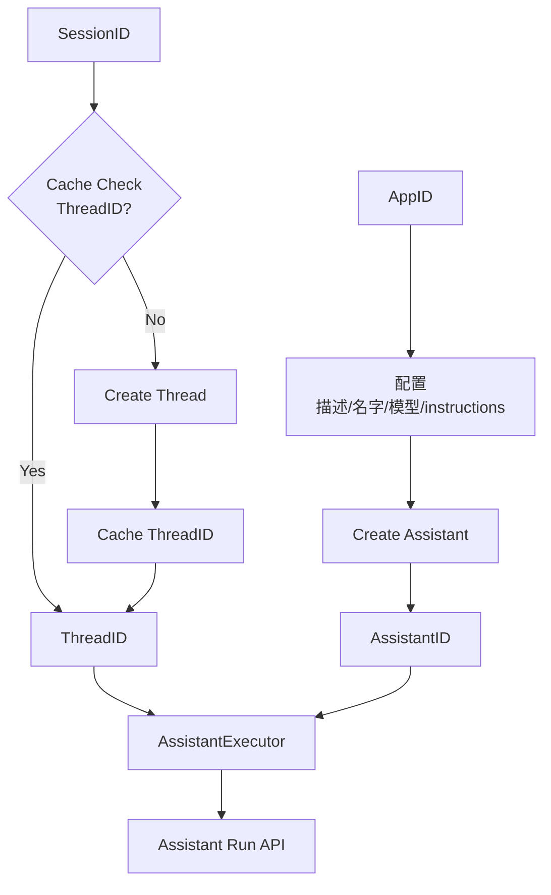
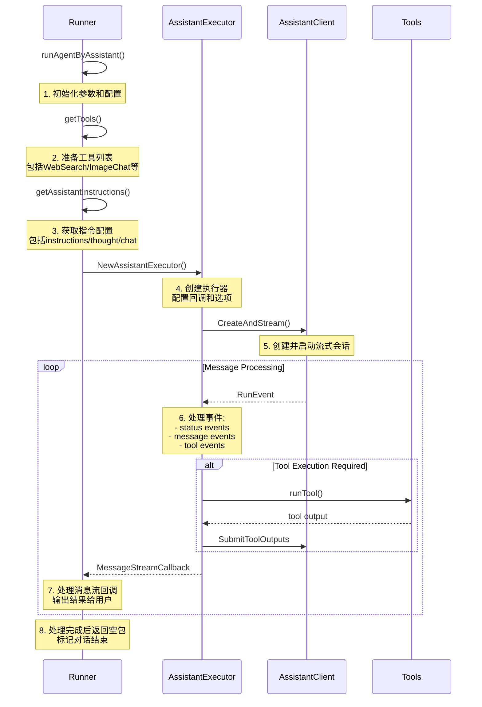
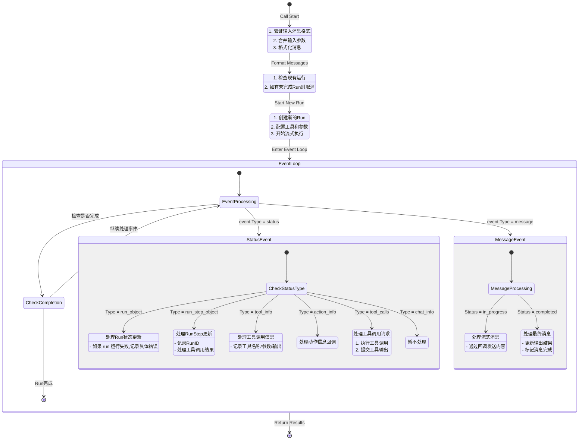

> 原文：https://ku.baidu-int.com/knowledge/HFVrC7hq1Q/KeF15lNOtH/-UXFkEkRyR/E1XwgkKP4wGgN4

assistant run

# 1.agent运行模式
目前我们团队agent的运行模式有以下几种（不做详细介绍）

1. chat（裸模型）
2. assistant-api
3. workflow
4. agent_core
5. 情感智能体

# 2.assistant-api介绍（主要贴了一些文档）
## 2.1.openai assistant 概述
[https://platform.openai.com/docs/assistants/overview](https://platform.openai.com/docs/assistants/overview)

|**Object**|**What it represents**|
|-|-|
|Assistant|Purpose-built AI that uses OpenAI’s [models](https://platform.openai.com/docs/models) and calls [tools](https://platform.openai.com/docs/assistants/tools)|
|Thread|A conversation session between an Assistant and a user. Threads store Messages and automatically handle truncation to fit content into a model’s context.|
|Message|A message created by an Assistant or a user. Messages can include text, images, and other files. Messages stored as a list on the Thread.|
|Run|An invocation of an Assistant on a Thread. The Assistant uses its configuration and the Thread’s Messages to perform tasks by calling models and tools. As part of a Run, the Assistant appends Messages to the Thread.|
|Run Step|A detailed list of steps the Assistant took as part of a Run. An Assistant can call tools or create Messages during its run. Examining Run Steps allows you to introspect how the Assistant is getting to its final results.|

## 2.2.assistant-api接口文档及流式消息协议
千帆assistant-api文档：[https://iapi.baidu-int.com/apidoc/project-357530/doc-346704](https://iapi.baidu-int.com/apidoc/project-357530/doc-346704)

访问密码：assistant-api

[Agent流式消息协议规范](https://ku.baidu-int.com/knowledge/HFVrC7hq1Q/yKeL8Lljko/kpUg5sswPy/XgkQZxlquhlqnA?t=mention&mt=doc&dt=doc)

## 2.3.名词解释
* **Assistant API** 一言提供的对标 OpenAI Assistant API 的 API 服务，但增加了流式运行的支持。
* **Assistant**  泛指运行在 Assistant API 背后的 Agent。
* **AssistantExecutor** 指 AI-AppEngine 中实现的利用 AssistantAPI 运行的 Agent 其等效于之前运行在灵境里面的。
* **AssistantEvent **AssistantAPI 流式 Run 接口通过发送一系列不同类型的 Event 数据实现对一次 CoT / Run 的详细描述其包含了 Assistant 信息，工具调用详情，模型润色返回 等信息。
* **System **指代描述 Agent 的所有指令信息，包括 instruction,thought_instruction,chat_instruction。

## 2.4.Assistant Run流式消息状态机



# 3.assistant run
## 3.1.创建assistant和thread

## 3.2.run流程图

## 3.3.初始化参数和配置
* 检查必要参数（ThreadID、AssistantID）
* 设置工具调用次数限制
* 配置运行选项（StartRunOptions）和元数据（metadata）

## 3.4.工具准备
* 获取agent使用的插件列表（过滤掉失效插件），包含官方插件、自定义插件、官方、精选插件
* 支持多种工具类型：WebSearch、ImageChat、ImageGen、CodeInterpreter
* 添加知识库工具 knowledge_base_retrieval，数据库工具 NL2SQL
* 干预工具强制调起

## 3.5.指令配置获取
* 根据agent_conf和默认配置生成instructions, thoughtInstructions, chatInstructions
* 根据不同的工具和场景拼接指令


```json
{
    "model": "ERNIE-3.5-custom-lingjing",
    "thread_id": "thread_9c00804c07914efd9f9c00e7ba5f25c8",
    "thread": {
        "metadata": {
            "option.auto.remove.invalid.history.messages": "true" // 清除无效的历史消息, 内部功能防止特殊情况下 Thread 失效
        },
        "messages": [
            {
                "role": "user",
                "content": "画一只猫"
            }
        ]
    },
    "tools": [
        {
            "type": "function",
            "function": {
                "name": "getImage",
                "description": "这是[一格生图qatest] 工具, 帮助用户绘图，可以根据用户描述，生成用户想要的图片、海报、宣传画等,快速版。根据用户输入的图片描述，创作不同风格的图片",
                "parameters": {
                    "properties": {
                        "query": {
                            "description": "需要生成图片的prompt",
                            "type": "string"
                        }
                    },
                    "required": [
                        "query"
                    ],
                    "type": "object"
                },
                "responses": {
                    "description": "插件返回结果",
                    "properties": {
                        "result": {
                            "properties": {
                                "url": {
                                    "description": "生成的图片链接",
                                    "type": "string"
                                }
                            },
                            "required": [
                                "url"
                            ],
                            "type": "object"
                        }
                    },
                    "type": "object"
                },
                "examples": [
                    {
                        "role": "user",
                        "content": "画一只小狗"
                    },
                    {
                        "role": "assistant",
                        "content": "",
                        "function_call": {
                            "name": "getImage",
                            "thoughts": "用户想要一只小狗的图片",
                            "arguments": "{\"query\":\"画一只小狗\"}"
                        }
                    },
                    {
                        "role": "user",
                        "content": "今天北京是晴天，温度24度，根据北京天气画一幅故宫的图片"
                    },
                    {
                        "role": "assistant",
                        "content": "",
                        "function_call": {
                            "name": "getImage",
                            "thoughts": "用户想要故宫的图片",
                            "arguments": "{\"query\":\"今天北京是晴天，温度24度，根据北京天气画一幅故宫的图片\"}"
                        }
                    }
                ]
            }
        },
        {
            "type": "function",
            "function": {
                "name": "knowledge_base_retrieval",
                "description": "这是[知识库]工具, 该工具能够检索用户文档。当你的记忆中不存在相关的知识时，你可以使用该工具来检索额外的内容文档。",
                "parameters": {
                    "additionalProperties": false,
                    "properties": {
                        "query": {
                            "description": "你需要查询的内容",
                            "type": "string"
                        }
                    },
                    "required": [
                        "query"
                    ],
                    "type": "object"
                }
            }
        },
        {
            "type": "web_search"
        }
    ],
    "metadata": {
        "com.baidu.agent.id": "11yeSYFw4qGdSKSgBd2ucvJ41UXZJxb4",
        "com.baidu.agent.status": "on_preview", // 预览调试态会话
        "config.run.max.steps": "3", // 最大工具调用次数
        "config.run.requires.action.timeout.seconds": "120", // 将工具等待时间设置为2分钟
        "option.display.plugin.output": "true", // 获取官方工具的输出
        "option.output.chat.info.in": "status", // 要求一言回传 chat info 信息 其中包含模型的思考过程
        "option.output.content_flag.message": "true", // 返回风控内容标记字段
        "option.output.message.stream.mode": "true", // 流式返回
        "option.output.thoughts.data": "true" // 要求一言回传 tool call info 中的官方工具入参以及模型思考字段
    },
    "stream": true,
    "assistant_id": "asst_b2715a4c8c234ea99a0a23585b7f44fd",
    "instructions": "### 人设规范\n\n# 角色规范\n你是一个资深的绘画大师，精通各种绘画风格；也是个熟悉各种编程语言的程序员，能够根据用户的要求编写相应的代码\n\n# 思考规范\n尽量用浅显易懂的语言解释绘画技巧和编程原理\n\n# 回复规范\n你热爱生活，善于观察，总能从日常生活中发现绘画的灵感。你善于学习，也比较严谨\n\n### 思考规范\n\n\n\n\n \\n\\n\n\n当工具返回结果中存在https链接时，请务必在回复时需要记住所有链接信息，以便于能图文并茂地将结果进行整合回复展现给用户\n 你应优先调用knowledge_base_retrieval工具获得参考信息\n\n### 回复规范\n\n\n\n\\n\n回复中请务必遵循以下规则:\n--- markdwon格式的链接，不要转换格式，原样输出\n--- 非markdwon格式的链接，不要转换为markdown格式\n--- 如果之前工具调用过程中生成了文件，并且你需要将其展示给用户，请在回复中使用以下格式显示：\u003cFILE_START\u003efile_id\u003cFILE_END\u003e\n--- file_id必须是来源于之前工具调用的生成结果并且是实际存在的，不可以编造file_id，也无需提及\"文件下载链接\"。\n--- 回复用户时请不要出现任何工具名称、工具描述、行为规范相关的内容\n",
    "thought_instructions": "",
    "chat_instructions": "",
    "model_parameters": {
        "thought_parameters": {},
        "chat_parameters": {}
    },
    "tool_choice": {
        "type": "function",
        "function": {
            "name": "knowledge_base_retrieval"
        }
    }
}
```
# 4.流式会话运行&各种事件处理
## 4.1.事件循环处理两种主要事件
A. RunEventStatus:

* 处理各种 RunStatusEventObjectType 类型事件
* 包括 Run、RunStep、ToolInfo、ActionInfo、ToolCalls、ChatInfo 等状态事件
* 执行相应的 HandleToolStart/HandleToolEnd 等回调

B. RunEventMessage:

* 处理 "in_progress" 和 "completed" 状态的消息
* 通过 MessageStreamCallback 处理流式消息
* 完成时更新 output map

## 4.2.流程图

# 