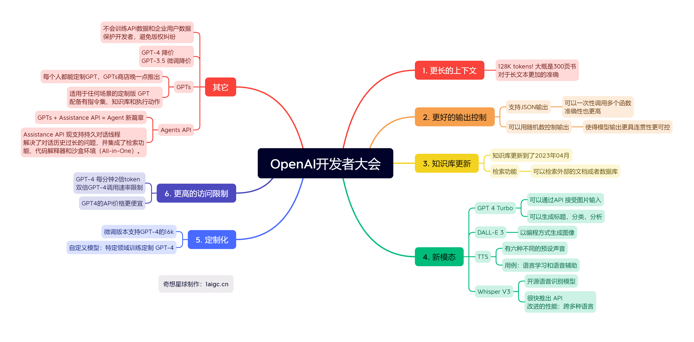
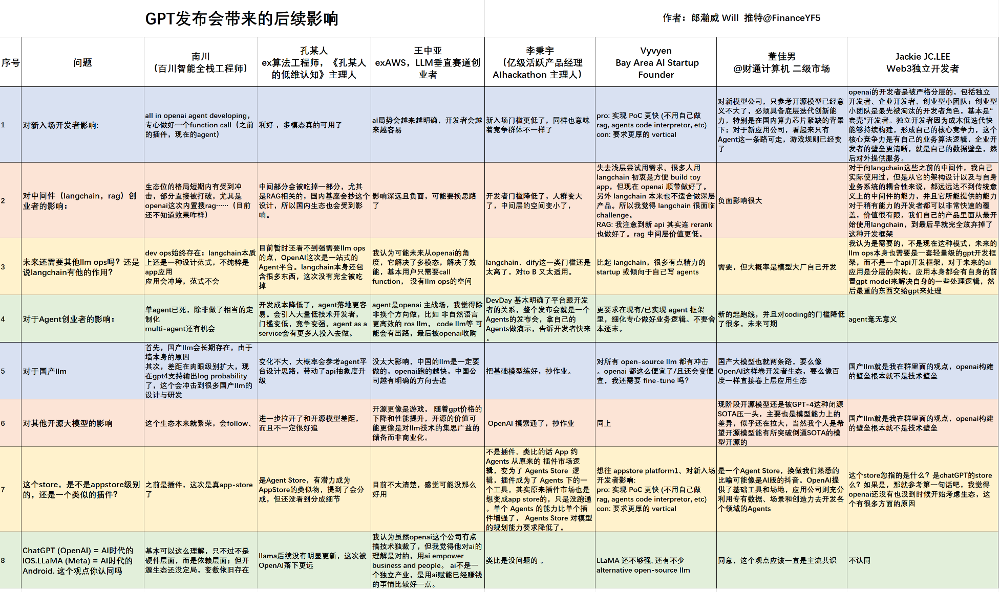
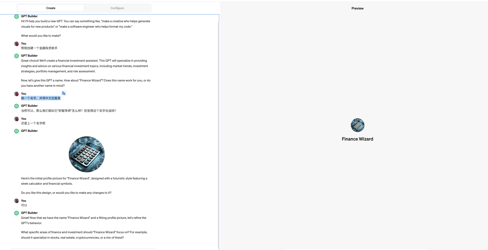
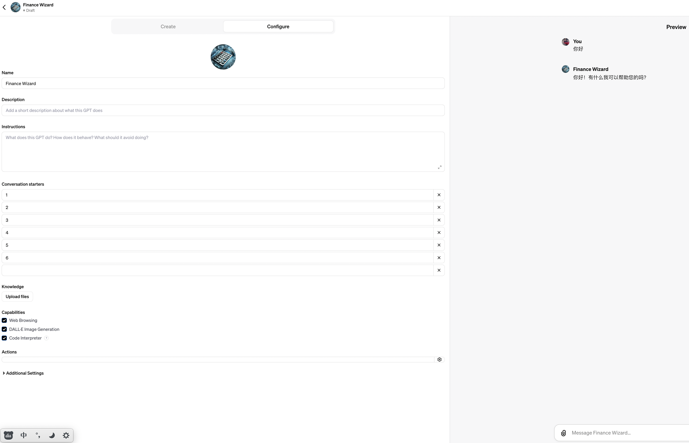
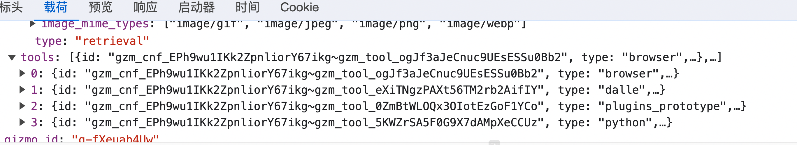
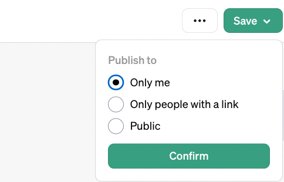
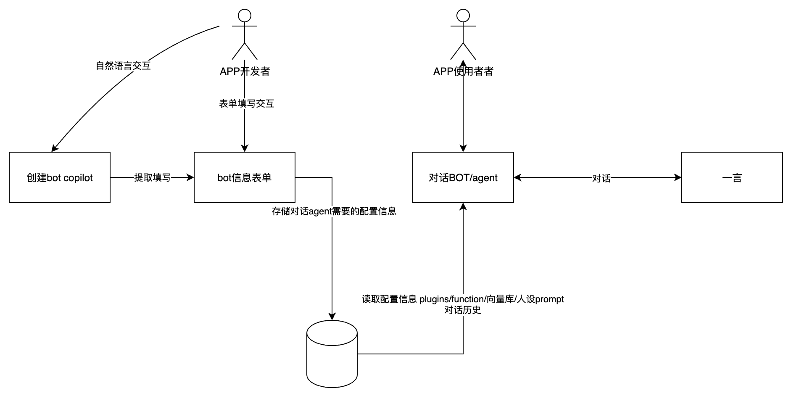
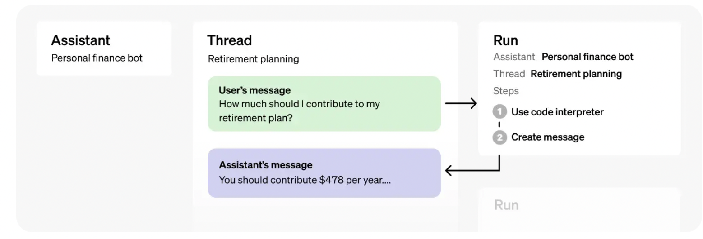
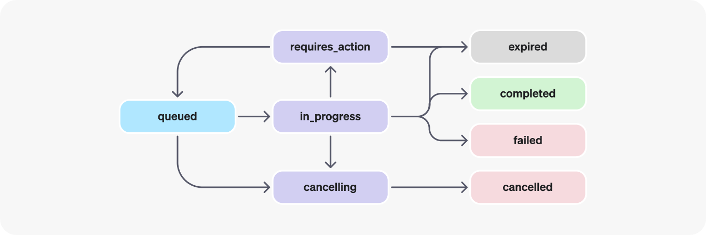

> 原文：https://ku.baidu-int.com/knowledge/HFVrC7hq1Q/KeF15lNOtH/-UXFkEkRyR/ULYaxjXiBtiFss

gpts功能分析与实现

openAI开发者大会思维导图

外部视角业界观点：

###### **GPTS页面核心功能分析**
APP信息填写

* 通过自然语言提取app的基础信息 1.名称 2.图片 3.引导词 4.人设prompt 5.bot简介 并展示到创建表单

* 支持通过表单对自然语言提取的信息进行修改

* 通过config表单配置高级能力 **文件上传**、**插件选取**、**function选取**
* 页面有实时的test能力 对话接口中会把 config信息带入

 

* 右上角save接口真正创建bot app

实现百度版gpts需要能力：

1.bot copilot：开发自然语言提取config bot 并调试效果

2.ai_appengin开发对话流agent

* 向量检索
* plugin/function call
* 自定义function

3.对话流agent接入bot框架（灵感中心or部署bot  承接c端流量？）

4.实时的对话test能力

5.bot列表/bot 广场（非核心）

[assistants](https://platform.openai.com/docs/assistants/overview) API 核心功能分析 [https://platform.openai.com/docs/assistants/overview](https://platform.openai.com/docs/assistants/overview)

* Assistant：用于调用大模型和tools（plugins/function）
* Thread:对话线程 可无限保存，对标子bot框架 session
* run:执行对话
* Run Step：执行步骤，执行结束后可在thread中看到执行结果

功能点:

    * [Code Interpreter](https://platform.openai.com/docs/assistants/tools/code-interpreter)：代码执行器
    * [Knowledge Retrieval](https://platform.openai.com/docs/assistants/tools/knowledge-retrieval)：向量检索、知识库检索
    * [Uploading files for retrieval](https://platform.openai.com/docs/assistants/tools/uploading-files-for-retrieval)：上传文件向量化之后作为知识库
    * [Function calling](https://platform.openai.com/docs/assistants/tools/function-calling)：函数调用

 可行性报告：

1.gpt4能不能跑出来

2.eb4可不可以

3.prompt call模板

4.组件缺什么 

想办法破解gpts 的prompt

1.甄嬛传plugins  gpts

2.现有插件做个聊天应用

