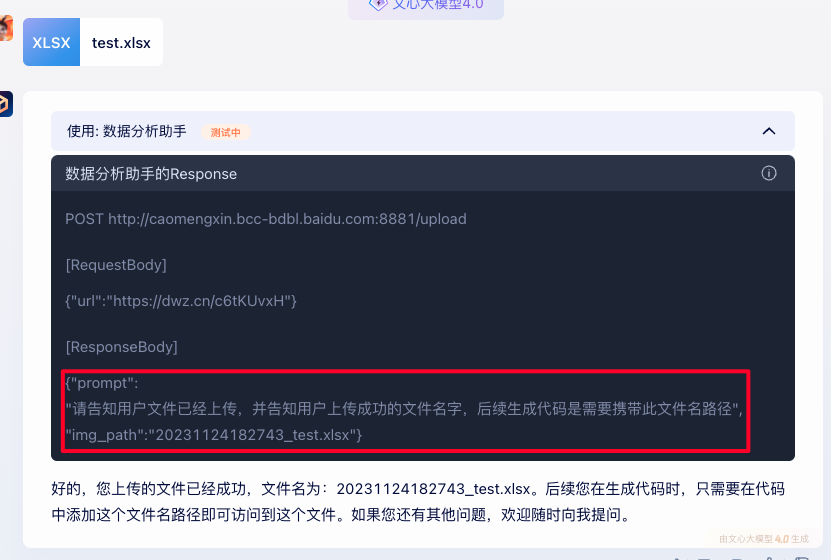
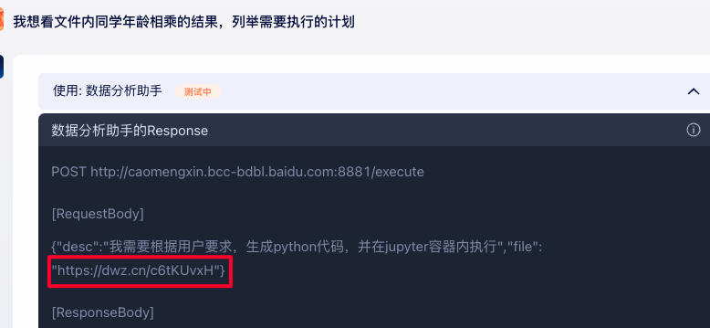

> 原文：https://ku.baidu-int.com/knowledge/HFVrC7hq1Q/KeF15lNOtH/-UXFkEkRyR/Zh5fpdZJ968UZA

一言模型能力需求汇总

## Agent 遇到的问题与需求
**Case参考文档：**[EB & GPT4 在 旅游助手 Agent 上效果对比](https://ku.baidu-int.com/knowledge/HFVrC7hq1Q/MYFIkxNl2o/-UXFkEkRyR/jrMa0zqUJ_IZ2U?t=mention&mt=doc&dt=doc)

## CodeInterpreter
**Case参考文档**:  [code-interpreter demo说明](https://ku.baidu-int.com/knowledge/HFVrC7hq1Q/MYFIkxNl2o/-UXFkEkRyR/8LBeuD89FCeOH5?t=mention&mt=doc&dt=doc)

### 存在问题&需求
|demo|问题|影响|预期 or 需求|备注|Case链接||
|-|-|-|-|-|-|-|
|agent|Token Stop 能力缺失影响部分 Agent 实现||与 OpenAI 接口 stop 参数能力打齐，支持Token粒度停止词|[https://platform.openai.com/docs/api-reference/chat/create#chat-create-stop](https://platform.openai.com/docs/api-reference/chat/create#chat-create-stop)|[EB & GPT4 在 旅游助手 Agent 上效果对比](https://ku.baidu-int.com/knowledge/HFVrC7hq1Q/MYFIkxNl2o/-UXFkEkRyR/jrMa0zqUJ_IZ2U#anchor-662166a0-89f2-11ee-b9e3-5918ce63ba6f?t=mention&mt=doc&dt=doc)||
||System 人设能力薄弱影响绝大部分 Multi Agent 实现，且支持长度太小只有 1024 个字符。||加强 System 能力||[EB & GPT4 在 旅游助手 Agent 上效果对比](https://ku.baidu-int.com/knowledge/HFVrC7hq1Q/MYFIkxNl2o/-UXFkEkRyR/jrMa0zqUJ_IZ2U#anchor-68180680-89f2-11ee-b9e3-5918ce63ba6f?t=mention&mt=doc&dt=doc)||
||单条消息大小存在限制，在 Agent 应用中限制了工具数量||增大或者解除单条消息大小限制|千帆负责|[EB & GPT4 在 旅游助手 Agent 上效果对比](https://ku.baidu-int.com/knowledge/HFVrC7hq1Q/MYFIkxNl2o/-UXFkEkRyR/jrMa0zqUJ_IZ2U#anchor-637b9b00-89f2-11ee-b9e3-5918ce63ba6f?t=mention&mt=doc&dt=doc)||
||总上下文大小不够||增大上下文大小，最好能和GPT-4-1106-preview打齐，或者先增强到 32k 也好||||
||模型指令跟随能力不足，导致 Agent输出和运行逻辑很难符合预期|Agent行为控制能力过弱，难以控制和优化|增强模型指令跟随能力||[EB & GPT4 在 旅游助手 Agent 上效果对比](https://ku.baidu-int.com/knowledge/HFVrC7hq1Q/MYFIkxNl2o/-UXFkEkRyR/jrMa0zqUJ_IZ2U#anchor-5ee95b70-8d91-11ee-981a-7d0cc2ee4956?t=mention&mt=doc&dt=doc)||
||模型返回结构体格式控制能力薄弱.|Agent 返回很容易不符合预期导致 agent运行失败.|支持 response_format 能够准确控制输出. 或者提升指令跟随能力先暂时缓解此问题|[https://platform.openai.com/docs/api-reference/chat/create#chat-create-response_format](https://platform.openai.com/docs/api-reference/chat/create#chat-create-response_format)|[EB & GPT4 在 旅游助手 Agent 上效果对比](https://ku.baidu-int.com/knowledge/HFVrC7hq1Q/MYFIkxNl2o/-UXFkEkRyR/jrMa0zqUJ_IZ2U#anchor-5ee95b70-8d91-11ee-981a-7d0cc2ee4956?t=mention&mt=doc&dt=doc)||
||||||||
|codeInterpreter|functionCall不支持大文本或代码参数|无法通过functionCall直接生成代码|可通过functionCall生成代码，上下文维护在一言对话模型|方案一：单一模型|||
||插件内部进行代码生成并支持，只能实现单次简单调用，不支持复杂连续执行代码块||functionCall支持连续调用|方案二：大小模型，小模型专门用于生成代码|||
||模型生成代码块截取，不能按照指定格式生成代码块。总会有其他描述和代码块标记|当前解决办法是要求必须有代码块标记，人工截取|结果格式生成稳定||||
||文件传递，如果跨多轮对文件的概念会有偏差| |同一回话内部，提供统一的文件传递方案||||
||functionCall和文本信息无法同时返回|无法通过要求列举计划的方式强化执行过程|期望可以和GPT一样同时支持functionCall和文本内容|建议需求，非强需求|||

