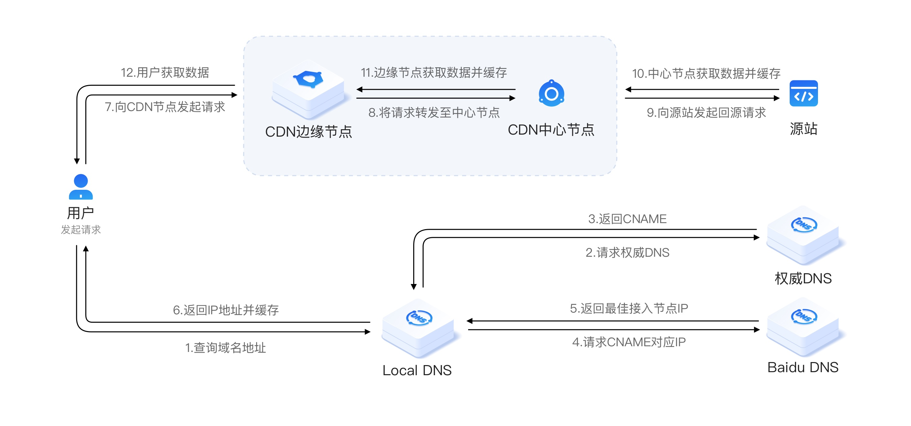

> 原文：https://ku.baidu-int.com/knowledge/HFVrC7hq1Q/KeF15lNOtH/-UXFkEkRyR/Of2erJIFtiIT5y

内容分发网络（Content Delivery Network）技术分享

## 1.**什么是CDN？**
CDN（Content Delivery Network，内容分发网络）是一种构建在现有互联网基础之上的智能虚拟网络，通过在全球各地部署边缘服务器节点（Edge Servers），将网站、应用或媒体内容缓存到距离用户最近的节点上，从而实现内容的就近访问与快速分发。其核心目标是**提升用户访问速度、降低源站负载、增强系统可用性与安全性**。

CDN = 就近访问 + 分布式缓存 + 智能调度

## 2.为什么需要 CDN
### 2.1 不用 CDN 会发生什么
用户直接访问源站：

```
User → Internet → Origin Server
```
问题：

1. **物理距离远**

    * RTT 高，延迟大

2. **跨运营商 / 跨地域**

    * 丢包、抖动

3. **源站压力大**

    * 流量洪峰
    * 易被打垮

4. **可用性差**

    * 单点故障

## 3.**CDN 的核心价值**
1. **加速内容交付**：用户从最近的边缘节点获取内容，大幅减少网络延迟。
2. **减轻源站压力**：大量请求被边缘节点缓存处理，减少回源次数。
3. **提高可用性与容灾能力**：即使源站宕机，部分静态内容仍可由CDN提供。
4. **增强安全性**：集成DDoS防护、WAF（Web应用防火墙）、HTTPS支持等安全能力。
5. **节省带宽成本**：减少源站出口带宽消耗，优化整体网络资源使用。

## 4.**CDN 的基本架构**
```
User
 ↓
DNS / 调度系统
 ↓
CDN Edge Node
 ↓ (miss)
Origin Server
```
一个典型的CDN系统包含以下几个关键组件：

### 4.1.** 边缘节点（Edge Server / POP）**
* 部署在全球各大城市或运营商网络中的缓存服务器。
* 负责接收用户请求、返回缓存内容或向父层/源站回源。

```
用户
 ↓
本地运营商 / 城域网
 ↓
CDN 边缘节点   ← 你请求真正命中的地方
 ↓（未命中才会）
CDN 回源节点
 ↓
源站
```
**特点**

* 同城 / 同运营商
* RTT 极低（毫秒级）
* 数量多、分布广

**常见组合：**

* **Nginx**
* **Varnish**
* SSD / NVMe
* 大内存（缓存元数据）

```
用户
 ↓
Nginx（协议 / TLS / 转发）
 ↓
Varnish（缓存）
 ↓
回源
```
### 4.2.**源站（Origin Server）**
* 内容的最终来源，内容的原始服务器，存储所有未缓存或动态内容。
* 可以是：Web Server, 对象存储（OSS / S3），内部服务
* CDN通过回源机制从源站拉取最新内容。

### 4.3.**调度系统（DNS/GSLB + 负载均衡）**
* 决定“用户请求应该打到哪个边缘节点”
* **GSLB（Global Server Load Balancing）**：基于用户地理位置、网络状况、节点负载等信息，将用户调度到最优边缘节点。
    * 用户在浏览器输入 `www.example.com`
    * DNS 请求到达 GSLB 系统
    * GSLB 根据以下信息决定返回哪个 IP：
        * 用户的 **地理位置**（通过 DNS 请求源 IP 判断）
        * 各数据中心的 **健康状态**（是否在线）
        * 各节点的 **当前负载**（CPU、连接数等）
        * 网络 **延迟或带宽质量**

    * GSLB 返回**最优数据中心的 IP 地址**（如：上海节点 203.0.113.10）
    * 用户直接连接该 IP，获得更快、更稳的服务


### 4.4.**缓存管理系统**
* 控制内容的缓存策略（如TTL、Cache-Control、Vary等）。
* 支持主动预热、缓存刷新、缓存标签等高级功能。

## 5.**CDN 工作流程（以HTTP请求为例）**
### 5.1.主要流程
1. 用户在浏览器输入 `https://www.example.com/image.jpg`。
2. DNS解析请求发送至CDN厂商的智能DNS系统。
3. 智能DNS根据用户IP地理位置、运营商、节点健康状态等，返回最优边缘节点IP（如北京联通节点）。
4. 用户向该边缘节点发起HTTP请求。
5. 边缘节点检查本地是否缓存了 `/image.jpg`：

    * **命中缓存（Cache Hit）**：直接返回内容，响应时间极短。
    * **未命中（Cache Miss）**：向上游（可能是中间层或源站）发起回源请求。

6. 源站返回内容后，边缘节点缓存该内容（遵循缓存规则），再返回给用户。
7. 后续相同请求可直接由缓存服务，无需再次回源。


### 5.2.Cache Miss 时的回源流程
```
Edge Node → Origin → Edge Node → User
```
回源策略包括：

* 回主源
* 回中间层（父节点）
* 多级缓存

## 6.**CDN 缓存机制详解**
### 6.1.HTTP缓存协议
HTTP 缓存协议是一套**浏览器、CDN、代理服务器与源站之间协同工作的缓存规则体系**，核心目标是：**减少重复请求、降低延迟、节省带宽、提升稳定性**。

HTTP 缓存通过 **响应头（Response Headers）** 和 **请求头（Request Headers）** 控制资源是否可以被缓存、缓存多久、如何验证缓存是否有效等。

#### 6.1.1.核心缓存控制头（Cache-Control）
**常见指令：**

|指令|说明|
|-|-|
|`max-age=<seconds>`|资源在多少秒内被认为是“新鲜”的，无需重新验证。例如：`max-age=3600` 表示 1 小时内可直接使用缓存。|
|`no-cache`|**不是禁止缓存！** 而是要求**每次使用前必须向服务器验证**（通过 ETag 或 Last-Modified）。常用于 HTML 页面。|
|`no-store`|**禁止缓存**，敏感数据（如银行页面）应使用此指令。浏览器和 CDN 都不能存储该响应。|
|`public`|响应可以被任何缓存（包括 CDN、代理）存储。通常用于静态资源。|
|`private`|响应只能被**用户浏览器**缓存，不能被共享缓存（如 CDN、代理）缓存。适用于用户私有数据。|
|`must-revalidate`|一旦缓存过期，必须重新验证，不能使用过期内容（即使网络离线也不行）。|

**示例：**

```
Cache-Control: public, max-age=31536000
```
允许所有缓存，有效期 1 年

#### 6.1.2.验证机制头（协商缓存）
当缓存过期或使用 `no-cache` 时，浏览器会向服务器发起**条件请求**，验证缓存是否仍有效。

**ETag + If-None-Match: **

* **ETag**（响应头）：服务器为资源生成的唯一标识（如文件哈希、版本号）。

```
ETag: "abc123"
```
* 浏览器下次请求时带上 **If-None-Match**：

```
If-None-Match: "abc123"
```
* 若资源未变，服务器返回 **304 Not Modified**（无响应体），浏览器继续使用缓存。


**Last-Modified + If-Modified-Since:**

* **Last-Modified**（响应头）：资源最后修改时间。

```
Last-Modified: Tue, 13 Jan 2026 10:00:00 GMT
```
* 浏览器下次请求时带上：

```
If-Modified-Since: Tue, 13 Jan 2026 10:00:00 GMT
```
若资源未在此时间后修改，返回 **304**。

#### 6.1.3.HTTP 缓存整体模型
HTTP 缓存分为三层：

```
Client (Browser)
   ↓
Browser Cache（强缓存 / 协商缓存）
   ↓
CDN / Proxy Cache（边缘缓存）
   ↓
Origin Server（源站）
```
缓存协议解决两个问题：

1. **能不能用缓存？**（缓存策略）
2. **缓存是否还有效？**（缓存校验）

#### 6.1.4.浏览器缓存和CDN缓存
* **缓存位置不同**
    * **浏览器缓存**：存储在**用户本地设备**（如电脑、手机）的浏览器中。
    * **CDN 缓存**：存储在**CDN 服务商的边缘节点服务器**上，这些服务器分布在全球各地，靠近用户。

* **作用范围不同**
    * **浏览器缓存**：仅对**当前用户**有效。每个用户的浏览器缓存是独立的。
    * **CDN 缓存**：对**所有访问同一边缘节点的用户**有效。一旦某个资源被缓存到 CDN 节点，后续访问该节点的用户都能快速获取。

* **缓存目的不同**
    * **浏览器缓存**：避免重复下载相同资源（如图片、CSS、JS），提升**单个用户的重复访问体验**。
    * **CDN 缓存**：减轻源站压力，加速**首次或非本地用户**的访问速度，提升全球用户访问性能。

* **缓存控制机制**
    * 两者都依赖 HTTP 缓存头（如 `Cache-Control`、`Expires`、`ETag` 等），但控制粒度和策略不同：


|**特性**|**浏览器缓存**|**CDN 缓存**|
|-|-|-|
|控制方式|由 HTTP 响应头（如 `Cache-Control: max-age=3600`）控制|除 HTTP 头外，还受 CDN 平台配置影响（如缓存规则、TTL 设置）|
|是否可绕过|用户可手动清除或强制刷新（Ctrl+F5）|普通用户无法清除，需通过 CDN 提供商刷新或设置较短 TTL|
|缓存层级|最靠近用户的最后一级缓存|位于用户和源站之间的中间层缓存|

### 6.2.缓存对象
* 静态资源：
    * JS / CSS / 图片 / 视频

* 动态资源（部分）：
    * API 响应


### 6.3.**缓存键（Cache Key）**
CDN通常基于以下因素生成唯一缓存键：

* 请求URL（含Query String，可配置是否忽略）
* Host头
* User-Agent
* Accept-Encoding

严格来说，**Cache Key 的默认生成规则和可配置能力是由 CDN 厂商决定的，但大部分厂商都会提供可自定义的方式**

**默认策略**

* 每个 CDN 都有自己的默认 Cache Key 生成规则，例如：
    * 阿里云 CDN：默认使用 `host + path + query`，可选择忽略 query 参数
    * 腾讯云 CDN：默认 `host + path + query + cookie`
    * Cloudflare：默认 `host + path`（query 和 cookie 可选）

* 默认策略保证大部分静态资源可以直接缓存，但精度和命中率不是最优。

**可配置性**

* 几乎所有 CDN 都允许用户自定义 Cache Key：
    * **选择是否包含**：
        * Query 参数
        * Header（User-Agent / Accept-Language）
        * Cookie

    * **添加自定义字段**：
        * 比如增加自定义 HTTP Header 或业务参数


### 6.4.**缓存刷新 vs 预热**
* **刷新（Purge）**：强制删除CDN节点上的缓存，下次请求将回源获取新内容。
    * 当 CDN 上的缓存内容**已经过期或错误**，主动通知 CDN **删除或失效**缓存。
    * 解决 资源更新后仍返回旧内容，配置错误 / 回源异常，紧急内容下线 问题
    * 刷新优先级 > TTL

* **预热（Prefetch）**：主动将源站内容推送到CDN节点，避免首次访问慢。
    * 在用户真正访问之前，**主动**把指定资源拉取到 CDN 边缘节点缓存中，避免首批用户访问时回源。
    * 避免**冷启动回源，**减轻源站瞬时压力（发布 / 大促 / 热点事件）


## 7.**CDN 的类型**
|类型|特点|适用场景|
|-|-|-|
|**静态加速**|缓存图片、JS、CSS、视频等静态资源|网站、APP静态资源分发|
|**下载加速**|优化大文件（APK、安装包）分发，支持断点续传|软件更新、游戏补丁|
|**流媒体加速**|支持HLS、DASH、RTMP等协议，低延迟直播|视频直播、点播平台|
|**动态加速**|不缓存，但优化TCP连接、智能路由、协议优化|API、登录、支付等动态请求|
|**全站加速（DSA）**|静态+动态混合加速，智能识别内容类型|电商、金融、SaaS平台|

## 8.**CDN 与安全**
现代CDN已深度集成安全能力：

* **DDoS防护**：利用分布式节点吸收攻击流量，保护源站。
    * 利用全球分布的CDN节点吸收和缓解攻击
    * 用户访问先经过边缘节点过滤

* **Web应用防火墙（WAF）**：过滤SQL注入、XSS、CC攻击等。
* **HTTPS/TLS支持**：
    * 支持自定义证书或免费Let’s Encrypt。
    * 提供TLS 1.3、HTTP/2、HTTP/3（QUIC）等现代协议。

* **Bot管理**：识别恶意爬虫，限制自动化请求。
* **隐私保护**：隐藏源站IP，防止直接攻击。


## 9.**主流CDN厂商对比**
|厂商|优势|特色|
|-|-|-|
|**Cloudflare**|免费套餐强大、全球覆盖广、安全集成深|自动HTTPS、Workers边缘计算|
|**Akamai**|企业级稳定、超大规模节点|高端媒体分发、金融行业首选|
|**阿里云CDN**|国内节点密集、价格透明、与云产品无缝集成|DCDN（全站加速）、视频直播优化|
|**腾讯云CDN**|游戏、音视频场景优化好|与微信生态联动|
|**AWS CloudFront**|与S3/Lambda深度集成|边缘计算（Lambda@Edge）|

****