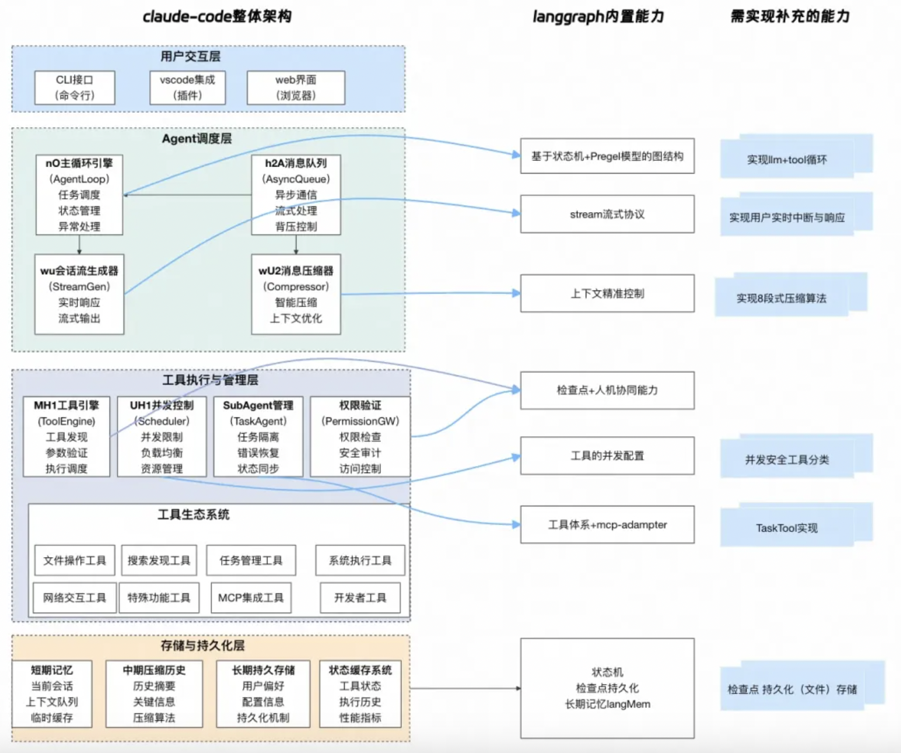
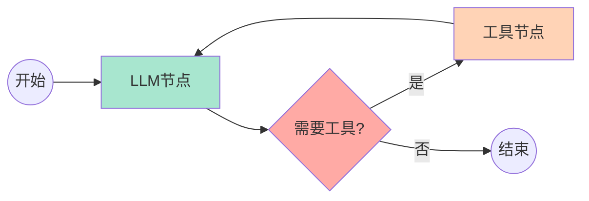
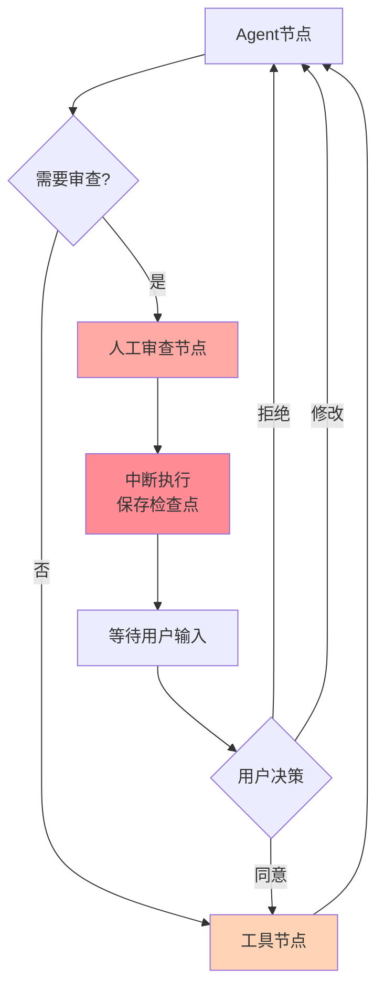
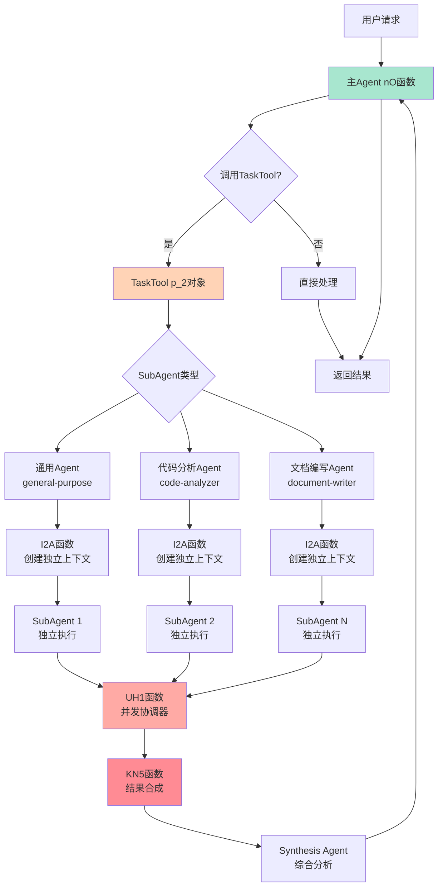
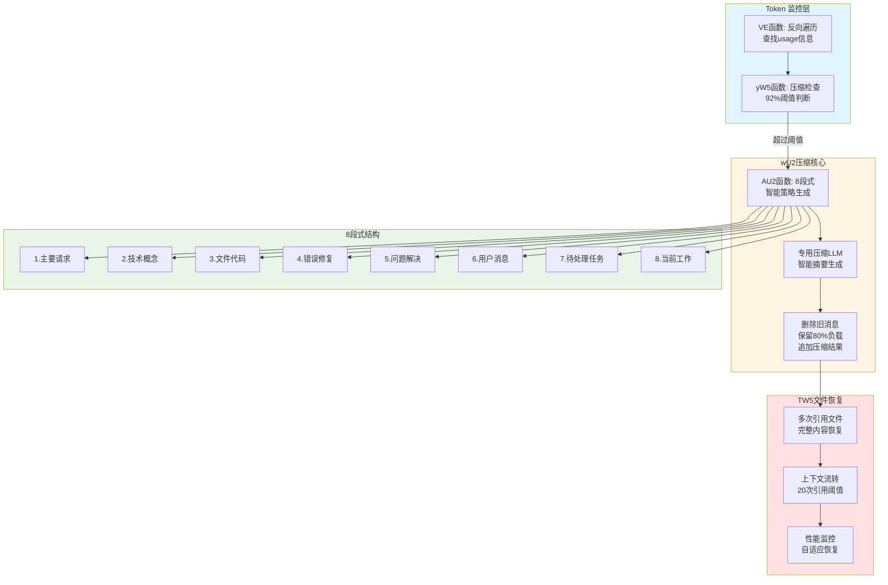
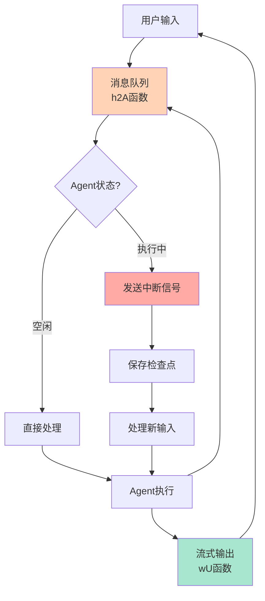
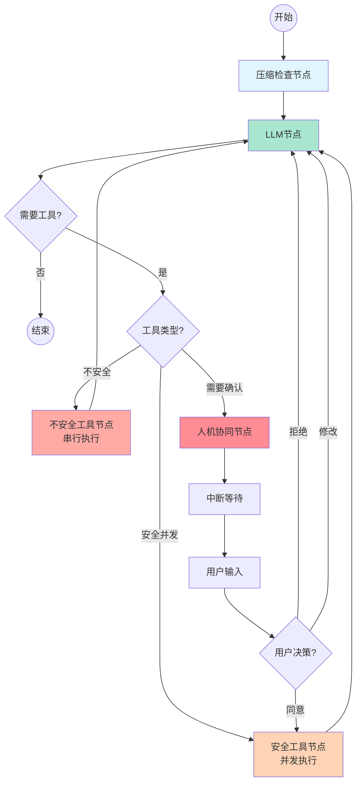

> 原文：https://ku.baidu-int.com/knowledge/HFVrC7hq1Q/KeF15lNOtH/-UXFkEkRyR/D7xSFCzZMxrzTI

基于LangGraph实现Claude-Code核心设计

## 文档概述
本文档剖析 Claude-Code 的核心设计思想与关键技术实现,结合 LangGraph 框架的能力,演示如何从基础的 ReAct Agent 出发,逐步构建一个功能完备的简版 Claude-Code。

## 第一部分:背景介绍
### 1.1 Claude-Code 简介
Claude-Code 是 Anthropic 公司推出的 CLI 工具,是当前 Code Agent 领域的最佳实践之一。其核心特点包括:

* **智能任务管理**: 自动分解复杂任务,跟踪执行进度
* **多 Agent 协作**: 支持创建专门的子 Agent 处理特定任务
* **人机协同**: 在关键操作前请求用户确认
* **上下文压缩**: 智能管理对话历史,优化 Token 使用


### 1.2 LangGraph 核心概念
LangGraph 是专注于智能体应用开发的框架,其核心优势:

**三层架构:**

|层级|描述|核心能力|
|-|-|-|
|第一层|基础数据结构|状态机(State)、图模型(Node/Edge)、节点流转方案|
|第二层|LLM 基础能力|流式输出、事件机制、人机协同、检查点持久化|
|第三层|预构建 Agent|ReActAgent、SupervisorAgent、SwarmAgent|

### 1.3 整体架构



## 第二部分:核心功能实现
### 2.1 基础 ReAct Agent
这是所有功能的起点,展示 LangGraph 的基本使用。

**核心代码:**

```tsx
// 1. 定义状态机
const agentState = Annotation.Root({
  messages: Annotation<BaseMessage[]>({
    reducer: safeMessagesStateReducer,
    default: () => [],
  })
});

// 2. 创建工具节点
const toolNode = new ToolNode(tools);

// 3. 定义路由函数
const shouldContinue = (state: typeof agentState.State) => {
  const lastMessage = state.messages[state.messages.length - 1];
  
  if ("tool_calls" in lastMessage && 
      Array.isArray(lastMessage.tool_calls) && 
      lastMessage.tool_calls.length > 0) {
    return "tools";
  }
  
  return END;
};

// 4. 构建图
const workflow = new StateGraph(agentState)
  .addNode("llm", callModel)
  .addNode("tools", toolNode)
  .addEdge(START, "llm")
  .addConditionalEdges("llm", shouldContinue, ["tools", END])
  .addEdge("tools", "llm");

const agent = workflow.compile();
```
**执行流程:**


**流式输出:**

```tsx
const config = {
  configurable: { thread_id: sessionId },
  streamMode: ['values', 'messages', 'updates'],
  version: 'v2' as const,
};

const stream = agent.streamEvents(
  { messages: [inputMessage] }, 
  config
);

// 处理流式事件
for await (const event of stream) {
  if (event.event === 'on_chat_model_stream') {
    // 处理 LLM 流式输出
  } else if (event.event === 'on_tool_start') {
    // 工具开始执行
  }
}
```
---

### 2.2 人机协同:中断与恢复
Claude-Code 在需要用户确认时会暂停执行,这是"人在环路"(Human-in-the-Loop)的典型应用。

**核心机制:**


**2.2.1 人工审查节点实现**

```tsx
const humanReviewNode = async (state: typeof MessagesAnnotation.State) => {
  const lastMessage = state.messages[state.messages.length - 1];
  
  // interrupt 会抛出错误,中断图的执行,同时保存检查点
  const humanAnswer = interrupt("确认是否执行");
  
  if (humanAnswer === "同意") {
    return new Command({
      goto: "tools",
      update: {
        messages: [new HumanMessage("确认执行")]
      }
    });
  }
  
  if (humanAnswer === "拒绝") {
    return new Command({
      goto: "agent",
      update: {
        messages: [new HumanMessage("用户拒绝执行")]
      }
    });
  }
};

// 更新图结构
const workflow = new StateGraph(MessagesAnnotation)
  .addNode("agent", callModel)
  .addNode("tools", toolNode)
  .addNode("human_review", humanReviewNode)  // 新增
  .addEdge(START, "agent")
  .addConditionalEdges("agent", shouldContinueWithReview, 
    ["human_review", END])
  .addConditionalEdges("human_review", checkUserApproval, 
    ["tools", "agent"])
  .addEdge("tools", "agent");
```
**关键 API:**

1. **interrupt()**: 抛出错误中断执行,自动保存检查点
2. **Command**: 动态选择下一个节点,灵活控制流程

**2.2.2 LLM 驱动的人机协同**

让大模型自主决定何时需要人工介入:

```tsx
function createHumanLoopTool() {
  const executor = (args, config) => {
    const state = getCurrentTaskInput();
    
    // 构造工具消息,保持上下文完整性
    const toolMsg = new ToolMessage({
      content: 'Successfully asked human',
      name: 'askHuman',
      tool_call_id: config.toolCall.id,
    });
    
    // 跳转到人工协同节点
    return new Command({
      goto: 'askHuman',
      graph: Command.PARENT,
      update: {
        messages: state.messages.concat(toolMsg),
      },
    });
  };
  
  return tool(executor, {
    name: 'askHuman',
    description: `当需要向用户确认需求、询问补充信息、向用户提问时,务必调用此工具。
    
使用场景:
1. 需求不明确,需要用户澄清
2. 有多种方案,需要用户选择
3. 涉及重要操作,需要用户确认
4. 缺少必要信息,需要用户补充`,
    schema: z.object({
      question: z.string().describe('要询问用户的问题'),
      context: z.string().describe('问题的上下文背景').optional(),
    }),
  });
}
```
**2.2.3 检查点持久化**

```tsx
import { MemorySaver } from "@langchain/langgraph";

// 内存存储(开发环境)
const app = workflow.compile({
  checkpointer: new MemorySaver(),
});

// 使用检查点
const config = { 
  configurable: { thread_id: "session-123" } 
};

// 第一次调用 - 执行到中断点
await app.invoke(initialState, config);

// 恢复执行 - 从中断点继续
await app.invoke(null, config);
```
**生产环境持久化:**

```tsx
// Redis 持久化(需自行实现或使用第三方库)
class RedisCheckpointer implements Checkpointer {
  async put(config, checkpoint, metadata) {
    // 存储到 Redis
  }
  
  async get(config) {
    // 从 Redis 读取
  }
  
  async list(config) {
    // 列出检查点
  }
}

const app = workflow.compile({
  checkpointer: new RedisCheckpointer(redisClient),
});
```
---

### 2.3 SubAgent:多智能体协作
这是 Claude-Code 最具特色的功能之一,通过创建专门的子 Agent 处理复杂任务。

**2.3.1 架构设计**


**2.3.2 TaskTool 实现**

```tsx
function createTaskTool(baseTools: any[], model: any, subAgentConfigs: SubAgentConfig[]) {
  // 为每种类型创建专门的 Agent 实例
  const agentInstances = new Map<string, any>();
  
  subAgentConfigs.forEach(config => {
    const filteredTools = config.allowedTools
      ? baseTools.filter(tool => config.allowedTools.includes(tool.name))
      : baseTools.filter(tool => tool.name !== "TaskTool"); // 防止递归
    
    agentInstances.set(config.type, createReactAgent({
      llm: model,
      tools: filteredTools,
      messageModifier: config.systemPrompt
    }));
  });
  
  return tool(
    async (args: { description: string; subagent_type: string }, config) => {
      const { description, subagent_type } = args;
      
      const agent = agentInstances.get(subagent_type);
      if (!agent) {
        throw new Error(`Unknown SubAgent type: ${subagent_type}`);
      }
      
      console.log(`🤖 启动 SubAgent [${subagent_type}]: ${description}`);
      
      // 创建隔离的执行上下文
      const subAgentState = {
        messages: [{ role: "user", content: description }]
      };
      
      // 执行 Agent
      const result = await agent.invoke(subAgentState);
      const finalMessage = result.messages[result.messages.length - 1];
      
      console.log(`✅ SubAgent [${subagent_type}] 完成`);
      
      return `SubAgent [${subagent_type}] 执行完成:

任务: ${description}

结果:
${finalMessage.content}

注意: 这是专门 SubAgent 生成的结果,请总结关键信息给用户`;
    },
    {
      name: "TaskTool",
      description: `启动专门的 SubAgent 自主处理复杂任务。

可用的 Agent 类型:
- general-purpose: 通用 Agent,适合复杂查询、文件搜索、多步分析
- code-analyzer: 代码分析专家,擅长代码审查、架构分析、性能优化
- document-writer: 文档编写专家,擅长技术文档、用户手册、API 文档

使用规则:
1. 任务复杂且需要专门处理时使用此工具
2. 每次 SubAgent 调用都是独立且无状态的
3. 提供详细的任务描述,SubAgent 将自主完成
4. SubAgent 完成后,总结关键信息给用户

何时使用:
- 复杂的多步分析任务
- 需要专门技能的任务(代码分析、文档编写)
- 大规模文件搜索和处理
- 可以并行处理的独立任务`,
      schema: z.object({
        description: z.string().describe("SubAgent 的详细任务描述"),
        subagent_type: z.enum([
          "general-purpose", 
          "code-analyzer", 
          "document-writer"
        ]).describe("SubAgent 类型"),
         parallel_count: z.number()
          .min(1)
          .max(5)
          .default(1)
          .describe(`并发 Agent 数量:
            - 1: 简单任务(读文件、搜索)
            - 2-3: 中等复杂度(代码审查、架构分析)
            - 4-5: 高复杂度(全面研究、技术选型)`)
      })
    }
  );
}
```
**2.3.3 SubAgent 配置**

```tsx
const subAgentConfigs: SubAgentConfig[] = [
  {
    type: "general-purpose",
    systemPrompt: `你是通用 AI 助手,专注于:
- 擅长文件搜索、内容分析和代码理解
- 系统性地分解复杂问题
- 提供详细准确的分析结果`,
    allowedTools: null  // 使用所有工具
  },
  {
    type: "code-analyzer",
    systemPrompt: `你是代码分析专家,专注于:
- 代码质量评估和改进建议
- 架构设计分析和优化
- 性能瓶颈识别和解决方案
- 安全漏洞检测和修复建议

请提供具体可操作的技术建议`,
    allowedTools: ["Read", "Edit", "Grep", "Glob", "LS"]
  },
  {
    type: "document-writer",
    systemPrompt: `你是技术写作专家,专注于:
- 清晰准确的技术文档
- 用户友好的操作指南
- 完整的 API 文档和示例
- 结构化的项目文档

确保文档的可读性和实用性`,
    allowedTools: ["Read", "Write", "Edit"]
  }
];
```
**2.3.4 并发执行支持**

LangGraph 原生支持工具并发,但需要按安全性分类:

```tsx
// 按并发安全性分组
const safeConcurrencyTools = [
  taskTool,      // 可以高并发
  readFileTool,  // 只读,安全
  grepTool,      // 搜索,安全
];

const unsafeConcurrencyTools = [
  writeFileTool,  // 文件写入
  editFileTool,   // 文件编辑
  bashTool,       // 系统命令
];

// 创建不同的 ToolNode
const safeConcurrencyToolNode = new ToolNode(safeConcurrencyTools, {
  maxConcurrency: 10,
  name: "safeConcurrencyTools"
});

const unsafeConcurrencyToolNode = new ToolNode(unsafeConcurrencyTools, {
  maxConcurrency: 1,  // 串行执行
  name: "unsafeConcurrencyTools"
});

// 路由函数
const shouldContinue = (state: typeof agentState.State) => {
  const lastMessage = state.messages[state.messages.length - 1];
  
  if ("tool_calls" in lastMessage) {
    const toolName = lastMessage.tool_calls[0]?.name;
    
    if (safeConcurrencyTools.some(t => t.name === toolName)) {
      return "safeConcurrencyTools";
    } else {
      return "unsafeConcurrencyTools";
    }
  }
  
  return END;
};
```
---

### 2.4 任务管理:TodoList 实现
Claude-Code 的任务跟踪功能让复杂任务的执行过程清晰可见。

**2.4.1 状态机扩展**

```tsx
export interface TodoItem {
  id: string;
  name: string;
  desc: string;
  status: 'pending' | 'in_progress' | 'completed' | 'failed';
  priority?: 'high' | 'medium' | 'low';
  startTime?: string;
  endTime?: string;
  error?: string;
}

const agentState = Annotation.Root({
  messages: Annotation<BaseMessage[]>({
    reducer: safeMessagesStateReducer,
    default: () => [],
  }),
  todoList: Annotation<TodoItem[]>({
    reducer: (x, y) => y,
    default: () => [],
  }),
});
```
**2.4.2 TodoWrite 工具**

```tsx
export function createTaskWriteTool() {
  const executor = (args, config) => {
    const state = getCurrentTaskInput() as any;
    const { todoList } = args;
    
    // 验证任务状态转换
    const validatedTasks = validateTaskTransitions(
      state.todoList, 
      todoList
    );
    
    return new Command({
      update: {
        todoList: validatedTasks,
        messages: state.messages.concat([
          new ToolMessage({
            content: `任务列表已更新,当前 ${validatedTasks.length} 个任务`,
            name: 'taskWrite',
            tool_call_id: config.toolCall.id,
          })
        ]),
      },
    });
  };
  
  return tool(executor, {
    name: 'taskWrite',
    description: `更新当前会话的任务列表。主动使用此工具来跟踪进度和管理任务执行。

## 何时使用
1. 开始任务时 - 标记为 in_progress(单个或批量,每批最多5个)
2. 完成任务后 - 标记为 completed(可批量)
3. 任务失败时 - 标记为 failed 并包含错误详情
4. 需要更新进度时

## 任务管理规则
1. **状态管理**:
   - pending: 未开始
   - in_progress: 执行中(同时最多5个)
   - completed: 已完成
   - failed: 失败

2. **执行规则**:
   - 实时更新状态
   - 支持批量操作(最多5个同时进行)
   - 按顺序执行,不能跳跃
   - 失败时记录错误详情

3. **完成标准**:
   - 只有完全完成才标记 completed
   - 遇到错误标记 failed
   - 以下情况不要标记完成:
     * 实现不完整
     * 有未解决的错误
     * 缺少必要文件或依赖`,
    schema: z.object({
      todoList: z.array(
        z.object({
          id: z.string().describe('任务唯一标识'),
          name: z.string().describe('任务名称'),
          desc: z.string().describe('任务描述'),
          status: z.enum(['pending', 'in_progress', 'completed', 'failed'])
            .describe('任务状态'),
          priority: z.enum(['high', 'medium', 'low'])
            .describe('优先级').optional(),
          startTime: z.string().optional(),
          endTime: z.string().optional(),
          error: z.string().optional(),
        })
      ).describe('更新后的完整任务列表'),
    }),
  });
}
```
**2.4.3 TodoRead 工具**

```tsx
export function createTaskReadTool() {
  const executor = (args, config) => {
    const state = getCurrentTaskInput() as any;
    const currentTasks = state.todoList || [];
    
    const taskSummary = currentTasks.map((task, idx) => {
      const statusEmoji = {
        pending: '⏳',
        in_progress: '🔄',
        completed: '✅',
        failed: '❌'
      }[task.status] || '❓';
      
      return `${idx + 1}. ${statusEmoji} [${task.status}] ${task.name}
   描述: ${task.desc}
   ${task.error ? `错误: ${task.error}` : ''}`;
    }).join('\n\n');
    
    const content = `当前任务列表(${currentTasks.length} 个任务):

${taskSummary || '暂无任务'}

请继续使用任务列表功能跟踪进度。`;
    
    return new ToolMessage({
      content,
      name: 'taskRead',
      tool_call_id: config.toolCall.id,
    });
  };
  
  return tool(executor, {
    name: 'taskRead',
    description: `读取当前任务列表。

主动且频繁地使用此工具,确保了解任务状态。
应该尽可能多地使用,特别是:
- 开始工作前
- 完成任务后
- 不确定下一步时`,
    schema: z.object({}),
  });
}
```
**2.4.4 集成到主 Agent**

```tsx
const todoPrompt = `
你具备任务管理能力,遵循以下规则:

1. **任务管理**:
   - 使用 todoRead 检查当前任务
   - 复杂请求使用 todoWrite 创建任务
   - 开始工作时标记 in_progress
   - 完成时标记 completed
   - 将复杂请求分解为可管理的小任务

2. **任务组织**:
   - High priority: 紧急或阻塞问题
   - Medium priority: 正常功能开发
   - Low priority: 优化改进

3. **状态更新**:
   - 工作时始终更新状态
   - 遇到问题标记 blocked 并说明原因
   - 保持任务描述清晰可执行
`;

const systemPrompt = `
// 原有提示词
${todoPrompt}
`;
```
### 2.5 上下文压缩:8段式算法
**2.5.1 架构设计**


**2.5.2 Token 监控**

```tsx
export function getLatestTokenUsage(messages: BaseMessage[]): number {
  // 倒序扫描,找到最新的 usage 信息
  for (let i = messages.length - 1; i >= 0; i--) {
    const msg = messages[i];
    
    if (isAIMessage(msg) && msg?.response_metadata?.usage) {
      const usage = msg.response_metadata.usage;
      
      return (
        (usage.total_tokens || 0) +
        (usage.cache_creation_tokens || 0) +
        (usage.cache_read_tokens || 0)
      );
    }
  }
  
  // 回退到估算
  return estimateTokens(messages);
}

function needsCompress(state: typeof agentState.State): boolean {
  const currentTokens = getLatestTokenUsage(state.messages);
  const maxTokens = 200000; // Claude 的上下文窗口
  const outputReserve = 8000; // 为输出预留空间
  const compressionThreshold = 0.92; // 92% 阈值
  
  const availableTokens = maxTokens - outputReserve;
  const usageRatio = currentTokens / availableTokens;
  
  console.log(`📊 Token 使用情况: ${currentTokens}/${availableTokens} (${(usageRatio * 100).toFixed(1)}%)`);
  
  return usageRatio > compressionThreshold;
}
```
**2.5.3 压缩节点实现**

```tsx
async function compressionNode(state: typeof agentState.State) {
  // 1. 检查是否需要压缩
  if (!needsCompress(state)) {
    console.log('✅ Token 使用正常,无需压缩');
    return {};
  }
  
  console.log('🗜️ 开始压缩对话历史...');
  
  // 2. 生成 8 段式压缩提示词
  const compressionPrompt = generateCompressPrompt();
  
  // 3. 调用专用压缩模型
  const compressedSummary = await callCompressionModel(
    compressionPrompt,
    state.messages
  );
  
  // 4. 计算要删除的消息数量(保留 20% 缓冲)
  const currentTokens = getLatestTokenUsage(state.messages);
  const targetTokens = currentTokens * 0.2; // 压缩到 20%
  
  const messagesToKeep = calculateMessagesToKeep(
    state.messages, 
    targetTokens
  );
  
  // 5. 创建压缩摘要消息
  const summaryMsg = new AIMessage({
    content: `[压缩摘要 - ${new Date().toISOString()}]\n\n${compressedSummary}`,
    id: `compression_${Date.now()}`
  });
  
  // 6. 重构消息历史
  const newMessages = [
    state.messages[0], // 保留系统提示词
    summaryMsg,        // 添加压缩摘要
    ...messagesToKeep  // 保留最近的消息
  ];
  
  console.log(`✅ 压缩完成: ${state.messages.length} → ${newMessages.length} 条消息`);
  
  return {
    messages: newMessages,
    compressionHistory: [
      ...(state.compressionHistory || []),
      {
        timestamp: new Date().toISOString(),
        originalCount: state.messages.length,
        compressedCount: newMessages.length,
        tokensSaved: currentTokens - getLatestTokenUsage(newMessages),
      }
    ]
  };
}

// 图结构更新
const workflow = new StateGraph(agentState)
  .addNode("compressionNode", compressionNode)  // 新增
  .addNode("llm", callModel)
  .addNode("tools", toolNode)
  .addEdge(START, "compressionNode")  // 先检查压缩
  .addEdge("compressionNode", "llm")
  .addConditionalEdges("llm", shouldContinue, ["tools", END])
  .addEdge("tools", "llm");
```
**2.5.4 8段式压缩提示词**

这是 Claude-Code 压缩算法的核心:

```tsx
function generateCompressPrompt(): string {
  return `你的任务是创建到目前为止对话的详细摘要,密切关注用户的明确请求和你之前的行动。

在提供最终摘要之前,将你的分析包装在 <analysis> 标签中,组织思考并确保涵盖所有要点。

你的摘要应包括以下 8 个部分:

**1. 主要请求和意图**
详细捕获用户的所有明确请求和意图。包括:
- 用户的核心诉求是什么?
- 期望达成什么目标?
- 有哪些明确的约束条件?

**2. 关键技术概念**
列出讨论的所有重要技术概念、技术栈和框架:
- 使用的编程语言
- 涉及的框架和库
- 架构设计模式
- 技术术语和概念

**3. 文件和代码段**
枚举检查、修改或创建的特定文件和代码段:
- 文件路径和名称
- 关键代码片段
- 修改的具体位置
- 新增的功能模块

**4. 错误和修复**
列出遇到的所有错误以及修复方法:
- 错误类型和现象
- 错误原因分析
- 采取的解决方案
- 用户的特定反馈

**5. 问题解决**
记录已解决的问题和正在进行的故障排除:
- 已解决的具体问题
- 采用的解决思路
- 当前正在调试的问题
- 待验证的解决方案

**6. 所有用户消息**
列出所有非工具结果的用户消息(这对理解用户反馈和变化的意图至关重要):
- 用户的原始提问
- 用户的补充说明
- 用户的反馈意见
- 用户的需求变更

**7. 待处理任务**
概述明确被要求处理的待处理任务:
- 尚未开始的任务
- 计划中的下一步
- 需要用户确认的事项
- 阻塞中的任务及原因

**8. 当前工作**
详细描述在此摘要请求之前正在进行的确切工作:
- 正在执行的具体任务
- 当前的进度状态
- 已完成的步骤
- 下一步计划

**9. 可选的下一步**(如果适用)
列出与最近工作相关的建议下一步。

格式要求:
- 使用清晰的标题和子标题
- 重点信息使用 **加粗**
- 代码片段使用代码块
- 保持简洁但完整`;
}
```
**提示词设计亮点:**

1. **强制分析标签**: 使用 `<analysis>` 标签组织思考,提高输出质量
2. **8 段结构化**: 确保关键信息不遗漏
3. **用户消息完整保留**: 第 6 部分确保用户意图不丢失
4. **格式规范**: 明确输出格式,便于解析

---

### 2.6 实时响应
H2A = Human-to-Agent Message Queue，H2A是Claude Code中重要的通信机制，它实现了用户与 AI Agent 之间的异步、可靠、有序的消息传递。

```json
┌─────────────────────────────────────────────────────────────┐
│                    Claude Code Frontend                      │
│                  (CLI / IDE Extension)                       │
└────────────────────────┬────────────────────────────────────┘
                         │ User Input
                         ↓
┌─────────────────────────────────────────────────────────────┐
│                    H2A Producer Layer                       │
├─────────────────────────────────────────────────────────────┤
│  • Message Validation                                       │
│  • Message Enrichment（添加元数据）                           │
│  • Rate Limiting （防止滥用）                                 │
│  • Message ID Generation                                    │
└────────────────────────┬────────────────────────────────────┘
                         ↓
┌─────────────────────────────────────────────────────────────┐
│                    H2A Message Queue                        │
│                     (Core Storage)                          │
├─────────────────────────────────────────────────────────────┤
│  ┌───────────────────────────────────────────────────────┐  │
│  │  Priority Queue 1 (HIGH)    │ [msg1, msg2, ...]       │  │
│  ├───────────────────────────────────────────────────────┤  │
│  │  Priority Queue 2 (NORMAL)  │ [msg3, msg4, ...]       │  │
│  ├───────────────────────────────────────────────────────┤  │
│  │  Priority Queue 3 (LOW)     │ [msg5, msg6, ...]       │  │
│  └───────────────────────────────────────────────────────┘  │
│                                                             │
│  Message Index: {                                           │
│    msg_id -> {queue, position, status, metadata}            │
│  }                                                          │
└────────────────────────┬────────────────────────────────────┘
                         ↓
┌─────────────────────────────────────────────────────────────┐
│                  H2A Consumer Layer                          │
├─────────────────────────────────────────────────────────────┤
│  • Message Routing (路由到合适的 Agent)                     │
│  • Load Balancing (负载均衡)                                │
│  • Retry Logic (重试机制)                                   │
│  • Dead Letter Queue (失败消息处理)                         │
└────────────────────────┬────────────────────────────────────┘
                         ↓
┌─────────────────────────────────────────────────────────────┐
│                   Agent Processing Layer                     │
│              (Orchestrator + Sub-Agents)                     │
└─────────────────────────────────────────────────────────────┘
```
**2.6.1 核心特性**


**2.6.2 LangGraph 实现思路**

目前langgraph 没有对应的h2A能力，这里只介绍如何实现流式回复

**1.实时中断：**用户可以在agent执行过程中随时输入新指令

**2.立即响应：**不需要等待当前任务完成，agent会立即处理新输入

**3.上下文保持：**中断后能够保持之前的执行状态和任务进度

```tsx
// 1. 使用 AbortSignal 实现中断
const abortController = new AbortController();

const config = {
  configurable: { thread_id: sessionId },
  streamMode: ['values', 'messages', 'updates'] as any,
  version: 'v2' as const,
  signal: abortController.signal,  // 传入中断信号
};

const stream = agent.streamEvents(
  { messages: [inputMessage] }, 
  config
);

// 2. 前端监听用户新输入
inputBox.addEventListener('submit', async (newInput) => {
  // 中断当前执行
  abortController.abort();
  
  // 发送新消息(会从检查点恢复)
  await sendMessage(newInput);
});

// 3. 处理流式事件
for await (const event of stream) {
  try {
    // 处理正常事件
    handleStreamEvent(event);
  } catch (error) {
    if (error.name === 'AbortError') {
      console.log('⏸️ 用户中断,准备处理新输入');
      // 检查点已自动保存
    }
  }
}
```


## 第三部分:完整集成示例
### 3.1 状态机定义
```tsx
export interface TodoItem {
  id: string;
  name: string;
  desc: string;
  status: 'pending' | 'in_progress' | 'completed' | 'failed';
  priority?: 'high' | 'medium' | 'low';
  startTime?: string;
  endTime?: string;
  error?: string;
}

export interface CompressionRecord {
  timestamp: string;
  originalCount: number;
  compressedCount: number;
  tokensSaved: number;
}

const agentState = Annotation.Root({
  messages: Annotation<BaseMessage[]>({
    reducer: safeMessagesStateReducer,
    default: () => [],
  }),
  
  todoList: Annotation<TodoItem[]>({
    reducer: (x, y) => y,
    default: () => [],
  }),
  
  compressionHistory: Annotation<CompressionRecord[]>({
    reducer: (x, y) => [...x, ...y],
    default: () => [],
  }),
});
```
### 3.2 完整图结构
```tsx
async function buildClaudeCodeAgent() {
  // 1. 创建基础工具
  const baseTools = [
    createReadFileTool(),
    createWriteFileTool(),
    createEditFileTool(),
    createGrepTool(),
    createBashTool(),
  ];
  
  // 2. 创建 Todo 工具
  const todoReadTool = createTaskReadTool();
  const todoWriteTool = createTaskWriteTool();
  
  // 3. 创建 TaskTool (SubAgent)
  const taskTool = createTaskTool(baseTools, model, subAgentConfigs);
  
  // 4. 创建人机协同工具
  const askHumanTool = createHumanLoopTool();
  
  // 5. 所有工具
  const allTools = [
    ...baseTools,
    todoReadTool,
    todoWriteTool,
    taskTool,
    askHumanTool,
  ];
  
  // 6. 按并发安全性分组
  const safeConcurrencyTools = [
    taskTool,
    createReadFileTool(),
    createGrepTool(),
  ];
  
  const unsafeConcurrencyTools = [
    createWriteFileTool(),
    createEditFileTool(),
    createBashTool(),
  ];
  
  // 7. 创建 ToolNode
  const safeConcurrencyToolNode = new ToolNode(safeConcurrencyTools, {
    maxConcurrency: 10,
    name: "safeConcurrencyTools"
  });
  
  const unsafeConcurrencyToolNode = new ToolNode(unsafeConcurrencyTools, {
    maxConcurrency: 1,
    name: "unsafeConcurrencyTools"
  });
  
  // 8. 创建 LLM
  const modelWithTools = model.bindTools(allTools);
  
  // 9. 定义节点函数
  const callModel = async (state: typeof agentState.State) => {
    const response = await modelWithTools.invoke(state.messages);
    return { messages: response };
  };
  
  // 10. 路由函数
  const shouldContinue = (state: typeof agentState.State) => {
    const lastMessage = state.messages[state.messages.length - 1];
    
    if ("tool_calls" in lastMessage && 
        Array.isArray(lastMessage.tool_calls) && 
        lastMessage.tool_calls.length > 0) {
      
      const toolName = lastMessage.tool_calls[0].name;
      
      // 路由到不同的工具节点
      if (safeConcurrencyTools.some(t => t.name === toolName)) {
        return "safeConcurrencyTools";
      } else {
        return "unsafeConcurrencyTools";
      }
    }
    
    return END;
  };
  
  // 11. 构建图
  const workflow = new StateGraph(agentState)
    // 添加节点
    .addNode("compressionNode", compressionNode)
    .addNode("llm", callModel)
    .addNode("safeConcurrencyTools", safeConcurrencyToolNode)
    .addNode("unsafeConcurrencyTools", unsafeConcurrencyToolNode)
    .addNode("askHuman", askHumanNode)
    
    // 定义边
    .addEdge(START, "compressionNode")
    .addEdge("compressionNode", "llm")
    .addConditionalEdges("llm", shouldContinue, 
      ["safeConcurrencyTools", "unsafeConcurrencyTools", "askHuman", END])
    .addEdge("safeConcurrencyTools", "llm")
    .addEdge("unsafeConcurrencyTools", "llm")
    .addConditionalEdges("askHuman", handleHumanResponse, 
      ["llm", "safeConcurrencyTools", "unsafeConcurrencyTools"]);
  
  // 12. 编译(带检查点)
  const agent = workflow.compile({
    checkpointer: new MemorySaver(), // 或 RedisCheckpointer
  });
  
  return agent;
}
```
### 3.3 完整执行流程

### 3.4 使用示例
```tsx
// 创建 Agent
const agent = await buildClaudeCodeAgent();

// 配置
const config = {
  configurable: { thread_id: "session-123" },
  streamMode: ['values', 'messages', 'updates'],
  version: 'v2' as const,
};

// 执行
const stream = agent.streamEvents({
  messages: [
    new HumanMessage("分析 LangGraph 项目的整体架构和设计模式")
  ]
}, config);

// 处理流式输出
for await (const event of stream) {
  if (event.event === 'on_chat_model_stream') {
    // LLM 流式输出
    process.stdout.write(event.data.chunk.content);
  } else if (event.event === 'on_tool_start') {
    // 工具开始执行
    console.log(`\n🔧 调用工具: ${event.name}`);
  } else if (event.event === 'on_tool_end') {
    // 工具执行完成
    console.log(`\n✅ 工具完成: ${event.name}`);
  }
}
```


## 第四部分:总结与展望
### 4.1 核心功能总结
|功能|Claude-Code 实现|LangGraph 实现|难度|
|-|-|-|-|
|基础 Agent|nO 主循环|StateGraph + ReActAgent|⭐|
|人机协同|权限网关 + 中断|interrupt() + Command|⭐⭐|
|SubAgent|I2A + UH1 + KN5|TaskTool + 独立 Agent|⭐⭐⭐|
|任务管理|TodoRead/Write|Todo 工具 + State|⭐⭐|
|上下文压缩|8段式 + wU2|压缩节点 + 专用 LLM|⭐⭐⭐|
|实时响应|h2A 消息队列|AbortSignal + 检查点|⭐⭐⭐⭐|

### 4.2 Claude-Code 其他优秀设计


**System Reminder **

长对话中的提示词注入机制

<long_conversation_reminder>

核心指令提醒：

- 你是一个编程助手

- 始终遵循安全规范

- 优先考虑代码可维护性

</long_conversation_reminder>

**Steering 多层反馈控制系统 **

用户意图 ──→ 目标设定 ──→ 执行路径 ──→ 实时反馈 ──→ 动态调整

    ↑                                              │                                                       ↓

  └──────────────── 偏差修正 ────────────────────┘

**Plan Mode**：采用"思考-规划-执行"三阶段模型，将复杂任务分解为可验证的执行计划

**Backpressure 背压控制机制**:

用户请求 → 队列缓冲 → 速率限制 → AI 处理 → 流式输出

              ↑                                           ↓

              └──── 背压信号 ──────┘ 

**Hooks机制 **:生命周期钩子

```
├──────────────────────────────────────────┤
│                                          │
│  ┌────────────────────────────────┐      │
│  │    System Reminder             │      │
│  │    （长对话指令保持）             │      │
│  └──────────┬─────────────────────┘      │
│             ↓                            │
│  ┌────────────────────────────────┐      │
│  │    Steering （方向控制）         │      │
│  │    • Goal Tracking             │      │
│  │    • Context Awareness         │      │
│  │    • Adaptive Execution        │      │
│  └──────────┬─────────────────────┘      │
│             ↓                            │
│  ┌───────────────────────────────┐       │
│  │    Plan Mode                  │       │
│  │   （规划与执行）                │       │
│  └──────────┬────────────────────┘       │
│             ↓                            │
│  ┌───────────────────────────────┐       │
│  │    Backpressure               │       │
│  │    （流量控制）                 │       │
│  └──────────┬────────────────────┘       │
│             ↓                            │
│  ┌───────────────────────────────┐       │
│  │    Hooks （生命周期）           │       │
│  │    • beforeExec               │       │
│  │    • onProgres                │       │ 
│  │    • afterExec                │       │
│  │    • onError                  │       │
│  └───────────────────────────────┘       │
│                ↓                         │
│          实际执行 & 反馈                   │
└──────────────────────────────────────────┘
```
### 4.3 延伸阅读
1. **LangGraph 官方文档**: [https://langchain-ai.github.io/langgraphjs/](https://langchain-ai.github.io/langgraphjs/)
2. **Claude-Code 逆向分析**:

    * [https://github.com/shareAI-lab/analysis_claude_code](https://github.com/shareAI-lab/analysis_claude_code)
    * [https://github.com/Yuyz0112/claude-code-reverse](https://github.com/Yuyz0112/claude-code-reverse)

3. **OpenDeepResearch**: [https://github.com/langchain-ai/open_deep_research](https://github.com/langchain-ai/open_deep_research)
4. **Anthropic Prompt Engineering**: [https://docs.claude.com/](https://docs.claude.com/)
5. **LangGraph 中文文档 **[https://docs.langchain.org.cn/oss/python/langgraph/streaming](https://docs.langchain.org.cn/oss/python/langgraph/streaming)


