> 原文：https://ku.baidu-int.com/knowledge/HFVrC7hq1Q/pKzJfZczuc/a35K9if7_r/FEoJEnqUvh_VjT

推理加速：从工程实践到框架级方案的调研与演进思考

**📌 文档简介**

本文聚焦推理加速框架与方法调研，以Wan2.1-FLF2V-14B-720P 为例，从扩散模型原理、端到端 Profile、推理优化策略、推理框架调研四个方面，整理视频生成模型推理加速的调研与实践结果。

* **端到端推理 Profile：**拆解视频生成的完整推理链路(文本编码、图像编码、VAE 编解码、Patchify、DiT 去噪等几个阶段)，结合模型结构与硬件算力推算各阶段的理论耗时下界，再用 profiler 实测各阶段耗时分布，定位出真正的性能瓶颈所在
* **推理优化策略：**围绕定位到的瓶颈系统性地调研并验证了多类优化手段，注意力后端替换与 DiT 整网算子优化、低精度量化(注意力/GEMM)、跳步缓存与步数蒸馏等减步方法，以及多卡序列并行/张量并行，逐一评估各手段的加速效果与适用条件
* **推理框架调研：**调研对比了三个主流视频推理框架(SGLang-Diffusion、FastVideo、vLLM-Omni)的定位、优化方向与优劣，并在统一环境下做了框架级性能测试，判断它们各自的适用场景与可集成性
* **推理加速方法清单**：汇总单卡、算法、多卡各条优化路径的结论，规划工程体系化方向——把 Profiling、Kernel 选型调优、框架统一等能力沉淀为可复用的标准工具与 Skill

🏷️ **关键词：**视频生成、DiT、FlashAttention-3、量化、TeaCache、步数蒸馏、序列并行


# 一、前言
各个视频厂商通过视频生成推理加速手段，降低视频生成成本，从而提升产品的竞争力，例如字节Seedance 1.0 使用了多阶段蒸馏、精简 VAE 解码器、算子融合等推理优化的手段，实现了端到端加速不低于10倍，生成效果质量不下降。


在实时互动数字人离线视频素材制作场景中，工程团队正与算法策略团队协同探索模型推理加速方案。**目前，算法策略团队通过对生成模型进行蒸馏优化，实现了约 5 倍的推理加速；在此基础上，工程团队进一步开展推理部署与性能优化，实现了约 1.45 倍的额外加速**，形成了算法优化与工程优化协同推进的技术路径。


从行业实践来看，推理优化通常能够实现 2～3 倍甚至更高的加速效果。相比之下，目前工程侧的优化工作仍处于初步探索阶段，先用理论下界找对地方、工程把每步做到极限、算法把步数砍到最少、多卡把剩下的瓶颈补齐——算法 × 工程协同，才是把成本打下来的关键路径，现阶段，在算子优化、计算图优化、显存管理及推理调度等方面仍有较大的挖潜空间。后续将进一步深入推理框架与底层算子的性能优化，持续提升模型推理效率，降低生成式视频的成本。


## 1.1 扩散模型原理
模型训练阶段通常采用 **DDPM（Denoising Diffusion Probabilistic Models，去噪扩散概率模型）** 的前向加噪过程：从原始图像出发，按照预设的噪声调度策略，逐步向数据中添加高斯噪声，直至其逐渐接近标准高斯噪声分布。


模型推理阶段则通常采用 **DDIM（Denoising Diffusion Implicit Models，去噪扩散隐式模型）** 等采样方法，从随机高斯噪声出发，逐步预测并去除噪声，最终恢复生成图像。与 DDPM 训练阶段的逐步加噪不同，DDIM 推理可以跳过部分时间步，采用稀疏时间步采样，在尽可能保持生成质量的前提下，减少模型前向计算次数，降低推理耗时。


两种过程的具体区别如下图所示：


### **训练阶段：逐步加噪**
### **推理阶段：跳步去噪**
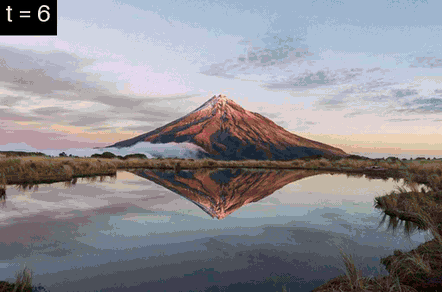
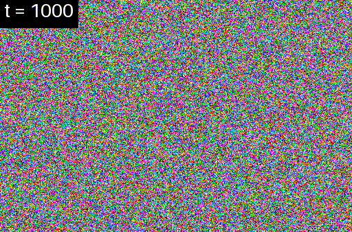


在推理阶段，跳步的原理是扩散模型**可以把去噪过程看作求解微分方程，通过数值积分近似一段时间内的整体变化量**，从而用一次计算跨越多个时间步，而不必逐步计算。

<video src="attachment/diffusion_skip_step_wide.mp4" controls width="720"></video>

[视频：diffusion_skip_step_wide.mp4](attachment/diffusion_skip_step_wide.mp4)


**训练阶段：** 扩散模型通常采用 DDPM 的逐步加噪方式，在不同时间步构造不同噪声水平的训练样本，使模型充分学习不同噪声状态下的数据恢复规律，建立对噪声预测函数及其变化趋势的有效估计，为推理阶段的跳步采样提供基础。


**推理阶段：** 模型从随机高斯噪声出发，沿着学习到的去噪方向逐步恢复数据。**其跳步采样的理论基础是将去噪过程建模为连续时间的微分方程，并利用数值积分方法（如高阶 ODE Solver）近似求解去噪轨迹，从而实现跨时间步计算，减少模型前向推理次数，在控制数值误差的同时提升推理效率。这也为后续通过时间步跳跃减少采样步数、实现推理加速提供了理论依据。**


**但跳步幅度并非越大越好**：步长过大会增加数值积分的截断误差，使预测轨迹偏离真实去噪轨迹，进而造成生成质量下降。因此，需要在积分精度、采样步数和生成质量之间取得平衡。

# 二、端到端推理profile
## 2.1 端到端推理流程简介
下面来着重介绍完整的视频生成模型的推理的过程，如下所示：

<video src="attachment/video_pipeline.mp4" controls width="720"></video>

[视频：video_pipeline.mp4](attachment/video_pipeline.mp4)

从输入一句提示词和一张首帧图，输出一段 MP4的整个流程大致分为如下7个步骤：                                                                                                                                                                                                                                                   

  1. 文本编码：提示词分词后送入 T5 编码器，得到 512×4096 的文本特征，作为生成内容的条件。                                                                                                                                                                                                                                                                                                              

  2. 图像编码：首帧图经 CLIP ViT 编码成 257×1280 的图像 token，提供人物外观等语义条件。                   

  3. VAE 编码：把视频压缩到隐空间。空间缩小 8 倍，时间压缩 4 倍，通道从 3 变成 16，数据量降到约 1/46。

  4. Patchify：把 latent 切成 2×2 的小块，每块展平后变成一个 token，排成一条长度为 32760 的序列，交给 Transformer 处理。

  5. DiT 去噪 + CFG（核心）：计算每个时间步的噪声，去除噪声，计算期望图像。

  6. VAE 解码：token 还原成 latent 网格，解码器逐级放大分辨率，恢复成 81 帧像素画面。

  7. 视频编码：像素帧经 H.264 编码（I/P/B 帧预测、DCT 量化、熵编码），封装成 MP4。

所以，视频生产组件可以归类为文本特征编码、图像特征编码、VAE编解码、去噪步计算，如果我们想要对模型推理进行加速，需要对各阶段进行profile，抓瓶颈进行优化！


## 2.2 理论耗时下界推导
在正式进行 profile 前，我们还需要对模型的结构进行解析，估算各阶段计算量，再根据推理卡的性能，推算出各阶段耗时的理论下界，即硬件跑满时的最短耗时。有了这个下界，profile 出来的每个数字才有参照：**离下界远的阶段值得优化，已经贴近下界的阶段只能靠降精度或减少计算量。**


本次估算使用的配置如下：

|**配置项**|**取值**|
|-|-|
|模型|Wan2.1-FLF2V-14B-720P（实际投入生产使用）|
|输入|竖屏 1080P 原始视频素材|
|推理参数|沿用线上配置：生成 81 帧，40 步 UniPC 采样，cfg_scale=1|
|推理卡|H800 单卡 SXM 80 GB|


输入的 1080P 视频先经过预处理自动 resize，再经过 VAE 编码降维并 patchify，得到 Token 长度：

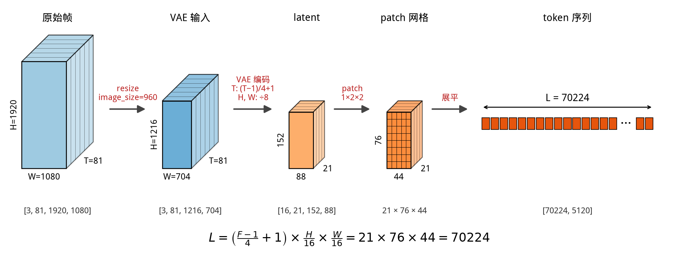
Token 长度取决于 image_size 和帧数。由于自注意力计算量随 Token 长度的平方增长，不同分辨率下 DiT 计算量差别很大：

|推理分辨率（H × W）|L|DiT 每步计算量|其中注意力占比|
|-|-|-|-|
|832 × 480|32760|1694 TFLOP|53.5%|
|**1216 × 704（本 case）**|**70224**|**5782 TFLOP**|**70.9%**|
|1280 × 720|75600|6557 TFLOP|72.4%|

通过对模型结构、H800单卡性能指标以及推理分辨率，我们进一步可以得到如下数据：

|阶段|计算量|**理论下界**|
|-|-|-|
|① 文本编码（1 次）|4.85 TF（FP32）|**72 ms**|
|② 图像编码|0.65 TF（FP32）|**9.7 ms**|
|③ VAE 编码|354.1 TF（TF32）|**0.72 s**|
|⑤ DiT 每步|5782 TF（BF16）|**5.84 s**|
|⑤ DiT 40 步|231,289 TF|**233.8 s**|
|⑥ VAE 解码|593.3 TF（TF32）|**1.20 s**|

上述指标是按照NVIDIA 数据手册中H100性能指标估算的理论下界。但是规格峰值按 1980 MHz 计算，连续跑大 GEMM 时，这张卡会撞上 700 W 功耗墙，SM 频率降到约 1470 MHz，实际算力只有规格的 70% 左右，如下是实际验证的数据：

|项目|实测|占规格|
|-|-|-|
|FP32 GEMM 8192³（关 TF32）|51.7 TFLOPS|77%|
|TF32 GEMM 8192³|353.1 TFLOPS|71%|
|BF16 GEMM 8192³|673 TFLOPS|68%|
|BF16 GEMM，DiT 真实形状（q/k/v/o、FFN）|687 ~ 703 TFLOPS|70%|
|FA3 自注意力 BF16，L = 70224|678 TFLOPS|69%|
|PyTorch SDPA 自注意力 BF16，L = 70224|354 TFLOPS|36%|
|HBM 拷贝 2 GiB|2.65 TB/s|79%|

结合实测峰值性能，重新校准各阶段理论下界，并引入 ±10% 的波动区间，提升理论估算的准确性。

|阶段|计算量|**实际下界估算范围**|
|-|-|-|
|① 文本编码（1 次）|4.85 TF|**85~103 ms**|
|② 图像编码|0.65 TF|**11.3~13.9 ms**|
|③ VAE 编码|354.1 TF|**0.90~1.10 s**|
|⑤ DiT 每步|5782 TF|**7.54~9.22 s**|
|⑤ DiT 40 步|231,289 TF|**301.7~368.7 s**|
|⑥ VAE 解码|593.3 TF|**1.51~1.85 s**|


## 2.3 模型推理profile
有了理论下界做指导，我们就可以使用torch.profiler捕捉各个阶段的耗时分布情况，从而进一步分析各个阶段的优化空间了。

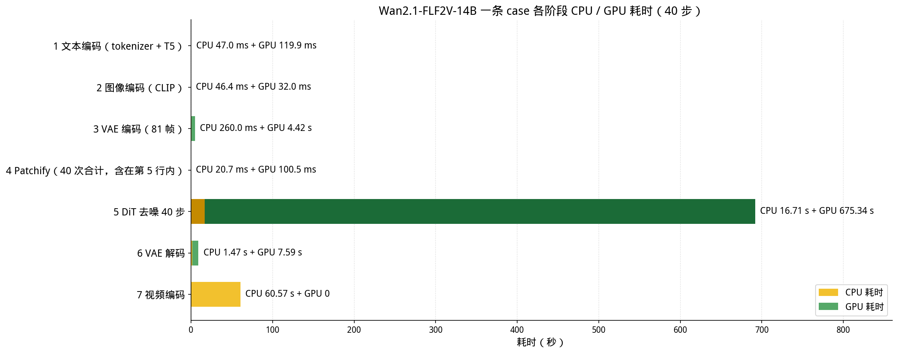
各阶段的耗时明细如下：

|#|阶段|总时长|CPU 耗时|GPU 耗时|GPU 利用率|算子耗时构成|
|-|-|-|-|-|-|-|
|1|文本编码（tokenizer + T5）|125.5 ms|47.0 ms|119.9 ms|95%|GEMM 84% + 拷贝/类型转换 8% + 逐元素 7% + Softmax 1%|
|2|图像编码（CLIP）|50.7 ms|46.4 ms|32.0 ms|61%|GEMM 90% + 注意力 6% + LayerNorm 2%|
|3|VAE 编码（81 帧）|4.41 s|0.26 s|4.42 s|100%|卷积 50% + 逐元素 20% + 拷贝 13% + 布局转换 8% + 注意力 4%|
|4|Patchify（40 次合计，包含在第 5 行里）|—|20.7 ms|100.5 ms|—|每次 2.5 ms：逐元素 43% + 布局转换 33% + Conv3d 24%|
|5|**DiT 去噪 40 步**|**677.86 s**|16.71 s|675.34 s|100%|**自注意力 79%（SDPA kernel 67%）+ LayerNorm/调制/残差 10% + FFN 6% + 交叉注意力 5%**|
|6|VAE 解码|8.73 s|1.47 s|7.59 s|87%|decode 本体 7.11 s：卷积 50% + 逐元素 20% + 拷贝 12% + 布局转换 9%；拷回 CPU、转 PIL 1.61 s|
|7|视频编码|60.63 s|60.57 s|0|—|存 PNG 55.44 s + H.264 5.12 s|

**瓶颈：**DiT 去噪 40 步占了耗时的大头（677.86 s），其中**自注意力占 79%，SDPA kernel 单项占 67%**。

进一步解析单个去噪步 16.71 s 的构成：

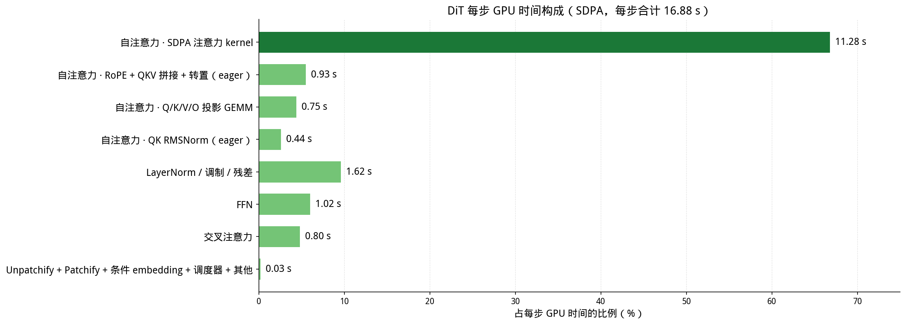
因此，首先聚焦 Attention 算子，优先降低单步计算耗时，逐步逼近理论性能下界；当常规算子优化接近瓶颈后，进一步探索低精度量化，寻求性能收益与生成质量损失的平衡。随后，在单步计算优化空间趋于饱和的情况下，通过减少 DiT 去噪步数，从算法层面降低总计算量。最后，当单卡性能优化接近极限后，再引入多卡并行，进一步提升推理速度。


# 三、推理优化策略
|优化类型|优化方案|实现难度|预期收益|效果损失情况|可行性验证|
|-|-|-|-|-|-|
|CUDA Kernel 优化|H100/H800 使用 FA3 替换默认 Attention 后端|★|单步耗时降低约 34%|无损|✅ 已验证|
|CUDA Kernel 优化|DiT 整网算子优化，包括 RoPE、GEMM、Norm 融合及 FA3 调优|★★★|单步耗时进一步降低约 11%|无损|✅ 已验证|
|编译优化|使用 torch.compile 优化计算图，减少算子调度及执行开销|★|单步耗时降低约 10%|无损|✅ 已验证|
|CUDA Kernel 量化|引入 FP8/INT8 Attention、GEMM 低精度计算|★★★|单步加速约 1.07～1.45 倍|有轻微数值误差，需评估生成质量|✅ 已验证|
|推理缓存优化|引入 TeaCache 等步间缓存技术，减少重复 DiT 计算|★★★|DiT 阶段约 2 倍加速|有损，可能出现末帧模糊及生成质量波动|✅ 已验证|
|VAE 优化|VAE 解码采用 BF16 计算|★|VAE 耗时降低约 40%|轻微数值误差，需评估实际画质|✅ 已验证|
|模型蒸馏|通过步数蒸馏，将 40 步去噪压缩至 8 步|★★★★|DiT 推理理论上约 5 倍加速|存在模型质量风险，需要算法侧训练和评估|✅ 已验证|
|模型蒸馏|Self-Forcing + DMD，将双向扩散模型转化为低步数因果生成模型|★★★★★|支持 4 步生成及流式输出，显著降低推理计算量|当前生成画质仍有差距，需进一步训练调优|✅ 已验证|
|CUDA Kernel 量化|引入免训练稀疏注意力，减少冗余 Attention 计算|★★★★|预期获得数倍加速潜力，具体收益取决于稀疏策略|可能影响全局信息建模及生成质量|✅ 已验证|
|多卡并行优化|使用 Ulysses SP 沿序列维度切分 DiT 计算|★★★|8 卡 DiT 阶段约 6.15 倍加速，并行效率约 77%|理论上无损，存在数值误差风险|✅ 已验证|
|CUDA Kernel 量化|引入稀疏注意力、FP8 等量化感知训练（QAT）|★★★★★|进一步释放低精度与稀疏计算的加速潜力|需要算法训练配合，存在质量风险|🕒 待验证|
|多卡并行优化|优化 SP 通信链路，减少 All-to-All 前后数据拷贝及跨卡同步等待|★★★★|提升多卡并行效率，进一步降低 DiT 单步耗时|无损|🕒 待验证|
|多卡并行优化|VAE 多卡并行，消除各卡重复执行的前后处理计算|★★★★|降低 VAE、T5、CLIP 等环节的冗余计算，提升端到端加速比|无损|🕒 待验证|
|推理数据链路优化|VAE 解码与视频编码异步并行，减少串行等待|★★★|缩短端到端推理耗时|无损|🕒 待验证|
|工程实践能力优化|将 Profiling、硬件峰值评估、Attention 选型、量化误差评估、SP 扩展性测试及 Kernel A/B 验证沉淀为标准化工具和 Skill|★★★|提高性能分析效率，缩短优化迭代周期，提升经验复用能力||🕒 待验证|
|工程实践能力优化|引入 AutoKernel、Meta KernelAgent、AKO4X 等开源 Agent，探索自动化 Kernel 优化|★★★★★|降低算子优化成本，提高 Kernel 搜索与调优效率||🕒 待验证|
|推理框架优化|统一 FastVideo、SGLang 等框架底层 Kernel，实现框架无关的算子抽象及统一性能评测|★★★★★|减少重复适配成本，提升优化成果跨框架复用能力|无损|🕒 待验证|
|推理框架优化|推进训练与推理共用 DiT 实现及 Kernel，为 FP8、稀疏注意力等技术提供统一基础|★★★★★|降低训推差异，支持量化感知训练及新型算子快速落地||🕒 待验证|
|前沿架构优化|探索步数蒸馏与缓存联合优化|★★★★★|进一步减少去噪计算量，提升端到端生成速度|需要算法训练及画质评估|🔍 待调研|

## 3.1 Attention 后端优化
Self-Attention 中计算 SDPA 注意力 Kernel 占据了 66.8% 耗时，因此可以想到的优化思路就是使用更高效的 Attention 计算后端。因此，我们对 Attention Kernel 的单次推理耗时进一步统计，计算量如下：

|调用|q|k / v|输出|计算量|
|-|-|-|-|-|
|自注意力|`[1, 70224, 40, 128]`|`[1, 70224, 40, 128]`|`[1, 70224, 40, 128]`|101.0 TFLOP|

本次对比的候选 Attention 后端如下：

|**后端**|**说明**|
|-|-|
|SDPA|PyTorch 实现的通用高效注意力后端|
|FA2|FlashAttention-2，重点优化 Attention 的计算分块与线程工作分配|
|FA3|FlashAttention-3，利用 Hopper 的 TMA + 异步 WGMMA，把数据搬运、矩阵计算和 Softmax 尽可能重叠起来|
|FA4|FlashAttention-4，利用 Blackwell 异步 MMA + TMEM + 更深流水线 + Softmax 指数运算优化|

各后端的耗时对比如下：

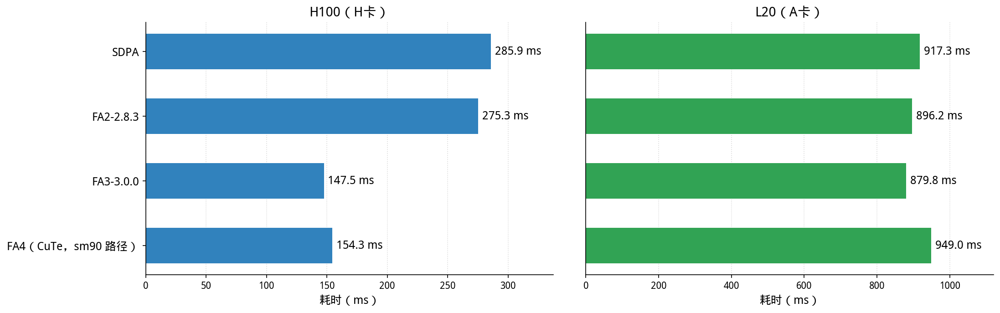
根据验证结果以及理论分析，**A 卡各个后端算子效率差距不大，H 卡使用 FA3 可以得到更优的计算性能**。因此，我们将 WAN2.1-FLF2V-14B-720P 的注意力后端更新为 FA3，更新后的耗时分布如下：

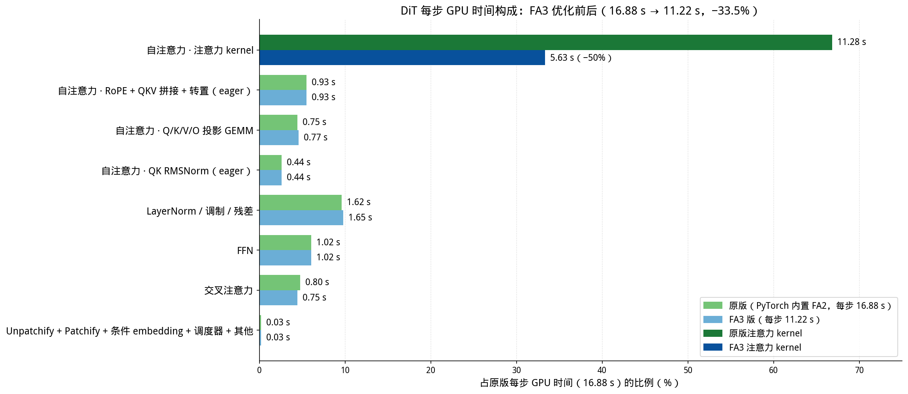
 除此之外，通过对比估算的理论下界与当前值，我们进一步对DiT block中的算子更细致性的优化：

|优化配置阶段|优化点|单个DiT去噪步|较上一阶段耗时变化|
|-|-|-|-|
|**FA3 **|升级 FlashAttention-3 (vllm-flash-attn)|11220ms||
|**+ torch.compile**|按 block 编译，Inductor 算子融合（线上基准）|9443 ms|-16.2%|
|**+ Triton RoPE**|原有 12 个 ATen kernel 替换为 Triton 单 kernel|9146 ms|-3.1%|
|**+ FA3 深度调优**|奇数 Q tile 开启 2-CTA cluster、ptxas 12.8 等|8822 ms|-3.5%|
|**+ 三项算子融合**|normrope、ffngate、crossadd 融合|8798 ms|-0.3%|
|**+ cuBLAS 12.8**|GEMM 换用 nvjet 内核，打满 132 SM|8654 ms|-1.6%|
|**+ FFN 升维融合**|升维阶段 GELU 算子并入 cuBLASLt epilogue|8600 ms|-0.6%|
|**+ FA3 3.0.1 (BEST)**|升级 FA3 上游 3.0.1 版本 + 性能补丁|8393 ms|-2.4%|
|**+ 后续微调**|引入 `lnfuse` (LayerNorm) 与 `crossnorm`|**8358 ms**|-0.4%|

**结论：**基于交付版本，通过替换 FA3 Attention 后端及进一步优化 DiT Block，将单步去噪耗时由 16.71 s 降至 **8.36 s**，累计实现约 2 倍加速，已接近当前硬件条件下的理论性能上限。


## 3.2 CUDA Kernel量化
### 3.2.1 Attention 量化
我们还探索了有损优化手段：量化注意力 SageAttention 在 H100 上的性能以及精度表现。SageAttention 把注意力里的矩阵乘法换成 INT8/FP8 等低精度 Tensor Core 运算来提速，并对 K 做平滑、对 QKᵀ 做细粒度量化来压低误差，PV 部分则保留较高精度，不需要重新训练就能替换原有实现。简单来说，就是**对 Q、K 矩阵做了细粒度量化，并且精度损失不明显**。SageAttention 各版本的差异如下：

|**版本**|**QKᵀ**|**PV**|**关键改进**|
|-|-|-|-|
|SA1|INT8，per-block 量化|FP16，FP16 累加|对 K 做平滑（减去 token 维均值）来消除离群值|
|SA2|INT8，per-warp 量化（另有 INT4 变体）|FP8，两级累加|在 K 平滑的基础上再对 Q 做平滑；两级累加弥补 FP8 累加器精度不足|
|SA3|FP4（NVFP4 微缩放）|FP4（NVFP4 微缩放）|面向 Blackwell，P 先按行缩放再做 FP4 量化|

本次测试使用的模型为 WAN2.1-I2V-14B-720P，输入分辨率为 832×1104，测试机器为 H100，因此选择 SageAttention2 进行校验。以 FA3 的推理性能和结果作为 baseline，单个 DiT 去噪步的性能对比如下：


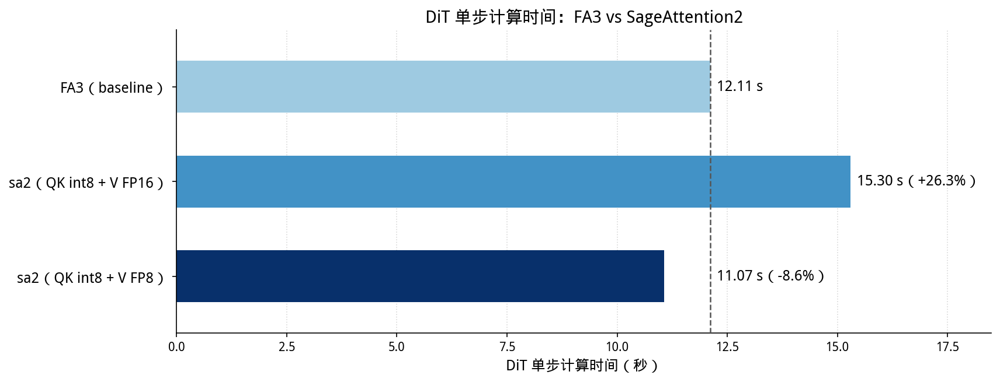
SA2 标准用法是 QK_int4 + V_fp8，但 Hopper（sm_90）GPU 上没有 INT4 Tensor Core，所以不测试这个组合。**SA2（QK int8 + V FP8）版本相比 FA3，性能提升约 8.5%**。从生成的两个视频中随机抽取一帧进行对比，效果如下：


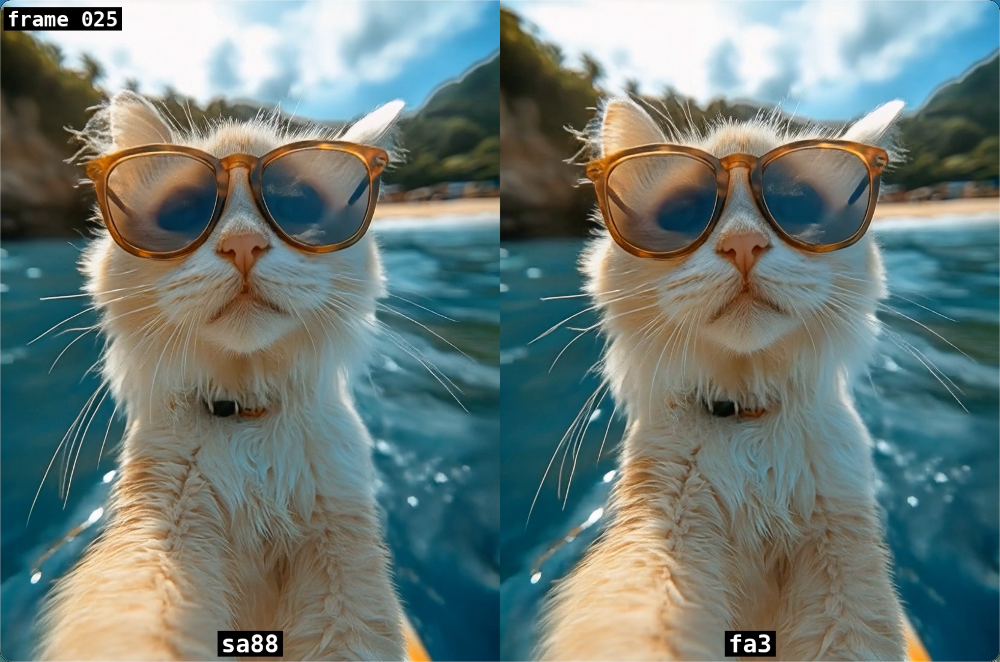
在测试的 case 上，端到端的效果无明显损失，如果想要真正上线使用，还需要在实际的 case 上做更多的效果测试。另外，在 SageAttention2 的基础上，进一步叠加手动优化的 CUDA kernel，性能应该还可以进一步提升！

### 3.2.2 GEMM 量化
通过对整个推理阶段的算子分析，除了 Attention 计算占 70%，其次就是 GEMM，计算量占 28%。除了高效 GEMM 算子实现，我们也尝试了 GEMM 的 FP8 量化，**每个去噪时间步大约节省 0.8 s**：

|分类|BF16 GEMM（+torch_compile）|FP8 GEMM（+torch_compile）|
|-|-|-|
|GEMM|2.34s|1.44s|
|FA3|5.57s|5.75s|
|element-wise + 融合|1.26s|1.32s|
|**DiT 单步**|**9.80s**|**9.145s**|

从生成的视频中，随机抽取一帧拼接，在当前case下，视觉感觉上基本是无损的，效果如下：

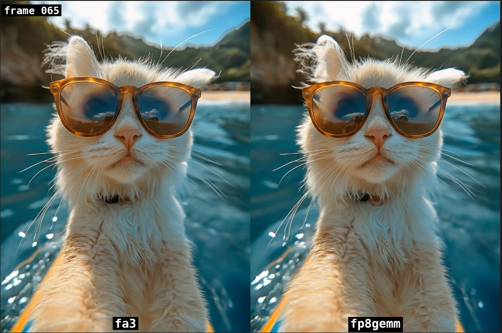
## 3.3 DiT去噪时间步优化
除了上述的针对性cuda kernel本身的优化，从另一个角度来思考，耗时主要的大头都在40步的DiT去噪，我们可以通过一些优化策略，**来减少去噪时间步**，从而减少计算量，达到性能优化的目的。

### 3.3.1 时间步跳步
去噪过程中，相邻两步 DiT 的输入和输出往往非常像，尤其在中后期，每一步只是在细节上微调。基于这一特点，可以直接复用上一次的部分计算结果，跳过本次的部分计算。


**TeaCache 原理：**用经过 timestep embedding 调制后的输入在相邻步之间的变化来估计模型输出的变化，并用多项式拟合做校正。累积变化低于阈值时，直接复用上一次缓存的残差，跳过整个 Transformer 的计算。这样在画质损失很小的情况下，推理可以提速约 1.5 到 2 倍，激进的设置能更快。


以 WAN2.1-I2V-14B-720P 模型为例，输入分辨率为 832×1104，测试机器为 H100，不同阈值下的测试结果如下：

|Thresh|计算步|跳过步|DiT loop 总耗时|Dense 基线|加速比|
|-|-|-|-|-|-|
|0.2|21/40|19|231.0 s|439.6 s|**1.90×**|
|0.3|16/40|24|175.88 s|439.6 s|**2.50×**|
|0.4|13/40|27|142.94 s|439.7 s|**3.08×**|
|0.5|11/40|29|120.89 s|439.4 s|**3.64×**|


阈值配置0.2：跳过19个时间步计算，部分帧效果近似无损，但是最后一帧背景出现明显模糊的情况

### **阈值 0.2：跳过 19 步**
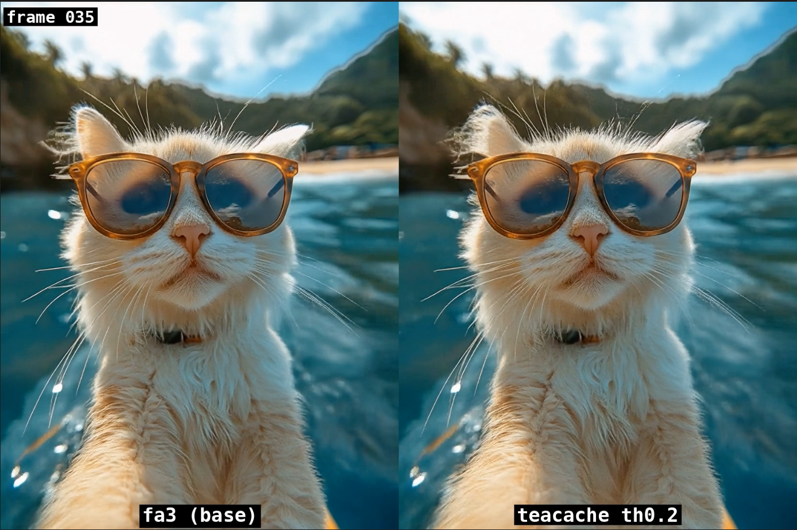
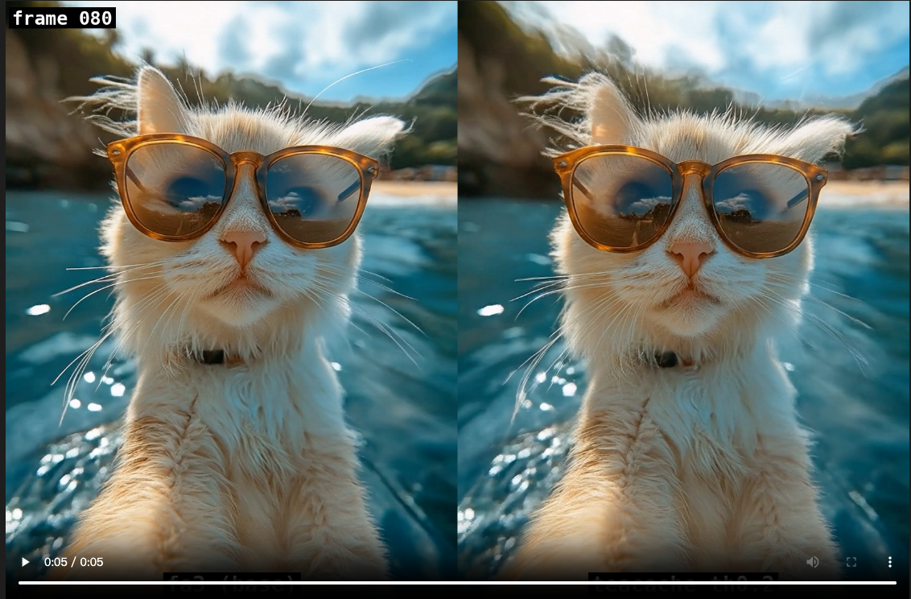


阈值配置0.3：跳过24个时间步，精度损失跟0.2差不多，但是最后一帧效果更好，因此tea-cache效果存在一定的不稳定性

### **阈值 0.3：跳过 24 步**
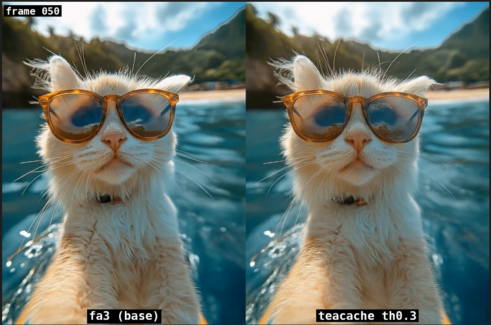
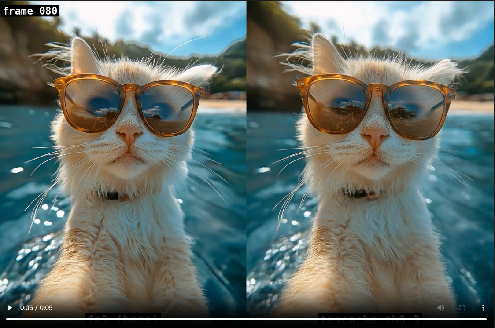


阈值配置0.4、0.5，精度损失明显：

### **阈值 0.4 / 0.5：跳过 27 / 29 步**
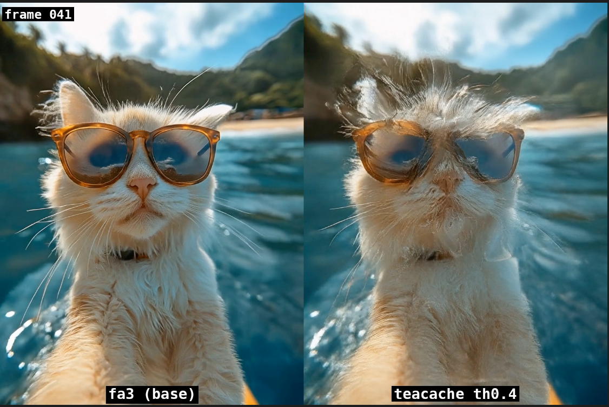
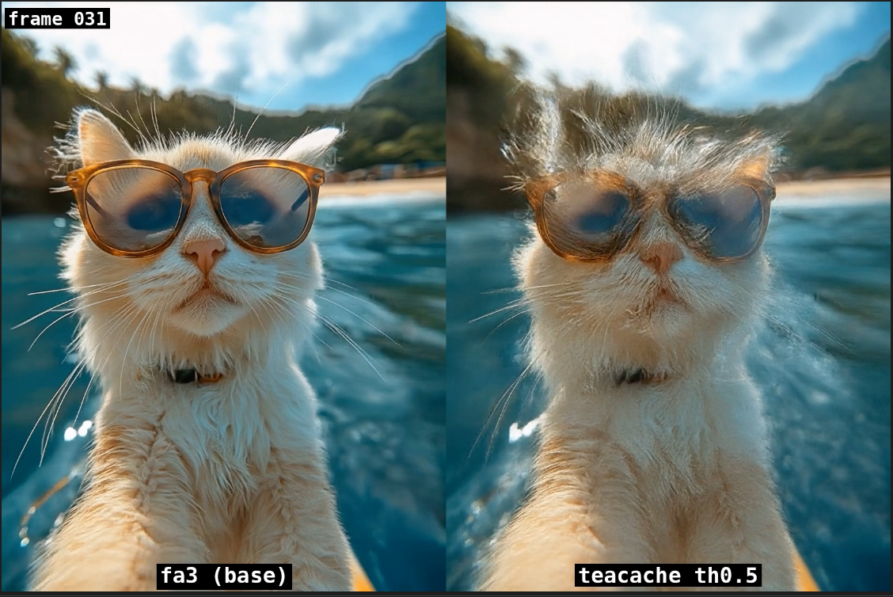


**注意：**TeaCache 是有损优化，在端到端效果上存在一定的不稳定性。如果想要更细粒度的cache跳步，还可以考虑使用DBCache + SCM + TaylorSeer的组合，可以到达精度更稳定的效果。但是想要真正效果无损地减少去噪时间步，一般需要对时间步进行少步蒸馏。


### 3.3.2 时间步蒸馏
**时间步蒸馏（Step Distillation）：**通过知识蒸馏，将原始扩散模型多步去噪的生成能力迁移到少步数 Student 模型中，使 Student 能够用更少的去噪步数逼近 Teacher 的生成效果。


时间步蒸馏的方法有多种，本次选择其中一种介绍。Self-Forcing（自回归分块生成与在策略分布匹配）的蒸馏思想是将传统双向视频扩散模型转化为支持低步数生成与流式输出的因果模型，同时抑制长序列生成中的误差累积。其核心机制如下

1. **块级因果架构**：将视频 Latent 按时间维度划分为多个 Chunk，块内采用双向注意力，块间采用因果注意力，并通过 KV Cache 复用历史上下文，实现自回归分块生成。
2. **自强制训练（Self-Forcing Rollout）**：训练阶段使用 Student 自身生成的前序 Chunk 作为后续生成条件，使训练与推理过程保持一致，提升模型对生成误差累积的鲁棒性。
3. **两阶段训练**：

    * **KD（ODE 初始化）**：利用 Teacher 生成轨迹进行知识蒸馏，使 Student 获得基础的低步数去噪能力。
    * **Self-Forcing DMD**：基于 Student 自回归生成的视频进行分布匹配优化，降低跨 Chunk 误差累积，提升长序列生成质量。


我们在4卡L20上基于 **Wan2.1-T2V-1.3B** 开展了 Self-Forcing 端到端实验，受限于单机 4 卡显存与存储规模，我们在保持核心算法超参（块大小、DMD 更新步数、更新比）与论文一致的前提下，对序列长度、数据集规模和 Teacher 尺寸进行了合理缩减：

|配置维度|本次 4×L20 实验设置|Self-Forcing 原论文配置|调整原因说明|
|-|-|-|-|
|**Student 模型**|Wan2.1-T2V-1.3B 因果版（3 latent 帧/块）|Wan2.1-T2V-1.3B 因果版（3 latent 帧/块）|完全一致|
|**Real Score (Teacher)**|**Wan2.1-T2V-1.3B**（双向）|Wan2.1-T2V-14B（双向）|3 个 1.3B 同驻显存已达 31～42GB/卡，14B 无法装入单机 L20|
|**视频规格**|**33 帧**（9 个 latent 帧，共 3 块），480×832|81 帧（21 个 latent 帧，共 7 块），480×832|缩短序列以控制单步耗时与显存，3 块足以暴露并验证跨块误差累积|
|**训练数据 (Prompt)**|**1,000 条** OpenVid 文本描述|VidProM 数据集|验证纯文本（Text-Only）驱动下的数据预处理与训练闭环|
|**阶段 1：ODE 初始化**|缓存 **1,000 条** Teacher 轨迹（90GB），训练 1,000 步|缓存约 16,000 条轨迹|16k 条需耗时数天且占用 >1.4TB 磁盘，1k 条足以完成冷启动验证|
|**阶段 2：Self-Forcing DMD**|**600 步**，全局 Batch 16，Critic:Student 更新比 5:1|约 600 步，Critic:Student 更新比 5:1|迭代步数与更新节奏完全对齐论文|
|**算力与总耗时**|**4 × L20，共 20.4 小时**|64 × H100，2 小时以内|以单机消费/推理卡完成全链路复现|

将训练完成的权重导出并修正模型配置后，使用 FastVideo 标准推理接口在**单张 L20** 上进行测速（生成 33 帧、480×832 视频）：

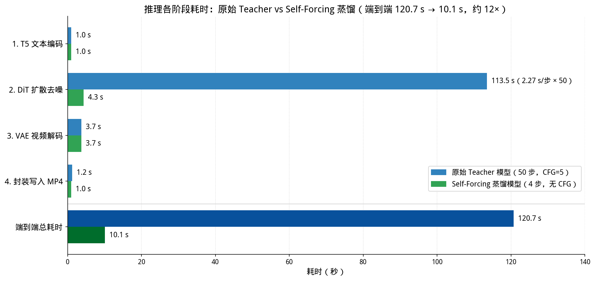
各推理阶段的耗时明细如下：

|推理阶段|Self-Forcing 蒸馏模型（4 步，无 CFG）|原始 Teacher 模型（50 步，CFG=5）|耗时占比（蒸馏后）|
|-|-|-|-|
|**1. T5 文本编码**|1.0 秒|（共用同一模块）|9.9%|
|**2. DiT 扩散去噪**|**4.3 秒**|**~113.5 秒**（2.27 秒/步）|**42.6%**|
|**3. VAE 视频解码**|3.7 秒|（共用同一模块）|36.6%|
|**4. 封装写入 MP4**|1.0 秒|1.2 秒|9.9%|
|**端到端总耗时**|**10.1 秒**|**120.7 秒**|**100%**|


**结论：**经过 600 步 Self-Forcing DMD 迭代训练后，蒸馏模型已具备 4 步去噪生成能力，端到端加速 **12 倍**。当前尚未针对训练参数充分调优，生成视频的整体画质较 Teacher 模型仍有明显差距，但整体风格保持较好一致性。

## 3.4 多卡并行
上述的优化手段针对的是单卡场景下推理任务优化，如果想要更快的性能，可以使用模型切分并行策略。在视频生成推理加速中，TP（Tensor Parallelism，张量并行）和 SP（Sequence Parallelism，序列并行）都是将单卡上的计算任务拆分到多张 GPU 上执行，但两者拆分的维度不同。

### 3.4.1 SP：序列并行
### **SP 序列并行示意**
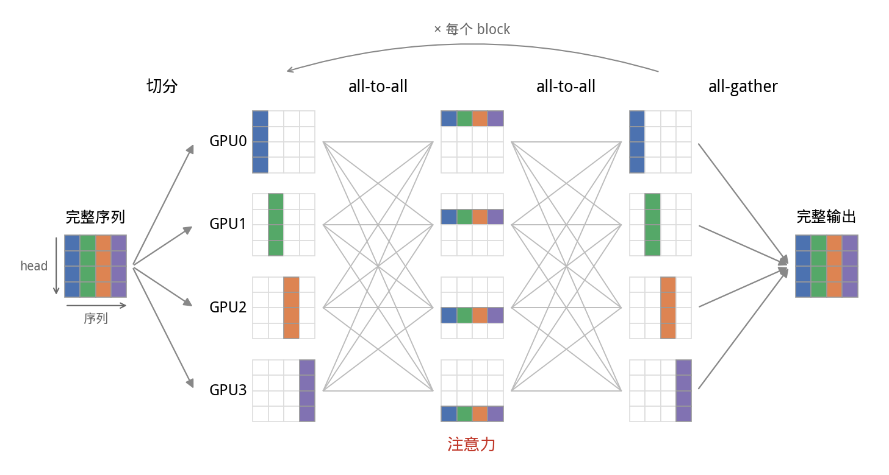
**核心原理：**沿 Transformer 的序列维度（Sequence / Token Dimension）切分输入数据，让不同 GPU 分别处理一部分 Token，分别完成对应序列片段的计算，在 Attention 等需要全局信息交互的环节进行跨卡通信。

**适用场景：**

* 视频分辨率较高，Token 数量较大
* 长视频生成，序列长度较长
* Attention 激活显存占用较大，单卡计算压力较高

测试机器H800，测试模型WAN2.1-FLF2V-14B-720P，输入分辨率704x1216，输出视频帧数 81帧，去噪时间步 40步，后端使用FA3，启用torch.compile

|卡数|DiT 单步|加速比|并行效率|通信相关开销（传输 + 前后拷贝）|同步等待 / 空隙|整条 Case（GPU 阶段）加速比|
|-|-|-|-|-|-|-|
|1|9.420 s|1.00x|100%|—|—|1.00x|
|2|5.258 s|1.79x|89.6%|335 ms（6.4%）|211 ms（4.0%）|1.46x|
|4|2.801 s|3.36x|84.1%|182 ms（6.5%）|260 ms（9.3%）|2.02x|
|8|1.532 s|6.15x|76.8%|95 ms（6.2%）|263 ms（17.1%）|2.50x|

对通信开销和并行计算效率的拆解如下：

**通信开销**

* **纯传输：**每卡每步 2 / 4 / 8 卡分别是 100 / 66 / 38 ms。推理中 All-to-All 实测 290～330 GB/s，和单独测同样大小 All-to-All 的 311～326 GB/s 一致，说明传输本身已经跑满 NVLink。
* **All-to-All 前后的转置和拼接拷贝：**2 / 4 / 8 卡分别是 235 / 116 / 57 ms，比传输本身还多。这是 FastVideo 在通信前后各重排一次数据布局造成的。

**并行计算效率**

* **计算本身几乎没有损失：**FA3、GEMM 和各类 Norm 切分以后，每卡的耗时都等于单卡的 1/N，误差在 ±1% 以内。
* **8 卡效率降到 77%，主要是同步等待和 Kernel 空隙：**这部分基本固定在 210～260 ms，不随卡数减少。原因是每步有 80 次 All-to-All，每次都要所有卡同时到达；同时每卡计算量变小后，Kernel 之间下发的空隙占比变大。

**瓶颈：**在 8 卡并行推理场景下，整条 Case 的端到端加速比仅为 2.5 倍。**主要原因在于 VAE 编解码、T5 和 CLIP 等前后处理模块合计耗时 28.7 s，仍由各 GPU 独立完整执行，未能随并行卡数增加而缩减**。在 8 卡场景下，上述环节占整体 GPU 执行时间的约 69%，已成为制约端到端推理性能进一步提升的主要瓶颈。

基于这一分析，后续多卡推理优化的重点需要从去噪阶段的并行计算，进一步拓展至去噪前后的数据准备与模型处理环节，通过优化模块执行方式、引入合理的并行策略及减少冗余计算，提升整条推理链路的并行效率。


### 3.4.2 TP：张量并行
### **TP 张量并行示意**
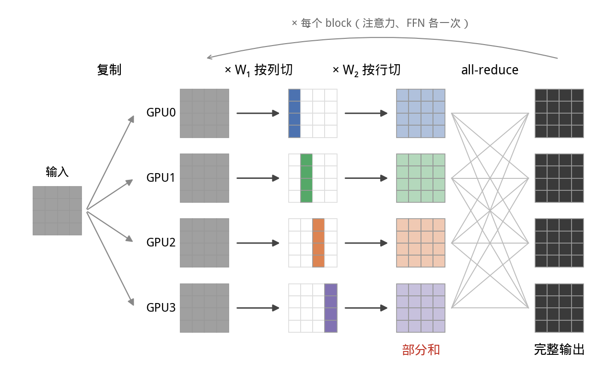
**核心原理：**沿模型的权重矩阵或隐藏维度切分计算任务，让多张 GPU 协同完成同一层网络的计算。

**适用场景：**模型参数量较大，单卡显存无法容纳完整模型。

TP、SP 以及两者组合的对比如下：

|**并行方式**|**解决的问题**|**说明**|
|-|-|-|
|TP|模型维度|模型参数较大，单卡显存不足，或者希望将 FFN、Attention 的计算分摊到多张 GPU|
|SP|序列维度|1080P 视频经过 Patch Embedding 后产生大量 Token，单卡处理长序列的计算和显存压力较大|
|TP + SP|模型维度 + 序列维度|多卡部署中可以进一步提高 GPU 资源利用率，但也会增加通信复杂度|


# 四、推理框架调研
## 4.1 主流框架对比
原生模型代码主要关注功能实现，难以系统优化算子执行、显存管理、多卡通信及任务调度。引入成熟推理框架，可复用高性能算子、编译优化、缓存、并行计算和异步流水线等能力，将优化从单点 Kernel 扩展至端到端推理链路，降低重复开发成本，提升整体推理效率。

 本次选择了三种推理框架，分别是SGLang-Diffusion、FastVideo、vLLM-Omni，各个框架的对比情况如下：

|推理框架|核心定位|主要优化方向|优势|局限性|
|-|-|-|-|-|
|SGLang-Diffusion|扩散模型专用推理引擎|DiT 算子、Attention、缓存、多卡并行|扩散模型专项优化深入，适合视频生成低延迟、多卡推理|训练与蒸馏能力不是核心方向|
|vLLM-Omni|通用多模态推理框架|异构流水线、阶段调度、资源分配|多模态统一调度和服务化能力较强|视频扩散专项算子优化不是主要侧重点|
|FastVideo|视频生成推理与后训练一体化|模型蒸馏、稀疏注意力、量化、序列并行|算法与工程协同，支持探索深度加速方案|部分优化需要针对模型和硬件适配|

三个推理框架的架构设计图如下：

### SGLang-Diffusion 架构设计图
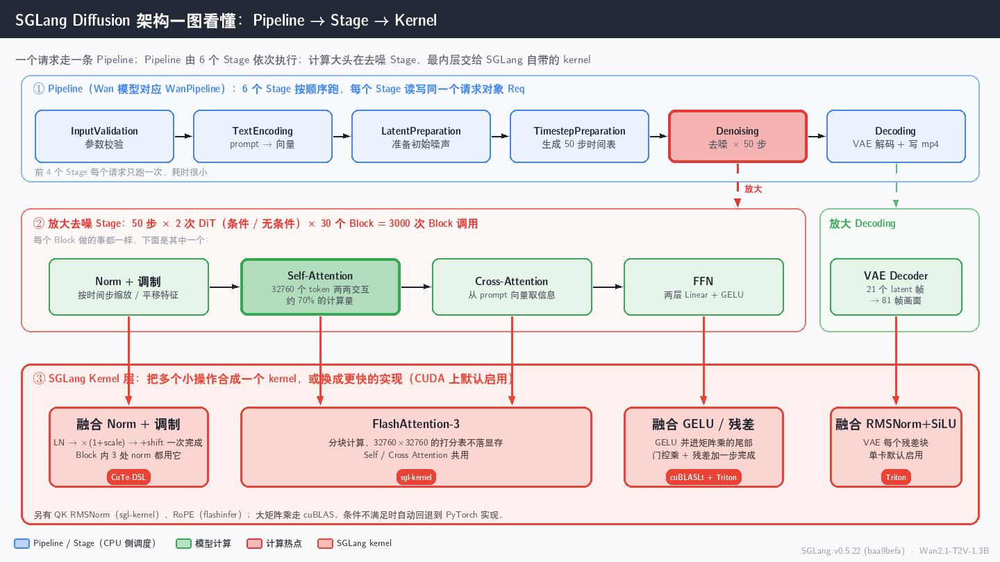


### vLLM-Omni 架构设计图
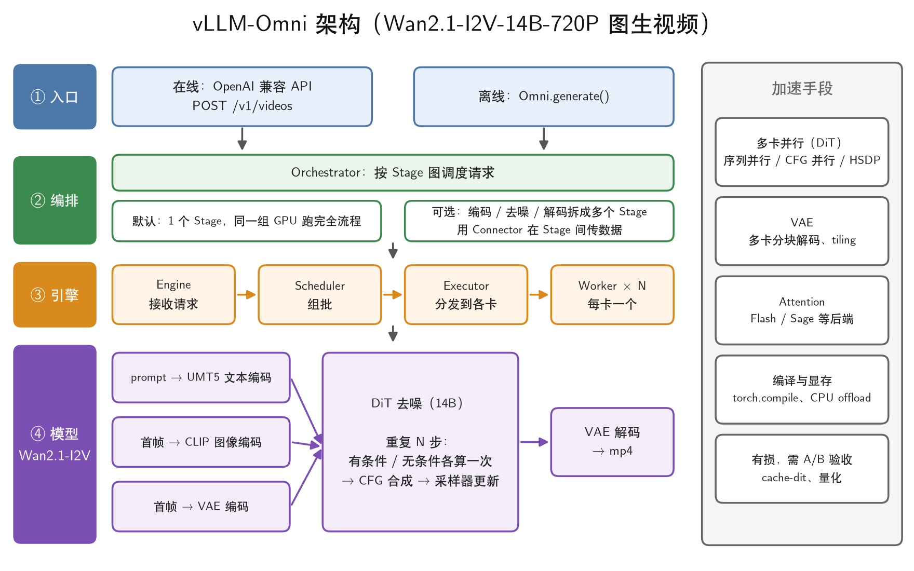
### FastVideo 架构设计图
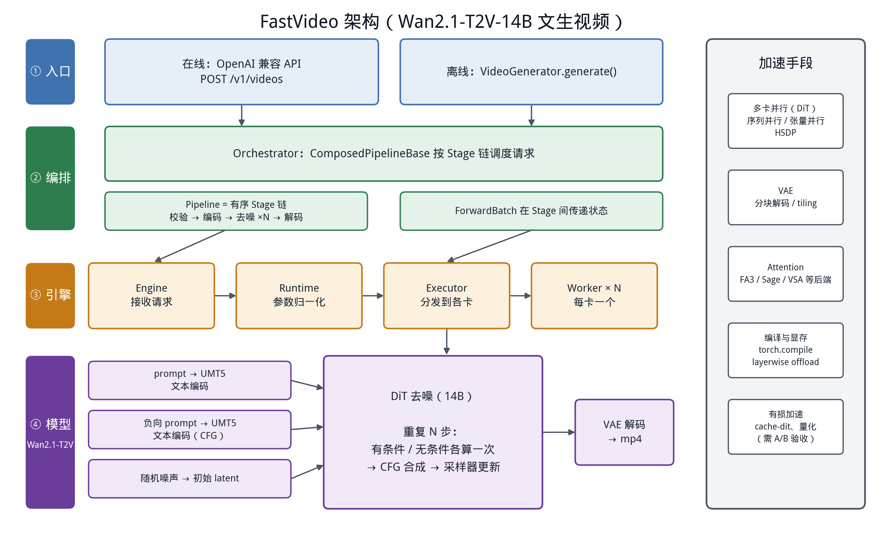
## 4.2 框架性能测试
测试环境配置如下：

|**配置项**|**取值**|
|-|-|
|测试环境|H100 单卡|
|测试模型|Wan 2.1 T2V-14B|
|输入分辨率|1280×720，81 帧|
|去噪步数|40 步|
|随机种子|42|
|cfg_scale|1|

测试使用的 prompt 如下：

```
正向 prompt：
A cat and a dog baking a cake together in a kitchen. The cat is carefully measuring flour, while the dog is stirring the batter with a wooden spoon. The kitchen is cozy, with sunlight streaming through the window.

负向 prompt：
Bright tones, overexposed, static, blurred details, subtitles, style, works, paintings, images, overall gray, worst quality, low quality, JPEG compression residue, ugly, incomplete, extra fingers, poorly drawn hands, poorly drawn faces, deformed, disfigured, misshapen limbs, fused fingers, still picture, messy background, three legs, many people in the background, walking backwards
```
各框架的性能测试数据如下：

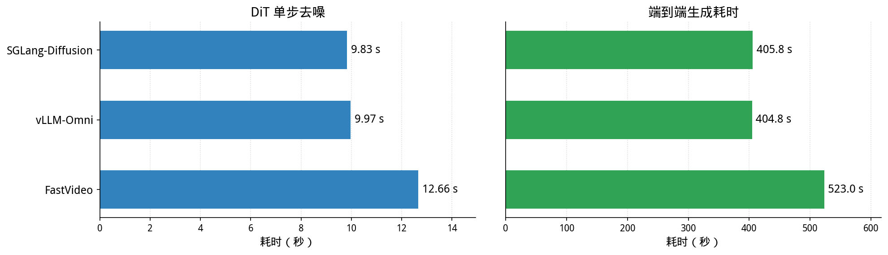


**结论：**上述是原版框架的性能耗时，如果在框架内进一步集成我们的优化手段，时延还可以进一步优化。


# 五、总结与展望
|优化类型|优化方案|实现难度|预期收益|效果损失情况|可行性验证|
|-|-|-|-|-|-|
|CUDA Kernel 优化|H100/H800 使用 FA3 替换默认 Attention 后端|★|单步耗时降低约 34%|无损|✅ 已验证|
|CUDA Kernel 优化|DiT 整网算子优化，包括 RoPE、GEMM、Norm 融合及 FA3 调优|★★★|单步耗时进一步降低约 11%|无损|✅ 已验证|
|编译优化|使用 torch.compile 优化计算图，减少算子调度及执行开销|★|单步耗时降低约 10%|无损|✅ 已验证|
|CUDA Kernel 量化|引入 FP8/INT8 Attention、GEMM 低精度计算|★★★|单步加速约 1.07～1.45 倍|有轻微数值误差，需评估生成质量|✅ 已验证|
|推理缓存优化|引入 TeaCache 等步间缓存技术，减少重复 DiT 计算|★★★|DiT 阶段约 2 倍加速|有损，可能出现末帧模糊及生成质量波动|✅ 已验证|
|VAE 优化|VAE 解码采用 BF16 计算|★|VAE 耗时降低约 40%|轻微数值误差，需评估实际画质|✅ 已验证|
|模型蒸馏|通过步数蒸馏，将 40 步去噪压缩至 8 步|★★★★|DiT 推理理论上约 5 倍加速|存在模型质量风险，需要算法侧训练和评估|✅ 已验证|
|模型蒸馏|Self-Forcing + DMD，将双向扩散模型转化为低步数因果生成模型|★★★★★|支持 4 步生成及流式输出，显著降低推理计算量|当前生成画质仍有差距，需进一步训练调优|✅ 已验证|
|CUDA Kernel 量化|引入免训练稀疏注意力，减少冗余 Attention 计算|★★★★|预期获得数倍加速潜力，具体收益取决于稀疏策略|可能影响全局信息建模及生成质量|✅ 已验证|
|多卡并行优化|使用 Ulysses SP 沿序列维度切分 DiT 计算|★★★|8 卡 DiT 阶段约 6.15 倍加速，并行效率约 77%|理论上无损，存在数值误差风险|✅ 已验证|
|CUDA Kernel 量化|引入稀疏注意力、FP8 等量化感知训练（QAT）|★★★★★|进一步释放低精度与稀疏计算的加速潜力|需要算法训练配合，存在质量风险|🕒 待验证|
|多卡并行优化|优化 SP 通信链路，减少 All-to-All 前后数据拷贝及跨卡同步等待|★★★★|提升多卡并行效率，进一步降低 DiT 单步耗时|无损|🕒 待验证|
|多卡并行优化|VAE 多卡并行，消除各卡重复执行的前后处理计算|★★★★|降低 VAE、T5、CLIP 等环节的冗余计算，提升端到端加速比|无损|🕒 待验证|
|推理数据链路优化|VAE 解码与视频编码异步并行，减少串行等待|★★★|缩短端到端推理耗时|无损|🕒 待验证|
|工程实践能力优化|将 Profiling、硬件峰值评估、Attention 选型、量化误差评估、SP 扩展性测试及 Kernel A/B 验证沉淀为标准化工具和 Skill|★★★|提高性能分析效率，缩短优化迭代周期，提升经验复用能力||🕒 待验证|
|工程实践能力优化|引入 AutoKernel、Meta KernelAgent、AKO4X 等开源 Agent，探索自动化 Kernel 优化|★★★★★|降低算子优化成本，提高 Kernel 搜索与调优效率||🕒 待验证|
|推理框架优化|统一 FastVideo、SGLang 等框架底层 Kernel，实现框架无关的算子抽象及统一性能评测|★★★★★|减少重复适配成本，提升优化成果跨框架复用能力|无损|🕒 待验证|
|推理框架优化|推进训练与推理共用 DiT 实现及 Kernel，为 FP8、稀疏注意力等技术提供统一基础|★★★★★|降低训推差异，支持量化感知训练及新型算子快速落地||🕒 待验证|
|前沿架构优化|探索步数蒸馏与缓存联合优化|★★★★★|进一步减少去噪计算量，提升端到端生成速度|需要算法训练及画质评估|🔍 待调研|

关键优化结论：

1. **单卡优化**：通过 FA3、torch.compile 和 DiT 整网算子优化，单步耗时可由 15.8s 降至 8.4s，累计降低约 47%，无损工程优化已取得较明显收益。
2. **算法优化**：步数蒸馏能够显著减少 DiT 前向次数，相比单纯 Kernel 优化具有更大的加速潜力，是下一阶段重点方向。
3. **多卡优化**：8 卡 SP 可实现 DiT 阶段约 6.15 倍加速，但端到端仅约 2.5 倍，后续重点转向 VAE 多卡并行、冗余计算消除及视频编码优化。
4. **工程体系建设**：通过标准化 Profiling、自动化 Kernel 优化及训推框架统一，将单点性能优化能力沉淀为可复用的工程体系。