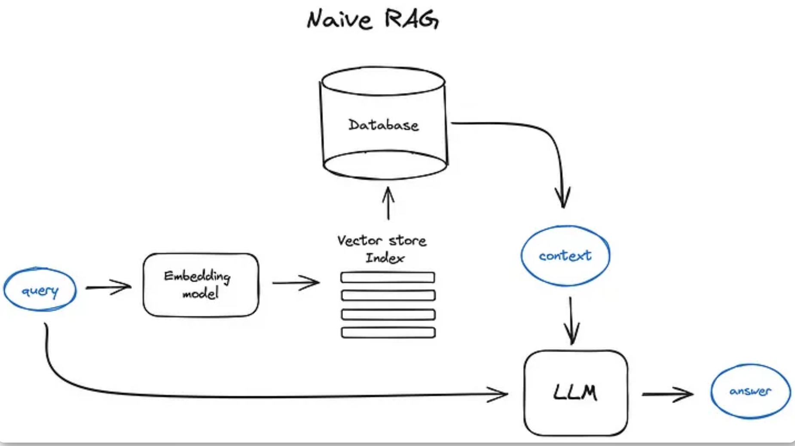
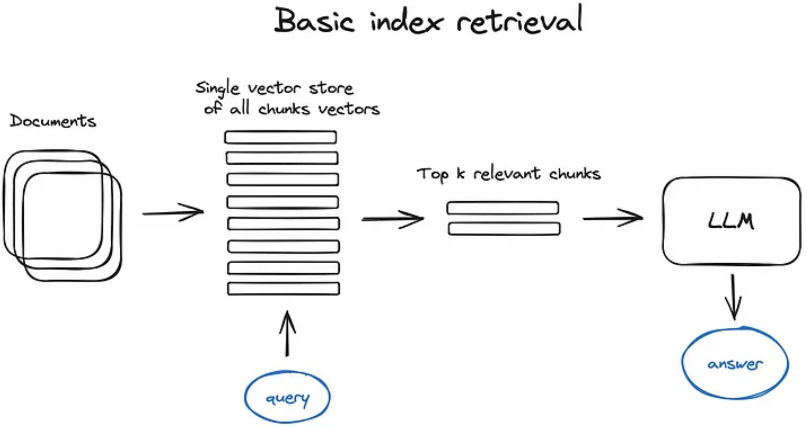
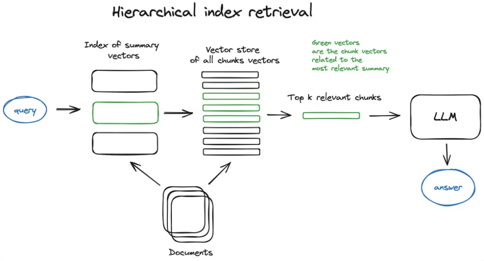
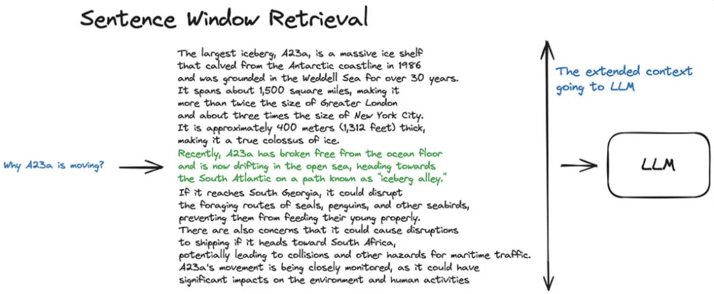
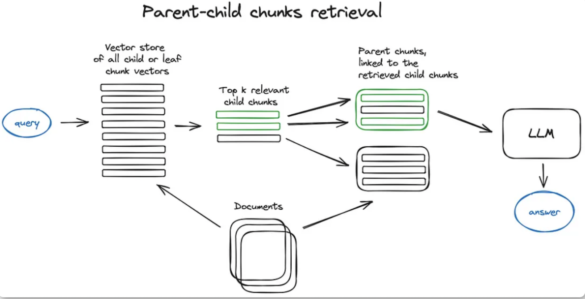
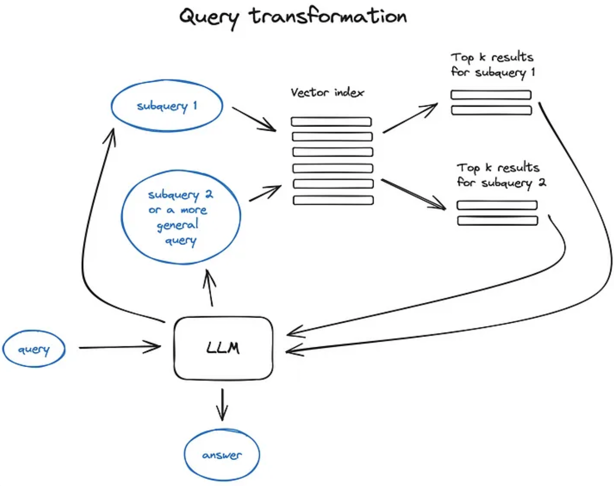
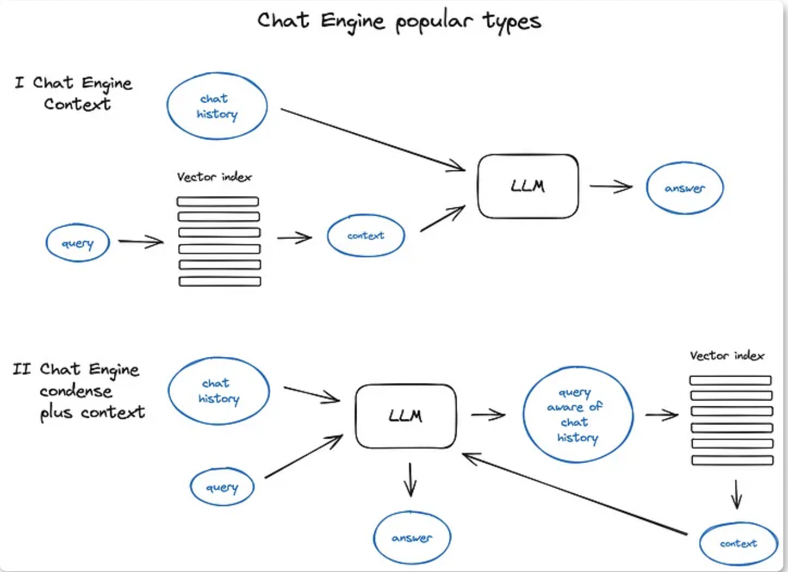

> 原文：https://ku.baidu-int.com/knowledge/HFVrC7hq1Q/KeF15lNOtH/-UXFkEkRyR/SbSq7249Jmazte

检索增强生成技术(RAG)

### 一.RAG简介
检索增强的思想是在提问时从外部知识库检索文档，并将这些文档和用户的查询一起传递给LLM，以增强其生成准确和相关答案的能力。


首先，需要将文本切分成小段，将这些文本段通过编码器模型转换成向量形式。接着，把所有向量汇集到一个索引里进行存储。在实际运行过程中，会用同一个编码器模型把用户的查询转换成向量，然后根据这个向量在索引中进行搜索。系统会找到最相关的前k个结果，从数据库中提取相应的文本段，然后把这些文本段作为上下文信息输入到大语言模型的提示词中，这个提示词会指导模型根据在搜索步骤中找到的上下文信息来回答用户的查询。

由此可见，检索增强的核心功能，主要包括三个基本步骤：

1. **外部知识库的内容存储**- 将文档语料库分割成较短的块并进行存储。
2. **检索**- 块构建索引，以及根据query和块之间的相似性检索相关文档片段。
3. **生成**- 根据检索到的上下文生成问题的答案。

要使RAG系统被认为是成功的，实际上需要满足以下两个要求：

 1.**检索必须能够找到与用户查询最相关的文档**

 2.**生成必须能够很好的利用检索的文档来充分回答用户的查询**

本文将针对数据索引与查询部分介绍一些优化思路，并介绍一个专注于数据索引与检索的开源数据框架LlamaIndex.

### 二.RAG系统-检索与检索方法介绍
###### **1.基本存储索引(FLAT)**

暴力计算每条向量和目标向量之间的余弦距离，得到距离最相近的topk个向量。

###### **2.层次索引**

在处理大型数据库时，一个有效的做法是创建两个索引——一个由摘要组成，另一个由文档块组成，然后分两步进行搜索：首先通过摘要过滤出相关文档，接着只在这个相关群体内进行搜索。

假设将向量空间分成 nlist 个聚类单元。假设以默认值 nlist = 10，检索时会先比较这 10 个单元的中心与目标向量之间的距离，得出最近的几个单元，接着比较这些单元内所有向量距离，得到最接近的向量。

当向量总条数约等于 nlist 时，两者的计算量相当，无明显性能差距。然而，随着向量条数达到 nlist 的 2 倍、3 倍、n 倍之后，层次索引的性能优势就越来越突出。

###### 3.假设性问题
让LLM为每个块生成一个假设性问题，并将这些问题以向量形式嵌入。在运行时，针对这个问题向量的索引进行查询搜索（用问题向量替换索引中的块向量），检索后将原始文本块作为上下文发送给LLM以获取答案。这种方法由于查询和假设性问题之间的语义相似性更高，从而提高了搜索质量。

###### **4.句子窗口索引**
在这种方案中，文档中的每个句子都被单独嵌入向量，这样做可以提高查询到上下文的余弦距离搜索的准确度。因为一个完整的句子携带的自然语言信息相比较分块更完整。句子窗口检索会在关键句子前后各扩展k个句子，然后将这个扩展的上下文发送给LLM。


绿色部分代表在索引搜索中找到的句子的向量表示，而整个黑色加绿色的段落会被输入到大语言模型（LLM）中，目的是在分析提供的查询时扩大其上下文范围。

###### **5.自动合并检索(父文档检索)**

这里的思路与句子窗口索引十分相似。文档被分割成较小的子块，这些子块又与更大的父块相对应。在检索过程中，首先获取较小的数据块。如果在前k个检索到的块中，有超过n个块指向同一个父节点（即更大的块），那么我们就用这个父节点来替换原先提供给大语言模型（LLM）的上下文内容。这个过程类似于自动将几个小块合并成一个更大的父块。

###### **6.查询转换**
使用LLM作为推理引擎来修改用户输入，以此提高检索质量。


如果查询内容复杂，大语言模型（LLM）可以将其分解为几个子查询。例如，如果您问：

—— “在Github上，Langchain和LlamaIndex哪个框架的star更多？”我们不太可能直接在语料库中找到这样的比较，因此将这个问题分解为两个假设更简单和具体信息检索的子查询是合理的：

——“Langchain在Github上有多少star？”

——“LlamaIndex在Github上有多少star？”

这些查询将并行执行，然后检索到的上下文将组合在一个提示中，供大语言模型综合出对初始查询的最终答案。

###### **7.对话引擎(上下文压缩)**
考虑到对话上下文的逻辑连贯性，通常需要将用户query合并历史记录一起发送给 LLM，确保 LLM 在生成下一条回答时能够关联之前的上下文。实际情况由于大语言模型对输入token的长度限制，需要将上下文进行压缩，具体实现如下。在这种模式下，每次互动中的聊天历史和最后一条消息会被压缩成一个新的查询。然后，这个查询被发送到索引系统，检索到的上下文连同原始用户消息一起回传。


##### 句子窗口索引样例分析
此处使用开源项目llama_index的句子窗口索引对比分析

###### **数据加载**
```
curl https://www.ipcc.ch/report/ar6/wg2/downloads/report/IPCC_AR6_WGII_Chapter03.pdf --output IPCC_AR6_WGII_Chapter03.pdf

from llama_index import SimpleDirectoryReader

documents = SimpleDirectoryReader(
    input_files=["./IPCC_AR6_WGII_Chapter03.pdf"]
).load_data()
```
###### **提取节点(分块+构建索引)**
提取出使用句子窗口解析器的节点，以及使用标准解析器提取的“基本”节点。

```
// 句子窗口解析器
nodes = node_parser.get_nodes_from_documents(documents)
// 构建索引
sentence_index = VectorStoreIndex(nodes, service_context=ctx)

// 标准解析器
base_nodes = text_splitter.get_nodes_from_documents(documents)
// 构建索引
base_index = VectorStoreIndex(base_nodes, service_context=ctx)
```
###### **查询**
```
from llama_index.postprocessor import MetadataReplacementPostProcessor

query_engine = sentence_index.as_query_engine(
    similarity_top_k=2,
    # the target key defaults to `window` to match the node_parser's default
    node_postprocessors=[
        MetadataReplacementPostProcessor(target_metadata_key="window")
    ],
)
window_response = query_engine.query(
    "What are the concerns surrounding the AMOC?"
)
print(window_response)

There is low confidence in the quantification of Atlantic Meridional Overturning Circulation (AMOC) 
changes in the 20th century due to low agreement in quantitative reconstructed and simulated trends. 
Additionally, direct observational records since the mid-2000s remain too short to determine the 
relative contributions of internal variability, natural forcing, and anthropogenic forcing to AMOC change. 
However, it is very likely that AMOC will decline for all SSP scenarios over the 21st century, 
but it will not involve an abrupt collapse before 2100.
大西洋经向翻转环流（AMOC）的量化置信度较低
20世纪的变化是由于定量重建和模拟趋势的一致性较低。
此外，自2000年代中期以来的直接观测记录仍然太短，无法确定
内部变异性、自然强迫和人为强迫对AMOC变化的相对贡献。
然而，AMOC很可能在21世纪的所有SSP场景中都会下降，
但它不会在2100年之前突然崩溃。

// 打印原始句子窗口信息
window = window_response.source_nodes[0].node.metadata["window"]
sentence = window_response.source_nodes[0].node.metadata["original_text"]

print(f"Window: {window}")
print("------------------")
print(f"Original Sentence: {sentence}")


// 打印结果
Window: Nevertheless, projected future annual cumulative upwelling wind 
changes at most locations and seasons remain within ±10–20% of 
present-day values (medium confidence) (WGI AR6 Section  9.2.3.5; 
Fox-Kemper et al., 2021).
 Continuous observation of the Atlantic meridional overturning 
circulation (AMOC) has improved the understanding of its variability 
(Frajka-Williams et  al., 2019), but there is low confidence in the 
quantification of AMOC changes in the 20th century because of low 
agreement in quantitative reconstructed and simulated trends (WGI 
AR6 Sections 2.3.3, 9.2.3.1; Fox-Kemper et al., 2021; Gulev et al., 2021). 
 Direct observational records since the mid-2000s remain too short to 
determine the relative contributions of internal variability, natural 
forcing and anthropogenic forcing to AMOC change (high confidence) 
(WGI AR6 Sections 2.3.3, 9.2.3.1; Fox-Kemper et al., 2021; Gulev et al., 
2021).  Over the 21st century, AMOC will very likely decline for all SSP 
scenarios but will not involve an abrupt collapse before 2100 (WGI 
AR6 Sections 4.3.2, 9.2.3.1; Fox-Kemper et al., 2021; Lee et al., 2021).
 3.2.2.4 Sea Ice Changes
Sea ice is a key driver of polar marine life, hosting unique ecosystems 
and affecting diverse marine organisms and food webs through its 
impact on light penetration and supplies of nutrients and organic 
matter (Arrigo, 2014).  Since the late 1970s, Arctic sea ice area has 
decreased for all months, with an estimated decrease of 2 million km2 
(or 25%) for summer sea ice (averaged for August, September and 
October) in 2010–2019 as compared with 1979–1988 (WGI AR6 
Section 9.3.1.1; Fox-Kemper et al., 2021). 
------------------
Original Sentence: Over the 21st century, AMOC will very likely decline for all SSP 
scenarios but will not involve an abrupt collapse before 2100 (WGI 
AR6 Sections 4.3.2, 9.2.3.1; Fox-Kemper et al., 2021; Lee et al., 2021).
```
```
query_engine = base_index.as_query_engine(similarity_top_k=5)
vector_response = query_engine.query(
    "What are the concerns surrounding the AMOC?" //围绕AMOC的问题有哪些
)
print(vector_response)

// 模型回复
There are concerns surrounding the AMOC (Atlantic Meridional Overturning Circulation). 
The context information mentions that the AMOC will decline over the 21st century.
有人担心大西洋经向翻转环流AMOC将在21世纪下降

```
###### **分析**
比较每个索引检索到的块，句子级别的索引似乎捕获了更细粒度的细节

```
for source_node in window_response.source_nodes:
    print(source_node.node.metadata["original_text"])
    print("--------")
    
// 句子索引原始文本打印
Over the 21st century, AMOC will very likely decline for all SSP 
scenarios but will not involve an abrupt collapse before 2100 (WGI 
AR6 Sections 4.3.2, 9.2.3.1; Fox-Kemper et al., 2021; Lee et al., 2021).
在21世纪，所有SSP的AMOC很可能会下降
情景，但不会涉及2100年之前的突然坍塌（WGI
AR6第4.3.2、9.2.3.1节；Fox Kemper等人，2021；Lee等人，2021）。
--------
Direct observational records since the mid-2000s remain too short to 
determine the relative contributions of internal variability, natural 
forcing and anthropogenic forcing to AMOC change (high confidence) 
(WGI AR6 Sections 2.3.3, 9.2.3.1; Fox-Kemper et al., 2021; Gulev et al., 
2021). 
自2000年代中期以来的直接观测记录仍然太短，无法
确定内部变异性的相对贡献，自然
AMOC变化的强迫和人为强迫（高置信度）
（WGI AR6第2.3.3、9.2.3.1节；Fox Kemper等人，2021；Gulev等人。，
2021).
--------


// 标准索引原始文本打印
for node in vector_response.source_nodes:
    print("AMOC mentioned?", "AMOC" in node.node.text)
    print("--------")
    
    
AMOC mentioned? False
--------
AMOC mentioned? False
--------
AMOC mentioned? True
--------
AMOC mentioned? False
--------
AMOC mentioned? False
--------

标准索引 [2] 处的源节点提到了 AMOC，但是这段文本实际上是什么样的？
print(vector_response.source_nodes[2].node.text)

2021; Gulev et al. 
2021)The AMOC will decline over the 21st century 
(high confidence, but low confidence for 
quantitative projections).4.3.2.3, 9.2.3 (Fox-Kemper 
et al. 2021; Lee et al. 
2021)

2021; Gulev等人。
2021）AMOC将在21世纪下降
（信心很高，但信心很低
定量预测）。4.3.2.3，9.2.3（Fox Kemper
等人2021；Lee等人。
2021)

```
可以看到句子窗口索引很容易检索到两个谈论 AMOC 的节点

### 三.LlamaIndex
##### 1.什么是llamaindex
llamaIndex在 LLM 和外部数据源（如 API、PDF、SQL 等）之间提供一个简单的接口进行交互。它接收输入数据并为其构建索引，随后会使用该索引来回答与输入数据相关的任何问题。并有助于在查询期间在成本和性能之间进行权衡。

LllamaIndex 以专用索引的形式提供独特的数据结构：

* **向量存储索引**：最常用，允许您回答对大型数据集的查询。
* **树索引**：对于总结文档集合很有用。
* **列表索引**：对于合成一个结合了多个数据源信息的答案很有用。
* **关键字表索引**：用于将查询路由到不同的数据源。
* **结构化存储索引**：对于结构化数据（例如 SQL 查询）很有用。
* **知识图谱索引**：对于构建知识图谱很有用。

github地址 [https://github.com/run-llama/llama_index](https://github.com/run-llama/llama_index)

