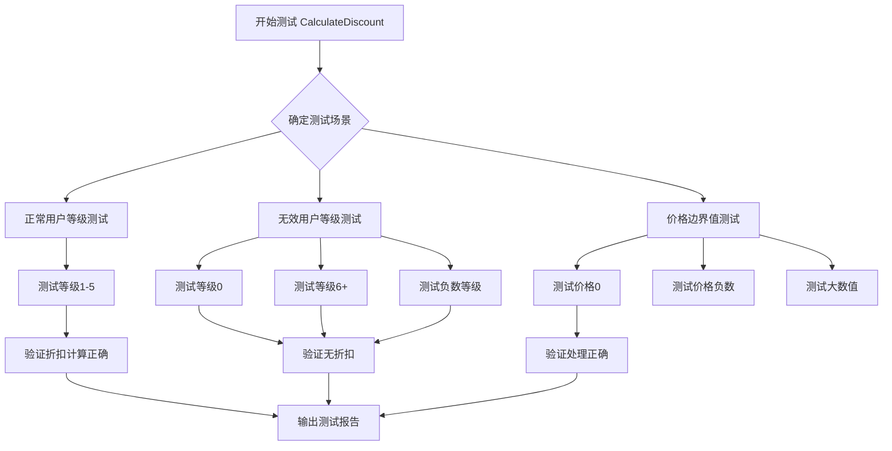
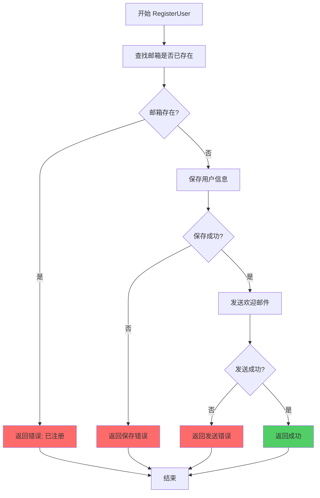
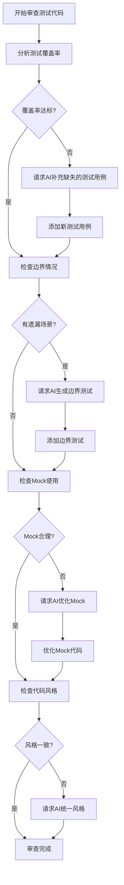
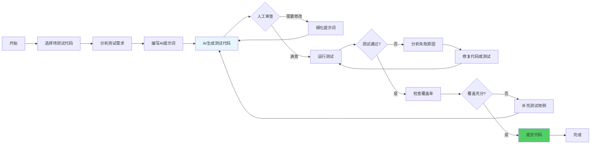

使用 AI  编写单元测试

## 1. 为什么要写单测
**提前发现问题**：在开发阶段就能发现代码缺陷，而不是等到测试或生产环境

**防止回归**：确保代码变更不会破坏现有功能

**代码质量**：编写单测的过程会促使开发者思考边界情况和异常处理

**快速反馈**：运行单测可以快速验证代码修改是否正确

**文档作用**：单测是最好的文档，展示了代码的预期使用方式

**重构信心**：有了单测保护，重构代码时更加安心

**减少代码审查负担**：单测通过验证功能正确性，让代码审查更专注于代码风格和架构

**降低沟通成本**：单测清楚地展示了函数的输入输出行为

**知识传递**：新成员可以通过单测快速理解代码逻辑


## 2. 用 AI 写单测有什么好处
**自动化生成**：AI 可以在几秒钟内生成覆盖全面的单测代码

**减少重复劳动**：不再需要手动编写大量相似的测试用例

**快速迭代**：修改代码后，AI 可以快速更新对应的测试用例

**全面覆盖**：AI 能够考虑各种边界情况、异常场景和极端输入

**发现盲点**：AI 可能发现人类容易忽略的测试场景

**持续优化**：可以基于代码变化自动补充缺失的测试用例

**学习成本降低**：新手无需深入理解测试框架即可获得高质量单测

**知识补充**：AI 了解各种测试模式和最佳实践

**标准化输出**：生成的单测遵循统一的代码风格和规范

**智能建议**：AI 可以根据代码复杂度建议合适的测试策略

**模式识别**：识别代码中的反模式，并生成相应的测试

**历史学习**：从已有的测试用例中学习项目特定的测试风格


## 3. 如何使用 AI 写单测
### 3.1 准备工作
#### 确定测试范围
```md
- 选择需要测试的核心功能模块
- 明确测试的边界和覆盖率目标
- 整理相关的输入输出示例
```
#### 准备代码上下文
```md
- 提供被测函数的完整实现
- 包含相关的依赖和接口定义
- 说明函数的业务逻辑和预期行为
```
### 3.2 提示词编写
#### 基础提示词模板
```
#xxx.go
请为 [函数名/结构体名] 编写单元测试：

要求：
1. 使用 Go 标准库 testing 框架
2. 覆盖正常场景和边界情况
3. 包含异常处理测试
4. 添加必要的中文注释
```
#### 进阶提示词模板
```
#xxx.go
请为这个代码生成全面的单元测试：

测试要求：
- 使用 Go testing 框架（如需使用 testify 断言库请说明）
- 目标覆盖率：[XX]%
- 需要覆盖的场景：
  1. 正常业务流程
  2. 边界值测试
  3. 异常输入处理
  4. 并发场景（如适用）
- 测试数据应包含：
  - 最小值、最大值
  - 零值、nil
  - 典型业务数据

额外要求：
- 使用接口和 Mock 隔离外部依赖
- 添加 table-driven test 表格驱动测试
- 测试用例命名清晰表达测试意图
```
### 3.3 实践示例
#### 示例 1：简单函数测试
```go
// 待测试代码
package discount

// CalculateDiscount 根据用户等级计算折扣后价格
func CalculateDiscount(price float64, userLevel int) float64 {
    discountMap := map[int]float64{
        1: 0.95,
        2: 0.90,
        3: 0.85,
        4: 0.80,
        5: 0.75,
    }
    discount, ok := discountMap[userLevel]
    if !ok {
        discount = 1.0
    }
    return price * discount
}
```
**测试流程图：**


**AI 提示词：**

```
#discount.go
请为上面的 CalculateDiscount 函数编写 Go 单元测试，要求：
1. 使用 table-driven test 表格驱动测试
2. 覆盖所有用户等级（1-5）
3. 测试无效用户等级的情况（0、6、-1）
4. 测试价格边界情况（0、负数、大数值）
5. 添加中文注释说明每个测试的目的
```
**生成的测试代码示例：**


```go
package discount

import (
    "testing"
)

// TestCalculateDiscount 测试 CalculateDiscount 函数
func TestCalculateDiscount(t *testing.T) {
    // 表格驱动测试用例
    testCases := []struct {
        name      string  // 测试用例名称
        price     float64 // 输入价格
        userLevel int     // 输入用户等级
        want      float64 // 期望结果
        desc      string  // 测试目的描述
    }{
        // 测试所有用户等级（1-5）
        {"用户等级1", 100.0, 1, 95.0, "测试用户等级1的折扣，应为原价的95%"},
        {"用户等级2", 100.0, 2, 90.0, "测试用户等级2的折扣，应为原价的90%"},
        {"用户等级3", 100.0, 3, 85.0, "测试用户等级3的折扣，应为原价的85%"},
        {"用户等级4", 100.0, 4, 80.0, "测试用户等级4的折扣，应为原价的80%"},
        {"用户等级5", 100.0, 5, 75.0, "测试用户等级5的折扣，应为原价的75%"},

        // 测试无效用户等级的情况（0、6、-1）
        {"无效用户等级0", 100.0, 0, 100.0, "测试无效用户等级0，应无折扣"},
        {"无效用户等级6", 100.0, 6, 100.0, "测试无效用户等级6，应无折扣"},
        {"无效用户等级-1", 100.0, -1, 100.0, "测试无效用户等级-1，应无折扣"},

        // 测试价格边界情况（0、负数、大数值）
        {"价格为0", 0.0, 1, 0.0, "测试价格为0的情况"},
        {"价格为负数", -100.0, 1, -95.0, "测试价格为负数的情况"},
        {"价格为大数值", 1000000.0, 5, 750000.0, "测试价格为大数值的情况"},
    }

    // 执行测试用例
    for _, tc := range testCases {
        t.Run(tc.name, func(t *testing.T) {
            got := CalculateDiscount(tc.price, tc.userLevel)
            if got != tc.want {
                t.Errorf("%s: CalculateDiscount(%v, %v) = %v; want %v", tc.desc, tc.price, tc.userLevel, got, tc.want)
            }
        })
    }
}

```
#### 示例 2：依赖注入的结构体测试
```go
// 待测试代码
package user

import "errors"

// UserRepository 用户存储接口
type UserRepository interface {
    FindByEmail(email string) (*User, error)
    Save(user *User) error
}

// EmailService 邮件服务接口
type EmailService interface {
    SendWelcomeEmail(email string) error
}

// User 用户实体
type User struct {
    ID    int
    Email string
    Name  string
}

// UserService 用户服务
type UserService struct {
    userRepo  UserRepository
    emailSvc  EmailService
}

// NewUserService 创建用户服务实例
func NewUserService(repo UserRepository, email EmailService) *UserService {
    return &UserService{
        userRepo: repo,
        emailSvc: email,
    }
}

// RegisterUser 注册新用户
func (s *UserService) RegisterUser(user *User) error {
    // 检查邮箱是否已存在
    existing, err := s.userRepo.FindByEmail(user.Email)
    if err != nil {
        return err
    }
    if existing != nil {
        return errors.New("email already registered")
    }

    // 保存用户
    if err := s.userRepo.Save(user); err != nil {
        return err
    }

    // 发送欢迎邮件
    return s.emailSvc.SendWelcomeEmail(user.Email)
}
```
**注册流程图：**


**AI 提示词：**

```
#user_test.go
请为 UserService 结构体编写 Go 单元测试，要求：
1. 使用接口 Mock 隔离 UserRepository 和 EmailService
2. 使用 table-driven test 表格驱动测试
3. 测试成功注册场景
4. 测试邮箱已存在的场景
5. 测试数据库保存失败的异常场景
6. 验证邮件服务被正确调用
7. 添加中文注释说明每个测试的目的
```


**生成的测试代码示例：**


```go
// UserService 单元测试
package user

import (
    "errors"
    "testing"
)

// MockUserRepository 模拟 UserRepository 接口
type MockUserRepository struct {
    findByEmailFunc func(email string) (*User, error)
    saveFunc        func(user *User) error
    findByEmailCalled bool
    saveCalled        bool
}

// FindByEmail 模拟 FindByEmail 方法
func (m *MockUserRepository) FindByEmail(email string) (*User, error) {
    m.findByEmailCalled = true
    if m.findByEmailFunc != nil {
        return m.findByEmailFunc(email)
    }
    return nil, nil
}

// Save 模拟 Save 方法
func (m *MockUserRepository) Save(user *User) error {
    m.saveCalled = true
    if m.saveFunc != nil {
        return m.saveFunc(user)
    }
    return nil
}

// MockEmailService 模拟 EmailService 接口
type MockEmailService struct {
    sendWelcomeEmailFunc func(email string) error
    sendWelcomeEmailCalled bool
}

// SendWelcomeEmail 模拟 SendWelcomeEmail 方法
func (m *MockEmailService) SendWelcomeEmail(email string) error {
    m.sendWelcomeEmailCalled = true
    if m.sendWelcomeEmailFunc != nil {
        return m.sendWelcomeEmailFunc(email)
    }
    return nil
}

// TestUserService_RegisterUser 测试 UserService.RegisterUser 方法
func TestUserService_RegisterUser(t *testing.T) {
    // 测试用例
    testCases := []struct {
        name           string
        user           *User
        findByEmail    func(email string) (*User, error)
        save           func(user *User) error
        sendWelcomeEmail func(email string) error
        expectedErr    error
        expectedFindByEmailCalled bool
        expectedSaveCalled        bool
        expectedSendWelcomeEmailCalled bool
    }{
        {
            name: "成功注册场景",
            user: &User{ID: 1, Email: "test@example.com", Name: "Test User"},
            findByEmail: func(email string) (*User, error) {
                return nil, nil // 邮箱不存在
            },
            save: func(user *User) error {
                return nil // 保存成功
            },
            sendWelcomeEmail: func(email string) error {
                return nil // 发送邮件成功
            },
            expectedErr: nil,
            expectedFindByEmailCalled: true,
            expectedSaveCalled:        true,
            expectedSendWelcomeEmailCalled: true,
        },
        {
            name: "邮箱已存在的场景",
            user: &User{ID: 1, Email: "test@example.com", Name: "Test User"},
            findByEmail: func(email string) (*User, error) {
                return &User{ID: 2, Email: "test@example.com", Name: "Existing User"}, nil // 邮箱已存在
            },
            save: func(user *User) error {
                return nil
            },
            sendWelcomeEmail: func(email string) error {
                return nil
            },
            expectedErr: errors.New("email already registered"),
            expectedFindByEmailCalled: true,
            expectedSaveCalled:        false, // 由于邮箱已存在，不应调用 Save
            expectedSendWelcomeEmailCalled: false, // 由于邮箱已存在，不应调用发送邮件
        },
        {
            name: "数据库保存失败的异常场景",
            user: &User{ID: 1, Email: "test@example.com", Name: "Test User"},
            findByEmail: func(email string) (*User, error) {
                return nil, nil // 邮箱不存在
            },
            save: func(user *User) error {
                return errors.New("database error") // 保存失败
            },
            sendWelcomeEmail: func(email string) error {
                return nil
            },
            expectedErr: errors.New("database error"),
            expectedFindByEmailCalled: true,
            expectedSaveCalled:        true,
            expectedSendWelcomeEmailCalled: false, // 由于保存失败，不应调用发送邮件
        },
    }

    // 执行测试用例
    for _, tc := range testCases {
        t.Run(tc.name, func(t *testing.T) {
            // 创建模拟对象
            mockUserRepo := &MockUserRepository{
                findByEmailFunc: tc.findByEmail,
                saveFunc:        tc.save,
            }
            mockEmailSvc := &MockEmailService{
                sendWelcomeEmailFunc: tc.sendWelcomeEmail,
            }

            // 创建 UserService 实例
            userService := NewUserService(mockUserRepo, mockEmailSvc)

            // 调用 RegisterUser 方法
            err := userService.RegisterUser(tc.user)

            // 验证错误是否符合预期
            if (err != nil && tc.expectedErr == nil) || (err == nil && tc.expectedErr != nil) || (err != nil && tc.expectedErr != nil && err.Error() != tc.expectedErr.Error()) {
                t.Errorf("Expected error: %v, got: %v", tc.expectedErr, err)
            }

            // 验证方法调用情况
            if mockUserRepo.findByEmailCalled != tc.expectedFindByEmailCalled {
                t.Errorf("Expected FindByEmail to be called: %v, got: %v", tc.expectedFindByEmailCalled, mockUserRepo.findByEmailCalled)
            }
            if mockUserRepo.saveCalled != tc.expectedSaveCalled {
                t.Errorf("Expected Save to be called: %v, got: %v", tc.expectedSaveCalled, mockUserRepo.saveCalled)
            }
            if mockEmailSvc.sendWelcomeEmailCalled != tc.expectedSendWelcomeEmailCalled {
                t.Errorf("Expected SendWelcomeEmail to be called: %v, got: %v", tc.expectedSendWelcomeEmailCalled, mockEmailSvc.sendWelcomeEmailCalled)
            }
        })
    }
}

```
### 3.4 质量检查
#### 检查清单
- [ ] 测试用例命名清晰，表达测试意图
- [ ] 每个测试用例只验证一个功能点
- [ ] 测试数据具有代表性，覆盖边界情况
- [ ] Mock/Stub 使用正确，没有过度 Mock
- [ ] 测试可独立运行，不依赖执行顺序
- [ ] 断言明确，错误信息清晰

#### AI 辅助测试审查流程

#### 持续优化
```
#user_test.go 
请审查这个单元单元测试，指出可以改进的地方：

关注点：
1. 测试覆盖率是否充分
2. 是否有遗漏的边界情况
3. Mock 使用是否合理
4. 代码风格是否一致
```


**生成的测试代码示例：**


```go
// UserService 单元测试
package user

import (
    "errors"
    "testing"

    "github.com/stretchr/testify/assert"
)

// MockUserRepository 模拟 UserRepository 接口
type MockUserRepository struct {
    findByEmailFunc    func(email string) (*User, error)
    saveFunc           func(user *User) error
    findByEmailCalled  bool
    saveCalled         bool
    lastFindByEmailArg string // 记录最后一次调用 FindByEmail 的参数
    lastSaveArg        *User  // 记录最后一次调用 Save 的参数
}

// FindByEmail 模拟 FindByEmail 方法
func (m *MockUserRepository) FindByEmail(email string) (*User, error) {
    m.findByEmailCalled = true
    m.lastFindByEmailArg = email // 记录调用参数
    if m.findByEmailFunc != nil {
        return m.findByEmailFunc(email)
    }
    return nil, nil
}

// Save 模拟 Save 方法
func (m *MockUserRepository) Save(user *User) error {
    m.saveCalled = true
    m.lastSaveArg = user // 记录调用参数
    if m.saveFunc != nil {
        return m.saveFunc(user)
    }
    return nil
}

// MockEmailService 模拟 EmailService 接口
type MockEmailService struct {
    sendWelcomeEmailFunc    func(email string) error
    sendWelcomeEmailCalled  bool
    lastSendWelcomeEmailArg string // 记录最后一次调用 SendWelcomeEmail 的参数
}

// SendWelcomeEmail 模拟 SendWelcomeEmail 方法
func (m *MockEmailService) SendWelcomeEmail(email string) error {
    m.sendWelcomeEmailCalled = true
    m.lastSendWelcomeEmailArg = email // 记录调用参数
    if m.sendWelcomeEmailFunc != nil {
        return m.sendWelcomeEmailFunc(email)
    }
    return nil
}

// TestUserService_RegisterUser 测试 UserService.RegisterUser 方法
func TestUserService_RegisterUser(t *testing.T) {
    // 测试用例
    testCases := []struct {
        name                           string
        user                           *User
        findByEmail                    func(email string) (*User, error)
        save                           func(user *User) error
        sendWelcomeEmail               func(email string) error
        expectedErr                    error
        expectedFindByEmailCalled      bool
        expectedSaveCalled             bool
        expectedSendWelcomeEmailCalled bool
    }{
        {
            name: "成功注册场景",
            user: &User{ID: 1, Email: "test@example.com", Name: "Test User"},
            findByEmail: func(email string) (*User, error) {
                return nil, nil // 邮箱不存在
            },
            save: func(user *User) error {
                return nil // 保存成功
            },
            sendWelcomeEmail: func(email string) error {
                return nil // 发送邮件成功
            },
            expectedErr:                    nil,
            expectedFindByEmailCalled:      true,
            expectedSaveCalled:             true,
            expectedSendWelcomeEmailCalled: true,
        },
        {
            name: "邮箱已存在的场景",
            user: &User{ID: 1, Email: "test@example.com", Name: "Test User"},
            findByEmail: func(email string) (*User, error) {
                return &User{ID: 2, Email: "test@example.com", Name: "Existing User"}, nil // 邮箱已存在
            },
            save: func(user *User) error {
                return nil
            },
            sendWelcomeEmail: func(email string) error {
                return nil
            },
            expectedErr:                    errors.New("email already registered"),
            expectedFindByEmailCalled:      true,
            expectedSaveCalled:             false, // 由于邮箱已存在，不应调用 Save
            expectedSendWelcomeEmailCalled: false, // 由于邮箱已存在，不应调用发送邮件
        },
        {
            name: "数据库保存失败的异常场景",
            user: &User{ID: 1, Email: "test@example.com", Name: "Test User"},
            findByEmail: func(email string) (*User, error) {
                return nil, nil // 邮箱不存在
            },
            save: func(user *User) error {
                return errors.New("database error") // 保存失败
            },
            sendWelcomeEmail: func(email string) error {
                return nil
            },
            expectedErr:                    errors.New("database error"),
            expectedFindByEmailCalled:      true,
            expectedSaveCalled:             true,
            expectedSendWelcomeEmailCalled: false, // 由于保存失败，不应调用发送邮件
        },
        {
            name: "发送邮件失败的异常场景",
            user: &User{ID: 1, Email: "test@example.com", Name: "Test User"},
            findByEmail: func(email string) (*User, error) {
                return nil, nil // 邮箱不存在
            },
            save: func(user *User) error {
                return nil // 保存成功
            },
            sendWelcomeEmail: func(email string) error {
                return errors.New("email service error") // 发送邮件失败
            },
            expectedErr:                    errors.New("email service error"),
            expectedFindByEmailCalled:      true,
            expectedSaveCalled:             true,
            expectedSendWelcomeEmailCalled: true, // 发送邮件失败，但方法应被调用
        },
        {
            name: "空用户对象测试",
            user: nil, // 空用户对象
            findByEmail: func(email string) (*User, error) {
                return nil, nil
            },
            save: func(user *User) error {
                return nil
            },
            sendWelcomeEmail: func(email string) error {
                return nil
            },
            expectedErr:                    errors.New("user cannot be nil"),
            expectedFindByEmailCalled:      false, // 空用户对象不应调用 FindByEmail
            expectedSaveCalled:             false, // 空用户对象不应调用 Save
            expectedSendWelcomeEmailCalled: false, // 空用户对象不应调用发送邮件
        },
        {
            name: "用户信息不完整测试",
            user: &User{ID: 1, Email: "", Name: "Test User"}, // 邮箱为空
            findByEmail: func(email string) (*User, error) {
                return nil, nil
            },
            save: func(user *User) error {
                return nil
            },
            sendWelcomeEmail: func(email string) error {
                return nil
            },
            expectedErr:                    errors.New("email cannot be empty"),
            expectedFindByEmailCalled:      false, // 邮箱为空不应调用 FindByEmail
            expectedSaveCalled:             false, // 邮箱为空不应调用 Save
            expectedSendWelcomeEmailCalled: false, // 邮箱为空不应调用发送邮件
        },
        {
            name: "邮箱格式验证测试",
            user: &User{ID: 1, Email: "invalid-email", Name: "Test User"}, // 无效邮箱格式
            findByEmail: func(email string) (*User, error) {
                return nil, nil
            },
            save: func(user *User) error {
                return nil
            },
            sendWelcomeEmail: func(email string) error {
                return nil
            },
            expectedErr:                    errors.New("invalid email format"),
            expectedFindByEmailCalled:      false, // 无效邮箱格式不应调用 FindByEmail
            expectedSaveCalled:             false, // 无效邮箱格式不应调用 Save
            expectedSendWelcomeEmailCalled: false, // 无效邮箱格式不应调用发送邮件
        },
    }

    // 执行测试用例
    for _, tc := range testCases {
        t.Run(tc.name, func(t *testing.T) {
            // 创建模拟对象
            mockUserRepo := &MockUserRepository{
                findByEmailFunc: tc.findByEmail,
                saveFunc:        tc.save,
            }
            mockEmailSvc := &MockEmailService{
                sendWelcomeEmailFunc: tc.sendWelcomeEmail,
            }

            // 创建 UserService 实例
            userService := NewUserService(mockUserRepo, mockEmailSvc)

            // 调用 RegisterUser 方法
            err := userService.RegisterUser(tc.user)

            // 验证错误是否符合预期
            if tc.expectedErr != nil {
                assert.Error(t, err)
                assert.Equal(t, tc.expectedErr.Error(), err.Error())
            } else {
                assert.NoError(t, err)
            }

            // 验证方法调用情况
            assert.Equal(t, tc.expectedFindByEmailCalled, mockUserRepo.findByEmailCalled, "FindByEmail called status mismatch")
            assert.Equal(t, tc.expectedSaveCalled, mockUserRepo.saveCalled, "Save called status mismatch")
            assert.Equal(t, tc.expectedSendWelcomeEmailCalled, mockEmailSvc.sendWelcomeEmailCalled, "SendWelcomeEmail called status mismatch")

            // 验证调用参数
            if tc.expectedFindByEmailCalled && tc.user != nil {
                assert.Equal(t, tc.user.Email, mockUserRepo.lastFindByEmailArg, "FindByEmail called with wrong email")
            }
            if tc.expectedSaveCalled {
                assert.Equal(t, tc.user, mockUserRepo.lastSaveArg, "Save called with wrong user")
            }
            if tc.expectedSendWelcomeEmailCalled && tc.user != nil {
                assert.Equal(t, tc.user.Email, mockEmailSvc.lastSendWelcomeEmailArg, "SendWelcomeEmail called with wrong email")
            }
        })
    }
}

```
### 3.5 最佳实践
1. **人机协作**：AI 生成初稿，人工审查和调整
2. **增量生成**：针对新功能或修改的代码生成测试
3. **持续学习**：根据项目的测试风格优化提示词
4. **版本管理**：将 AI 生成的测试纳入版本控制
5. **定期评估**：检查测试的有效性和维护成本

#### AI 辅助单测开发完整流程

## 4. 将 AI 写单测能力抽象为 SKILL
```go
将上面这个生成单元测试并优化单测的能力抽象成一个 skills
```


```md
---
name: "unit-test-generator"
description: "Generates and optimizes unit tests for Go code. Invoke when user wants to create or improve unit tests for their codebase."
---

# 单元测试生成器

此技能帮助您为 Go 代码生成和优化单元测试。它提供全面的测试覆盖率，处理边界情况，并确保测试编写的最佳实践。

## 使用场景

当以下情况时调用此技能：
- 您需要为现有 Go 代码创建单元测试
- 您想要提高代码库的测试覆盖率
- 您需要优化现有的单元测试
- 您想要确保测试正确处理边界情况
- 您需要验证测试的正确性

## 功能特性

### 1. 测试生成
- 为 Go 函数和方法生成全面的单元测试
- 为依赖项创建模拟对象
- 覆盖正常场景和边界情况
- 遵循 Go 测试最佳实践

### 2. 测试优化
- 通过识别缺失的测试用例提高测试覆盖率
- 使用更好的断言增强现有测试
- 优化模拟使用以实现更好的测试隔离
- 确保测试中的代码风格一致

### 3. 边界情况处理
- 识别并测试边界条件
- 处理 nil 输入和错误场景
- 测试无效参数和边界值
- 确保测试中的正确错误处理

### 4. 模拟管理
- 为依赖项创建有效的模拟对象
- 增强模拟验证能力
- 确保模拟方法使用正确的参数调用
- 简化模拟的设置和拆卸

## 使用指南

### 步骤 1：指定目标代码
指定您要测试的 Go 文件或包。技能将分析代码结构并识别要测试的函数/方法。

### 步骤 2：生成测试
技能将生成全面的单元测试，包括：
- 正常场景
- 边界场景
- 错误处理场景
- 依赖项的模拟设置

### 步骤 3：优化测试
技能将通过以下方式优化生成的测试：
- 提高测试覆盖率
- 使用 Testify 增强断言
- 添加参数验证
- 确保一致的代码风格

### 步骤 4：验证测试
技能将运行测试以验证其正确性并提供有关任何问题的反馈。

## 示例工作流程

1. **用户输入**："为 user.go 中的 UserService 生成单元测试"
2. **技能操作**：分析 user.go，生成包含全面测试的 user_test.go
3. **用户输入**："优化 user_test.go 中的现有单元测试"
4. **技能操作**：提高测试覆盖率，添加边界情况，增强模拟
5. **用户输入**："运行测试以验证正确性"
6. **技能操作**：执行测试并提供反馈

## 最佳实践

- **测试覆盖率**：目标是 80%+ 的测试覆盖率，重点关注关键路径
- **边界情况**：始终测试 nil 输入、空值和错误场景
- **模拟使用**：使用模拟处理外部依赖，而不是内部逻辑
- **代码风格**：遵循一致的命名约定和格式
- **断言**：使用 Testify 进行更清晰、更具表现力的断言
- **测试隔离**：每个测试应该是独立且可重现的

## 依赖项

- **Testify**：用于增强断言 (`github.com/stretchr/testify/assert`)
- **Go Testing**：标准 Go 测试框架

## 输出格式

生成的测试将遵循标准的 Go 测试格式：

```go
// <函数/方法> 单元测试
package <包名>

import (
    "testing"
    "github.com/stretchr/testify/assert"
)

// 依赖项的模拟对象
// ...

// Test<函数/方法> 测试 <函数/方法> 函数
func Test<函数/方法>(t *testing.T) {
    // 测试用例
    // ...
}
```

## 限制

- 目前仅支持 Go 代码
- 需要访问代码库文件
- 对于复杂依赖项可能需要手动调整
- 模拟生成仅限于基于接口的依赖项

## 故障排除

- **测试失败**：检查是否缺少边界情况或模拟设置不正确
- **覆盖率低**：为未测试的函数和边界场景添加测试
- **模拟问题**：确保模拟正确模拟依赖项行为
- **性能**：将大型测试文件拆分为更小、更集中的测试
```


## 总结
使用 AI Agent 编写单元测试可以大幅提升开发效率和测试质量，但它不是完全替代人工，而是作为辅助工具。开发者需要理解生成的测试逻辑，进行必要的审查和调整。随着 AI 工具的不断发展，AI 辅助编写单测将成为开发流程中的标准实践，帮助团队构建更加健壮、可靠的软件系统。