后端go语言单元测试

# 一、单测的作用
**环境独立**：不依赖复杂的上下游链路及中间件，不用搭建整套环境，即可快速低成本验证函数的逻辑正确性。

**快速反馈**：开发中及时发现问题，避免错误累积，越早发现，修复成本越低。

**快速定位**：集成测试报错时，排查范围很大。而单元测试报错时，因为测试范围极小可以瞬间定位到是哪一行代码、哪个逻辑分支出了问题。

**代码信心**：有了全覆盖的单元测试，每次修改代码后运行一次测试，如果全部通过，可以确信这次的修改没有破坏现有的业务逻辑。

**活体文档**： 文档可能会过期，但通过的单测永远不会，新同学可以通过阅读单元测试，快速理解核心业务逻辑和边界条件的处理方式，而无需猜测代码意图。

**驱动设计**： 如果一段代码很难写单元测试，通常说明这段代码的耦合度过高，可以倒逼开发人员写出符合 SOLID 原则的高质量代码。

**开发提效**：上述的 快速反馈、快速定位、代码信心、活体文档、驱动设计组合起来，其实就在帮助我们提升开发效率。

**测试自动化**：自动化运行测试，避免人为疏漏遗忘，保证发布版本的稳定性。

# 二、测试框架&规范
[1.1 百度 Go 编码规范 v1.3](https://ku.baidu-int.com/knowledge/HFVrC7hq1Q/pKzJfZczuc/a1zD7CMpKX/AD4lVjdO8PfAC6?t=mention&mt=doc&dt=doc)

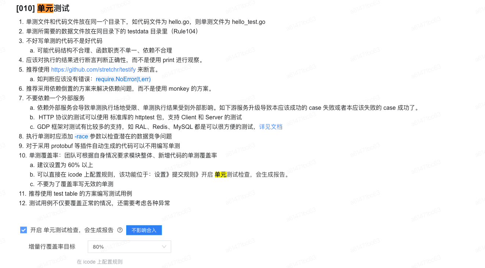
|**场景**|**框架**|**推荐理由**|
|-|-|-|
|测试组织&断言|goconvey[https://github.com/smartystreets/goconvey](https://github.com/smartystreets/goconvey) testify[https://github.com/stretchr/testify](https://github.com/stretchr/testify)|成熟的组织与断言框架；[testify](https://github.com/stretchr/testify)也挺好但mockey对convey兼容好|
|打桩mock|mockey[https://github.com/bytedance/mockey](https://github.com/bytedance/mockey)|现在虽然星少但活跃；泛型支持的好；使用方便；文档齐全|
|gdp ral|servicer.Testing[https://gdp.baidu-int.com/api/#/pkg/icode.baidu.com/baidu/gdp/net/servicer/](https://gdp.baidu-int.com/api/#/pkg/icode.baidu.com/baidu/gdp/net/servicer/)|gdp原生，可全流程跑网络请求|
|gdp redis|redis.Testing[https://gdp.baidu-int.com/api/#/pkg/icode.baidu.com/baidu/gdp/redis/](https://gdp.baidu-int.com/api/#/pkg/icode.baidu.com/baidu/gdp/redis/)|gdp原生，可全流程跑redis操作|
|msyql|sqlite[https://github.com/go-gorm/sqlite](https://github.com/go-gorm/sqlite)|可全流程跑mysql操作|

# 三、高效的写单测
**强烈推荐**使用** Comate+rules** AI Coding进行单测编写

* 节省时间，重复的体力劳动让AI去干吧！
* 想你没想，AI生成的用例会非常细，帮我们查缺补漏（当然，我们更要为AI查缺补漏）


有了AI，我们仅需要做两件事（Table-Driven Testing下，会非常方便）：

* review AI生的用例，审核入参和断言是否正确
* 补充AI没有覆盖到的业务相关的测试用例

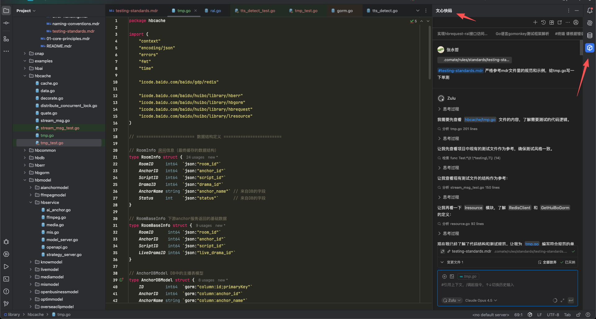
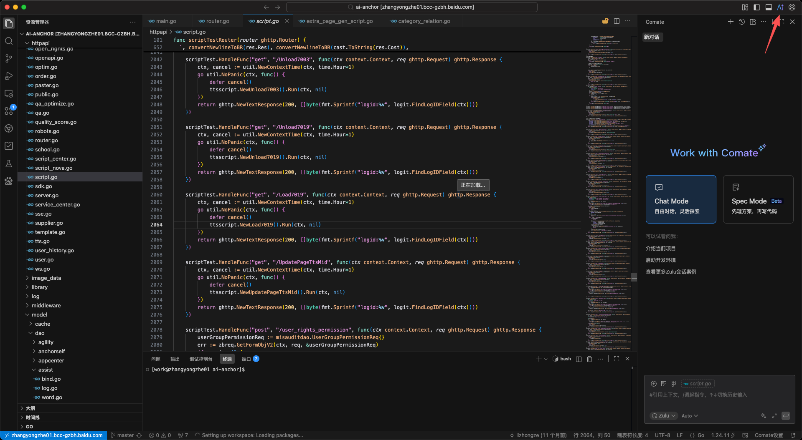
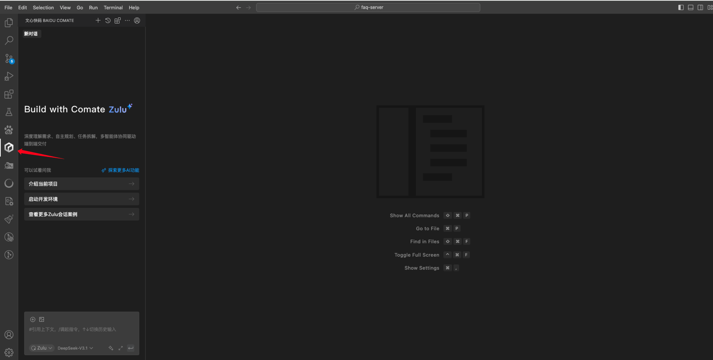
[单测侠-单测工程师使用手册](https://ku.baidu-int.com/knowledge/HFVrC7hq1Q/_SKPgSwp2G/B8wSneaLSC/wR0VnIUkWJAC3U?t=mention&mt=doc&dt=doc)

# 四、单测rules及实践
## 4.1 rules
[后端go语言单测rules](https://ku.baidu-int.com/knowledge/HFVrC7hq1Q/K4aC71pX9v/E5IZepvmyr/md-qFBuV8gPRuD?t=mention&mt=doc&dt=doc)

```md
---
globs: *_test.go
---
# 单元测试规范

## 1. 核心原则

- **框架统一**：所有单元测试必须使用 [goconvey](https://github.com/smartystreets/goconvey) 作为测试组织和断言框架。
- **风格统一**：强制使用 **Table-Driven Testing (表驱动测试)** 风格来组织测试用例，保持代码整洁和易维护。
- **Mock 策略**：
  - **网络请求 (RAL)**：优先使用 [`servicer.Testing`](https://gdp.baidu-int.com/api/#/pkg/icode.baidu.com/baidu/gdp/net/servicer/) 进行服务模拟。
  - **Redis 操作**：优先使用 [`redis.Testing`](https://gdp.baidu-int.com/api/#/pkg/icode.baidu.com/baidu/gdp/redis/) 进行 Redis 模拟。
  - **数据库 (GORM)**：推荐使用 [SQLite 内存模式](https://github.com/go-gorm/sqlite) 进行测试，相比 mock SQL 语句，这种方式更接近真实环境且维护成本更低。
  - **其他外部依赖**：对于文件系统、第三方库或其他无法使用上述工具模拟的依赖，统一使用 [mockey](https://github.com/bytedance/mockey) 进行打桩。

- **文件对应**：每个 `.go` 源文件应有对应的 `_test.go` 单元测试文件，确保测试与源码一一对应，便于维护和追踪。
- **覆盖率要求**：目标行覆盖率为 **100%**，并尽可能覆盖各类场景，包括：正常流程、边界条件、异常/错误处理、空值/零值等。

- **关键注意**：运行包含 `mockey` 的测试时，**必须**添加编译参数 `-gcflags="all=-N -l"` 以禁用内联优化，否则 Mock 可能不生效。

---

## 2. 测试结构模板 (Table-Driven + goconvey)

测试函数应遵循以下结构：

1. **环境准备**：初始化 mock、stub 或测试数据。
2. **定义测试表**：使用结构体切片定义测试用例（输入、预期输出、描述）。
3. **执行测试循环**：遍历测试表，在 `Convey` 块中执行逻辑并断言。

### 示例代码

```go
import (
    "context"
    "testing"

    . "github.com/bytedance/mockey"
    . "github.com/smartystreets/goconvey/convey"
)

func TestBusinessLogic(t *testing.T) {
    // 1. 全局环境准备
    // 注意：如果使用 mockey，必须使用 PatchConvey 替代 Convey

    Convey("测试业务逻辑函数 BusinessFunc", t, func() {
        // 2. 定义测试用例表
        testCases := []struct {
            Name           string
            Input          string
            MockReturn     string // 用于控制 mock 行为
            ExpectedResult string
            ExpectedError  bool
        }{
            {
                Name:           "正常场景",
                Input:          "valid_input",
                MockReturn:     "success",
                ExpectedResult: "processed_valid_input",
                ExpectedError:  false,
            },
            {
                Name:           "错误场景",
                Input:          "invalid_input",
                MockReturn:     "error",
                ExpectedResult: "",
                ExpectedError:  true,
            },
        }

        // 3. 遍历执行
        for _, tc := range testCases {
            Convey(tc.Name, func() {
                // 3.1 针对每个 case 的 Mock 设置 (如果需要差异化)
                // e.g. mockey.Mock(...)

                // 3.2 执行被测函数
                res, err := BusinessFunc(context.Background(), tc.Input)

                // 3.3 断言
                if tc.ExpectedError {
                    So(err, ShouldNotBeNil)
                    So(res, ShouldBeBlank)
                } else {
                    So(err, ShouldBeNil)
                    So(res, ShouldEqual, tc.ExpectedResult)
                }
            })
        }
    })
}
```

---

## 3. Mock 规范与示例

### 3.1 网络请求 (RAL) - 使用 `servicer.Testing`

对于使用 `hbrequest.Ral` 发起的网络请求，必须使用 `servicer.Testing` 启动一个本地模拟服务器来拦截请求。

**适用场景**：集成测试、验证完整的 HTTP 请求/响应处理逻辑。

**示例：**

```go
import (
    "net/http"
    "icode.baidu.com/baidu/gdp/net/servicer"
    "icode.baidu.com/baidu/gdp/ghttp"
)

func TestRalRequest(t *testing.T) {
    Convey("测试 RAL 请求", t, func() {
        // 启动模拟服务
        ts := &servicer.Testing{
            Name: "target_service_name", // 必须与代码中调用的服务名一致
            Server: &http.Server{
                Handler: http.HandlerFunc(func(w http.ResponseWriter, r *http.Request) {
                    // 模拟返回
                    _ = ghttp.NewTextResponse(200, []byte(`{"code":0, "data":"mocked_data"}`)).WriteTo(w)
                }),
            },
        }
        ts.Start()
        defer ts.Stop()

        // 执行调用
        resp, err := CallRemoteService(context.Background())

        So(err, ShouldBeNil)
        So(resp.Data, ShouldEqual, "mocked_data")
    })
}
```

### 3.2 Redis 操作 - 使用 `redis.Testing`

**适用场景**：测试依赖 Redis 缓存、锁或计数器的逻辑。

**核心概念**：
- `redis.Testing` 内部使用 [miniredis](https://github.com/alicebob/miniredis) 创建进程内的 Redis 环境
- 使用 `Client()` 获取测试用的 Redis 客户端
- 使用 `MiniRedis()` 可直接预设或验证 Redis 数据

**示例 1：基础用法**

```go
import (
    "context"
    "testing"
    "time"

    . "github.com/smartystreets/goconvey/convey"
    "icode.baidu.com/baidu/gdp/redis"
)

func TestRedisLogic(t *testing.T) {
    Convey("测试 Redis 逻辑", t, func() {
        // 启动 Redis Mock
        // ServicerName 可选，为空时默认为 "mock_redis"
        ts := &redis.Testing{
            ServicerName: "redis_huibo", // 配置文件中的 redis 服务名
        }
        ts.Start()
        defer ts.Stop()

        // 获取测试用的 Redis 客户端
        client := ts.Client()
        ctx := context.Background()

        Convey("测试缓存读写", func() {
            // 写入数据
            err := client.Set(ctx, "test_key", "test_value", time.Hour).Err()
            So(err, ShouldBeNil)

            // 读取数据
            val, err := client.Get(ctx, "test_key").Result()
            So(err, ShouldBeNil)
            So(val, ShouldEqual, "test_value")
        })
    })
}
```

**示例 2：使用 MiniRedis 预设数据**

```go
import (
    "context"
    "fmt"
    "strconv"
    "time"

    "icode.baidu.com/baidu/gdp/redis"
)
// 用户使用的 redis Client，
// 一般是一个单例，由程序在启动阶段完成初始化
var userRedis redis.Client

// readUserCache 业务模块函数: 从 redis 中读取缓存信息
// 这个是待测试的函数
func readUserCache(ctx context.Context, id int) (string, error) {
    key := "user_" + strconv.Itoa(id)
    ret := userRedis.Get(ctx, key)
    return ret.Result()
}

func TestReadUserCache(t *testing.T) {
    Convey("测试用户缓存读取", t, func() {
        ts := &redis.Testing{}
        ts.Start()
        defer ts.Stop()

        // 将模块中使用的 redis client 替换为测试客户端
        userRedis = ts.Client()
        ctx := context.Background()

        Convey("缓存不存在时返回 nil 错误", func() {
            info, err := readUserCache(ctx, 1)
            So(info, ShouldBeEmpty)
            So(err, ShouldEqual, redis.Nil)
        })

        Convey("缓存存在时返回数据", func() {
            // 使用 MiniRedis() 直接预设数据
            _ = ts.MiniRedis().Set("user_1", "Hello GDP Users")

            info, err := readUserCache(ctx, 1)
            So(err, ShouldBeNil)
            So(info, ShouldEqual, "Hello GDP Users")
        })
    })
}
```

**示例 3：测试 List 队列操作**

```go
func TestStreamMsg(t *testing.T) {
    Convey("测试流式消息队列", t, func() {
        ts := &redis.Testing{
            ServicerName: "redis_stream_test",
        }
        ts.Start()
        defer ts.Stop()

        client := ts.Client()
        ctx := context.Background()
        cacheKey := "test_stream"

        Convey("队列写入和读取", func() {
            // 写入数据
            err := client.RPush(ctx, cacheKey, "data1", "data2", "data3").Err()
            So(err, ShouldBeNil)

            // 读取全部数据
            result, err := client.LRange(ctx, cacheKey, 0, -1).Result()
            So(err, ShouldBeNil)
            So(result, ShouldResemble, []string{"data1", "data2", "data3"})

            // 验证队列长度
            length := client.LLen(ctx, cacheKey).Val()
            So(length, ShouldEqual, 3)
        })
    })
}
```

**注意事项**：
- miniredis 目前**不支持** CAS 和 JSON 命令
- 如果被测代码使用全局 Redis 客户端，需要在测试中替换为 `ts.Client()` 返回的客户端

### 3.3 数据库 (GORM) - 使用 SQLite 内存模式

**适用场景**：测试 DAO 层逻辑，无需 Mock 复杂的 SQL 语句，直接验证数据操作结果。

**示例：**

假设有一个 DAO 结构体 `SpuImgOcrInfoDB`，它使用 `Option` 模式来接收 `gorm.DB` 实例。

```go
import (
    "testing"

    "github.com/glebarez/sqlite" // 纯 Go 实现的 SQLite 驱动，无需 CGO
    . "github.com/smartystreets/goconvey/convey"
    "gorm.io/gorm"

    "icode.baidu.com/baidu/huibo/library/hbgorm"
    "icode.baidu.com/baidu/huibo/library/hbgorm/db/ocrdb"
)

func TestSpuImgOcrInfoDB_CreateRecord(t *testing.T) {
    Convey("测试 CreateRecord 方法", t, func() {
        // 1. 初始化内存数据库
        // 使用 github.com/glebarez/sqlite 可以避免 CGO 依赖问题
        gormDB, err := gorm.Open(sqlite.Open(":memory:"), &gorm.Config{})
        So(err, ShouldBeNil)

        // 2. 自动迁移表结构 (关键步骤)
        // 在内存库中创建真实的表结构
        err = gormDB.AutoMigrate(&ocrdb.SpuImgOcrInfo{})
        So(err, ShouldBeNil)

        // 3. 创建 DAO 实例，注入内存 DB
        // 关键点：使用 Option 模式注入内存 DB，覆盖默认的真实 DB 连接
        dao := ocrdb.NewSpuImgOcrInfoDB(hbgorm.WithDB(gormDB))

        // 4. 定义测试数据
        imgURL := "http://example.com/test.jpg"
        lang := 1
        ocrInfo := "test info"
        spuID := uint64(1001)

        Convey("成功创建记录", func() {
            // 5. 执行被测方法
            err := dao.CreateRecord(imgURL, lang, ocrInfo, spuID)
            So(err, ShouldBeNil)

            // 6. 验证数据是否真的写入了 DB
            var record ocrdb.SpuImgOcrInfo
            err = gormDB.First(&record, "spu_id = ?", spuID).Error

            So(err, ShouldBeNil)
            So(record.ImgURL, ShouldEqual, imgURL)
            So(record.OcrInfo, ShouldEqual, ocrInfo)
            So(record.Status, ShouldEqual, 1) // 验证默认值逻辑
        })
    })
}
```

### 3.4 其他依赖 - 使用 `mockey`

对于不支持 `servicer` 或 `redis` 模拟的场景（如数据库 DB、本地文件操作、第三方库函数、未导出的私有函数），使用 `mockey` 进行函数打桩。

**导入方式**：
- **推荐使用 `.` 形式导入**：`import . "github.com/bytedance/mockey"`，这样可以直接使用 `Mock`、`PatchConvey` 等函数，代码更简洁。

**最佳实践**：
- **必须使用 `PatchConvey`**：当 `Convey` 块内部（任意层级）包含 `Mock` 调用时，该 `Convey` **必须**替换为 `PatchConvey`。
- **嵌套规则**：`PatchConvey` 支持嵌套。**每一层** `Convey` 只要内部有 `Mock` 调用，就必须改为 `PatchConvey`，无论是外层还是内层。
- **自动清理**：`PatchConvey` 会在代码块结束时自动执行 `UnPatch`，无需手动调用 `defer` 或 `Reset`，从根本上防止 Mock 泄漏到其他测试用例。

**注意**：
- `Mock` 必须在 `Build()` 后生效。
- 禁止在并发测试中使用 mockey（因为它修改的是全局函数地址）。

**示例 1：基础用法**

```go
import (
    . "github.com/bytedance/mockey"
    . "github.com/smartystreets/goconvey/convey"
)

func TestWithMockey(t *testing.T) {
    // 外层使用 PatchConvey（因为内部有 Mock）
    PatchConvey("测试 Mockey 打桩", t, func() {
        // Mock 一个普通函数
        // 注意：无需手动调用 UnPatch，PatchConvey 会自动处理
        Mock(SomeExternalFunc).To(func(a int) int {
            return a * 2 // Mock 实现
        }).Build()

        // 内层没有 Mock，可以用普通 Convey
        Convey("执行函数", func() {
            res := SomeExternalFunc(10)
            So(res, ShouldEqual, 20)
        })
    })
}
```

**示例 2：嵌套 PatchConvey（Table-Driven + 不同 Mock 场景）**

当每个测试用例需要不同的 Mock 行为时，内层循环也需要使用 `PatchConvey`：

```go
import (
    "context"
    "errors"
    "testing"

    . "github.com/bytedance/mockey"
    . "github.com/smartystreets/goconvey/convey"
)

func TestServiceWithMockDB(t *testing.T) {
    // 外层使用 PatchConvey
    PatchConvey("测试数据库依赖的服务", t, func() {
        ctx := context.Background()

        testCases := []struct {
            Name          string
            MockDBReturn  *User
            MockDBErr     error
            ExpectedError bool
        }{
            {
                Name:          "正常查询",
                MockDBReturn:  &User{ID: 1, Name: "test"},
                MockDBErr:     nil,
                ExpectedError: false,
            },
            {
                Name:          "数据库错误",
                MockDBReturn:  nil,
                MockDBErr:     errors.New("db connection failed"),
                ExpectedError: true,
            },
        }

        for _, tc := range testCases {
            // 内层也使用 PatchConvey（因为每个 case 有不同的 Mock）
            PatchConvey(tc.Name, func() {
                // 每个 case 设置不同的 Mock 行为
                Mock(GetUserFromDB).To(func(ctx context.Context, id int64) (*User, error) {
                    return tc.MockDBReturn, tc.MockDBErr
                }).Build()

                result, err := GetUserService(ctx, 1)

                if tc.ExpectedError {
                    So(err, ShouldNotBeNil)
                } else {
                    So(err, ShouldBeNil)
                    So(result.Name, ShouldEqual, tc.MockDBReturn.Name)
                }
            })
        }
    })
}
```

**示例 3：混合使用 PatchConvey 和 Convey**

```go
func TestMixedConvey(t *testing.T) {
    // 外层使用 PatchConvey（因为部分内层有 Mock）
    PatchConvey("混合测试场景", t, func() {
        // 通用的 Mock，对所有子测试生效
        Mock(GetConfig).Return(&Config{Timeout: 30}).Build()

        // 这个内层没有额外的 Mock，可以用普通 Convey
        Convey("不需要额外 Mock 的场景", func() {
            cfg := GetConfig()
            So(cfg.Timeout, ShouldEqual, 30)
        })

        // 这个内层有额外的 Mock，必须用 PatchConvey
        PatchConvey("需要额外 Mock 的场景", func() {
            Mock(CallExternalAPI).Return("mocked_response", nil).Build()

            resp, err := CallExternalAPI()
            So(err, ShouldBeNil)
            So(resp, ShouldEqual, "mocked_response")
        })
    })
}
```

---

## 4. 最佳实践总结

1. **Table-Driven 优先**：除非逻辑极其简单，否则一律使用 Table-Driven 风格。
2. **断言清晰**：`So` 断言的第二个参数应当直观，避免复杂的布尔表达式（如 `So(a==b, ShouldBeTrue)` 不如 `So(a, ShouldEqual, b)`）。
3. **资源清理**：所有的 Mock (`ts.Stop()`) 必须使用 `defer` 确保清理，防止污染其他测试。使用 `PatchConvey` 时无需手动清理 mockey。
4. **测试独立性**：每个 `Convey` 块应该是独立的，不要依赖全局状态的变更顺序。
5. **PatchConvey 规则**：任何 `Convey` 块内部只要有 `Mock` 调用，就必须改为 `PatchConvey`，支持多层嵌套。
```
## 4.2 实践示例
1. **提示词**

* 实践发现，Comate对**rules的遵循不太严格**，而且会主动参考代码库里的其他代码风格，所以建议提示词要通过一些措辞强调一下 **“严格参考mdr文件” **
* 模型优先使用 **Claude opus**，实测了 auto模式，效果不行；GLM4.7 也差点意思（最近又新支持了 Gemini3 Pro，可以试试）

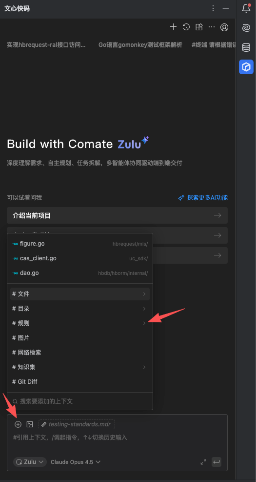
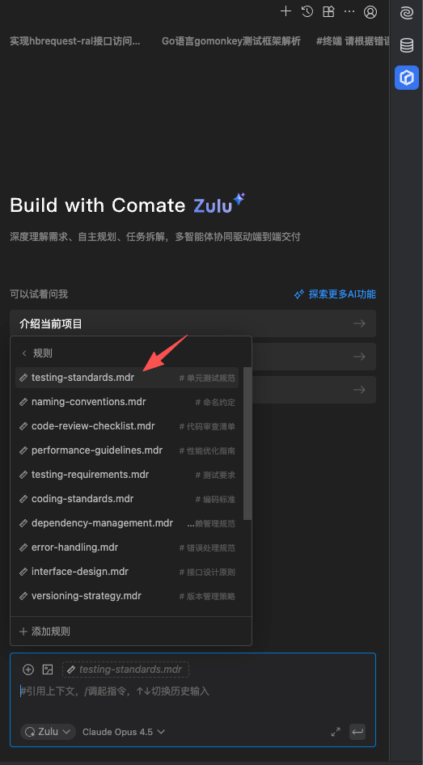
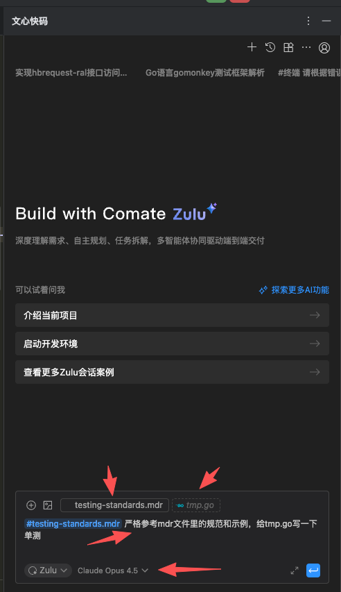
```md
#testing-standards.mdr 严格参考mdr文件里的规范和示例，给tmp.go写一下单测
```


2. **源代码**

源代码模拟一个缓存懒加载的场景，内容覆盖 **逻辑组合、网络、db、redis **操作，旨在覆盖各场景下的单测

源代码大致逻辑：

*redis查数据 data*

* *查到：*
    * *返回*

* *没查到：*
    * *HTTP查下游，获取数据A*
    * *DB查询，获取数据B*
    * *A+B组合为目标 data*
    * *data 写缓存*
    * *返回*


```go
package hbcache

import (
    "context"
    "encoding/json"
    "errors"
    "fmt"
    "time"

    "icode.baidu.com/baidu/gdp/redis"

    "icode.baidu.com/baidu/huibo/library/hberr"
    "icode.baidu.com/baidu/huibo/library/hbgorm"
    "icode.baidu.com/baidu/huibo/library/hbrequest"
    "icode.baidu.com/baidu/huibo/library/lresource"
)

// ======================== 数据结构定义 ========================

// RoomInfo 房间信息（最终缓存的数据结构）
type RoomInfo struct {
    RoomID     int64  `json:"room_id"`
    AnchorID   int64  `json:"anchor_id"`
    ScriptID   int64  `json:"script_id"`
    DramaID    int64  `json:"drama_id"`
    AnchorName string `json:"anchor_name"` // 来自DB的字段
    Status     int    `json:"status"`      // 来自DB的字段
}

// RoomBaseInfo 下游anchor服务返回的基础数据
type RoomBaseInfo struct {
    RoomID      int64 `json:"room_id"`
    AnchorID    int64 `json:"anchor_id"`
    ScriptID    int64 `json:"script_id"`
    LiveDramaID int64 `json:"live_drama_id"`
}

// AnchorDBModel DB中的主播表模型
type AnchorDBModel struct {
    ID         int64  `gorm:"column:id;primaryKey"`
    AnchorID   int64  `gorm:"column:anchor_id"`
    AnchorName string `gorm:"column:anchor_name"`
    Status     int    `gorm:"column:status"`
}

// TableName 指定表名
func (AnchorDBModel) TableName() string {
    return "t_anchor"
}

// AnchorDBResult DB查询结果
type AnchorDBResult struct {
    AnchorName string `gorm:"column:anchor_name"`
    Status     int    `gorm:"column:status"`
}

// ======================== 缓存配置 ========================

const (
    roomInfoExpiration = 8 * time.Hour // 房间信息缓存过期时间
)

// BuildRoomInfoRedisKey 构建房间信息key
func BuildRoomInfoRedisKey(roomID int64) string {
    return fmt.Sprintf("faq_server:room_info:%d", roomID)
}

// ======================== 核心方法 ========================

// GetRoomInfo 获取房间信息（带缓存）
// 流程：先从Redis获取 -> 缓存未命中则从下游+DB获取并缓存
func GetRoomInfo(ctx context.Context, roomID int64) (*RoomInfo, error) {
    // 1. 尝试从Redis获取缓存
    roomInfo, err := GetRoomInfoFromRedis(ctx, roomID)
    if err == nil {
        return roomInfo, nil
    }

    // 2. 缓存未命中或过期，刷新缓存
    if errors.Is(err, redis.ErrNil) {
        return RefreshRoomInfo(ctx, roomID)
    }

    return nil, err
}

// RefreshRoomInfo 刷新房间信息缓存
// 流程：从下游anchor拉基础数据 -> 从DB查额外信息 -> 组合 -> 缓存到Redis
func RefreshRoomInfo(ctx context.Context, roomID int64) (*RoomInfo, error) {
    // 1. 从下游anchor服务获取基础数据
    baseInfo, err := GetRoomInfoFromAIAnchor(ctx, roomID)
    if err != nil {
        return nil, hberr.AddDetailMsg(err, "从anchor获取房间基础信息失败")
    }

    // 2. 从DB查询额外信息
    dbInfo, err := GetAnchorInfoFromDB(ctx, baseInfo.AnchorID)
    if err != nil {
        // DB查询失败，可以选择降级处理或返回错误
        lresource.LoggerService.Warning(ctx, fmt.Sprintf("从DB获取主播信息失败: %v", err))
        // 降级：使用默认值
        dbInfo = &AnchorDBResult{
            AnchorName: "",
            Status:     0,
        }
    }

    // 3. 组合成最终数据
    roomInfo := &RoomInfo{
        RoomID:     roomID,
        AnchorID:   baseInfo.AnchorID,
        ScriptID:   baseInfo.ScriptID,
        DramaID:    baseInfo.LiveDramaID,
        AnchorName: dbInfo.AnchorName,
        Status:     dbInfo.Status,
    }

    // 4. 缓存到Redis
    if err := SetRoomInfoToRedis(ctx, roomInfo); err != nil {
        lresource.LoggerService.Warning(ctx, fmt.Sprintf("缓存房间信息失败: %v", err))
        // 缓存失败不影响返回结果
    }

    return roomInfo, nil
}

// ======================== Redis操作 ========================

// GetRoomInfoFromRedis 从Redis获取房间信息
func GetRoomInfoFromRedis(ctx context.Context, roomID int64) (*RoomInfo, error) {
    key := BuildRoomInfoRedisKey(roomID)
    s, err := lresource.RedisClient.Get(ctx, key).Result()
    if err != nil {
        return nil, err
    }

    roomInfo := &RoomInfo{}
    if err = json.Unmarshal([]byte(s), roomInfo); err != nil {
        return nil, hberr.AddDetailMsg(err, "解析房间信息缓存失败")
    }

    return roomInfo, nil
}

// SetRoomInfoToRedis 将房间信息缓存到Redis
func SetRoomInfoToRedis(ctx context.Context, roomInfo *RoomInfo) error {
    if roomInfo == nil {
        return errors.New("roomInfo is nil")
    }

    b, err := json.Marshal(roomInfo)
    if err != nil {
        return hberr.AddDetailMsg(err, "序列化房间信息失败")
    }

    key := BuildRoomInfoRedisKey(roomInfo.RoomID)
    return lresource.RedisClient.Set(ctx, key, string(b), roomInfoExpiration).Err()
}

// ======================== 下游服务调用 ========================

// GetRoomInfoFromAIAnchor 从下游anchor服务获取房间基础信息
func GetRoomInfoFromAIAnchor(ctx context.Context, roomID int64) (*RoomBaseInfo, error) {
    req := struct {
        RoomID int64 `json:"room_id"`
    }{RoomID: roomID}

    ralParam := hbrequest.JSONParam{
        Base: hbrequest.Base{
            HTTPName: "aianchor_service",
            Path:     "/aianchor/room_info",
        },
        JSONData: req,
    }

    resp, err := hbrequest.Ral[RoomBaseInfo](ctx, ralParam)
    if err != nil {
        return nil, hberr.AddDetailMsg(err, fmt.Sprintf("GetRoomInfoFromAIAnchor失败，roomID=%d", roomID))
    }
    return resp, nil
}

// ======================== 数据库操作 ========================

// GetAnchorInfoFromDB 从DB查询主播信息
func GetAnchorInfoFromDB(ctx context.Context, anchorID int64) (*AnchorDBResult, error) {
    db := lresource.GetHuiBoGorm()
    if db == nil {
        return nil, errors.New("db connection is nil")
    }

    // 使用hbgorm的FindOne泛型方法查询
    cond := &AnchorDBModel{AnchorID: anchorID}
    result, err := hbgorm.FindOne[AnchorDBModel, AnchorDBResult](ctx, db, cond)
    if err != nil {
        return nil, hberr.AddDetailMsg(err, fmt.Sprintf("查询主播信息失败，anchorID=%d", anchorID))
    }

    return result, nil
}

```


3. **Comate生成的单测代码**

```go
/*
 * Copyright(C) 2026 Baidu Inc. All Rights Reserved.
 * Author: Zulu (AI Assistant)
 * Date: 2026/01/30
 * File: tmp_test.go
 */

package hbcache

import (
    "context"
    "encoding/json"
    "errors"
    "net/http"
    "testing"
    "time"

    . "github.com/bytedance/mockey"
    "github.com/glebarez/sqlite"
    . "github.com/smartystreets/goconvey/convey"
    "gorm.io/gorm"
    "icode.baidu.com/baidu/gdp/ghttp"
    "icode.baidu.com/baidu/gdp/logit"
    "icode.baidu.com/baidu/gdp/net/servicer"
    "icode.baidu.com/baidu/gdp/redis"

    "icode.baidu.com/baidu/huibo/library/lresource"
)

func init() {
    // 禁用日志，避免测试时输出大量日志
    lresource.LoggerService = logit.NopLogger
}

// ==================== BuildRoomInfoRedisKey 测试 ====================

func TestBuildRoomInfoRedisKey(t *testing.T) {
    Convey("测试 BuildRoomInfoRedisKey 函数", t, func() {
        testCases := []struct {
            Name     string
            RoomID   int64
            Expected string
        }{
            {
                Name:     "正常 roomID",
                RoomID:   12345,
                Expected: "faq_server:room_info:12345",
            },
            {
                Name:     "roomID 为 0",
                RoomID:   0,
                Expected: "faq_server:room_info:0",
            },
            {
                Name:     "大数值 roomID",
                RoomID:   9999999999,
                Expected: "faq_server:room_info:9999999999",
            },
            {
                Name:     "负数 roomID",
                RoomID:   -100,
                Expected: "faq_server:room_info:-100",
            },
        }

        for _, tc := range testCases {
            Convey(tc.Name, func() {
                result := BuildRoomInfoRedisKey(tc.RoomID)
                So(result, ShouldEqual, tc.Expected)
            })
        }
    })
}

// ==================== GetRoomInfoFromRedis 测试 ====================

func TestGetRoomInfoFromRedis(t *testing.T) {
    Convey("测试 GetRoomInfoFromRedis 函数", t, func() {
        // 启动 Redis Mock
        rs := &redis.Testing{
            ServicerName: "redis_test_room_info",
        }
        rs.Start()
        defer rs.Stop()

        // 替换全局 Redis 客户端
        originalClient := lresource.RedisClient
        lresource.RedisClient = rs.Client()
        defer func() { lresource.RedisClient = originalClient }()

        ctx := context.Background()

        testCases := []struct {
            Name          string
            RoomID        int64
            PresetData    *RoomInfo
            ExpectedError bool
            ErrorType     error
        }{
            {
                Name:   "缓存命中 - 正常数据",
                RoomID: 1001,
                PresetData: &RoomInfo{
                    RoomID:     1001,
                    AnchorID:   2001,
                    ScriptID:   3001,
                    DramaID:    4001,
                    AnchorName: "测试主播",
                    Status:     1,
                },
                ExpectedError: false,
            },
            {
                Name:          "缓存未命中",
                RoomID:        9999,
                PresetData:    nil,
                ExpectedError: true,
                ErrorType:     redis.ErrNil,
            },
        }

        for _, tc := range testCases {
            Convey(tc.Name, func() {
                // 预设数据
                if tc.PresetData != nil {
                    data, _ := json.Marshal(tc.PresetData)
                    key := BuildRoomInfoRedisKey(tc.RoomID)
                    _ = rs.MiniRedis().Set(key, string(data))
                }

                // 执行测试
                result, err := GetRoomInfoFromRedis(ctx, tc.RoomID)

                if tc.ExpectedError {
                    So(err, ShouldNotBeNil)
                    if tc.ErrorType != nil {
                        So(errors.Is(err, tc.ErrorType), ShouldBeTrue)
                    }
                } else {
                    So(err, ShouldBeNil)
                    So(result, ShouldNotBeNil)
                    So(result.RoomID, ShouldEqual, tc.PresetData.RoomID)
                    So(result.AnchorID, ShouldEqual, tc.PresetData.AnchorID)
                    So(result.ScriptID, ShouldEqual, tc.PresetData.ScriptID)
                    So(result.DramaID, ShouldEqual, tc.PresetData.DramaID)
                    So(result.AnchorName, ShouldEqual, tc.PresetData.AnchorName)
                    So(result.Status, ShouldEqual, tc.PresetData.Status)
                }
            })
        }

        Convey("缓存数据格式错误", func() {
            key := BuildRoomInfoRedisKey(8888)
            _ = rs.MiniRedis().Set(key, "invalid_json_data")

            result, err := GetRoomInfoFromRedis(ctx, 8888)
            So(err, ShouldNotBeNil)
            So(result, ShouldBeNil)
        })
    })
}

// ==================== SetRoomInfoToRedis 测试 ====================

func TestSetRoomInfoToRedis(t *testing.T) {
    Convey("测试 SetRoomInfoToRedis 函数", t, func() {
        // 启动 Redis Mock
        rs := &redis.Testing{
            ServicerName: "redis_test_set_room_info",
        }
        rs.Start()
        defer rs.Stop()

        // 替换全局 Redis 客户端
        originalClient := lresource.RedisClient
        lresource.RedisClient = rs.Client()
        defer func() { lresource.RedisClient = originalClient }()

        ctx := context.Background()

        testCases := []struct {
            Name          string
            RoomInfo      *RoomInfo
            ExpectedError bool
        }{
            {
                Name: "正常写入",
                RoomInfo: &RoomInfo{
                    RoomID:     1001,
                    AnchorID:   2001,
                    ScriptID:   3001,
                    DramaID:    4001,
                    AnchorName: "测试主播",
                    Status:     1,
                },
                ExpectedError: false,
            },
            {
                Name: "写入空字符串字段",
                RoomInfo: &RoomInfo{
                    RoomID:     1002,
                    AnchorID:   2002,
                    ScriptID:   0,
                    DramaID:    0,
                    AnchorName: "",
                    Status:     0,
                },
                ExpectedError: false,
            },
            {
                Name:          "roomInfo 为 nil",
                RoomInfo:      nil,
                ExpectedError: true,
            },
        }

        for _, tc := range testCases {
            Convey(tc.Name, func() {
                err := SetRoomInfoToRedis(ctx, tc.RoomInfo)

                if tc.ExpectedError {
                    So(err, ShouldNotBeNil)
                } else {
                    So(err, ShouldBeNil)

                    // 验证数据已写入
                    key := BuildRoomInfoRedisKey(tc.RoomInfo.RoomID)
                    val, getErr := rs.MiniRedis().Get(key)
                    So(getErr, ShouldBeNil)

                    var cached RoomInfo
                    _ = json.Unmarshal([]byte(val), &cached)
                    So(cached.RoomID, ShouldEqual, tc.RoomInfo.RoomID)
                    So(cached.AnchorID, ShouldEqual, tc.RoomInfo.AnchorID)
                }
            })
        }
    })
}

// ==================== GetRoomInfoFromAIAnchor 测试 ====================

func TestGetRoomInfoFromAIAnchor(t *testing.T) {
    Convey("测试 GetRoomInfoFromAIAnchor 函数", t, func() {
        ctx := context.Background()

        testCases := []struct {
            Name           string
            RoomID         int64
            MockResponse   string
            MockStatusCode int
            ExpectedError  bool
            ExpectedData   *RoomBaseInfo
        }{
            {
                Name:           "正常返回",
                RoomID:         1001,
                MockResponse:   `{"room_id":1001,"anchor_id":2001,"script_id":3001,"live_drama_id":4001}`,
                MockStatusCode: 200,
                ExpectedError:  false,
                ExpectedData: &RoomBaseInfo{
                    RoomID:      1001,
                    AnchorID:    2001,
                    ScriptID:    3001,
                    LiveDramaID: 4001,
                },
            },
            {
                Name:           "HTTP 状态码错误",
                RoomID:         9999,
                MockResponse:   `{"error":"internal error"}`,
                MockStatusCode: 500,
                ExpectedError:  true,
                ExpectedData:   nil,
            },
        }

        for _, tc := range testCases {
            Convey(tc.Name, func() {
                // 启动模拟服务
                ts := &servicer.Testing{
                    Name: "aianchor_service",
                    Server: &http.Server{
                        Handler: http.HandlerFunc(func(w http.ResponseWriter, r *http.Request) {
                            _ = ghttp.NewTextResponse(tc.MockStatusCode, []byte(tc.MockResponse)).WriteTo(w)
                        }),
                    },
                }
                ts.Start()
                defer ts.Stop()

                result, err := GetRoomInfoFromAIAnchor(ctx, tc.RoomID)

                if tc.ExpectedError {
                    So(err, ShouldNotBeNil)
                } else {
                    So(err, ShouldBeNil)
                    So(result, ShouldNotBeNil)
                    So(result.RoomID, ShouldEqual, tc.ExpectedData.RoomID)
                    So(result.AnchorID, ShouldEqual, tc.ExpectedData.AnchorID)
                    So(result.ScriptID, ShouldEqual, tc.ExpectedData.ScriptID)
                    So(result.LiveDramaID, ShouldEqual, tc.ExpectedData.LiveDramaID)
                }
            })
        }
    })
}

// ==================== GetAnchorInfoFromDB 测试 ====================

func TestGetAnchorInfoFromDB(t *testing.T) {
    PatchConvey("测试 GetAnchorInfoFromDB 函数", t, func() {
        // 初始化 SQLite 内存数据库
        gormDB, err := gorm.Open(sqlite.Open(":memory:"), &gorm.Config{})
        So(err, ShouldBeNil)

        // 自动迁移表结构
        err = gormDB.AutoMigrate(&AnchorDBModel{})
        So(err, ShouldBeNil)

        ctx := context.Background()

        testCases := []struct {
            Name          string
            AnchorID      int64
            PresetData    *AnchorDBModel
            ExpectedError bool
            ExpectedData  *AnchorDBResult
        }{
            {
                Name:     "查询存在的记录",
                AnchorID: 2001,
                PresetData: &AnchorDBModel{
                    ID:         1,
                    AnchorID:   2001,
                    AnchorName: "测试主播",
                    Status:     1,
                },
                ExpectedError: false,
                ExpectedData: &AnchorDBResult{
                    AnchorName: "测试主播",
                    Status:     1,
                },
            },
            {
                Name:          "查询不存在的记录",
                AnchorID:      9999,
                PresetData:    nil,
                ExpectedError: true,
                ExpectedData:  nil,
            },
        }

        for _, tc := range testCases {
            PatchConvey(tc.Name, func() {
                // 预设数据
                if tc.PresetData != nil {
                    err := gormDB.Create(tc.PresetData).Error
                    So(err, ShouldBeNil)
                }

                // Mock GetHuiBoGorm 返回内存数据库
                Mock(lresource.GetHuiBoGorm).Return(gormDB).Build()

                result, err := GetAnchorInfoFromDB(ctx, tc.AnchorID)

                if tc.ExpectedError {
                    So(err, ShouldNotBeNil)
                } else {
                    So(err, ShouldBeNil)
                    So(result, ShouldNotBeNil)
                    So(result.AnchorName, ShouldEqual, tc.ExpectedData.AnchorName)
                    So(result.Status, ShouldEqual, tc.ExpectedData.Status)
                }
            })
        }

        PatchConvey("数据库连接为 nil", func() {
            Mock(lresource.GetHuiBoGorm).Return(nil).Build()

            result, err := GetAnchorInfoFromDB(ctx, 1001)
            So(err, ShouldNotBeNil)
            So(result, ShouldBeNil)
        })
    })
}

// ==================== RefreshRoomInfo 测试 ====================

func TestRefreshRoomInfo(t *testing.T) {
    PatchConvey("测试 RefreshRoomInfo 函数", t, func() {
        // 启动 Redis Mock
        rs := &redis.Testing{
            ServicerName: "redis_test_refresh",
        }
        rs.Start()
        defer rs.Stop()

        // 替换全局 Redis 客户端
        originalClient := lresource.RedisClient
        lresource.RedisClient = rs.Client()
        defer func() { lresource.RedisClient = originalClient }()

        ctx := context.Background()

        testCases := []struct {
            Name             string
            RoomID           int64
            MockBaseInfo     *RoomBaseInfo
            MockBaseInfoErr  error
            MockDBInfo       *AnchorDBResult
            MockDBInfoErr    error
            ExpectedError    bool
            ExpectedRoomInfo *RoomInfo
        }{
            {
                Name:   "正常刷新缓存",
                RoomID: 1001,
                MockBaseInfo: &RoomBaseInfo{
                    RoomID:      1001,
                    AnchorID:    2001,
                    ScriptID:    3001,
                    LiveDramaID: 4001,
                },
                MockBaseInfoErr: nil,
                MockDBInfo: &AnchorDBResult{
                    AnchorName: "测试主播",
                    Status:     1,
                },
                MockDBInfoErr: nil,
                ExpectedError: false,
                ExpectedRoomInfo: &RoomInfo{
                    RoomID:     1001,
                    AnchorID:   2001,
                    ScriptID:   3001,
                    DramaID:    4001,
                    AnchorName: "测试主播",
                    Status:     1,
                },
            },
            {
                Name:            "下游服务调用失败",
                RoomID:          1002,
                MockBaseInfo:    nil,
                MockBaseInfoErr: errors.New("service unavailable"),
                MockDBInfo:      nil,
                MockDBInfoErr:   nil,
                ExpectedError:   true,
            },
            {
                Name:   "DB 查询失败 - 降级处理",
                RoomID: 1003,
                MockBaseInfo: &RoomBaseInfo{
                    RoomID:      1003,
                    AnchorID:    2003,
                    ScriptID:    3003,
                    LiveDramaID: 4003,
                },
                MockBaseInfoErr: nil,
                MockDBInfo:      nil,
                MockDBInfoErr:   errors.New("db connection failed"),
                ExpectedError:   false,
                ExpectedRoomInfo: &RoomInfo{
                    RoomID:     1003,
                    AnchorID:   2003,
                    ScriptID:   3003,
                    DramaID:    4003,
                    AnchorName: "", // 降级为空
                    Status:     0,  // 降级为 0
                },
            },
        }

        for _, tc := range testCases {
            PatchConvey(tc.Name, func() {
                // Mock 下游服务调用
                Mock(GetRoomInfoFromAIAnchor).To(func(ctx context.Context, roomID int64) (*RoomBaseInfo, error) {
                    return tc.MockBaseInfo, tc.MockBaseInfoErr
                }).Build()

                // Mock DB 查询
                Mock(GetAnchorInfoFromDB).To(func(ctx context.Context, anchorID int64) (*AnchorDBResult, error) {
                    return tc.MockDBInfo, tc.MockDBInfoErr
                }).Build()

                result, err := RefreshRoomInfo(ctx, tc.RoomID)

                if tc.ExpectedError {
                    So(err, ShouldNotBeNil)
                } else {
                    So(err, ShouldBeNil)
                    So(result, ShouldNotBeNil)
                    So(result.RoomID, ShouldEqual, tc.ExpectedRoomInfo.RoomID)
                    So(result.AnchorID, ShouldEqual, tc.ExpectedRoomInfo.AnchorID)
                    So(result.ScriptID, ShouldEqual, tc.ExpectedRoomInfo.ScriptID)
                    So(result.DramaID, ShouldEqual, tc.ExpectedRoomInfo.DramaID)
                    So(result.AnchorName, ShouldEqual, tc.ExpectedRoomInfo.AnchorName)
                    So(result.Status, ShouldEqual, tc.ExpectedRoomInfo.Status)

                    // 验证缓存已写入 (除非 Redis 失败)
                    key := BuildRoomInfoRedisKey(tc.RoomID)
                    val, getErr := rs.MiniRedis().Get(key)
                    So(getErr, ShouldBeNil)
                    So(val, ShouldNotBeEmpty)
                }
            })
        }
    })
}

// ==================== GetRoomInfo 测试 ====================

func TestGetRoomInfo(t *testing.T) {
    PatchConvey("测试 GetRoomInfo 函数", t, func() {
        // 启动 Redis Mock
        rs := &redis.Testing{
            ServicerName: "redis_test_get_room",
        }
        rs.Start()
        defer rs.Stop()

        // 替换全局 Redis 客户端
        originalClient := lresource.RedisClient
        lresource.RedisClient = rs.Client()
        defer func() { lresource.RedisClient = originalClient }()

        ctx := context.Background()

        Convey("缓存命中 - 直接返回", func() {
            roomInfo := &RoomInfo{
                RoomID:     1001,
                AnchorID:   2001,
                ScriptID:   3001,
                DramaID:    4001,
                AnchorName: "缓存主播",
                Status:     1,
            }
            data, _ := json.Marshal(roomInfo)
            key := BuildRoomInfoRedisKey(1001)
            _ = rs.MiniRedis().Set(key, string(data))

            result, err := GetRoomInfo(ctx, 1001)

            So(err, ShouldBeNil)
            So(result, ShouldNotBeNil)
            So(result.RoomID, ShouldEqual, 1001)
            So(result.AnchorName, ShouldEqual, "缓存主播")
        })

        PatchConvey("缓存未命中 - 刷新缓存", func() {
            expectedInfo := &RoomInfo{
                RoomID:     2001,
                AnchorID:   3001,
                ScriptID:   4001,
                DramaID:    5001,
                AnchorName: "刷新主播",
                Status:     2,
            }

            // Mock RefreshRoomInfo
            Mock(RefreshRoomInfo).To(func(ctx context.Context, roomID int64) (*RoomInfo, error) {
                return expectedInfo, nil
            }).Build()

            result, err := GetRoomInfo(ctx, 2001)

            So(err, ShouldBeNil)
            So(result, ShouldNotBeNil)
            So(result.RoomID, ShouldEqual, expectedInfo.RoomID)
            So(result.AnchorName, ShouldEqual, expectedInfo.AnchorName)
        })

        PatchConvey("缓存未命中 - 刷新失败", func() {
            Mock(RefreshRoomInfo).To(func(ctx context.Context, roomID int64) (*RoomInfo, error) {
                return nil, errors.New("refresh failed")
            }).Build()

            result, err := GetRoomInfo(ctx, 3001)

            So(err, ShouldNotBeNil)
            So(result, ShouldBeNil)
        })
    })
}

// ==================== 数据结构测试 ====================

func TestRoomInfoStruct(t *testing.T) {
    Convey("测试 RoomInfo 结构体序列化", t, func() {
        testCases := []struct {
            Name     string
            RoomInfo *RoomInfo
        }{
            {
                Name: "完整数据",
                RoomInfo: &RoomInfo{
                    RoomID:     1001,
                    AnchorID:   2001,
                    ScriptID:   3001,
                    DramaID:    4001,
                    AnchorName: "测试主播",
                    Status:     1,
                },
            },
            {
                Name: "部分字段为零值",
                RoomInfo: &RoomInfo{
                    RoomID:     1002,
                    AnchorID:   0,
                    ScriptID:   0,
                    DramaID:    0,
                    AnchorName: "",
                    Status:     0,
                },
            },
        }

        for _, tc := range testCases {
            Convey(tc.Name, func() {
                // 序列化
                data, err := json.Marshal(tc.RoomInfo)
                So(err, ShouldBeNil)
                So(data, ShouldNotBeEmpty)

                // 反序列化
                var result RoomInfo
                err = json.Unmarshal(data, &result)
                So(err, ShouldBeNil)
                So(result.RoomID, ShouldEqual, tc.RoomInfo.RoomID)
                So(result.AnchorID, ShouldEqual, tc.RoomInfo.AnchorID)
                So(result.ScriptID, ShouldEqual, tc.RoomInfo.ScriptID)
                So(result.DramaID, ShouldEqual, tc.RoomInfo.DramaID)
                So(result.AnchorName, ShouldEqual, tc.RoomInfo.AnchorName)
                So(result.Status, ShouldEqual, tc.RoomInfo.Status)
            })
        }
    })
}

func TestAnchorDBModelTableName(t *testing.T) {
    Convey("测试 AnchorDBModel TableName 方法", t, func() {
        model := AnchorDBModel{}
        So(model.TableName(), ShouldEqual, "t_anchor")
    })
}

// ==================== 常量测试 ====================

func TestTmpConstants(t *testing.T) {
    Convey("测试常量定义", t, func() {
        testCases := []struct {
            Name     string
            Actual   any
            Expected any
        }{
            {
                Name:     "roomInfoExpiration",
                Actual:   roomInfoExpiration,
                Expected: 8 * time.Hour,
            },
        }

        for _, tc := range testCases {
            Convey(tc.Name, func() {
                So(tc.Actual, ShouldEqual, tc.Expected)
            })
        }
    })
}

```


4. **单测运行结果**

```go
zhangyongzhe@MacBook-Pro-5 library % go test -v ./hbcache/tmp_test.go ./hbcache/tmp.go   -gcflags=all=-l   
=== RUN   TestBuildRoomInfoRedisKey

  测试 BuildRoomInfoRedisKey 函数 
    正常 roomID ✔
    roomID 为 0 ✔
    大数值 roomID ✔
    负数 roomID ✔


4 total assertions

--- PASS: TestBuildRoomInfoRedisKey (0.00s)
=== RUN   TestGetRoomInfoFromRedis

  测试 GetRoomInfoFromRedis 函数 
    缓存命中 - 正常数据 ✔✔✔✔✔✔✔✔
    缓存未命中 ✔✔
    缓存数据格式错误 ✔✔


16 total assertions

--- PASS: TestGetRoomInfoFromRedis (0.00s)
=== RUN   TestSetRoomInfoToRedis

  测试 SetRoomInfoToRedis 函数 
    正常写入 ✔✔✔✔
    写入空字符串字段 ✔✔✔✔
    roomInfo 为 nil ✔


25 total assertions

--- PASS: TestSetRoomInfoToRedis (0.00s)
=== RUN   TestGetRoomInfoFromAIAnchor

  测试 GetRoomInfoFromAIAnchor 函数 
    正常返回 ✔✔✔✔✔✔
    HTTP 状态码错误 ✔


32 total assertions

--- PASS: TestGetRoomInfoFromAIAnchor (0.00s)
=== RUN   TestGetAnchorInfoFromDB

  测试 GetAnchorInfoFromDB 函数 ✔✔
    查询存在的记录 ✔✔✔✔✔✔✔
    查询不存在的记录 
2026/01/30 14:19:31 /Users/zhangyongzhe/baidu/library/hbgorm/base.go:46 record not found
[0.058ms] [rows:0] SELECT `t_anchor`.`anchor_name`,`t_anchor`.`status` FROM `t_anchor` WHERE `t_anchor`.`anchor_id` = 9999 ORDER BY `t_anchor`.`id` LIMIT 1
✔✔✔
    数据库连接为 nil ✔✔


46 total assertions

--- PASS: TestGetAnchorInfoFromDB (0.00s)
=== RUN   TestRefreshRoomInfo

  测试 RefreshRoomInfo 函数 
    正常刷新缓存 ✔✔✔✔✔✔✔✔✔✔
    下游服务调用失败 ✔
    DB 查询失败 - 降级处理 ✔✔✔✔✔✔✔✔✔✔


67 total assertions

--- PASS: TestRefreshRoomInfo (0.00s)
=== RUN   TestGetRoomInfo

  测试 GetRoomInfo 函数 
    缓存命中 - 直接返回 ✔✔✔✔
    缓存未命中 - 刷新缓存 ✔✔✔✔
    缓存未命中 - 刷新失败 ✔✔


77 total assertions

--- PASS: TestGetRoomInfo (0.00s)
=== RUN   TestRoomInfoStruct

  测试 RoomInfo 结构体序列化 
    完整数据 ✔✔✔✔✔✔✔✔✔
    部分字段为零值 ✔✔✔✔✔✔✔✔✔


95 total assertions

--- PASS: TestRoomInfoStruct (0.00s)
=== RUN   TestAnchorDBModelTableName

  测试 AnchorDBModel TableName 方法 ✔


96 total assertions

--- PASS: TestAnchorDBModelTableName (0.00s)
=== RUN   TestTmpConstants

  测试常量定义 
    roomInfoExpiration ✔


97 total assertions

--- PASS: TestTmpConstants (0.00s)
PASS
ok      command-line-arguments  0.055s

```
# 五、推进节奏
## 5.1 推进节奏
**即日** 流水线添加单测组件，但不阻塞合入，大家可以体验并查看覆盖率

**26.02.09** 创建[公共rules git仓库](https://console.cloud.baidu-int.com/devops/icode/repos/baidu/huibo/dhuman-rules/tree/master)，并在aianchor faq-server open mis 4个代码库创建 **unit_testing** 分支，通过`git submodule`引用 rules 文件，大家merge该分支即可，后续其他代码库参考 5.3 节自行操作引用即可

**26.02.13** 在 aianchor faq-server open mis **开启试点**，**增量**代码覆盖率 **20%**，不达标**阻塞合入**

**26.03.02 ****全部代码库**，**增量**代码覆盖率 **50%**，不达标**阻塞合入**

（注：过渡期，因 merge 已合入历史代码被拦截，可联系QA跳过）

## 5.2 覆盖率查看
目前不同的代码库入口不一样（下图2种），长期会都提到一级目录

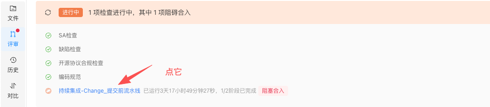
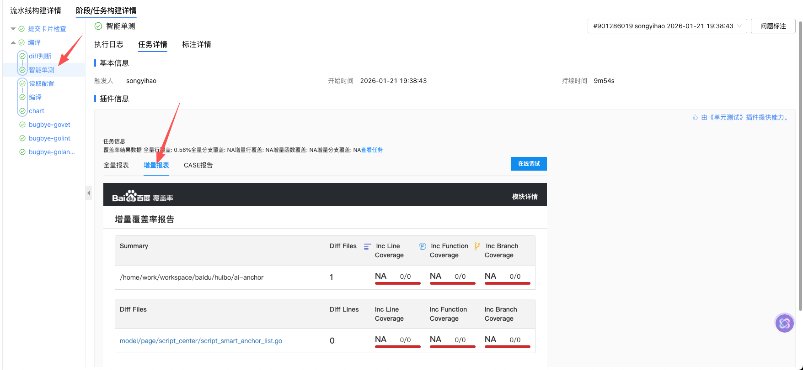
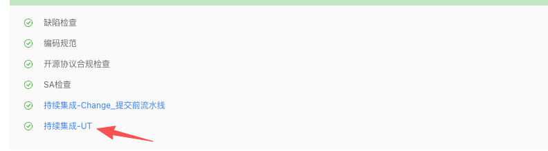
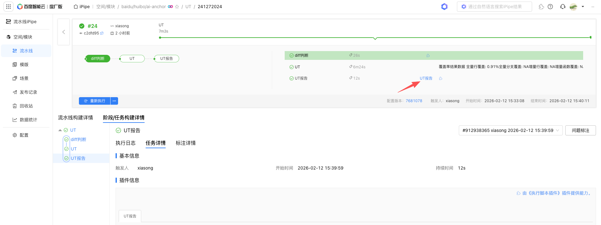
## 5.3 submodule 使用指南
### **前置准备&引用rules公共库**
可通过以下命令引用公共 rules 库

```
git submodule add -f ssh://icode.baidu.com:8235/baidu/huibo/dhuman-rules .comate/rules/common
```
如果你没有配置ssh的默认用户，需要在 ~/.ssh/config 中配置一下百度icode的默认用户，比如

```
Host icode.baidu.com
    HostName icode.baidu.com
    Port 8235
    User zhangyongzhe01 # 换成你的邮箱前缀
    IdentityFile ~/.ssh/id_rsa # 换成你的密钥路径
```
如果config文件原本不存在，新建文件后，需要对config文件进行权限设置（默认文件644，需改为600）

```go
chmod 600 ~/.ssh/config
```
### clone&初始化包含submodule的仓库
第一次 clone 时，需要初始化 submodule

```
git submodule update --init --recursive
```
或者，你也可以 全局设置自动 submodule 更新，pull的时候就会自动拉取**【推荐】**

```
git config --global submodule.recurse true
```
### 更新本地的submodule文件内容
当有人更新submodule的引用版本时，本地的submodule文件默认不会主动更新，可执行以下命令更新文件

```
git submodule update
```
### 更新submodule的引用版本
当远端rules代码库更新后，想要更新引用的版本

```
git submodule update --remote
```
然后提交

```bash
git add .comate/rules/common
git commit -m "update common rules"
git push
```
# 六、经验&反馈收集
实践过程中，优秀的经验 或 踩到各种坑，欢迎大家积极反馈，一起探索解决

[后端单元测试实践经验&反馈收集](https://ku.baidu-int.com/knowledge/HFVrC7hq1Q/K4aC71pX9v/E5IZepvmyr/NiG7xfqlRTlPhr?t=mention&mt=doc&dt=doc)


**绝对禁止**：故意无断言、假断言