vLLM 模型自部署：原理与部署指南


## 1. 端口架构与请求原理
### 1.1 一个 Pod 内跑了几个进程？
同一个容器（Pod）内并存 3 类进程，对外/对内共暴露 **4 个端口**：

* **Go 服务进程**（GDP 框架）：占用 `Main` + `Admin` 两个端口
* **vLLM 推理进程**：占用 `GRPC` 端口（名字叫 GRPC，实际是 vLLM 的 HTTP 端口）
* **图片处理 Python 进程**（`img_process.py`）：占用 `PYSERVER` 端口

### 1.2 四个端口分别是什么
|端口名|环境变量|进程|作用|
|-|-|-|-|
|**Main**|`LRS_RESOURCE_PORT_NAMING_MAIN`|Go 服务|对外主入口，接收业务请求（`/v1/chat/completions`、`/api/chat/image` 等）|
|**Admin**|`LRS_RESOURCE_PORT_NAMING_ADMIN`|Go 服务|管理/监控端口（`/metrics`、`/debug/pprof/`、探活面板）|
|**GRPC**|`LRS_RESOURCE_PORT_NAMING_GRPC`|vLLM|vLLM 推理 HTTP 端口，Go 服务把请求转发到这里；健康检查 `/health`|
|**PYSERVER**|`LRS_RESOURCE_PORT_NAMING_PYSERVER`|Python|图片预处理服务，健康检查 `/health`|

> 端口名来自 `conf/app.toml` 的 `[[Meta.Ports]]` 定义；监听地址在 `conf/server.toml`（`HTTPServer.Listen = tcp@0.0.0.0:{port.Main}`、`AdminServer.Listen = ...{port.Admin}`）。
### 1.3 国内 vs 国外：端口从哪来（核心区别）
四个端口的"名字和职责"国内外**完全一致**，区别只在于**端口号怎么拿到**：

* **国内（端口段动态注入）**：CNAP「命名端口」模式会在容器启动时自动注入 `LRS_RESOURCE_PORT_NAMING_*` 环境变量，端口号由平台动态分配（开发默认值：Main=8083、Admin=8084）。Go 服务和 `start.sh` 直接读环境变量即可。

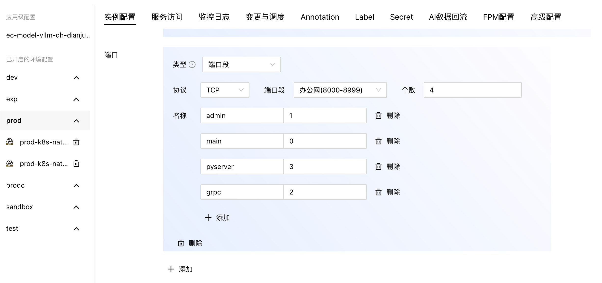
* **国外（静态兜底）**：海外 CNAP「命名端口-静态」模式**不注入** `LRS_RESOURCE_PORT_NAMING_*`。所以 `bin/abroad/*/start.sh` 里对四个变量做了写死兜底：

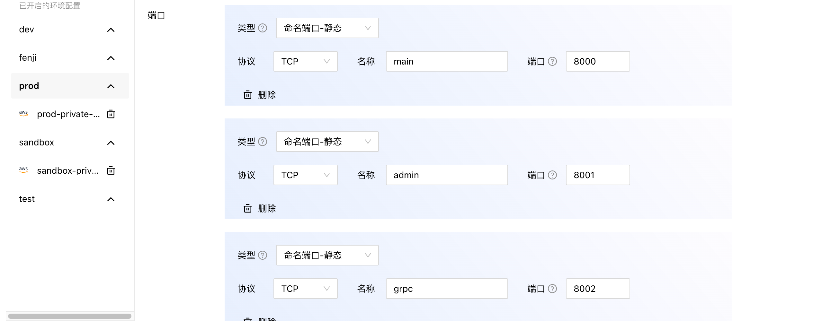
```bash
# bin/abroad/dh_4b_base/start.sh
export LRS_RESOURCE_PORT_NAMING_MAIN=${LRS_RESOURCE_PORT_NAMING_MAIN:-8000}
export LRS_RESOURCE_PORT_NAMING_ADMIN=${LRS_RESOURCE_PORT_NAMING_ADMIN:-8001}
export LRS_RESOURCE_PORT_NAMING_GRPC=${LRS_RESOURCE_PORT_NAMING_GRPC:-8002}
export LRS_RESOURCE_PORT_NAMING_PYSERVER=${LRS_RESOURCE_PORT_NAMING_PYSERVER:-8003}
```
含义：`${VAR:-默认值}` = 平台若已注入就用平台的，没注入就用静态默认（8000~8003）。这样海外静态端口场景下服务也能正常起。


### 1.4 别人访问 Main 端口，怎么请求到模型上？（请求链路图）
外部调用方**只访问 Main 端口**，Go 服务在同一 Pod 内把请求转发给 vLLM 的 GRPC 端口，拿到推理结果再返回。全链路如下：

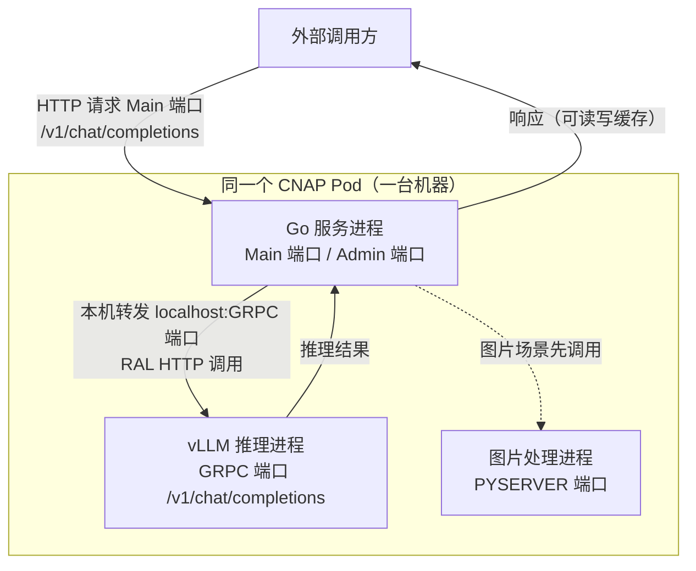
代码路径（对应上图）：

* 路由注册：`servers/httpserver/router.go` → `/v1/chat/completions` 绑定 `controller.CallVllmWithBody`
* 控制层：`servers/httpserver/controller/proxy.go` → 读 body、查缓存、经**并发限流器** `resource.VCLimit.Execute` 调用模型、写缓存
* 服务层：`model/service/proxy/vllm.go` → `vllmPostRal()` 读取 `LRS_RESOURCE_PORT_NAMING_GRPC`，拼出 `本机IP:GRPC端口`，用 RAL 发 HTTP 到本地 vLLM

一句话原理：**Main 是门面，GRPC 是真正的模型**。Go 服务只在同一 Pod 内做转发、缓存、限流、协议适配，从不跨机器调模型。


### 1.5 外部调用方是怎么"找到"Main 端口的（入口差异）
> 说明：Pod 内的转发链路（1.4）已由代码确认；**下面的对外入口方式属于平台侧接入**，请以 CNAP 控制台配置为准，本节结论待你用截图核对。
* **国内**：走 CNAP 服务发现 / BNS / 域名，调用方通过服务名寻址，平台把流量路由到 Main 端口（动态端口对调用方透明）。

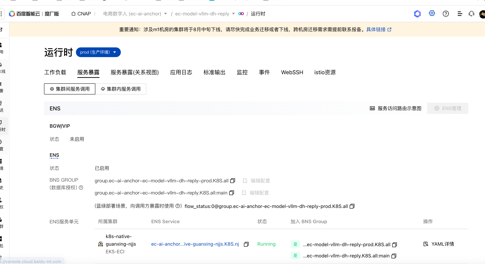
* **国外**：走静态 IP / 网关，Main 端口固定（默认 8000），调用方按约定的静态地址访问。

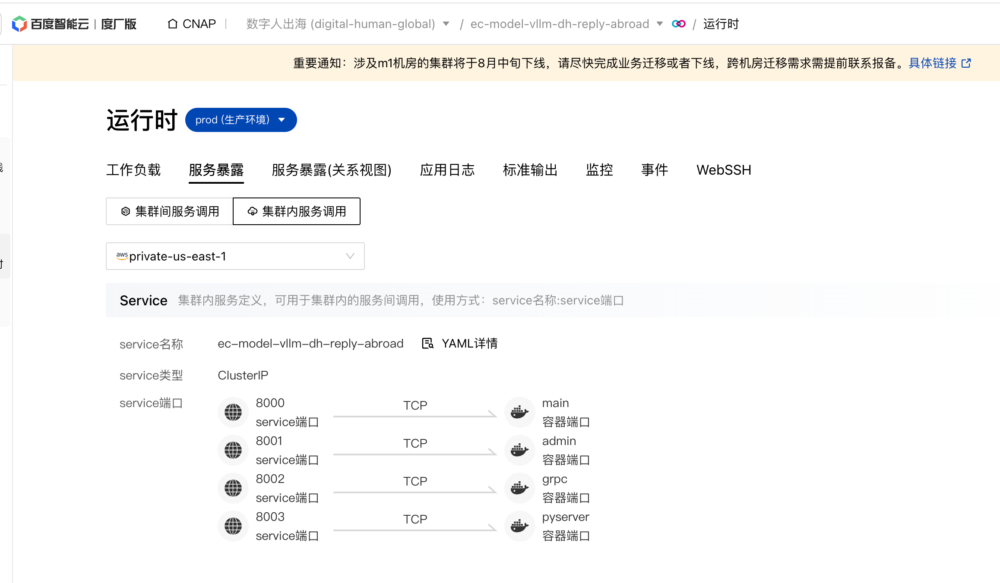
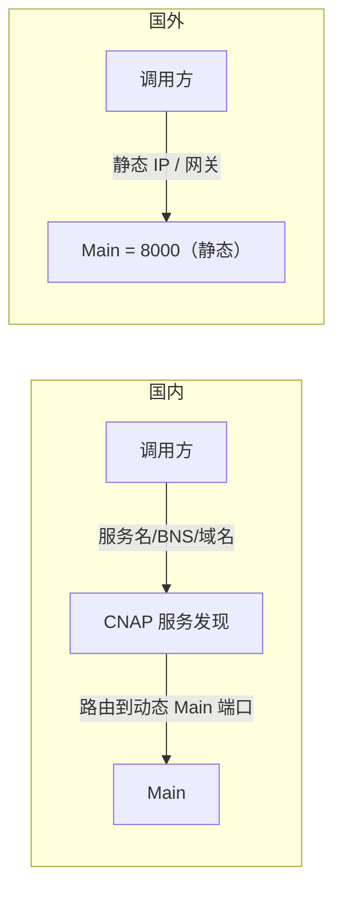
> 【需你确认/提供截图 A】CNAP「服务发现 / 访问入口」配置页，国内外各一张，用来最终敲定本节写法。
---

## 2. 部署步骤（重点讲 CNAP 平台配置与国内外差异）


### 2.1 前置动作
* 模型策略已上传 BOS：
    * `代码写到./upload_model.sh <本地模型路径> <模型名> <版本号>`，

* 确认能部署成功镜像
    * 可以提前做好


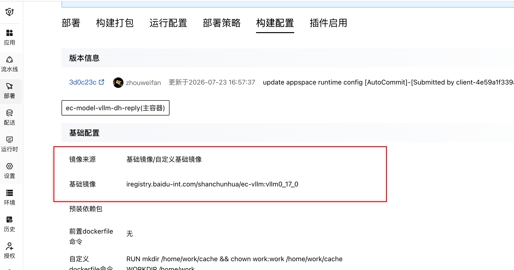
    * 也可以提前写好放到`docekrfile、build.sh` 。

### 2.2 整体部署流程
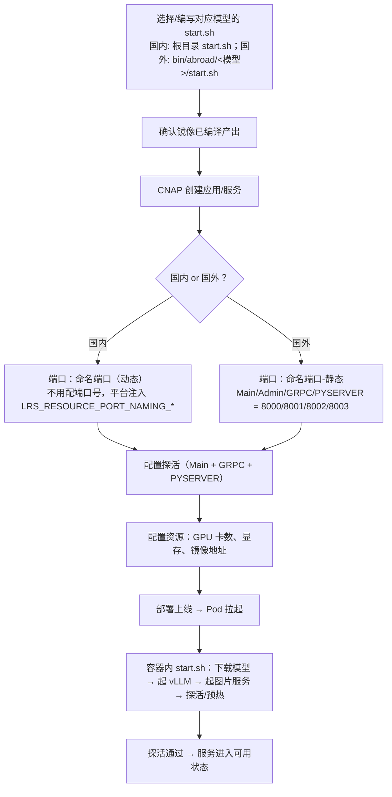
### 2.3 国内 vs 国外：部署差异对照
|差异点|国内|国外（abroad）|
|-|-|-|
|端口模式|CNAP 命名端口（动态注入）|CNAP 命名端口-静态（不注入）|
|端口号|平台分配，无需手填|静态写死 8000/8001/8002/8003（`start.sh` 兜底）|
|start.sh 位置|仓库根目录 `start.sh`|`bin/abroad/<模型>/start.sh`|
|vLLM 启动方式|前台 `&` 后台运行|`nohup ... > vllm.log 2>&1 &`，日志落文件|
|探活|`start.sh` 内联轮询 GRPC `/health`|独立 `bin/abroad/probe.sh`，同时探 Main/GRPC/PYSERVER|
|预热 Warmup|无|有（发短/长两条 prompt 消除首包 triton autotune 延迟 >55s）|
|探活地址|`http://APPSPACE_POD_IP:GRPC/health`|Main `/alive/ping`、GRPC `/health`、PYSERVER `/health`|


---

## 3. 依赖清单
* **BOS 对象存储**：模型权重存储与拉取（`upload_model.sh` / `download_model.sh`，凭证在 `~/.go-bcecli/credentials`）。

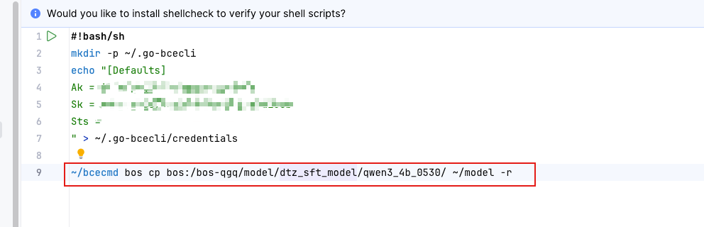
* **CNAP 平台**：容器调度、端口映射、探活、扩缩容。

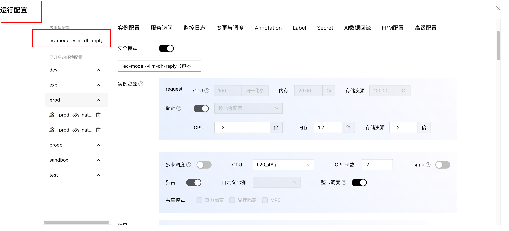
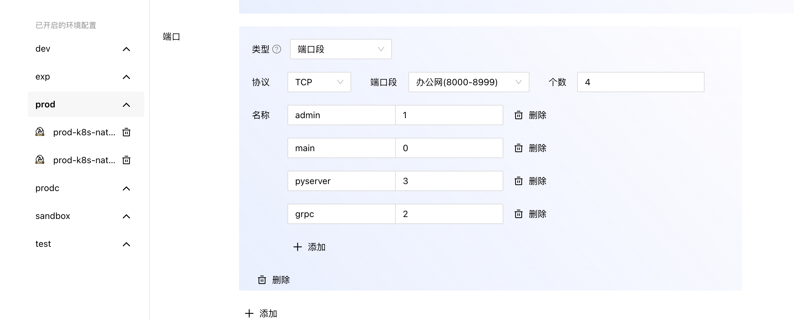
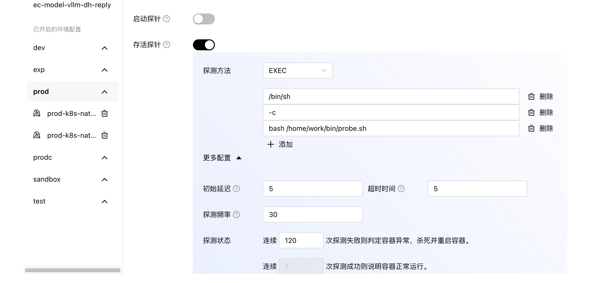
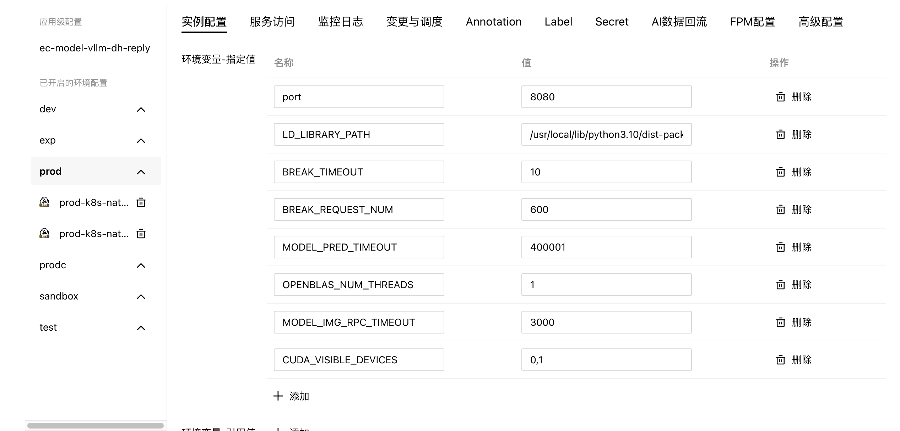
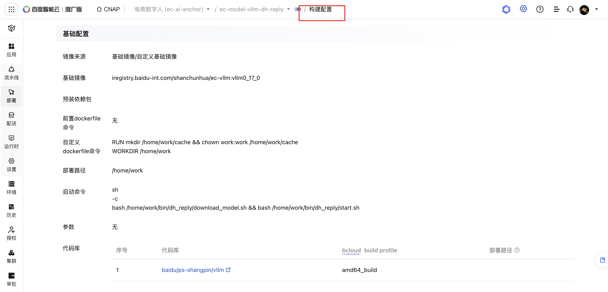


* **GPU + CUDA**：`start.sh` 用 `nvidia-smi --list-gpus` 统计卡数作为 `--tensor-parallel-size`；基础镜像 CUDA 12.6。

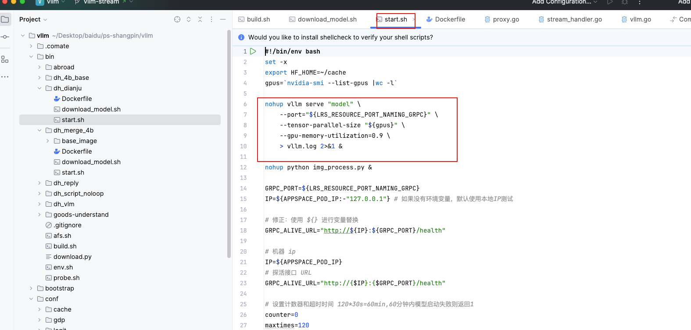
* **vLLM**：推理引擎，具体版本需要测试。
* **图片处理服务**：`img_process.py`（Flask），仅图片类模型需要。
* **环境变量**：`LRS_RESOURCE_PORT_NAMING_{MAIN,ADMIN,GRPC,PYSERVER}`、`APPSPACE_POD_IP`。

---

## 4.混布模型
* 太复杂先不展开
