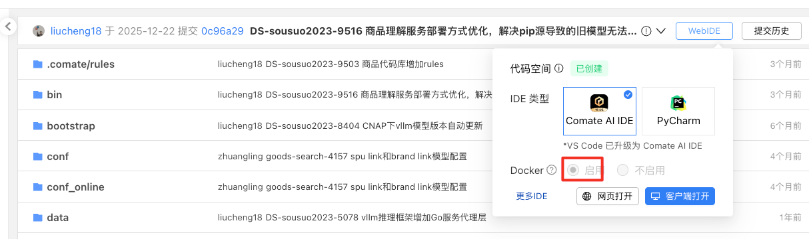
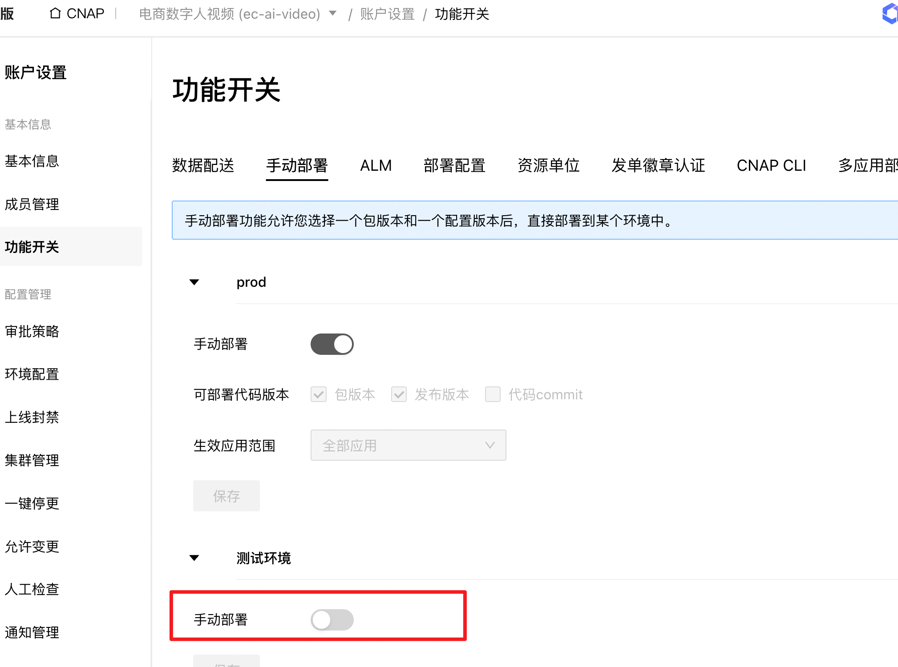
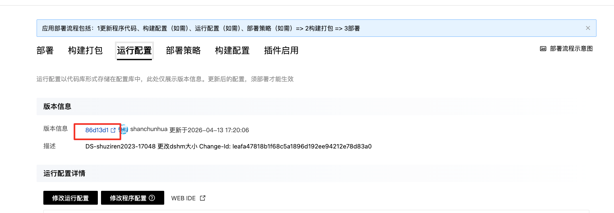
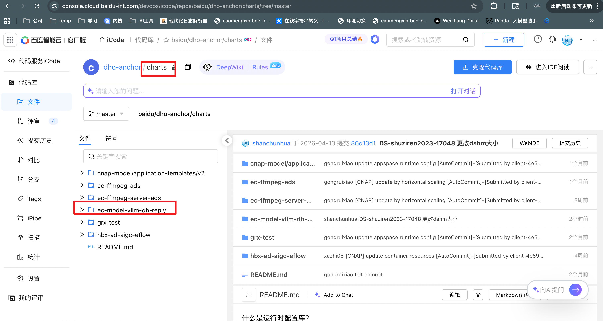
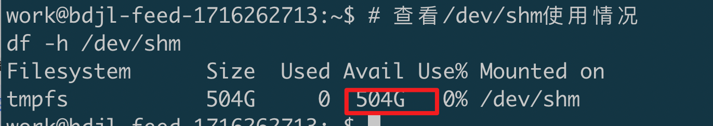
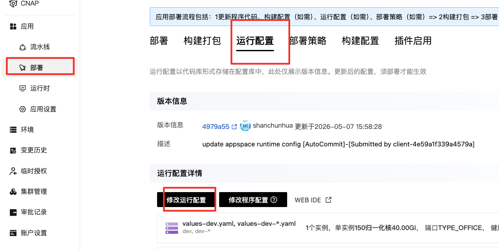
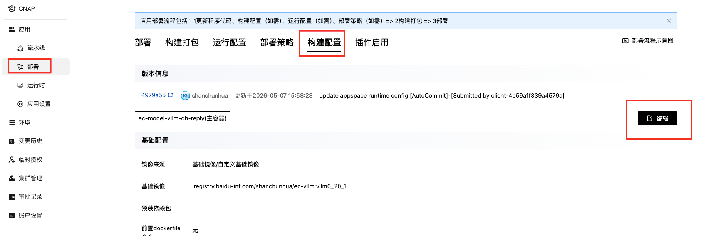
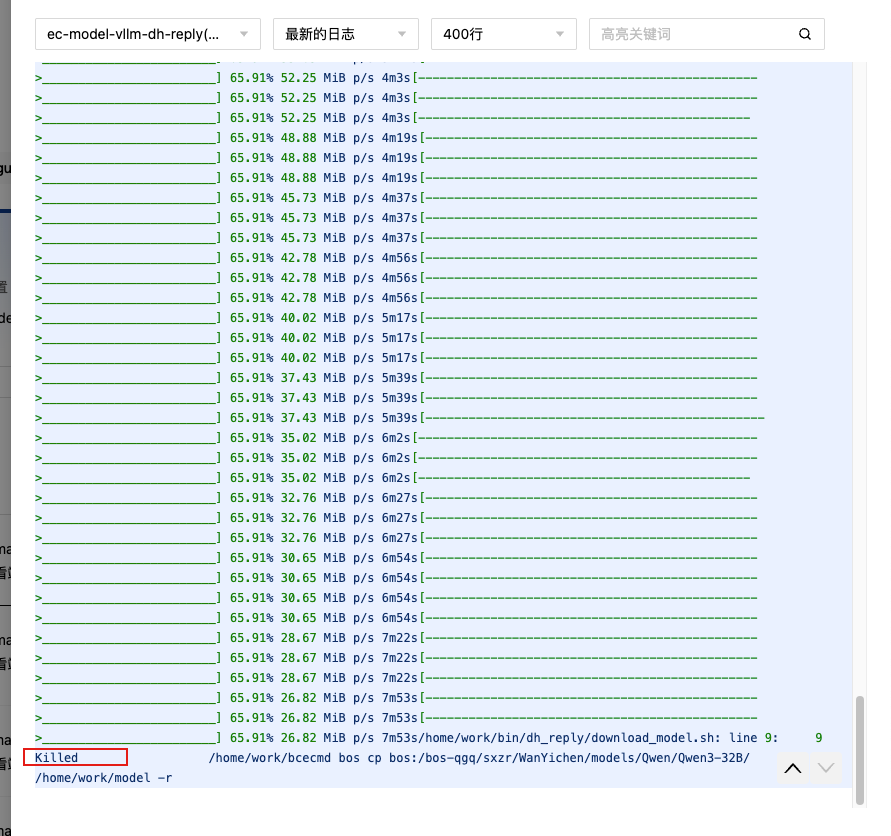

操作+部署踩坑记录

> 整体部署分为：  
> * 在代码库更新注册模型信息&更改启动脚本 
> * 在cnap上启动服务和压测
> 
# 一、代码库相关：
## 1 基础操作
[vllm开源大模型CNAP服务部署](https://ku.baidu-int.com/knowledge/HFVrC7hq1Q/K4aC71pX9v/gJF-TvC9RT/k486tHAkqu4fii?dt=doc&mt=doc&t=mention?t=mention&mt=doc&dt=doc)

## 2 代码开发
每个模型服务所依赖的镜像版本、启动参数都会有所不同，所以建议在 bin目录下创建自己的目录来操作，具体可查看

`vllm-stream`分支 [https://console.cloud.baidu-int.com/devops/icode/repos/baidu/ps-shangpin/vllm/tree/vllm-stream/bin/dh_reply](https://console.cloud.baidu-int.com/devops/icode/repos/baidu/ps-shangpin/vllm/tree/vllm-stream/bin/dh_reply)

包含了 基础镜像构建  +  启动脚本 + 模型下载脚本

## 3 镜像构建
### 3.1 docker环境
> * 开发机docker环境安装费劲
> * mac本地push/pull/build 非常慢   +  需要交叉编译
> 
使用代码空间！！！




### 3.2 基础镜像选择
* 选择1：iregistry.baidu-int.com/appspace/nvidia-pytorch
* 选择2：iregistry.baidu-int.com/appspace/cuda:12.6.1-cudnn-devel-ubuntu22.04

建议使用iregistry.baidu-int.com/appspace/cuda的相关版本

### 3.3 基础镜像和vllm版本适配问题：
> 在cnap的调试模型中验证模型时，经常会遇到模型与cuda vllm版本不匹配的问题，需要改dockerfile
1. 更改基础镜像版本：iregistry.baidu-int.com/appspace/cuda
2. 更改vllm版本

* dockerfile示例：

```json
FROM iregistry.baidu-int.com/appspace/cuda:12.6.1-cudnn-devel-ubuntu22.04

ENV IMAGE_VERSION="vllm_0.18.0_clean"
ENV DEBIAN_FRONTEND=noninteractive

# 系统依赖
RUN apt-get update && apt-get install -y \
    python3.10 python3.10-dev python3-pip \
    libsoxr-dev build-essential git curl vim\
    && rm -rf /var/lib/apt/lists/*

# 软链 python
RUN ln -sf /usr/bin/python3.10 /usr/bin/python \
    && ln -sf /usr/bin/python3.10 /usr/bin/python3

# 创建 work 用户
RUN mkdir -p /home/work && chown -R 1000:1000 /home/work \
    && echo 'work:x:1000:1000::/home/work:/bin/sh' >> /etc/passwd \
    && echo 'work:x:1000:' >> /etc/group

# pip 源（替换为你的内部源）
COPY pip.conf /usr/pip.conf
RUN mkdir -p /root/.pip && cp /usr/pip.conf /root/.pip/pip.conf

RUN python -m pip install --upgrade pip

# 直接安装 vLLM，让它自己拉取所有依赖
# 干净环境下不存在旧包冲突问题
RUN pip install vllm==0.17.0

RUN pip install soxr flask==3.1.0

USER work
WORKDIR /home/work
```
### 3.4 镜像仓库
目前基础镜像在[https://console.cloud.baidu-int.com/devops/iregistry/projects/5965/shanchunhua/mirror-images/list](https://console.cloud.baidu-int.com/devops/iregistry/projects/5965/shanchunhua/mirror-images/list)

后续可以专门建一个模型服务的镜像仓库

### 3.5 模型的bos地址
之前电商的模型存在电商的bos账号 aksk在代码库的master分支

智能体策略用的都是智能体初始初始账户 aksk 在代码库的vllm-stream分支(这也是为什么新建的download脚本的原因)


### 3.6 常见问题
**制作镜像时候拉取远端大镜像极慢/卡住**

* 镜像在本地/Mac 预下载，然后将镜像拷贝过去

```bash
pip download --dest wheels/ --pre vllm \
    --python-version 3.10 \
    --platform manylinux_2_28_x86_64 \
    --only-binary :all: \
    --extra-index-url https://wheels.vllm.ai/nightly
```
* 其他依赖通过容器内百度内网 pip 源在线安装
* dockerfile里拷贝地址，进行镜像制作

```go
# 将本地预下载的 vllm wheel 拷贝到镜像（避免容器内下载大文件）
COPY wheels/vllm-*.whl /tmp/wheels/

# 从本地 wheel 安装 vllm，依赖在线解决
RUN pip install --no-cache-dir /tmp/wheels/vllm-*.whl \
    --extra-index-url https://wheels.vllm.ai/nightly \
    && rm -rf /tmp/wheels/
```
---

### 
# 二、cnap应用
> 一个模型服务一个应用
## 1 基础信息
应用命名啥的参考：[vllm开源大模型CNAP服务部署](https://ku.baidu-int.com/knowledge/HFVrC7hq1Q/K4aC71pX9v/gJF-TvC9RT/k486tHAkqu4fii?dt=doc&mt=doc&t=mention?t=mention&mt=doc&dt=doc)

注意cnap账户使用：[https://console.cloud.baidu-int.com/devops/appspace/account/993/application/list](https://console.cloud.baidu-int.com/devops/appspace/account/993/application/list)

op: [https://zhiban.baidu-int.com/detail?id=70179](https://zhiban.baidu-int.com/detail?id=70179)


## 2 常见操作流程
* 新建应用
* 绑定代码库
* 修改运行配置&构建配置&部署配置
* 一个实例用多少gpu
* 调试
* 压测  &  产出压测报告
* prod上线部署

## 3 常见问题 
### 3.1 沙盒环境(sandbox)部署报错 "独立部署功能未开启"

* **解决**：找账号研发负责人打开开关  (同理 生产环境也是如此)


### 3.2 vllm报错 /dev/shm 空间不足
* 现象

```json
(EngineCore_DP0 pid=295) Last error:
(EngineCore_DP0 pid=295) Error while creating shared memory segment /dev/shm/nccl-M5qCmk (size 9637888), error: No space left on device (28)', please check the stack trace above for the root cause

```
```json
# 查看/dev/shm使用情况
df -h /dev/shm
```
* 解决：增加cnap的/dev/shm 空间

1. 更改 "chats"代码库的配置(每个账号下都会有一个chats代码库， 不同应用用不同文件夹区分，直接在master上新增配置)
2. 找到代码库


3. 代码库截图如下： 


4. 添加/dev/shm配置: [评审：DS-shuziren2023-17048 更改dshm大小](https://console.cloud.baidu-int.com/devops/icode/repos/baidu/dho-anchor/charts/reviews/120461470/files/base...latest/ec-model-vllm-dh-reply/extension/cloneset.yaml?t=mention&mt=doc&dt=sdk)
5. 重新构建打包、部署
6. 进入容器后发现OK了(原来只有几十M)




### 3.3 vllm报错gpu驱动版本不匹配
找过op，物理机上不同型号的显卡是统一的池子，目前无法单独修改，实在部署不了可以给op提需求

### 3.4 修改运行配置
参考：[https://console.cloud.baidu-int.com/devops/appspace/account/993/application/50499/deploy/runtime-config](https://console.cloud.baidu-int.com/devops/appspace/account/993/application/50499/deploy/runtime-config)


### 3.5 修改部署配置
参考：[https://console.cloud.baidu-int.com/devops/appspace/account/993/application/50499/deploy/build-config](https://console.cloud.baidu-int.com/devops/appspace/account/993/application/50499/deploy/build-config)


### 3.6 实例问题
> 可以直接找值班
* 实例起不来？  查看日志
* 重新部署实例一直重启失败？  可以点击重建  部署是原地升级，可能有问题 需要点击重建


* 大镜像容器启动需要先拉取远端bos地址，可能下载过程中失败，此时日志能定位到，重建




## 4 压测：
> 压测一般在沙盒环境使用vllm命令直接启动服务  不调用go的服务
> 压测  要预估成本 + 限流配置[https://searchx.baidu-int.com/uniconf/history?prodline=visd&module=ec-da&config=vllm_concurent&pid=2&mid=155&configID=16145](https://searchx.baidu-int.com/uniconf/history?prodline=visd&module=ec-da&config=vllm_concurent&pid=2&mid=155&configID=16145)
> 其他有临时部署模型测试的 直接在沙盒环境搞就行，搞完记得把运行配置和构建配置还原  参考prod环境
### 4.1 压测脚本：
[文件页：baidu/agents/dev-tools  *master](https://console.cloud.baidu-int.com/devops/icode/repos/baidu/agents/dev-tools/tree/master/model_pressure_test?t=mention&mt=doc&dt=sdk)

* 服务启动命令示例

```
vllm serve "model" --port=8007 --tensor-parallel-size 2 --gpu-memory-utilization=0.85
```


## 5 模型下载
> 策略如果直接提供bos地址则不需要咱们手动下载
模型下载地址：

* 国外 hugging face: [https://huggingface.co/](https://huggingface.co/)
* 国内 model scope: [https://modelscope.cn/models](https://modelscope.cn/models)

下载步骤：

* 建议 先到 model scope下载，没有的话然后尝试huggingface下载
* huggingface下载流程：
    * 常规加速方式可以在内网(baidu)搜一下(百舸加速的方式不能用了)
    * 实测在mac本地比在开发机要快一点(1M+  vs  200K+)嫌网速慢的话，还有一个方案：用google的 colab 将hf的模型转存到 google云盘，然后上传到model scope ，再从modelscope中下载 [(搬运) huggingface模型高速下载](https://ku.baidu-int.com/knowledge/HFVrC7hq1Q/pKzJfZczuc/kdzeCfCS2f/Hurg1OBwYurWIb?t=mention&mt=doc&dt=doc)
