自部署部署探索

# 一、支持mtp
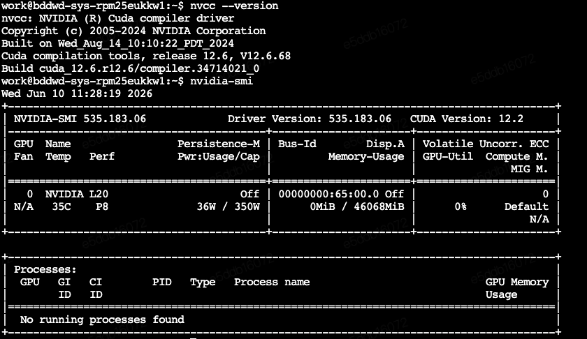
## 环境基础信息
* **GPU**: NVIDIA L20 (46GB)
* **驱动**: 535.183.06 (支持最高 CUDA 12.2)
* **CUDA Toolkit**: 12.6
* **Python**: 3.10
* **模型**: Qwen3.5 (混合架构: Transformer + Linear Attention/Mamba)
* **目标**: 开启 MTP speculative decoding (`num_speculative_tokens=3`)

策略同学反应加mtp参数能有效降低一半耗时，但目前vllm版本不支持进行以下探索

默认启动命令启动命令

```go
vllm serve "model" --port=8023 \
--tensor-parallel-size 1 \
--gpu-memory-utilization=0.85 \
--speculative-config '{"method": "mtp", "num_speculative_tokens": 3}'
```
|vllm版本|启动情况|原因|
|-|-|-|
|vLLM 0.17.0 默认|* 启动 → CUDA Graph capture (FULL decode 阶段)<br/>* 错误详情：RuntimeError: Triton Error [CUDA]: operation not permitted when stream is capturing|* `causal_conv1d_update` Triton kernel 在 CUDA Graph capture 时触发 lazy `load_binary`，驱动 535 不支持在 stream capture 状态下加载 kernel binary<br/>* 解决方案启动禁用 CUDA Graph capture，添加 `--enforce-eager` 参数：|
|vLLM 0.17.0 + `启动命令 --enforce-eager`|* 启动成功 → 推理时（第一个请求的 decode 阶段）<br/>* 并且压测1qps成功率仅有74%<br/>* 错误详情：torch.AcceleratorError: CUDA error: an illegal memory access was encountered|* MTP draft model 与 Qwen3.5 混合架构的 mamba conv state buffer 交互存在内存越界 bug（vLLM 0.17.0 代码缺陷），驱动 535 对越界访问容忍度更低|
|vLLM 0.18.0 默认|* 启动 → 模型初始化（import flashinfer）<br/>* 错误详情：RuntimeError: flashinfer-cubin version (0.6.11.post2) does not match flashinfer version (0.6.6)|* pip 安装时 flashinfer 和 flashinfer-cubin 包版本不匹配（依赖解析问题）该问题在0.19.0修复，单独尝试解决依赖问题也不大|
|vLLM 0.19.0默认 |* 启动 → CUDA Graph capture (FULL decode 阶段)<br/>* 错误详情：Triton Error [CUDA]: operation not permitted when stream is capturing|* 和0.17.0一样，建议升级下triton版本|
|vLLM 0.19.0 默认+Triton 3.7.0|* 启动 → CUDA Graph capture (FULL decode 阶段)<br/>* 错误详情：Triton Error [CUDA]: operation not permitted when stream is capturing|* 和0.17.0一样，升级triton版本无效|
|vLLM 0.22.1 默认|* 启动 → Worker init_device (CUDA 初始化)<br/>* ****`RuntimeError: The NVIDIA driver on your system is too old (found version 12020)`|*  vLLM 0.22.1 依赖 PyTorch 2.10 + CUDA 12.8+ runtime，驱动 535 (CUDA 12.2) 完全不兼容|
||||


## 效果对比
||自部署没加mtp|自部署加mtp|
|-|-|-|
|启动命令|**默认**<br/>vllm serve "model" --port=8010 \--tensor-parallel-size 1 \--gpu-memory-utilization=0.85 |**默认+mtp**<br/>vllm serve "model" --port=8010 \--tensor-parallel-size 1 \--gpu-memory-utilization=0.85 \--speculative-config '{"method": "mtp", "num_speculative_tokens": 3}' \--attention-backend flash_attn --max-num-batched-tokens 32768 \--compilation-config '{"cudagraph_mode":"PIECEWISE"}'|
|vllm版本|0.19.1|0.19.1|
|机器|L20 单卡|L20 单卡|
|压测数据|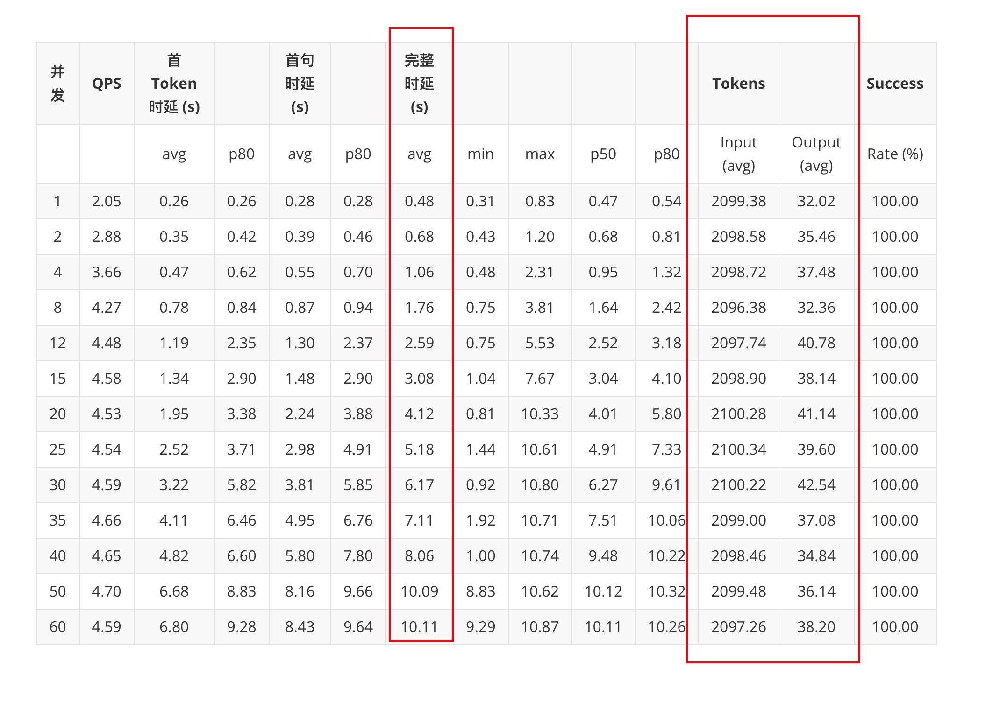|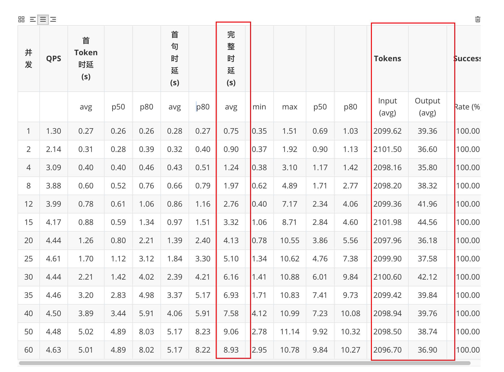|


|**自部署mtp对比嘉芮自部署效果**|||
|-|-|-|
||mine|嘉芮s|
|机器|一张l20|一张h800|
|vllm版本|0.19.1|0.19.1|
|启动参数|vllm serve "model" --port=8010 \--tensor-parallel-size 1 \--gpu-memory-utilization=0.85 \--speculative-config '{"method": "mtp", "num_speculative_tokens": 3}' \--attention-backend flash_attn --max-num-batched-tokens 32768 \--compilation-config '{"cudagraph_mode":"PIECEWISE"}'|vllm serve "model" --port=8010 \--speculative-config '{"method": "mtp", "num_speculative_tokens": 3}' \--attention-backend flash_attn --max-num-batched-tokens 32768 \--compilation-config '{"cudagraph_mode":"PIECEWISE"}'|
|效果对比|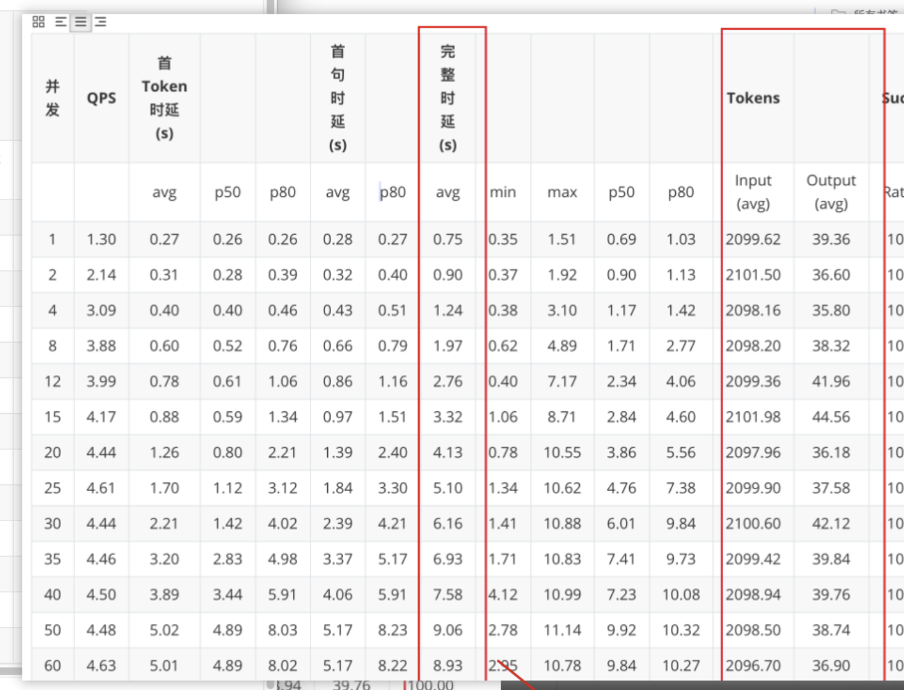|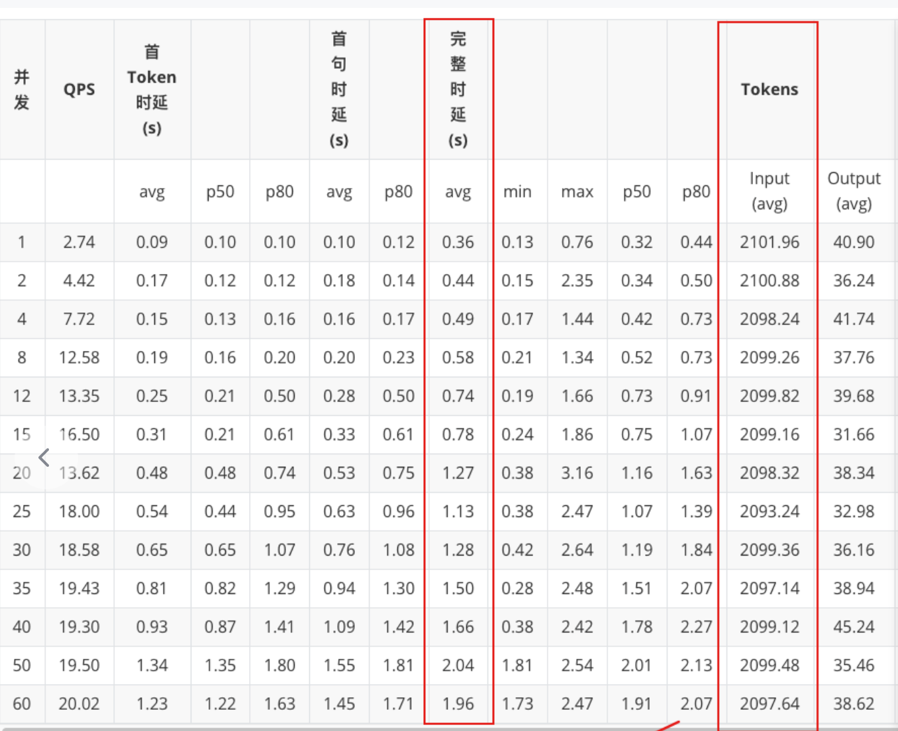|
|结论|机器原因 效果远不如嘉芮||

|**自部署对比千帆效果**|||
|-|-|-|
||mine|千帆|
|机器|l20|l20加速卡|
|vllm版本|>0.18.0|>0.18.0|
|启动参数|vllm serve "model" \  --max-model-len 131072 \  --gpu-memory-utilization 0.9 \  --enable-chunked-prefill \  --enable-prefix-caching \  --port 8019|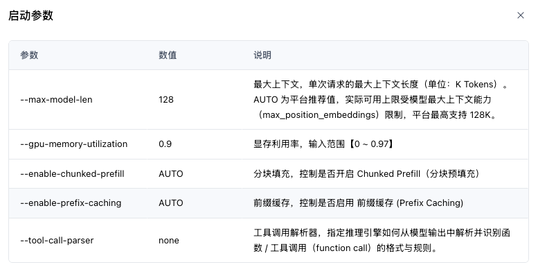|
|效果对比|**单卡**<br/>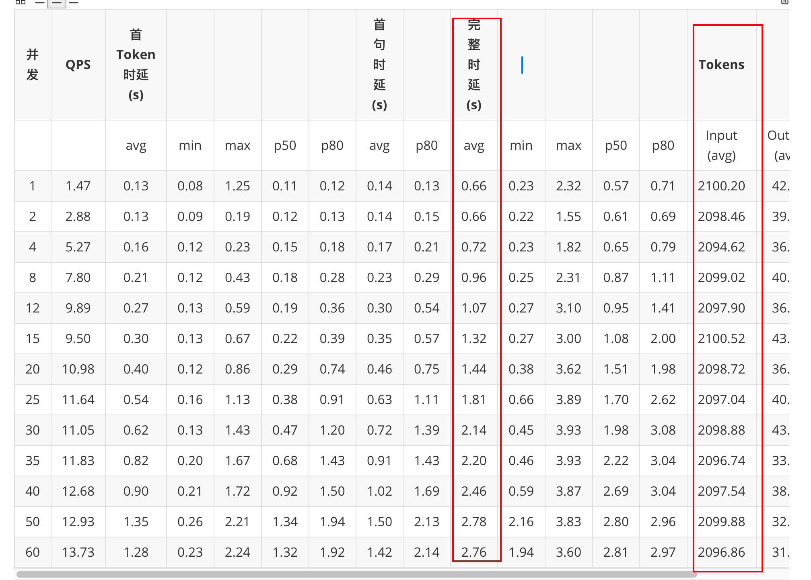<br/>**双卡**<br/>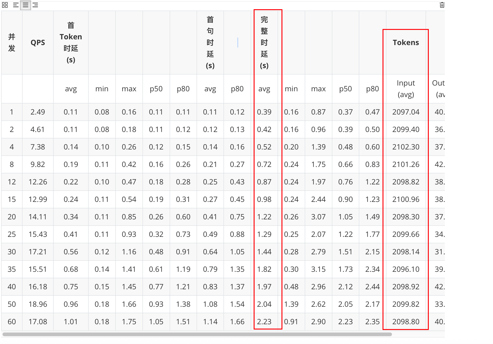|* 亚明提供数据<br/>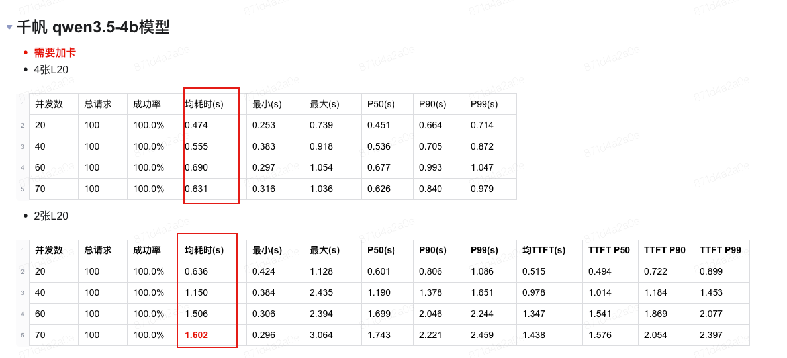<br/>* 嘉芮s千帆<br/>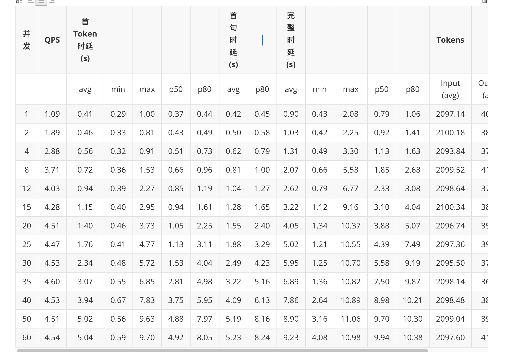|
|结论|效果逼近千帆，但是还没有千帆效果好，单比之前不加这个参数效果好很多<br/>tips：<br/>* vllm版本大于0.6 这俩参数默认是开的 dianju和reply都是开的<br/>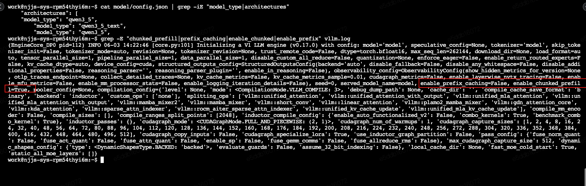<br/>* 但是3.5-4b默认是关的||


# 
# 三、vLLM Prefix Cache 原理总结
[https://docs.vllm.ai/en/v0.17.0/features/automatic_prefix_caching/#example-workloads](https://docs.vllm.ai/en/v0.17.0/features/automatic_prefix_caching/#example-workloads)

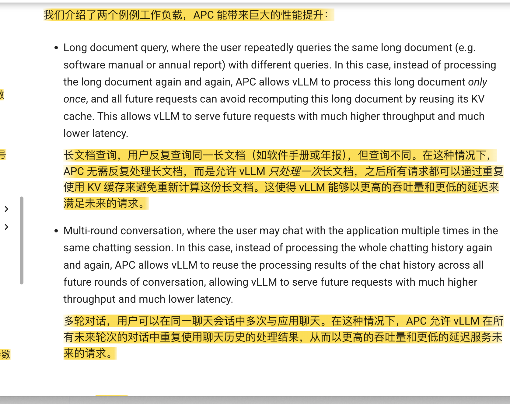
## 一、核心数据结构
vLLM 的 KV cache 管理由四个组件协同工作：

### 1. Block（KV Cache 物理块）
* KV cache 显存被切成固定大小的 **block**，每个 block 存 `block_size` 个 token 的 K、V（默认 `block_size = 16`）。
* 单 block 显存大小：
    * 例：Qwen3-32B（64 层，GQA num_kv_heads=8，head_dim=128，bf16），TP=2，单卡每 block ≈ 2 MiB；6.39 GiB / 卡 KV cache ≈ **3270 个 block**，对应 52,352 token。

* 每个 block 有元数据：`block_id`、`ref_count`、`block_hash`、链表前后指针。

### 2. FreeKVCacheBlockQueue（双向链表 LRU）
* 只装 `ref_count == 0` 的空闲块。
* 头 = 最久未用（LRU 端，**优先被回收**）；尾 = 最近用（MRU 端，**最后被回收**）。

### 3. cached_block_hash_to_block（哈希表）
* key = `block_hash`，value = block 对象。
* 用来做 **prefix cache 命中查询**：拿 prompt block 的 hash 来反查物理 block。
* 一个 block 同时存在于 free queue 和 cached_hash 表里是允许的——它"空闲但内容仍可复用"。

### 4. Block Hash 链
* 每个 block 的 hash 不是只 hash 自己内容，而是：

```go
block_hash[i] = hash(block_hash[i-1], tokens[i*16:(i+1)*16], extra_keys)
```
* 这意味着 **prefix 必须从头连续匹配**：第 K 个 block 命中的前提是 1..K-1 全部命中。中间任意一个 token 变了，从那以后的所有 block hash 全变，全部 miss。

### 5. Page Table（请求侧的 block 映射）
* 每个正在执行的 request 维护自己的 `block_table`：逻辑位置 → 物理 block_id 列表。
* 多个 request 可以指向**同一个物理 block**（前缀共享），此时该 block 的 `ref_count` = 持有者数量。
* 类比：物理 block = 物理内存页，page table = 进程的页表，prefix cache = 共享内存。

---

## 二、状态机与生命周期
每个 block 有两种状态：

|状态|ref_count|是否在 free queue|是否在 cached_hash|能否被命中|能否被淘汰|
|-|-|-|-|-|-|
|在用|> 0|否|是（如已写入）|是（再 ref++）|**否**|
|空闲缓存|== 0|是|是|是（从 queue 摘下复用）|是（漂到队头时）|
|空闲未缓存|== 0|是|否|否|是|

**关键不变量**：`ref_count > 0` 的块**不可能被淘汰**——它根本不在 free queue 里，新分配也取不到它。

---

## 三、三个核心操作
### 操作 1：Prefix 命中（复用空闲缓存块）
新请求 prompt 切块算 hash → 查 `cached_hash` 表：

1. 命中 → 把该 block 从 free queue 当前位置摘下（链表 O(1) 删除），挂到队尾（touch），`ref_count++`。
2. **不分配新块、不删 hash**。

### 操作 2：Prefix 共享（命中正在用的块）
查表命中的 block 当前 `ref_count > 0`（被别的请求持有）：

* 直接 `ref_count++`，加到当前请求的 page table。
* 不需要从 free queue 取（本来也不在）。

### 操作 3：新分配（evict）
没命中、需要新 block：

1. 从 free queue **头**取一个 block（最久未用）。
2. 如果该 block 的旧 `block_hash` 还在 `cached_hash` 表里，**先从表里删掉旧 hash**（这就是 evict / 淘汰）。
3. 物理 block 写入新 KV，绑定新 hash 加回 `cached_hash`，`ref_count = 1`。

### 操作 4：请求结束（释放）
请求完成时，遍历自己的 block_table：每个 block `ref_count--`。

* 减到 0 → 加入 free queue **尾部**（视为"刚刚被用过"）。
* 注意：**不立刻删 hash，也不清空内容**——内容保留在显存里直到该 block 被取去做新分配，这就是"空闲缓存"状态，下次还能命中。

---

## 四、具体例子
### 起始状态
```
free queue (头→尾): a1..a1365 → s1..s625 → b1..b1280
所有 block ref=0，cached_hash 表里都还在，总占用 3270（满）
其中 s1..s625 = 某个 10K-token system prompt 的 KV
```
### 例 1：纯命中（普通情况）
请求 A：`prompt = SystemPrompt(10K) + UserA(几十 token)`，需要 626 个 block。

```
Step 1  prefix 查表：s1..s625 全部命中
        → 从 free queue 摘下 s1..s625，依次挂到队尾，ref_count=1
        free queue: a1..a1365 → b1..b1280   (2645 free)

Step 2  UserA 部分（1 个 block）：从队头取 a1
        → cached_hash 删 a1 旧 hash → 写入 UserA 的 KV → ref=1
        free queue: a2..a1365 → b1..b1280   (2644 free)

Step 3  A 跑完：s1..s625 ref→0，a1(现在叫 ua1) ref→0，全部回到队尾
        free queue: a2..a1365 → b1..b1280 → s1..s625 → ua1
```
A 之后再来 B、C，只要每次 system 都被命中，s1..s625 就被反复 touch 到队尾，**永远不会漂到队头**，物理上不会被覆盖。

### 例 2：并发共享（system 被同时持有）
C、D 几乎同时到达，都用同一个 system prompt：

```
T0  free queue: a1..a1365 → s1..s625 → b1..b1280

T1  C 调度：
    - 命中 s1..s625：从 queue 摘下 → ref=1
    - C 自己的 user(2K=125 blk)：从队头取 a1..a125 → 写入 c1..c125
    - free queue: a126..a1365 → b1..b1280

T2  D 调度（C 还在跑）：
    - 查表命中 s1..s625（当前 ref=1，不在 queue 里）→ 直接 ref++ 变 2
    - D 不为 system 分配新块，page table 共享指向 s1..s625
    - D 自己的 user：从队头取 a126..a250 → 写入 d1..d125
    - free queue: a251..a1365 → b1..b1280

T3  C、D 跑完：
    - s1..s625 ref 从 2 减到 0 → 入队尾
    - free queue: a251..a1365 → b1..b1280 → c1..c125 → d1..d125 → s1..s625
```
关键点：**两个并发请求物理上共享同一份 system prompt 的 KV，显存零额外占用，prefix 命中率 100%。**

### 例 3：什么时候 system 才会真被覆盖
承接例 2 末尾状态：

```
free queue: a251..a1365 → b1..b1280 → c1..c125 → d1..d125 → s1..s625
                                                              （s 在尾）
```
此时来一个**完全不带这个 system 的请求 X**（比如换了 system prompt，或者另一个 API 占用同 engine），需要 2700 个新独有 block：

```
Step 1  X 没有 prefix 命中
Step 2  从队头开始连取 2700 个：
        - 取走 a251..a1365   (1115 块)
        - 取走 b1..b1280     (1280 块)  累计 2395
        - 取走 c1..c125      (125 块)   累计 2520
        - 取走 d1..d125      (125 块)   累计 2645
        - 还差 55 块 → 取 s1..s55 ← 此时 s1..s55 的旧 hash 从 cached_hash 删除！
Step 3  X 跑完后，原 s1..s55 物理 block 已被 X 的 KV 改写
```
后果：下一次再来一个用原 system 的请求 → prefix 查表 s1..s55 miss（hash 已删）→ **prefix hash 链从 s1 就断了，s56..s625 即使物理还在也算 miss**（hash 链断了无法继续匹配）→ 整个 10K system 重新 prefill。

**触发 system 被覆盖必须同时满足**：

1. system 块当前 `ref_count == 0`（没正在跑的请求持有）
2. 这段时间内**累计独有新分配 > free queue 中 system 之前的块数**
3. 期间没有命中 system 的请求把它 touch 回队尾

只要每隔一会儿就有一条命中 system 的请求，s 就会被刷到队尾，第 2 条永远满足不了。

---

## 五、和 prefill 的联动
请求实际 prefill 的 token 数：

```
real_prefill_tokens = prompt_tokens - cached_tokens
TTFT ≈ ⌈real_prefill_tokens / max_num_batched_tokens⌉ × per_step_time
```
例：10K system + 50 token query 的请求

|场景|cached|real prefill|chunks (max=2048)|TTFT 量级|
|-|-|-|-|-|
|全部命中|10000|50|1|~100ms|
|history 部分变化|9000|1050|1|~300ms|
|system 部分被驱逐|3000|7050|4|~2s|
|完全 miss（换 system）|0|10050|5|~3s|

这就是为什么 **prefix cache 命中率几个百分点的波动，在 TTFT 上会被放大成数量级差异**——因为 prefill 是 compute-bound 且要受 `max_num_batched_tokens` 切片串行执行。

---

## 六、几个常见误区
1. **"system prompt 没变就一定命中"** ❌ 命中条件是 hash 链 + 物理 block 都在。block 被覆盖后 hash 链就断了，内容没变也没用。
2. **"高 QPS 会更容易把 cache 撑爆"** ❌ 恰恰相反。高 QPS 下共享 block 一直 ref>0 或频繁 touch，反而稳定不被淘汰。低 QPS、稀疏流量才容易出问题。
3. **"prefix cache 是按 token 命中"** ❌ 是按 block（默认 16 token）命中，且必须从开头连续。第 17 个 token 改了，第 1 个 block 还能命中，第 2 个开始全 miss。
4. **"释放后内容立刻清空"** ❌ `ref→0` 只是回到 free queue，物理内容保留直到该 block 被新分配取走。这是"软淘汰"得以实现的关键。

---

# 四、时延问题
已32b模型为例

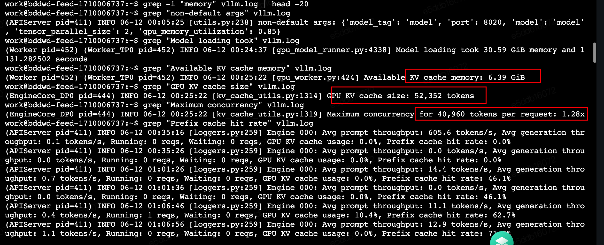
|项目|值|
|-|-|
|vLLM 版本|v0.17.0|
|模型|32B，bf16，TP=2（双卡）|
|GPU|2× NVIDIA L20（48GB 每张）|
|gpu_memory_utilization|0.85|
|模型占用显存|30.59 GiB（每卡）|
|**KV Cache 可用**|**6.39 GiB**|
|**KV Cache 容量**|**52,352 tokens**|
|max_seq_len|40,960 tokens|
|**最大并发**|**1.28x**（即最多同时处理 1 个完整请求）|
|enable_prefix_caching|**True** ✅|
|enable_chunked_prefill|True|


## 4.1 压测耗时远低于线上
* 线上真是prompt长度远高于测试


## 4.2 为什么替换system prompt后 耗时变高
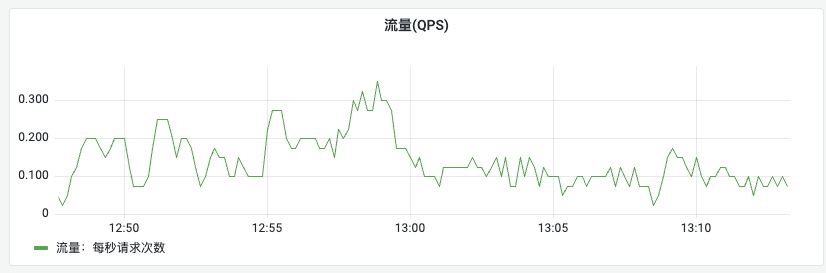
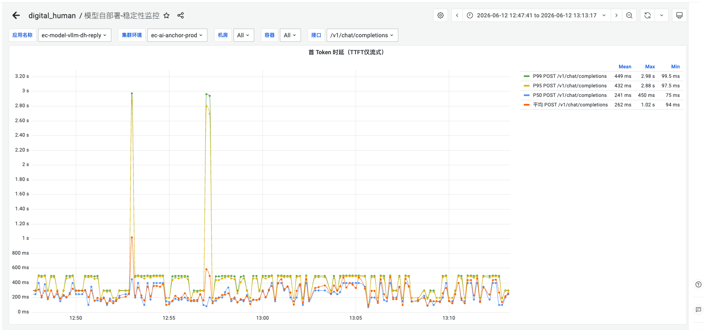
* 替换后需要新分配block，原来的system不能用


## 4.3 为什么流量忽高忽低 时延也忽高忽低，流量一直居高不下时延稳定
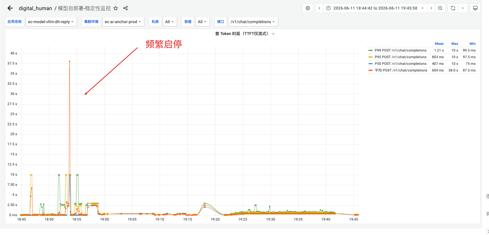
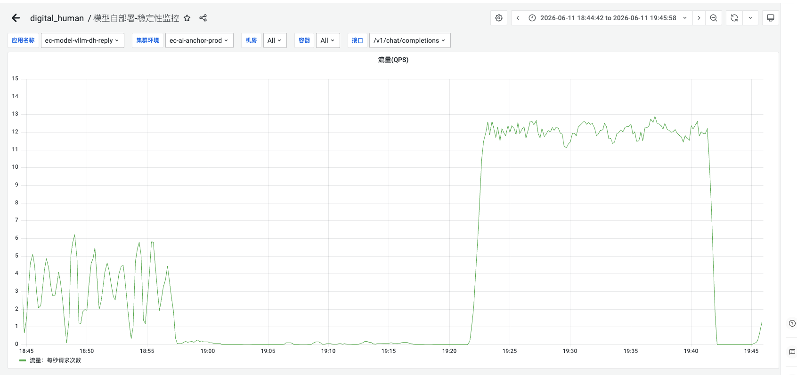
* 不是cache的问题。应该是gpu的问题
