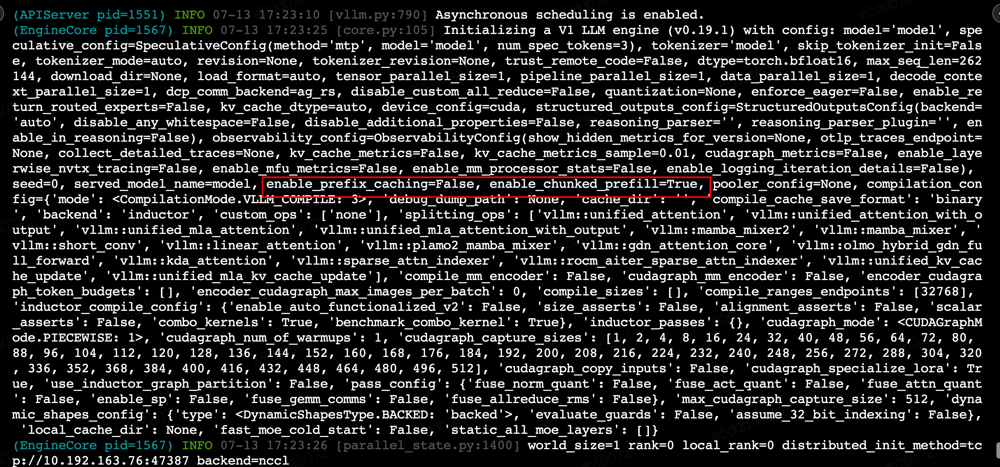

任务拆分-qwen3.5-4b-20260713

# 压测报告汇总
# 单卡
## 测试配置
* **测试时间**: 2026-07-13 16:26:22
* **环境名称**: task_split
* **结果目录**: `results_20260713_162305`
* **流式模式**: 是
* **图片模式**: 禁用
* **显卡：L20*1**
* **API地址**: `http://10.192.163.76:8015/v1/chat/completions`

## mtp测试结果
```sql
vllm serve "model" --port=8015 \
--tensor-parallel-size 1 \
--gpu-memory-utilization=0.85 \
--speculative-config '{"method": "mtp", "num_speculative_tokens": 3}' \
--attention-backend flash_attn --max-num-batched-tokens 32768 \
--compilation-config '{"cudagraph_mode":"PIECEWISE"}'
```
|并发|QPS|首Token时延 (s)|||||首句时延 (s)|||||完整时延 (s)|||||Tokens||Success|
|-|-|-|-|-|-|-|-|-|-|-|-|-|-|-|-|-|-|-|-|
|||avg|min|max|p50|p80|avg|min|max|p50|p80|avg|min|max|p50|p80|Input (avg)|Output (avg)|Rate (%)|
|1|1.83|0.27|0.26|0.35|0.27|0.27|0.28|0.26|0.37|0.29|0.29|0.54|0.31|1.04|0.47|0.67|2097.92|38.56|100.00|
|2|2.39|0.42|0.28|3.04|0.29|0.41|0.47|0.29|3.06|0.31|0.45|0.83|0.34|3.90|0.64|0.94|2096.26|36.94|100.00|
|4|3.68|0.52|0.29|0.96|0.49|0.71|0.61|0.29|0.98|0.62|0.79|1.05|0.45|2.49|0.95|1.31|2099.78|34.36|100.00|
|8|4.12|0.75|0.31|1.64|0.61|0.91|0.87|0.31|1.67|0.75|1.20|1.83|0.61|3.91|1.59|2.32|2098.76|40.74|100.00|
|12|4.47|1.07|0.29|2.36|0.79|2.36|1.17|0.32|2.39|0.87|2.36|2.52|0.47|6.14|2.28|3.46|2096.86|37.28|100.00|
|15|4.53|1.32|0.37|2.97|0.82|2.97|1.50|0.51|3.00|0.97|2.99|3.15|1.06|7.71|3.02|4.15|2097.44|37.58|100.00|
|20|4.31|2.06|0.32|4.13|1.22|3.63|2.36|0.33|4.17|1.64|4.13|4.38|0.73|10.16|4.33|6.12|2098.22|42.98|100.00|
|25|4.62|2.47|0.70|4.83|1.35|3.64|2.88|0.79|4.87|2.60|4.84|5.09|1.53|10.36|4.86|7.17|2097.66|39.80|100.00|
|30|4.58|3.29|0.42|5.77|3.86|5.76|3.93|0.65|5.81|5.76|5.80|6.05|1.88|10.52|6.33|8.44|2099.00|42.92|100.00|
|35|4.52|4.26|1.05|7.04|4.30|6.63|5.13|1.08|7.10|6.63|7.04|7.32|1.36|10.93|8.17|10.63|2097.08|43.80|100.00|
|40|4.66|4.70|0.67|7.69|5.00|7.68|5.74|1.00|7.74|6.34|7.69|8.01|1.64|10.50|8.95|10.14|2100.14|39.02|100.00|
|50|4.74|6.79|1.06|9.63|6.92|9.27|8.29|3.98|9.69|9.26|9.63|10.01|9.26|10.54|10.03|10.20|2099.12|33.18|100.00|
|60|4.67|6.81|1.06|9.67|6.95|9.30|8.35|3.99|9.74|9.30|9.67|10.06|9.29|10.68|10.07|10.20|2098.18|33.60|100.00|


## 无mtp测试结果
```sql
vllm serve "model" --port=8015 \
--tensor-parallel-size 1 \
--gpu-memory-utilization=0.85 
```
|并发|QPS|首Token时延 (s)|||||首句时延 (s)|||||完整时延 (s)|||||Tokens||Success|
|-|-|-|-|-|-|-|-|-|-|-|-|-|-|-|-|-|-|-|-|
|||avg|min|max|p50|p80|avg|min|max|p50|p80|avg|min|max|p50|p80|Input (avg)|Output (avg)|Rate (%)|
|1|1.33|0.28|0.26|1.07|0.27|0.27|0.29|0.26|1.09|0.28|0.29|0.73|0.38|1.72|0.70|0.78|2098.34|37.06|100.00|
|2|1.95|0.33|0.27|0.46|0.28|0.41|0.35|0.28|0.48|0.30|0.43|0.99|0.37|2.15|0.89|1.20|2100.36|43.10|100.00|
|4|3.04|0.40|0.28|0.80|0.42|0.46|0.42|0.29|0.82|0.42|0.51|1.26|0.39|3.32|1.16|1.58|2100.32|36.74|100.00|
|8|3.98|0.62|0.28|1.51|0.51|0.84|0.68|0.29|1.54|0.64|0.86|1.91|0.40|5.39|1.62|2.56|2096.64|35.38|100.00|
|12|4.41|0.76|0.30|2.21|0.61|0.98|0.86|0.32|2.23|0.66|1.13|2.57|0.62|7.61|2.11|3.20|2094.46|32.86|100.00|
|15|4.27|0.94|0.39|2.77|0.65|1.33|1.03|0.39|2.77|0.78|1.50|3.21|0.80|8.74|2.89|4.05|2096.76|40.76|100.00|
|20|4.54|1.27|0.35|3.87|0.78|2.24|1.39|0.42|3.95|0.86|2.25|4.15|0.90|10.59|3.70|5.64|2100.58|37.20|100.00|
|25|4.61|1.73|0.35|4.83|1.08|3.20|1.87|0.36|4.93|1.21|3.26|5.10|1.15|10.81|4.93|8.35|2097.54|35.94|100.00|
|30|4.53|2.24|0.47|5.78|1.62|4.08|2.38|0.47|5.97|1.79|4.08|6.11|0.98|11.00|6.16|10.00|2096.56|38.86|100.00|
|35|4.48|3.08|0.51|6.93|2.89|5.23|3.25|0.51|6.93|3.17|5.42|7.07|1.27|10.87|8.20|10.03|2098.52|37.20|100.00|
|40|4.50|3.88|0.52|7.96|3.81|6.00|4.04|0.52|8.15|3.81|6.19|7.67|2.41|10.88|8.16|10.05|2096.74|34.38|100.00|
|50|4.42|5.13|0.56|9.92|4.98|8.19|5.30|0.56|9.94|5.17|8.41|9.44|3.77|11.27|10.10|10.50|2101.10|40.10|100.00|
|60|4.44|5.07|0.53|9.82|4.95|8.11|5.24|0.69|9.84|5.13|8.31|9.09|1.91|11.22|9.96|10.31|2097.96|37.90|100.00|



由于3.5-4b模型默认enable_prefix_caching是关的，把该参数打开重新压测 数据如下


## mtp enable-prefix-caching 打开测试结果
```sql
vllm serve "model" --port=8015 \
--tensor-parallel-size 1 \
--gpu-memory-utilization=0.85 \
--enable-chunked-prefill \
--enable-prefix-caching  \
--speculative-config '{"method": "mtp", "num_speculative_tokens": 3}' \
--attention-backend flash_attn --max-num-batched-tokens 32768 \
--compilation-config '{"cudagraph_mode":"PIECEWISE"}'
```
|并发|QPS|首Token时延 (s)|||||首句时延 (s)|||||完整时延 (s)|||||Tokens||Success|
|-|-|-|-|-|-|-|-|-|-|-|-|-|-|-|-|-|-|-|-|
|||avg|min|max|p50|p80|avg|min|max|p50|p80|avg|min|max|p50|p80|Input (avg)|Output (avg)|Rate (%)|
|1|2.13|0.19|0.16|0.68|0.18|0.18|0.21|0.16|0.70|0.20|0.21|0.46|0.23|0.97|0.44|0.57|2099.28|36.72|100.00|
|2|2.95|0.30|0.20|2.09|0.22|0.26|0.32|0.20|2.09|0.24|0.29|0.67|0.25|2.97|0.58|0.76|2099.78|39.06|100.00|
|4|4.89|0.31|0.21|0.50|0.30|0.38|0.34|0.21|0.53|0.34|0.41|0.79|0.26|1.74|0.69|1.16|2097.82|41.74|100.00|
|8|6.10|0.53|0.21|0.90|0.49|0.76|0.56|0.21|0.92|0.52|0.79|1.22|0.26|2.96|1.15|1.70|2098.14|40.84|100.00|
|12|7.21|0.62|0.22|1.27|0.44|1.27|0.68|0.26|1.30|0.50|1.29|1.53|0.51|3.24|1.47|2.07|2101.16|39.96|100.00|
|15|7.58|0.94|0.29|1.55|0.75|1.54|0.98|0.32|1.56|0.85|1.56|1.79|0.78|4.80|1.75|2.04|2097.22|33.66|100.00|
|20|7.07|1.17|0.29|2.09|0.72|2.09|1.24|0.33|2.11|0.79|2.10|2.67|0.58|5.24|2.47|4.05|2100.76|47.00|100.00|
|25|7.59|1.63|0.32|2.47|1.80|2.47|1.69|0.36|2.50|1.93|2.49|2.84|0.61|5.80|2.54|3.74|2102.58|40.44|100.00|
|30|7.73|2.08|0.53|2.96|2.90|2.92|2.16|0.66|3.01|2.93|2.97|3.41|1.28|5.88|3.21|5.06|2097.80|44.06|100.00|
|35|7.35|2.66|0.40|3.55|3.53|3.54|2.72|0.40|3.55|3.54|3.55|3.88|0.57|6.76|4.16|5.43|2100.30|43.30|100.00|
|40|8.08|3.21|0.52|3.95|3.84|3.94|3.26|0.56|3.99|3.94|3.98|4.25|0.68|5.97|4.64|5.46|2097.36|37.22|100.00|
|50|8.35|4.67|0.44|4.89|4.79|4.87|4.85|3.34|4.94|4.88|4.92|5.43|4.93|5.98|5.45|5.56|2101.50|38.82|100.00|
|60|8.19|4.75|1.78|4.88|4.86|4.87|4.82|1.78|4.92|4.90|4.91|5.45|4.92|6.08|5.48|5.63|2099.22|40.56|100.00|


## 无mtp enable-prefix-caching 打开测试结果
```sql
vllm serve "model" --port=8015 \
--tensor-parallel-size 1 \
--gpu-memory-utilization=0.85 \
--enable-chunked-prefill \
 --enable-prefix-caching 
```
|并发|QPS|首Token时延 (s)|||||首句时延 (s)|||||完整时延 (s)|||||Tokens||Success|
|-|-|-|-|-|-|-|-|-|-|-|-|-|-|-|-|-|-|-|-|
|||avg|min|max|p50|p80|avg|min|max|p50|p80|avg|min|max|p50|p80|Input (avg)|Output (avg)|Rate (%)|
|1|1.57|0.13|0.08|1.12|0.11|0.12|0.14|0.09|1.13|0.12|0.14|0.62|0.18|1.74|0.55|0.73|2097.90|39.86|100.00|
|2|2.80|0.13|0.09|0.18|0.13|0.13|0.14|0.10|0.19|0.14|0.16|0.69|0.22|1.59|0.58|1.08|2097.80|41.24|100.00|
|4|4.72|0.15|0.11|0.26|0.14|0.17|0.17|0.12|0.39|0.16|0.19|0.78|0.23|1.74|0.72|1.15|2094.94|40.70|100.00|
|8|8.10|0.22|0.11|0.45|0.18|0.30|0.24|0.13|0.48|0.21|0.34|0.83|0.23|1.89|0.82|1.03|2094.52|32.50|100.00|
|12|9.05|0.25|0.13|0.55|0.19|0.36|0.28|0.13|0.56|0.22|0.54|1.12|0.35|2.79|0.98|1.39|2100.78|41.12|100.00|
|15|10.15|0.34|0.13|0.63|0.34|0.47|0.39|0.13|0.66|0.35|0.58|1.26|0.43|2.81|1.29|1.65|2100.90|39.28|100.00|
|20|11.33|0.39|0.14|0.77|0.35|0.58|0.45|0.16|0.78|0.39|0.76|1.41|0.48|2.93|1.41|1.77|2098.56|36.44|100.00|
|25|10.90|0.51|0.13|1.18|0.39|0.92|0.59|0.15|1.21|0.44|1.12|1.83|0.70|4.01|1.64|2.46|2097.22|40.92|100.00|
|30|11.49|0.69|0.17|1.43|0.57|1.13|0.80|0.19|1.44|0.68|1.32|1.95|0.53|3.89|1.85|2.80|2094.80|33.82|100.00|
|35|12.07|0.72|0.18|1.48|0.60|1.16|0.81|0.19|1.49|0.77|1.35|2.22|0.37|3.80|2.24|2.98|2099.04|36.78|100.00|
|40|11.55|1.01|0.22|1.99|0.93|1.70|1.14|0.22|2.03|1.11|1.90|2.59|0.55|4.17|2.88|3.15|2097.30|38.70|100.00|
|50|12.99|1.33|0.25|2.30|1.34|1.94|1.49|0.25|2.33|1.52|2.15|2.85|2.30|3.82|2.88|3.02|2096.32|32.20|100.00|
|60|13.31|1.28|0.26|2.11|1.33|1.95|1.43|0.42|2.15|1.35|2.10|2.77|2.11|3.72|2.77|2.97|2100.68|37.56|100.00|


# 双卡


## 测试配置
* **测试时间**: 2026-07-14 14:45:09
* **环境名称**: task_split
* **结果目录**: `results_20260714_144225`
* **流式模式**: 是
* **图片模式**: 禁用
* **API地址**: `http://10.192.168.11:8013/v1/chat/completions`
* **显卡：L20*2**

## mtp测试结果
```sql
vllm serve "model" --port=8013 \
--tensor-parallel-size 2 \
--gpu-memory-utilization=0.8 \
--speculative-config '{"method": "mtp", "num_speculative_tokens": 3}' \
--attention-backend flash_attn --max-num-batched-tokens 32768 \
--compilation-config '{"cudagraph_mode":"PIECEWISE"}'
```
|并发|QPS|首Token时延 (s)|||||首句时延 (s)|||||完整时延 (s)|||||Tokens||Success|
|-|-|-|-|-|-|-|-|-|-|-|-|-|-|-|-|-|-|-|-|
|||avg|min|max|p50|p80|avg|min|max|p50|p80|avg|min|max|p50|p80|Input (avg)|Output (avg)|Rate (%)|
|1|2.13|0.21|0.21|0.41|0.21|0.21|0.23|0.21|0.42|0.23|0.23|0.46|0.25|0.93|0.42|0.64|2099.36|42.38|100.00|
|2|2.32|0.33|0.21|3.43|0.25|0.33|0.37|0.21|4.63|0.27|0.35|0.85|0.34|5.65|0.60|1.04|2103.16|49.38|100.00|
|4|4.21|0.46|0.23|1.74|0.35|0.52|0.49|0.23|1.76|0.37|0.62|0.93|0.35|2.31|0.81|1.25|2096.90|34.20|100.00|
|8|5.49|0.66|0.24|1.28|0.60|1.03|0.70|0.26|1.29|0.62|1.05|1.41|0.47|3.05|1.38|1.85|2098.28|40.30|100.00|
|12|5.94|0.86|0.24|1.84|0.68|1.83|0.95|0.27|1.85|0.76|1.84|1.89|0.85|5.34|1.76|2.27|2094.00|33.22|100.00|
|15|5.88|1.07|0.25|2.26|0.84|2.26|1.22|0.40|2.27|0.90|2.27|2.38|0.90|5.89|2.38|3.31|2098.90|38.80|100.00|
|20|5.39|1.62|0.31|3.05|1.42|2.71|1.80|0.38|3.08|1.56|3.04|3.55|1.00|8.98|3.18|4.83|2100.68|39.54|100.00|
|25|5.85|1.97|0.25|3.74|1.51|2.53|2.34|0.27|3.76|1.53|3.74|3.90|0.97|7.90|3.84|5.45|2100.32|39.38|100.00|
|30|6.02|2.45|0.27|4.46|2.53|4.45|2.89|0.28|4.48|3.49|4.47|4.53|1.57|7.97|4.76|6.19|2096.98|38.48|100.00|
|35|6.09|2.96|0.27|5.21|2.54|4.78|3.67|0.29|5.24|4.78|5.20|5.32|1.47|8.20|5.57|7.71|2100.08|38.68|100.00|
|40|6.03|3.43|0.27|5.94|2.56|4.80|4.31|0.29|5.96|4.80|5.94|6.13|0.94|8.28|6.90|7.83|2098.64|38.84|100.00|
|50|6.08|4.89|0.30|7.42|4.82|7.08|6.15|0.33|7.46|7.08|7.42|7.79|7.41|8.21|7.80|7.95|2098.54|40.80|100.00|
|60|6.03|4.84|0.27|7.39|4.92|7.17|6.15|0.42|7.44|7.17|7.39|7.78|7.17|8.28|7.77|8.09|2099.26|44.64|100.00|


## 无mtp测试结果
```sql
vllm serve "model" --port=8013 \
--tensor-parallel-size 2 \
--gpu-memory-utilization=0.8 
```
|并发|QPS|首Token时延 (s)|||||首句时延 (s)|||||完整时延 (s)|||||Tokens||Success|
|-|-|-|-|-|-|-|-|-|-|-|-|-|-|-|-|-|-|-|-|
|||avg|min|max|p50|p80|avg|min|max|p50|p80|avg|min|max|p50|p80|Input (avg)|Output (avg)|Rate (%)|
|1|1.01|0.68|0.23|22.52|0.23|0.23|0.69|0.23|22.53|0.24|0.24|0.98|0.28|22.77|0.49|0.78|2098.88|42.98|100.00|
|2|2.85|0.27|0.23|0.44|0.24|0.27|0.28|0.23|0.45|0.25|0.38|0.68|0.29|1.65|0.61|0.89|2098.50|38.26|100.00|
|4|3.75|0.31|0.23|0.73|0.25|0.37|0.36|0.24|0.74|0.37|0.40|1.02|0.30|2.52|0.88|1.41|2099.36|42.30|100.00|
|8|4.98|0.53|0.24|1.31|0.49|0.76|0.60|0.24|1.31|0.52|0.85|1.55|0.31|3.88|1.43|1.77|2098.90|37.30|100.00|
|12|5.22|0.64|0.24|1.89|0.50|0.75|0.72|0.26|1.89|0.57|0.84|2.16|0.52|5.35|1.84|3.06|2098.88|41.46|100.00|
|15|5.38|0.78|0.25|2.38|0.61|1.11|0.86|0.25|2.45|0.67|1.25|2.56|0.72|5.85|2.46|3.48|2099.62|39.32|100.00|
|20|5.57|1.08|0.26|3.12|0.78|1.82|1.18|0.26|3.27|0.92|1.96|3.31|1.24|8.46|2.91|4.85|2102.54|41.26|100.00|
|25|5.61|1.43|0.26|3.84|1.00|2.54|1.55|0.27|3.98|1.09|2.54|4.11|0.75|8.46|4.02|6.03|2100.36|44.02|100.00|
|30|5.65|1.84|0.27|4.59|1.37|3.27|1.96|0.27|4.74|1.44|3.41|4.83|0.93|8.40|5.30|7.96|2097.44|40.94|100.00|
|35|5.88|2.54|0.29|5.47|2.32|4.00|2.67|0.43|5.62|2.40|4.15|5.44|1.55|8.09|5.85|7.80|2098.18|34.06|100.00|
|40|5.88|3.17|0.31|6.23|3.04|4.73|3.30|0.31|6.38|3.19|4.89|6.23|1.27|8.48|6.93|8.11|2100.82|38.80|100.00|
|50|5.77|4.03|0.30|7.75|3.94|6.41|4.14|0.44|7.76|4.09|6.55|7.23|3.74|8.65|7.93|8.36|2101.32|43.38|100.00|
|60|5.90|4.02|0.30|7.72|3.94|6.42|4.16|0.44|7.72|4.08|6.57|7.06|2.71|8.44|7.86|8.07|2098.20|36.10|100.00|


## mtp enable-prefix-caching 打开测试结果
```sql
vllm serve "model" --port=8013 \
--tensor-parallel-size 2 \
--gpu-memory-utilization=0.8 \
--enable-chunked-prefill \
--enable-prefix-caching  \
--speculative-config '{"method": "mtp", "num_speculative_tokens": 3}' \
--attention-backend flash_attn --max-num-batched-tokens 32768 \
--compilation-config '{"cudagraph_mode":"PIECEWISE"}'
```
|并发|QPS|首Token时延 (s)|||||首句时延 (s)|||||完整时延 (s)|||||Tokens||Success|
|-|-|-|-|-|-|-|-|-|-|-|-|-|-|-|-|-|-|-|-|
|||avg|min|max|p50|p80|avg|min|max|p50|p80|avg|min|max|p50|p80|Input (avg)|Output (avg)|Rate (%)|
|1|1.16|0.61|0.13|23.35|0.15|0.15|0.63|0.13|23.38|0.17|0.17|0.86|0.21|23.61|0.37|0.47|2097.66|35.24|100.00|
|2|3.46|0.23|0.15|0.98|0.19|0.24|0.28|0.16|1.41|0.21|0.25|0.55|0.24|1.70|0.43|0.65|2096.58|34.24|100.00|
|4|6.23|0.26|0.18|0.44|0.26|0.30|0.28|0.18|0.46|0.28|0.34|0.62|0.25|1.63|0.59|0.73|2095.46|30.36|100.00|
|8|7.46|0.41|0.19|1.04|0.33|0.42|0.44|0.19|1.06|0.35|0.46|0.99|0.34|2.56|0.97|1.22|2094.84|35.58|100.00|
|12|8.56|0.53|0.19|1.06|0.38|1.05|0.54|0.19|1.08|0.40|1.06|1.24|0.46|3.13|1.20|1.56|2097.12|33.94|100.00|
|15|9.41|0.75|0.21|1.32|0.60|1.31|0.78|0.23|1.33|0.69|1.32|1.45|0.37|3.76|1.32|1.96|2094.60|32.52|100.00|
|20|7.62|0.96|0.19|1.68|0.66|1.68|1.01|0.19|1.70|0.78|1.69|2.31|0.75|4.93|2.14|2.93|2101.22|42.90|100.00|
|25|9.30|1.35|0.21|2.08|1.09|2.07|1.44|0.23|2.09|1.23|2.09|2.38|0.67|4.73|2.37|2.80|2099.78|40.00|100.00|
|30|9.65|1.72|0.21|2.44|2.43|2.44|1.74|0.23|2.45|2.44|2.44|2.79|0.93|4.85|2.67|4.23|2098.98|41.98|100.00|
|35|9.59|1.96|0.21|2.82|2.52|2.53|2.12|0.23|2.86|2.82|2.83|3.11|1.12|4.88|3.49|4.45|2098.00|41.64|100.00|
|40|10.02|2.08|0.22|3.25|1.93|3.24|2.10|0.23|3.28|1.94|3.27|3.60|0.98|4.97|4.06|4.62|2100.66|39.84|100.00|
|50|9.80|3.01|0.23|4.04|2.17|4.03|3.03|0.25|4.07|2.18|4.06|4.47|4.06|5.07|4.44|4.71|2097.06|38.66|100.00|
|60|10.10|2.89|0.24|4.02|2.18|4.01|3.07|0.26|4.06|2.47|4.04|4.40|4.04|4.94|4.42|4.54|2099.24|33.84|100.00|


## 无mtp enable-prefix-caching 打开测试结果
```sql
vllm serve "model" --port=8013 \
--tensor-parallel-size 2 \
--gpu-memory-utilization=0.8 \
--enable-chunked-prefill \
 --enable-prefix-caching 
```


|并发|QPS|首Token时延 (s)|||||首句时延 (s)|||||完整时延 (s)|||||Tokens||Success|
|-|-|-|-|-|-|-|-|-|-|-|-|-|-|-|-|-|-|-|-|
|||avg|min|max|p50|p80|avg|min|max|p50|p80|avg|min|max|p50|p80|Input (avg)|Output (avg)|Rate (%)|
|1|1.35|0.45|0.07|13.73|0.09|0.11|0.46|0.08|13.74|0.10|0.12|0.73|0.13|13.99|0.34|0.72|2099.18|39.18|100.00|
|2|4.26|0.12|0.09|0.19|0.11|0.12|0.12|0.09|0.20|0.12|0.13|0.45|0.17|0.92|0.40|0.52|2100.42|41.04|100.00|
|4|7.57|0.13|0.10|0.19|0.12|0.14|0.14|0.10|0.20|0.13|0.15|0.49|0.16|1.07|0.45|0.62|2098.66|36.26|100.00|
|8|11.41|0.17|0.10|0.39|0.14|0.21|0.19|0.11|0.39|0.16|0.22|0.65|0.19|1.63|0.60|0.78|2099.32|35.54|100.00|
|12|11.80|0.23|0.12|0.52|0.21|0.30|0.27|0.13|0.54|0.23|0.44|0.88|0.21|2.00|0.82|1.03|2099.00|40.98|100.00|
|15|13.74|0.24|0.11|0.50|0.20|0.31|0.28|0.12|0.50|0.23|0.45|0.90|0.32|2.26|0.79|1.07|2101.62|36.84|100.00|
|20|14.88|0.33|0.13|0.73|0.28|0.59|0.39|0.13|0.75|0.31|0.73|1.21|0.25|3.02|1.00|1.79|2099.98|40.46|100.00|
|25|15.18|0.42|0.14|0.90|0.36|0.66|0.49|0.14|0.91|0.42|0.67|1.34|0.38|2.90|1.20|1.79|2096.36|36.80|100.00|
|30|16.87|0.50|0.13|0.96|0.45|0.89|0.56|0.15|0.97|0.46|0.96|1.32|0.25|2.61|1.28|1.75|2103.98|35.84|100.00|
|35|16.30|0.62|0.14|1.26|0.57|1.02|0.71|0.14|1.29|0.65|1.17|1.68|0.49|2.88|1.82|2.32|2097.72|35.54|100.00|
|40|16.21|0.73|0.15|1.41|0.66|1.11|0.83|0.16|1.43|0.81|1.39|1.92|0.48|2.90|2.19|2.35|2099.40|41.66|100.00|
|50|16.27|1.09|0.18|1.92|1.06|1.67|1.20|0.19|1.93|1.21|1.83|2.34|1.66|3.04|2.25|2.84|2097.06|41.22|100.00|
|60|16.57|1.06|0.19|1.88|1.06|1.67|1.19|0.19|1.90|1.23|1.69|2.39|1.89|2.99|2.32|2.86|2097.72|44.32|100.00|
