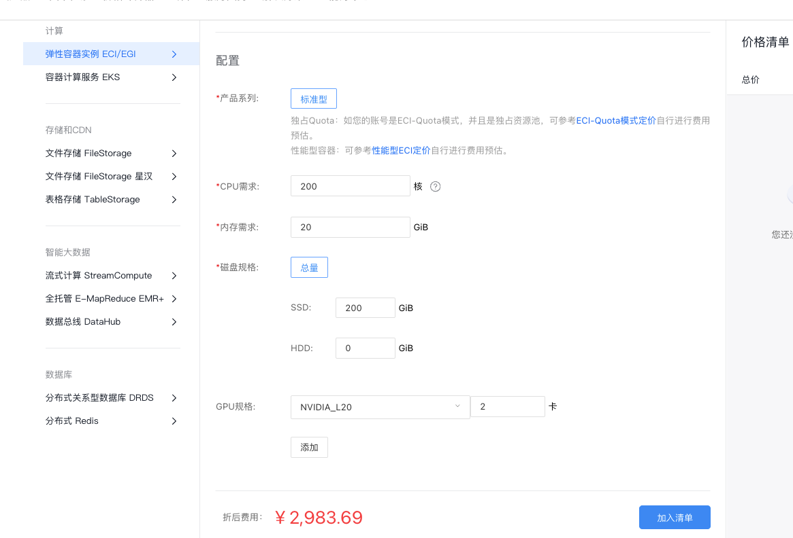
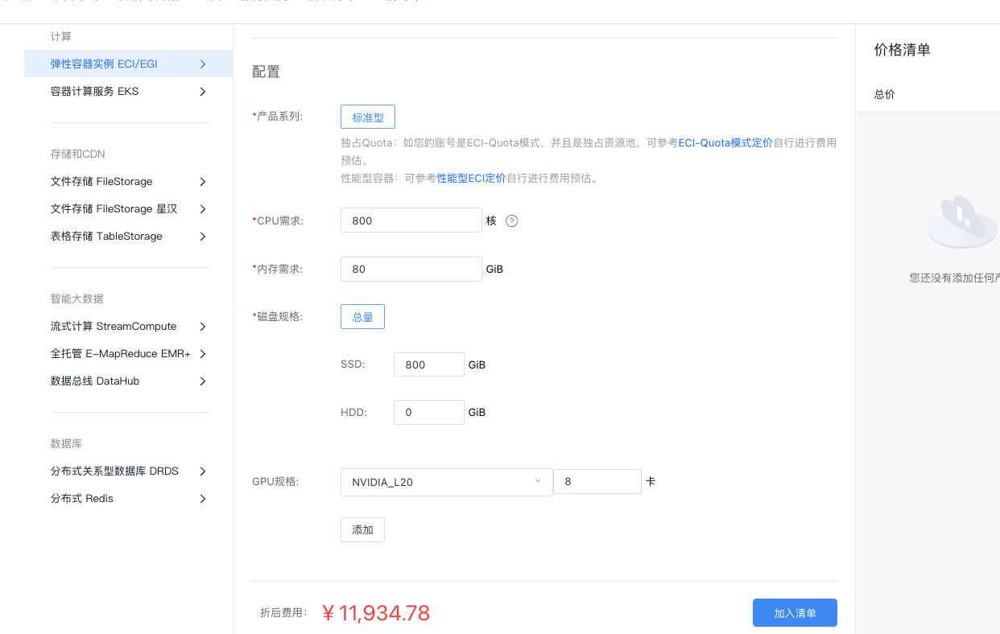
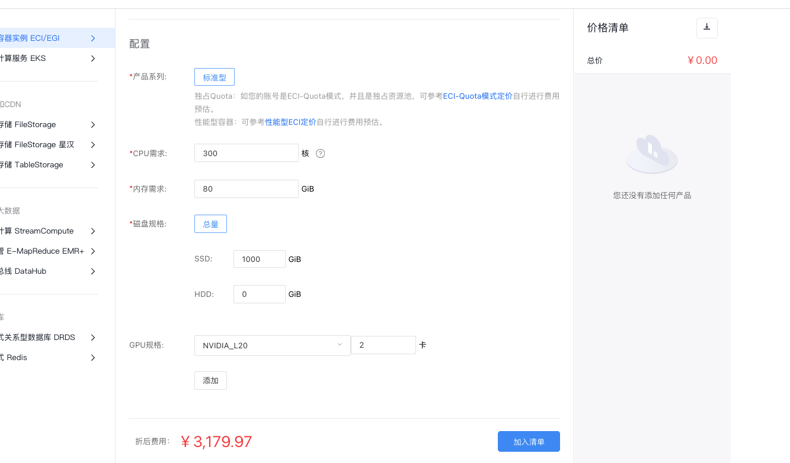
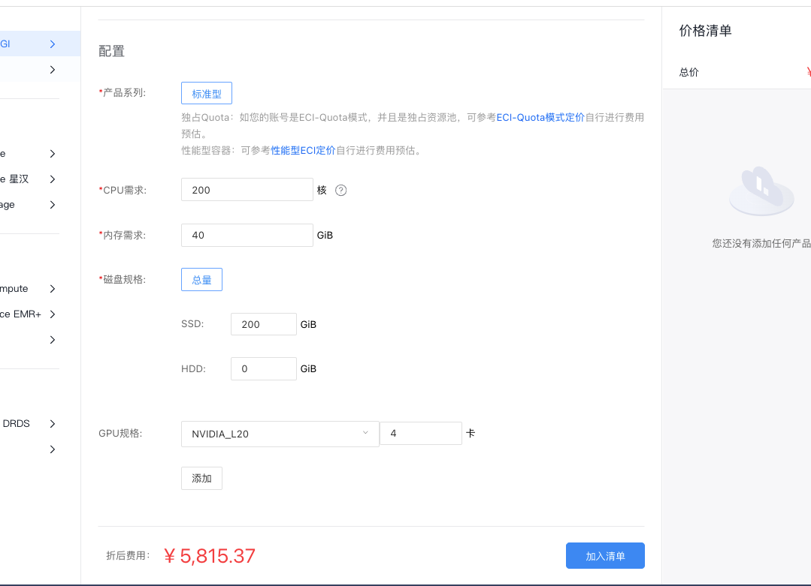
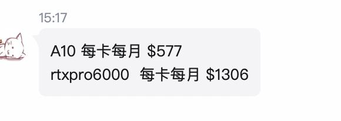

10-08 模型自部署成本预估

# 国内模型
|作用|模型|服务|配置|月成本|月调用量|
|-|-|-|-|-|-|
|视觉理解模型|qwen3-vl-30b-a3b-instruct-awq| [ec-model-vllm-dh-vlm](https://console.cloud.baidu-int.com/devops/appspace/account/343/application/58657)|L20*2 100c*2 10GB*2 100GB*2|  **2983.69¥**|14k|
|脚本不循环改写|qwen3.5-9b|[ec-model-vllm-dh-script-noloop](https://console.cloud.baidu-int.com/devops/appspace/account/343/application/172275)|L20*8 100c*8 10GB*8 100GB*8|  **11934.78¥**|12.4 K|
|任务拆分|qwen3.5-4b基准|[ec-model-vllm-dh-4b-base](https://console.cloud.baidu-int.com/devops/appspace/account/343/application/57799)|L20*2 150c*2 40GB*2 500GB*2| **3179.97¥**|14.0 K|
|垫句|qwen3-4b-sft|[ec-model-vllm-dh-dianju](https://console.cloud.baidu-int.com/devops/appspace/account/343/application/55337)|L20*2 150c*2 40GB*2 500GB*2| **3179.97¥**|4.7k|
|首句回复|qwen3-32b|ec-model-vllm-dh-reply|L20*4 100c*2 20GB*2 100GB*2| **5815.37¥**|64.9 K|

# 海外模型
|作用|模型|服务|配置|月成本|月调用量|
|-|-|-|-|-|-|
|千帆聚合小模型|qianfan_websearch_embedding qianfan_bge-large-zh qianfan_bge-large-en paddleocr-vl-0.9b|ec-model-vllm-dh-combine-abroad|a10*2 | **1154$**|749|
|任务拆分|vllm_qwen3.5-4b|[ec-model-vllm-dh-4b-base-abroad](https://console.cloud.baidu-int.com/devops/appspace/account/951/application/271747)|a10*2|**1154$**|5.38 K|
|垫句|vllm_qwen3-4b|[ec-model-vllm-dh-dianju-abroad](https://console.cloud.baidu-int.com/devops/appspace/account/951/application/271306)|a10*2|**1154$**|309|
|首句回复|qwen3-14b|[ec-model-vllm-dh-reply-abroad](https://console.cloud.baidu-int.com/devops/appspace/account/951/application/272670)|rtx6000*2| **2612$**|2.95 K|
